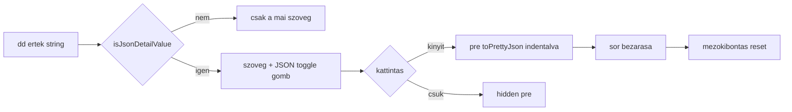

# AIS-163 — JSON mezőértékek lenyitható pretty-printje (log sor)

**Ticket:** [AIS-163](https://zakzag.atlassian.net/browse/AIS-163) · **Parent:** AIS-143
**Előfeltétel:** AIS-153 (részletek-régió, `LogDetailField`) — kész
**Scope:** csak a log drawer (`LogEntryRow`). **Nincs** új primitíva, **nincs** `DescriptionList`-bekötés,
**nincs** store/séma változás.

## Kiindulás

Az AIS-152 óta JSON is kerül a részletek-régióba, egysoros, olvashatatlan stringként:

| Mező                     | Mai `value`                   |
| ------------------------ | ----------------------------- |
| `queryKey`               | `["api-keys","update"]`       |
| `mutationKey`            | `["api-keys","create"]`       |
| `body` (csonkolt prefix) | `{"name":"first"}`            |
| `responseMeta`           | `{"pagination":{"total":12}}` |

## Döntések (rögzítve)

| #   | Döntés                                                                                                                                          |
| --- | ----------------------------------------------------------------------------------------------------------------------------------------------- |
| A   | **Csak a log drawerben** (user döntés): a `LogEntryRow` `dd`-i kapnak toggle-t. A logika `lib/`-ben van, hogy később önálló primitíva lehessen. |
| B   | A pretty print **csak megjelenítés**: a tárolt `details` érték, a `detail` egysoros és a „copy JSON” payload (`toEntryJson`) **változatlan**.   |
| C   | A primitív érték **nem** JSON: `42`, `"x"`, `true`, `false`, `null` → nincs gomb.                                                               |
| D   | A mező-kibontás komponens-lokális `useState<ReadonlySet<string>>`; nem perzisztálódik, nem kerül store-ba/URL-be.                               |
| E   | A pretty JSON `<pre>` `max-h-48 overflow-auto whitespace-pre` — nagy tömb ne nyújtsa szét a panelt, görgethető legyen.                          |
| F   | Parse hiba → csendben nincs gomb, nincs konzolzaj, nincs kivétel (mint a `lib/copy-text.ts`-nél).                                               |

## 1. [`lib/json.logic.ts`](packages/ui/src/lib/json.logic.ts:1) (új)

Tiszta függvények, DOM nélkül:

- `toPrettyJson(value: string): string | null` — `JSON.parse`, és **csak** `object`/`array` eredmény
  esetén `JSON.stringify(parsed, null, LOG_DETAIL_JSON_INDENT)`; minden más (primitív, üres/whitespace
  string, parse hiba) → `null`. Soha nem dob.
- `isJsonDetailValue(value: string): boolean` — `toPrettyJson(value) !== null`.

## 2. Konstansok — [`log-drawer.const.ts`](packages/ui/src/components/log-drawer/log-drawer.const.ts:1)

| Konstans                             | Érték                 |
| ------------------------------------ | --------------------- |
| `LOG_DETAIL_JSON_TOGGLE_LABEL_OPEN`  | `'JSON kibontása'`    |
| `LOG_DETAIL_JSON_TOGGLE_LABEL_CLOSE` | `'JSON összecsukása'` |
| `LOG_DETAIL_JSON_INDENT`             | `2`                   |
| `LOG_DETAIL_JSON_REGION_ID_SUFFIX`   | `'-log-detail-json'`  |

## 3. Recipe-ek — [`log-drawer.variants.ts`](packages/ui/src/components/log-drawer/log-drawer.variants.ts:152)

- `logDetailJsonToggleVariants` — kis gomb a `dd` mellett: `inline-flex items-center gap-1 rounded-control
border border-hairline border-transparent bg-transparent px-1 text-xs text-text-muted
transition-colors duration-fast hover:text-text-primary focus-visible:outline-none
focus-visible:border-border-focus focus-visible:shadow-focus-ring`.
- `logDetailJsonPreVariants` — `mt-1 max-h-48 overflow-auto rounded-control bg-surface-sunken p-2
font-mono text-xs whitespace-pre`.

Csak token osztályok (nincs hex/rgb, paletta utility, arbitrázs szín).

## 4. [`LogEntryRow.tsx`](packages/ui/src/components/log-drawer/LogEntryRow.tsx:61)

- Új state: `const [expandedJson, setExpandedJson] = useState<ReadonlySet<string>>(new Set())`;
  kulcs: `` `${field.label}-${index}` `` (ugyanaz, mint a React key) → a mezőnkénti függetlenség ingyen.
- A `dd` mellett, ha `isJsonDetailValue(field.value)`: `<button type="button" aria-expanded
aria-controls={jsonId}>` a `LOG_DETAIL_JSON_TOGGLE_LABEL_*` szöveggel; a `<pre id={jsonId}
hidden={!isExpanded}>` a `toPrettyJson(field.value)` kimenetét rendereli.
- A mező `dd` szövege **csukva változatlan** (a mai string).
- A sor becsukásakor a mező-kibontások visszaállnak: a fejléc-toggle handlerje záráskor
  `setExpandedJson(new Set())`.
- A toggle nem JSON értéknél nem renderelődik (sem gomb, sem `<pre>`).

## 5. Exportok — [`index.ts`](packages/ui/src/index.ts:294)

`toPrettyJson`, `isJsonDetailValue`, a négy új konstans, a két új recipe és típusaik. Explicit export.

## 6. Tesztek

| Fájl                                       | Esetek                                                                                                                                                                                                                                                                    |
| ------------------------------------------ | ------------------------------------------------------------------------------------------------------------------------------------------------------------------------------------------------------------------------------------------------------------------------- |
| `packages/ui/test/json.logic.test.ts` (új) | objektum → indentált pretty; tömb → pretty; beágyazott → helyes indent; `'42'`, `'"x"'`, `'true'`, `'false'`, `'null'`, `''`, `'   '`, `'nem json'` → `null`; már formázott JSON → 2 space-es normalizált; kétszer hívva ugyanaz; hosszú string nem dob                   |
| `packages/ui/test/log-entry-row.test.tsx`  | JSON mező kap gombot, nem JSON nem; kattintás → `pre` látható + indent; második kattintás → csukva; két JSON mező kibontása független; `dd` csukva a mai string; gomb accessible name tartalmazza a „JSON” szót és a helyes igét; sor becsukása után nincs kibontott mező |
| `packages/ui/test/log-drawer.test.tsx`     | a meglévő 45 eset zöld marad                                                                                                                                                                                                                                              |

## 7. Dokumentáció

- [`docs/Specs/UI-Architecture.md`](docs/Specs/UI-Architecture.md:323) — `LogEntryRow` sor: JSON mező
  lenyitása; §5 „Row expansion" sor kiegészítése (mező-kibontás lokális); `Utolsó frissítés` dátum.
- `docs/history/<ts>-ais-163-json-detail-expand.md`, `docs/milestones/<ts>-json-detail-expand.milestone.md`.

## 8. Ellenőrzés (DoD)

- [ ] `pnpm --filter @callback/ui test`
- [ ] `pnpm --filter @callback/ui typecheck` · `pnpm typecheck`
- [ ] `pnpm quality` (layers, dead-code, palette, field-errors, docs)
- [ ] Csak token osztályok; nincs `any`, nincs inline típus
- [ ] Nem JSON értéknél nincs gomb; parse hiba nem dob

## Folyamat

