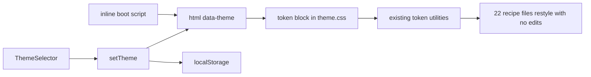

# Theme engine + glassmorphism appearance (light / dark / ambient / glass)

**Created:** 2026-11-08 00:22 (Europe/Budapest)
**Ticket:** [AIS-164](https://zakzag.atlassian.net/browse/AIS-164) — the "téma-implementáció" follow-up that AIS-140 deferred
**Subtasks:** [AIS-165](https://zakzag.atlassian.net/browse/AIS-165) (engine), [AIS-166](https://zakzag.atlassian.net/browse/AIS-166) (glass tokens + blur), [AIS-167](https://zakzag.atlassian.net/browse/AIS-167) (fourth option in the selector), [AIS-168](https://zakzag.atlassian.net/browse/AIS-168) (token gate + docs)
**Predecessor:** AIS-140 `D3` (selector is a UI contract only), AIS-149 (select-box header control)
**Feasibility:** [`2026-11-08--00-18-00-glassmorphism-theme-feasibility-plan.md`](./2026-11-08--00-18-00-glassmorphism-theme-feasibility-plan.md)

---

## 1. Problem

`light`, `dark` and `ambient` exist as **labels only**. Nothing reads the choice:
[`ThemeSelector.tsx`](../../apps/admin/src/app/layout/ui/ThemeSelector.tsx:41) keeps a local
`useState`, [`AdminLayout.tsx`](../../apps/admin/src/app/layout/AdminLayout.tsx:12) hands over a
documented no-op, and [`theme.css`](../../packages/ui/src/styles/theme.css:22) holds one dark token
set with `color-scheme: dark` hard-coded at line 128. A fourth `glass` appearance therefore cannot
be added "next to the three" — the mechanism that makes any appearance real has to be built, and
glass is the fourth token set on top of it.

## 2. Design

### 2.1 Where each piece lives

| Concern | Home | Why |
| ------- | ---- | --- |
| `ThemeName` union + ordered name list | `packages/ui/src/theme/` | the token vocabulary is a UI-package concern; both apps may read it |
| Token blocks (`light`, `ambient`, `glass`) | [`theme.css`](../../packages/ui/src/styles/theme.css:22) | the only file the palette gate allows colour literals in |
| Applying the theme (attribute, storage, boot) | `apps/admin/src/app/theme/` | DOM/storage access must not enter `packages/ui` (its layers are pure/presentational) |
| The choice UI | `apps/admin/src/app/layout/ui/ThemeSelector.tsx` (exists) | unchanged except a fourth option |
| `apps/web` | untouched | no provider means no attribute means the `@theme` default → stays as it is today |

### 2.2 The contract

```text
localStorage "aisztens.theme" ──┐
                                ├─ boot script in index.html ──> <html data-theme="…"> ──> token block wins
ThemeSelector ──> setTheme() ───┘                                        │
                                     utilities already read var(--color-…) so 22 recipe files
                                     and 107 utility usages restyle with zero edits
```



- **`data-theme` on `<html>`**, values `light | dark | ambient | glass`; anything else falls back to
  `dark`. No attribute ⇒ the `@theme` block (today's dark values) applies, so nothing regresses and
  `apps/web` keeps its current look.
- **Specificity:** `:root[data-theme="glass"]` (0,2,0) beats `:root` from `@theme` (0,1,0), so block
  order in the file does not matter.
- **Persistence:** `localStorage["aisztens.theme"]`, only the four names are accepted, storage
  failures (private mode, disabled storage) are caught and ignored — the theme then lives for the
  session only.
- **Flash-free boot:** a tiny inline script in [`apps/admin/index.html`](../../apps/admin/index.html:1)
  sets the attribute *before* the module bundle runs. The HTML file is outside the palette gate's
  scan roots, and the script contains no colour.
- **State bucket (UI-Architecture §5):** the theme is neither server state nor list state; it is
  document state mirrored into storage. It is **not** a Zustand store (AIS-140 `D11`), it is one
  `useState` in `ThemeProvider` (app shell) plus an effect that writes attribute + storage.

### 2.3 Token architecture in `theme.css`

1. `@theme` stays the **dark default** — untouched values, plus three new generic tokens:
   `--color-scheme`, `--app-backdrop` (`none`), `--blur-glass`, `--saturate-glass`.
2. `@layer base` stops hard-coding: `color-scheme: var(--color-scheme)`, and `body` gets
   `background-image: var(--app-backdrop)` + `background-attachment: fixed`. Glass needs a non-flat
   backdrop or the blur has nothing to blur.
3. Three new blocks, each defining **every** token of the default set:
   `:root[data-theme="light"]`, `:root[data-theme="ambient"]`, `:root[data-theme="glass"]`.
4. `@utility surface-glass { backdrop-filter: blur(var(--blur-glass)) saturate(var(--saturate-glass)); -webkit-backdrop-filter: … }`
   — a no-op over an opaque surface, so it can be applied unconditionally.
5. Accessibility fallbacks inside the glass block:
   `@media (prefers-reduced-transparency: reduce)` and `@media (prefers-contrast: more)` restore
   opaque surfaces and `backdrop-filter: none`.

**Glass token target values** (tuned at implementation, all in `theme.css`):

| Token | Glass value | Note |
| ----- | ----------- | ---- |
| `--color-surface-base` | deep violet `oklch(0.28 0.06 265)` | behind the backdrop gradients |
| `--color-surface-raised` | `oklch(0.42 0.05 265 / 0.35)` | frosted panel |
| `--color-surface-overlay` | `oklch(0.5 0.05 265 / 0.45)` | popovers, dialogs, toasts |
| `--color-surface-sunken` | `oklch(0.3 0.04 265 / 0.5)` | inputs, dimmer |
| `--color-border-hairline` / `-default` / `-strong` | `oklch(1 0 0 / 0.18)` / `0.28` / `0.45` | light rims instead of dark hairlines |
| `--shadow-neu-raised` | `0 24px 48px -24px oklch(0.12 0.03 265 / 0.7), inset 0 1px 0 oklch(1 0 0 / 0.35)` | soft drop + top highlight |
| `--shadow-neu-inset` / `-pressed` | inner light rim + faint inner shadow | inputs, pressed buttons |
| `--radius-control` / `-card` | `0.75rem` / `1.25rem` | smoother than today |
| `--app-backdrop` | three radial gradients, alpha 0.3–0.4 | teal 195, magenta 320, blue 250 |
| `--blur-glass` / `--saturate-glass` | `18px` / `140%` | tokens, never literals in components |

The `--shadow-neu-*` **names stay**: they are the four generic depth slots and each theme fills them.
Renaming them is 26 files of churn for zero behaviour — recorded as a follow-up only.

### 2.4 Where blur is actually applied

Blur goes on **floating layers only** (perf on the scrolling data table is the known worst case;
cards and table rows stay translucent but unblurred):

`dialog.variants.ts`, `drawer.variants.ts`, `dropdown-menu.variants.ts`, `tooltip.variants.ts`,
`toast.variants.ts`, `banner.variants.ts`, `log-drawer.variants.ts` (panel + tab),
`Combobox.tsx` (listbox), `select-menu` panel — ~10 files, one added class each.

### 2.5 Fourth option in the header

- `ThemeOption` becomes an alias of `ThemeName` (single union, no duplicate literal list).
- `layout.const.ts`: `THEME_OPTION_GLASS`, label `Üveg`, appended last in `THEME_SELECTOR_OPTIONS`,
  icon entry in `THEME_OPTION_ICONS`.
- New icon `LayersIcon` in [`icons.tsx`](../../packages/ui/src/components/icon/icons.tsx:1) (Lucide
  `layers`, `currentColor`, `aria-hidden`) — no new npm dependency.
- `AdminLayout` replaces `NOOP_THEME_CHANGE` with the provider's `setTheme`; the two existing tests
  that *assert the absence* of `data-theme` / storage writes are inverted into the new contract.

## 3. Subtask split (Jira)

| # | Key | Content | Depends |
| - | --- | ------- | ------- |
| 1 | AIS-165 | `packages/ui/src/theme/` types, `theme.css` `--color-scheme`/`--app-backdrop` + base layer, `apps/admin/src/app/theme/*` (const/logic/provider), boot script, **light** and **ambient** token blocks, provider + logic tests, UI-Architecture §5 | — |
| 2 | AIS-166 | `[data-theme="glass"]` block, `surface-glass` utility, reduced-transparency/contrast fallbacks, apply in ~10 overlay recipes + primitive tests | AIS-165 |
| 3 | AIS-167 | `LayersIcon`, `ThemeOption = ThemeName`, `layout.const.ts` entries, `AdminLayout` wiring, inverted side-effect tests | AIS-165 |
| 4 | AIS-168 | `scripts/quality/theme-tokens.*` (+ fixtures, tests), `quality:themes` in `package.json`, spec/rules reconciliation, history + milestone | AIS-165, AIS-166, AIS-167 |

### 3.1 The gate (subtask 4) — the part that keeps four themes honest

`theme-tokens` parses `theme.css`, collects the variable names declared in `@theme`, then asserts
every `[data-theme="…"]` block declares **exactly** that set. A theme that forgets
`--color-warning-foreground` fails the build instead of shipping a silent hole. Same shape as the
existing palette gate: `*.const.mjs` (data), `*.logic.mjs` (pure), `*.mjs` (CLI + report), plus
fixture-based tests; added to `pnpm quality`.

## 4. Definition of done

- Switching any of the four appearances in the header repaints the whole UI immediately, survives a
  reload, and produces no flash of the wrong theme on load.
- `glass` shows frosted overlays over a colourful backdrop; dialogs, drawers, menus, tooltips,
  toasts, the banner and the log drawer are translucent with blur, cards and tables only translucent.
- `prefers-reduced-transparency` and `prefers-contrast: more` turn glass into opaque surfaces.
- No colour literal outside `theme.css`, no palette utility, no arbitrary colour value.
- Dark appearance is byte-for-byte today's look (the `@theme` block is not edited).
- `pnpm quality` (including the new `quality:themes`) and `pnpm test` green; WCAG AA verified
  manually for `text-text-primary` / `-secondary` on every theme.

## 5. Risks

| Risk | Mitigation |
| ---- | ---------- |
| `backdrop-filter` costs frames on the scrolling table | blur only on floating layers (2.4) |
| Nested glass loses contrast | surface tokens are stacked by design (raised 0.35 → overlay 0.45), not free-form alpha |
| A theme block drifts incomplete | `theme-tokens` gate (3.1) |
| Storage unavailable | caught; session-only theme, documented |
| Glass contrast fails AA | manual matrix per theme in the DoD, tuned token alphas |

## 6. Follow-ups (not in this ticket)

`--shadow-neu-*` rename to theme-neutral depth names; theme selection for `apps/web`; per-user
theme persistence server-side; `color-scheme`-aware scrollbars on Windows.
