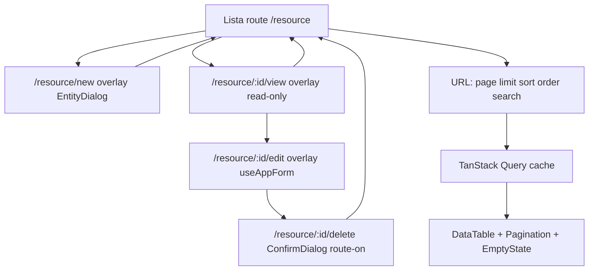

# Admin oldalak konzisztencia-audit — mi egységes ma, és mi hiányzik

**Dátum:** 2026-11-08 · **Típus:** kód-alapú audit + gap-terv (nem feature ticket)
**Bizonyíték-alap:** `apps/admin/src/**`, `apps/web/src/**`, `packages/ui/src/**`, `docs/Specs/UI-Architecture.md`, `docs/Specs/New-Admin-Page.md`
**Normatív forrás:** [`New-Admin-Page.md`](../Specs/New-Admin-Page.md:1) (mi a sorrend), [`UI-Architecture.md`](../Specs/UI-Architecture.md:891) §5 (mi a state-plan)

---

## 1. Kiindulás — hány admin oldal van valójában

| Oldal                                 | Állapot                    | Hol él                                                                                              |
| ------------------------------------- | -------------------------- | --------------------------------------------------------------------------------------------------- |
| API kulcsok (lista + 2 overlay)       | **valódi, referencia**     | [`pages/api-keys/`](../../apps/admin/src/pages/api-keys/ApiKeysPage.tsx:49)                          |
| API kulcs részlet (legacy)            | valódi, de kivezetés előtt | [`ApiKeyDetailPage.tsx`](../../apps/admin/src/pages/api-keys/ApiKeyDetailPage.tsx:71)               |
| Login                                 | valódi, page folder nélkül | [`LoginPage.tsx`](../../apps/admin/src/pages/LoginPage.tsx:9)                                        |
| Kezdőlap                              | placeholder                | [`PlaceholderPage.tsx`](../../apps/admin/src/pages/PlaceholderPage.tsx:11)                           |
| Hívások                               | placeholder                | markup a registryben: [`route-registry.tsx`](../../apps/admin/src/app/router/route-registry.tsx:126) |

**Következtetés:** ma **egyetlen** entitás-oldal létezik. A „konzisztens admin oldalak" kérdés valójában két kérdés:

1. az `api-keys` oldal **önmagán belül** konzisztens-e (lista ↔ create ↔ view ↔ detail), és
2. készen áll-e arra, hogy a **második** entitás (companies, calls) gondolkodás nélkül másolható legyen.

Az 1. részben a válasz: nagyrészt igen, de 4 helyen nem. A 2.-ra: nem, 3 hiányzó közös elem miatt.

---

## 2. Ami egységes — ne nyúlj hozzá

| #   | Terület                | A minta                                                                                                                                                                                            | Horgony                                                                                                                   |
| --- | ---------------------- | -------------------------------------------------------------------------------------------------------------------------------------------------------------------------------------------------- | ------------------------------------------------------------------------------------------------------------------------- |
| U1  | Routing                | **Egy** `RouteEntry` lista; a `<Routes>`, a nav és a breadcrumb mind ebből deriválódik, nincs kézi másodlista. Children route = overlay, `flattenRouteEntries()` adja a flat táblát               | [`route-registry.tsx`](../../apps/admin/src/app/router/route-registry.tsx:62), [`route-tree.logic.ts`](../../apps/admin/src/app/router/route-tree.logic.ts:1) |
| U2  | Lista-state             | Oldal/méret/rendezés/keresés **az URL-ben**, egy hookon át (`useListParams(schema)`); egy interakció = **egy** `setParams(patch)`, sosem két `setParam`                                             | [`use-list-params.ts`](../../apps/admin/src/features/api/use-list-params.ts:1)                                            |
| U3  | Server state           | Generikus hookok: `useApiList` / `useApiDetail` / `useApiMutation`; mindenhol ugyanaz a result-shape (`data`, `meta`, `isLoading`, `isFetching`, `error`, `errorMessage`, `errorSurface`, `refetch`) | [`use-api-list.interface.ts`](../../apps/admin/src/features/api/use-api-list.interface.ts:41)                              |
| U4  | Query kulcsok          | Kizárólag `features/<use-case>/<use-case>.const.ts`-ben; komponensben nincs inline kulcs                                                                                                            | [`features/api-keys/api-keys.const.ts`](../../apps/admin/src/features/api-keys/api-keys.const.ts:1)                       |
| U5  | Hiba-routing           | `errorSurface` (`banner` / `page` / `field`) dönt, nem a komponens; `toErrorSurface`, `toFieldErrors`, `isNotFoundFailure`, `isStaleWriteFailure` a `lib/`-ben; `error.code`-ra branch-elés gate-tiltott | [`error-surface.logic.ts`](../../apps/admin/src/lib/error-surface.logic.ts:1)                                              |
| U6  | Form                   | Minden űrlap `useAppForm` (zod séma, `fieldPaths`, first-error focus, `notify` port, `successMessage`); `pages/` alatt tilos `useForm`                                                              | [`use-app-form.ts`](../../apps/admin/src/features/forms/use-app-form.ts:1)                                                |
| U7  | Overlay                | `EntityDialog` **route-mountolva**, `submit: { label, formId, isSubmitting }`, bezárás `useEntityDialog(listPath)` → `navigate(list, { replace: true })`                                            | [`ApiKeyCreateDialog.tsx`](../../apps/admin/src/pages/api-keys/ui/ApiKeyCreateDialog.tsx:47), [`use-entity-dialog.ts`](../../apps/admin/src/features/entity-dialog/use-entity-dialog.ts:24) |
| U8  | Domain → view model    | Pure mapper `entities/<entity>/<entity>.mapper.ts`; a titok (`apiKey`) eleve kimarad, dátum `lib/date.ts`-en át                                                                                     | [`api-key.mapper.ts`](../../apps/admin/src/entities/api-key/api-key.mapper.ts:1)                                          |
| U9  | Presentational `ui/`   | Props-only, `onX` callbackek, nulla fetch/üzleti szabály; a mutációt a page birtokolja                                                                                                             | [`ApiKeyDetailCard.tsx`](../../apps/admin/src/pages/api-keys/ui/ApiKeyDetailCard.tsx:21)                                  |
| U10 | Copy                   | Minden user-visible szöveg, id, limit a `<page>.const.ts`-ben; teszt ugyanazt a konstanst assertálja                                                                                              | [`api-keys.const.ts`](../../apps/admin/src/pages/api-keys/api-keys.const.ts:20)                                           |
| U11 | Styling                | Csak tokenek/primitívek; nincs palette class, color literal, arbitrary color — gépi gate ellenőrzi                                                                                                  | `pnpm quality:tokens`                                                                                                     |
| U12 | Tesztek                | Fájl-per-fájl teszt, mock csak `test/mocks/**` alatt, MSW handler per resource                                                                                                                      | [`test/mocks/handlers/`](../../apps/admin/src/test/mocks/handlers/api-keys.handlers.ts:1)                                 |

Ez a 12 pont az, amit egy új entitásnál **nem szabad újra feltalálni** — ez a `New-Admin-Page.md` végrehajtott formája.

---

## 3. Ami még nem egységes — a kódból látszó eltérések

| #   | Tünet                                                                                                                                                                                                                                         | Hol látszik                                                                                                                                                                             | Miért probléma                                                                                                 |
| --- | --------------------------------------------------------------------------------------------------------------------------------------------------------------------------------------------------------------------------------------------- | --------------------------------------------------------------------------------------------------------------------------------------------------------------------------------------- | -------------------------------------------------------------------------------------------------------------- |
| **C1** | **A CRUD belépési pontjai széttartanak.** Sor → read-only overlay; törlés a **legacy** detail oldalon; szerkesztés **inline `Card`**-ban ugyanott. A create viszont overlay. Három különböző minta egy entitásra.                            | tábla-link [`ApiKeysTable.tsx`](../../apps/admin/src/pages/api-keys/ui/ApiKeysTable.tsx:30) · inline edit [`ApiKeyEditForm.tsx`](../../apps/admin/src/pages/api-keys/ui/ApiKeyEditForm.tsx:64) · törlés [`ApiKeyDetailPage.tsx`](../../apps/admin/src/pages/api-keys/ApiKeyDetailPage.tsx:244) | A második entitásnál el kell dönteni, melyik a minta — ma a „legacy" oldal a legerősebb CRUD-felület, miközben a standard az overlay |
| **C2** | **Az overlay nyitottsága kétféle állapot.** Create/view = URL; a delete `ConfirmDialog` = `useState(isConfirmOpen)`.                                                                                                                          | [`ApiKeyDetailPage.tsx`](../../apps/admin/src/pages/api-keys/ApiKeyDetailPage.tsx:76)                                                                                                    | Sérti a „dialógus nyitottsága = URL" szabályt ([`UI-Architecture.md`](../Specs/UI-Architecture.md:966)); reload-ra elvész, nem linkelhető |
| **C3** | **Siker-visszajelzés két csatornán.** Create → csak toast (`notify` + `successMessage`). Detail mentés → toast **és** oldalszintű `Alert` (`isSaved`) **és** stale `Alert`.                                                                  | [`ApiKeyCreateDialog.tsx`](../../apps/admin/src/pages/api-keys/ui/ApiKeyCreateDialog.tsx:59) vs. [`ApiKeyDetailPage.tsx`](../../apps/admin/src/pages/api-keys/ApiKeyDetailPage.tsx:238)   | A user két helyen kap ugyanarról visszajelzést; a `useState`-alapú „sikeres volt" flag a Query-ből származó adat állapotát duplikálja |
| **C4** | **Nincs page shell / page header primitíve.** A `<section className="space-y-6">` + `<h1 className="text-2xl font-bold text-text-primary">` + subtitle kézzel ismétlődik, oldalanként más tördeléssel (a detail oldalon back-link is).       | [`ApiKeysPage.tsx`](../../apps/admin/src/pages/api-keys/ApiKeysPage.tsx:73), [`ApiKeyDetailPage.tsx`](../../apps/admin/src/pages/api-keys/ApiKeyDetailPage.tsx:205), [`PlaceholderPage.tsx`](../../apps/admin/src/pages/PlaceholderPage.tsx:13) | A 3. oldal már a negyedik tördelés-variánst fogja megírni; `packages/ui`-ban nincs `PageHeader`             |
| **C5** | **Loading-state két mintával.** Lista: `DataTable isLoading` skeleton + `sr-only` mondat. Részlet/overlay: `Card` + `DescriptionList items={[]} isLoading` + `sr-only` mondat.                                                                | [`ApiKeysTable.tsx`](../../apps/admin/src/pages/api-keys/ui/ApiKeysTable.tsx:93) vs. [`ApiKeyDetailPage.tsx`](../../apps/admin/src/pages/api-keys/ApiKeyDetailPage.tsx:162)                  | Nem hiba, de nincs leírva, melyik melyik surface-hez tartozik → a következő oldal ötletszerűen választ        |
| **C6** | **A nem-entitás oldalak nem page folderek, és nem mennek át a közös shellen.** `/calls` markup a registryben, catch-all inline `<p>`, `PlaceholderPage` hard-code-olt szöveg, `LoginPage`/`PlaceholderPage` **teszt nélkül**.                  | [`route-registry.tsx`](../../apps/admin/src/app/router/route-registry.tsx:128), [`route-registry.tsx`](../../apps/admin/src/app/router/route-registry.tsx:143)                              | Ezek a kivételek nincsenek dokumentálva, és a „minden új kód teszttel jön" szabály itt sérül                   |
| **C7** | **Fejléc-akció: kód vs. döntés eltér.** Az AIS-155 `D9` `Button` + `PlusIcon` slot-ot ír elő; a kód `<Link className={buttonVariants()}>`-t használ (jó indokkal: linkelhető, új fülön nyitható).                                           | [`ApiKeysPage.tsx`](../../apps/admin/src/pages/api-keys/ApiKeysPage.tsx:90) vs. [AIS-155 plan](./2026-11-07--14-46-00-ais-155-entity-dialog-standard-plan.md:24)                          | A döntés és a kód ellentmond; a következő fejlesztő a rossz mintát másolja                                     |
| **C8** | **A „standard lista" definíciója hiányos.** Nincs kereső/filter UI (pedig `useListParams` támogatja a `search`-t), nincs soronkénti akció, az üres állapotnak nincs akció-gombja.                                                            | [`ApiKeysPage.tsx`](../../apps/admin/src/pages/api-keys/ApiKeysPage.tsx:104), [`ApiKeysTable.tsx`](../../apps/admin/src/pages/api-keys/ui/ApiKeysTable.tsx:106)                              | Minden új entitásnál újra fel kell találni: hol van a kereső, mi van a sor jobb végén, üres listánál mi az út tovább |
| **C9** | **Részlet-nézet vs. szerkesztő szétválasztása nem egységes.** A mezőlista már közös (`ApiKeyDetailFields`), de a szerkesztő inline kártya, a részlet overlay — ugyanaz az adat két felületen, két interakciós modellel.                       | [`ApiKeyDetailFields.tsx`](../../apps/admin/src/pages/api-keys/ui/ApiKeyDetailFields.tsx:1), [`ApiKeyViewDialog.tsx`](../../apps/admin/src/pages/api-keys/ui/ApiKeyViewDialog.tsx:106)      | A view overlay footer-extrája (`Teljes oldal (törlés)`) egy **átmeneti kompromisszum** ([`D8`](./2026-11-07--14-46-00-ais-155-entity-dialog-standard-plan.md:23)), ami a standard részévé válhat, ha nem zárjuk le |
| **C10** | **Detail route path forrása kettős.** A lista path az `app.const.ts`-ben, a részlet template a page constban (indokolt, mert a page nem importálhat `app`-ot) — de ez a szabály sehol nincs egy helyen leírva, csak kód-kommentben.          | [`app.const.ts`](../../apps/admin/src/app/app.const.ts:50), [`api-keys.const.ts`](../../apps/admin/src/pages/api-keys/api-keys.const.ts:147)                                                 | Új entitásnál ez a döntés könnyen elvész                                                                            |

---

## 4. Cél-minta — a „standard entitás oldal", amit másolni fogunk



Három közös elem vezethető le a hiányokból:

1. **`PageShell` / `PageHeader` primitíve** (C4) — cím, alcím, back-link slot, action slot, egységes `space-y` (C5-öt is magával hozza).
2. **Egyetlen entitás-surface szabály** (C1, C2, C9): minden mutáló felület route-mountolt overlay, a legacy inline detail oldal megszűnik, a delete is route (`/resource/:id/delete`).
3. **„Standard lista" checklist** (C8): kereső mező + üres állapot akcióval + soronkénti akció-slot; ha nincs, az indoklás a state-plan sorban.

---

## 5. Lépések

| #   | Lépés                                                                                                                                                            | Érintett fájlok                                                                                                    |
| --- | ---------------------------------------------------------------------------------------------------------------------------------------------------------------- | ------------------------------------------------------------------------------------------------------------------ |
| 1   | `PageShell` + `PageHeader` primitívek a `packages/ui`-ban (title, subtitle, backHref/onBack, actions slot), tesztekkel                                              | `packages/ui/src/components/page-header/*`, `index.ts`                                                             |
| 2   | `ApiKeysPage`, `ApiKeyDetailPage`, `PlaceholderPage`, catch-all és `/calls` átállítása a `PageShell`-re                                                          | `apps/admin/src/pages/**`, `app/router/route-registry.tsx`                                                         |
| 3   | Döntés + dokumentálás: primer akció = `Link` + `buttonVariants` (C7), a `D9` szövegének javítása a planban és a state-planban                                   | `docs/Specs/UI-Architecture.md` §5, AIS-155 plan (utólagos jegyzet)                                                |
| 4   | Edit felület overlay-vé tétele: `/api-keys/:identifier/edit` route + `ApiKeyEditDialog` (`useAppForm`, `successMessage`, nincs oldalszintű `isSaved`/`isStale` `Alert`) | `pages/api-keys/ui/ApiKeyEditDialog.tsx`, `route-registry.tsx`, `api-keys.const.ts`                                |
| 5   | Delete route (`/api-keys/:identifier/delete`) vagy dokumentált, indokolt kivétel a `ConfirmDialog` `useState`-re (C2)                                            | `route-registry.tsx`, `ApiKeyDetailPage.tsx` / `ApiKeyViewDialog.tsx`                                              |
| 6   | Legacy `ApiKeyDetailPage` kivezetése (C1, C9) — a `ApiKeyViewDialog` footer-extrája megszűnik, a törlés a view overlay saját akciója lesz                        | `pages/api-keys/ApiKeyDetailPage.tsx` (törlés), `api-keys.const.ts`, `route-registry.tsx`, tesztek                 |
| 7   | Standard lista checklist bevezetése: kereső mező a listán (`useListParams` `search`), üres állapot akcióval, sor-akció slot; ha valamelyik kimarad, a state-plan sor indokolja | `pages/api-keys/ui/ApiKeysTable.tsx`, `ApiKeysPage.tsx`, `docs/Specs/UI-Architecture.md` §5                        |
| 8   | „Kivétel-lista" dokumentálása: placeholder oldalak, catch-all — miért nem page folder, mikor lesz az; `LoginPage`/`PlaceholderPage` minimál tesztje             | `docs/Specs/New-Admin-Page.md` §3, `apps/admin/src/pages/*.test.tsx`                                              |
| 9   | Route-path forrás szabály egy helyre írása: lista path `app.const.ts`, részlet/overlay template a page constban (C10)                                            | `docs/Specs/UI-Architecture.md` §4.2, `docs/Specs/New-Admin-Page.md` §2 step 12                                    |
| 10  | `docs/Specs/UI-Architecture.md`, `New-Admin-Page.md` frissítése + `docs/history/` bejegyzés + milestone (több fájlt érintő, viselkedést rögzítő változás)         | `docs/**`                                                                                                         |

---

## 6. Jira bontás — 1 story + 4 subtask

Elv: **minden subtask nettó kód-csökkentés vagy drift-javítás.** Nincs új absztrakciós réteg, nincs scaffold, nincs plusz konfiguráció; amit lehet, törlünk.

| #   | Ticket                      | Mit tesz                                                                                                                                                                        | Nettó kódhatás                                                          | C     |
| --- | --------------------------- | ------------------------------------------------------------------------------------------------------------------------------------------------------------------------------- | ----------------------------------------------------------------------- | ----- |
| 0   | **Story**                   | Admin oldalak egységesítése: egy surface-minta, kevesebb kóddal                                                                                                                 | —                                                                       | C1–C10 |
| 1   | `PageShell` primitíve       | `packages/ui` `PageShell` (title, subtitle, back, action slot) + 5 hely átállítása                                                                                               | −4 ismételt `<section>/<h1>/<p>` blokk, +1 primitíve                     | C4–C6 |
| 2   | Edit overlay                | `/api-keys/:identifier/edit` + `ApiKeyEditDialog`; **`ApiKeyEditForm.tsx` törölve**                                                                                              | −1 fájl, −oldalszintű `isSaved`/`isStale` `Alert`, −2 `useState`         | C1, C3, C9 |
| 3   | Törlés + legacy page törlés | Törlés a view overlay footer-akciójaként (`ConfirmDialog` `useState`-csel, dokumentált kivétel); **`ApiKeyDetailPage.tsx` + `ApiKeyDeleteDialog.tsx` törölve**, `footerExtras` link megszűnik | −2 fájl, −1 route, −a „Teljes oldal (törlés)" kerülőút                  | C1, C2, C9 |
| 4   | Doksi + döntések            | C7 (Link vs Button), C10 (route-path forrás), C8 (lista: kereső **nincs**, üres állapot akció **van**), C6 kivétel-lista; `LoginPage`/`PlaceholderPage` minimál teszt          | +2 kis teszt, −3 helyen javított/elavult állítás                         | C6–C8, C10 |

**Sorrend:** 1 → 2 → 3 → 4. A 3. a 2. után jöhet, mert a törlés a view overlay-be költözik.

**Jira kulcsok (létrehozva 2026-11-08):**

| # | Ticket | Jira |
| --- | --- | --- |
| 0 | Story — Admin: egységes oldal-surface kevesebb kóddal | [AIS-170](https://zakzag.atlassian.net/browse/AIS-170) |
| 1 | `PageShell` primitíve + admin oldalak átállítása | [AIS-171](https://zakzag.atlassian.net/browse/AIS-171) |
| 2 | edit overlay + inline `ApiKeyEditForm` törlése | [AIS-172](https://zakzag.atlassian.net/browse/AIS-172) |
| 3 | törlés a view overlay-ből + legacy `ApiKeyDetailPage`/`ApiKeyDeleteDialog` törlése | [AIS-173](https://zakzag.atlassian.net/browse/AIS-173) |
| 4 | doksi-döntések + `LoginPage`/`PlaceholderPage` minimál tesztek | [AIS-174](https://zakzag.atlassian.net/browse/AIS-174) |

**Amit szándékosan NEM csinálunk** (boilerplate-et kerülünk): nincs kereső/filter UI, nincs page-generátor, nincs `/delete` route, nincs új store, nincs új dependency.

## 7. Kapuk

```bash
pnpm quality          # layers + dead-code + tokens + field-errors + docs
pnpm test:quality
pnpm typecheck && pnpm -r build && pnpm -r lint && pnpm test
```

Kész, ha a 4. pont mermaid-fája végigjárható a kódban, a `docs/Specs/UI-Architecture.md` §5 táblája az új page-eket és a megszűnt legacy detail oldalt is tükrözi, és nincs olyan admin oldal, ami ne a közös `PageShell`-en menne át (kivéve a dokumentált kivételeket).
