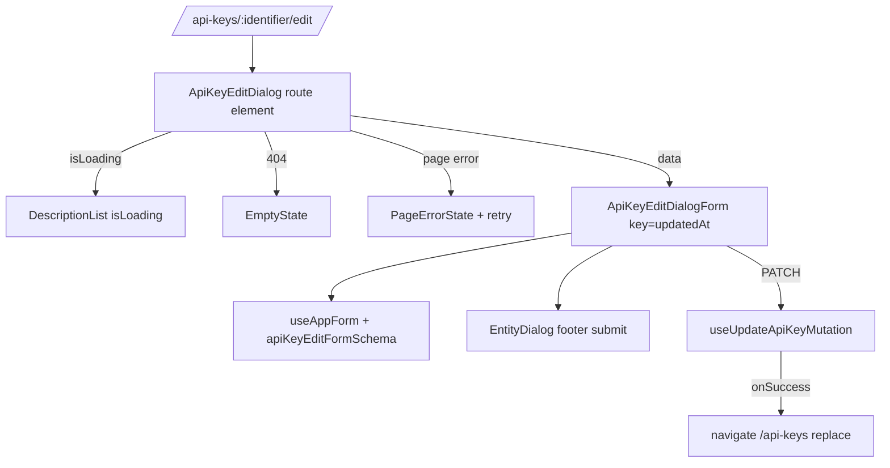

# AIS-172 — api-keys: edit as a route-mounted overlay (`/api-keys/:identifier/edit`)

**Ticket:** [AIS-172](https://zakzag.atlassian.net/browse/AIS-172) · **Parent:** AIS-170 ·
**Precondition:** AIS-171 (done — `PageShell` exists) · **Blocks:** AIS-173

Goal: move editing out of the legacy inline `Card` form into the same overlay pattern the create
and view surfaces already use, and **delete** the old file. Net code reduction, no new layer.

---

## 1. Decisions

| #       | Decision                                                                                                                                                                                                                                                                                                                                                                                                                                                                                                                                                                                                                                             |
| ------- | ---------------------------------------------------------------------------------------------------------------------------------------------------------------------------------------------------------------------------------------------------------------------------------------------------------------------------------------------------------------------------------------------------------------------------------------------------------------------------------------------------------------------------------------------------------------------------------------------------------------------------------------------------- |
| **D-A** | No `isSaved` flag, no page-level success `Alert`. The success signal is one toast through `useAppForm`'s `notify` port — exactly like create.                                                                                                                                                                                                                                                                                                                                                                                                                                                                                                        |
| **D-B** | **Resolved with the owner:** a `409 STALE_WRITE` keeps the dialog open, `detail.refetch()` runs, `key={updatedAt}` remounts the form, and the **single** surface is the capture error toast (`STALE_WRITE_MESSAGE`). `STALE_WRITE` has `fieldMessage: null` in [`ERROR_CODE_CATALOGUE`](../../apps/admin/src/lib/api-error-code.const.ts:77), so [`toErrorSurface()`](../../apps/admin/src/lib/error-surface.logic.ts:111) returns `page` and [`toFormErrorPlan()`](../../apps/admin/src/features/forms/use-app-form.logic.ts:42) deliberately leaves `formError` `null`. No stale `Alert`, no `API_KEY_DETAIL_STALE_WRITE_*` copy, zero extra code. |
| **D-C** | The three field controls are **moved**, not rewritten (markup of `name`, `description`, `expiresAt` lifted from `ApiKeyEditForm`). `ApiKeyFormFields` cannot be reused — it carries `identifier` and `apiKey`.                                                                                                                                                                                                                                                                                                                                                                                                                                       |
| **D-D** | `identifier` and `apiKey` stay non-editable (`PATCH` is `.strict()`, the key is a secret). `DEFAULT_FIELD_PATH_BY_CODE` is **not** passed to the edit form: it only maps an identifier conflict, which no edit field owns.                                                                                                                                                                                                                                                                                                                                                                                                                           |
| **D-E** | `useAppForm` must be reached through a **remountable** component, because RHF seeds `defaultValues` only on mount and the footer button needs `formState.isSubmitting`. So the route element (query + four states) renders a second component that owns the hook + `EntityDialog`, keyed by `data.updatedAt`. Names chosen so `rg "ApiKeyEditForm" apps/admin/src` stays empty: `ApiKeyEditDialog` + `ApiKeyEditDialogForm`.                                                                                                                                                                                                                         |
| **D-F** | `toApiKeyDetailRoute()` loses its last production consumer in this change, so it is **deleted** (knip would flag it). `API_KEY_DETAIL_ROUTE_PATH` stays — the registry still mounts the legacy page until AIS-173.                                                                                                                                                                                                                                                                                                                                                                                                                                   |

---

## 2. Structure



---

## 3. Steps

### 3.1 Constants — [`api-keys.const.ts`](../../apps/admin/src/pages/api-keys/api-keys.const.ts:1)

- Add `API_KEY_EDIT_ROUTE_PATH = '/api-keys/:identifier/edit'` (page const, not `app.const.ts` —
  a page must not import `app`).
- Add `API_KEY_EDIT_DIALOG_TITLE = 'API kulcs szerkesztése'`,
  `API_KEY_EDIT_DIALOG_FORM_ID = 'api-key-edit-form'`,
  `API_KEY_EDIT_DIALOG_SUBMIT_LABEL = 'Módosítás'`,
  `API_KEY_EDIT_DIALOG_PENDING_LABEL = 'Mentés…'`.
- Add `API_KEY_VIEW_EDIT_LINK_LABEL = 'Módosítás'`; delete `API_KEY_VIEW_DELETE_LINK_LABEL`.
- Delete the now-dead copy: `API_KEY_EDIT_FORM_TITLE`, `API_KEY_EDIT_FORM_SUBMIT_LABEL`,
  `API_KEY_EDIT_FORM_PENDING_LABEL`, `API_KEY_DETAIL_STALE_WRITE_TITLE/_MESSAGE/_ACTION`.
- Keep `API_KEY_EDIT_FORM_LABELS/_HINTS/_FIELD_IDS/_ERROR_TITLE/_SUCCESS_MESSAGE`.

### 3.2 Logic — [`api-keys.logic.ts`](../../apps/admin/src/pages/api-keys/api-keys.logic.ts:156)

- Add `toApiKeyEditRoute(identifier)` next to `toApiKeyViewRoute` (same contract, one literal).
- Delete `toApiKeyDetailRoute` and its cases in `api-keys.logic.test.ts`.

### 3.3 New route element — `ui/ApiKeyEditDialog.tsx`

`useParams()[API_KEY_DETAIL_PARAM]` → `useApiKeyDetailQuery(identifier, identifier.length > 0)`,
`useEntityDialog(API_KEYS_LIST_ROUTE_PATH)`. Branches mirror `ApiKeyViewDialog`: loading
(`DescriptionList isLoading`), 404 (`EmptyState` + back), page error (`PageErrorState` + retry),
otherwise `<ApiKeyEditDialogForm key={data.updatedAt} … />`. Failure branches render inside an
`EntityDialog` with `submit={null}`.

### 3.4 New form window — `ui/ApiKeyEditDialogForm.tsx`

`useAppForm<ApiKeyEditFormValues>` with `apiKeyEditFormSchema`, `API_KEY_EDIT_FIELD_PATHS`,
`defaultValues: toApiKeyEditFormValues(data)`, `submit: (v) => updateApiKey(toUpdateApiKeyInput(v, data.updatedAt))`,
`notify: useNotifier()`, `successMessage`, `onSuccess: onClose`. Renders
`<form id={API_KEY_EDIT_DIALOG_FORM_ID}>` with the three moved controls plus the `formError`
residue `Alert`, and `<EntityDialog submit={{ label, formId, pendingLabel, isSubmitting }}>`.

### 3.5 View overlay — `ui/ApiKeyViewDialog.tsx`

`footerExtras` link → `toApiKeyEditRoute(identifier)` with `API_KEY_VIEW_EDIT_LINK_LABEL`;
drop the `toApiKeyDetailRoute` import.

### 3.6 Legacy page — [`ApiKeyDetailPage.tsx`](../../apps/admin/src/pages/api-keys/ApiKeyDetailPage.tsx:1)

Remove the `ApiKeyEditForm` usage, both `Alert`s, `isSaved`/`isStale`, `useUpdateApiKeyMutation`
and the imports only they used. Delete stays (AIS-173 moves it to the view overlay).

### 3.7 Delete

`ui/ApiKeyEditForm.tsx`, `ui/ApiKeyEditForm.test.tsx`; remove `ApiKeyEditFormProps` from
[`api-keys.interface.ts`](../../apps/admin/src/pages/api-keys/api-keys.interface.ts:70); add
`ApiKeyEditDialogFormProps` (`data: ApiKey`, `identifier: string`, `onClose: () => void`).

### 3.8 Router — [`route-registry.tsx`](../../apps/admin/src/app/router/route-registry.tsx:83)

Third child of the `/api-keys` entry: `API_KEY_EDIT_ROUTE_PATH`, `navLabel: null`,
`breadcrumbLabel: null`, `breadcrumbParentPath: APP_ROUTE_API_KEYS_PATH`,
`resolveBreadcrumbLabel: (params) => params.identifier`.

### 3.9 Tests

| File                                       | Cases                                                                                                                                                                                                                                                                                                                                                                                                             |
| ------------------------------------------ | ----------------------------------------------------------------------------------------------------------------------------------------------------------------------------------------------------------------------------------------------------------------------------------------------------------------------------------------------------------------------------------------------------------------- |
| `ui/ApiKeyEditDialog.test.tsx` **new**     | prefill; save → `PATCH` with `updatedAt` + one toast + navigate to `/api-keys`; empty name → field error, no request; `422` → field error + focus, no toast; `409 STALE_WRITE` → no field error, no `formError`, dialog open, extra `GET` (refetch), form remounted from the refetched row, one error toast; `404` → `EmptyState`; `500` → `PageErrorState` + retry; pending label; `Esc` / `X` / `Mégsem` → list |
| `ui/ApiKeyViewDialog.test.tsx`             | footer link → `/api-keys/<identifier>/edit`, label `Módosítás`                                                                                                                                                                                                                                                                                                                                                    |
| `ApiKeyDetailPage.test.tsx`                | drop the four edit-form cases and the edit-form imports; assert the page no longer renders an editor                                                                                                                                                                                                                                                                                                              |
| `api-keys.logic.test.ts`                   | `toApiKeyEditRoute` encode case; `toApiKeyDetailRoute` cases removed                                                                                                                                                                                                                                                                                                                                              |
| `app/router/route-registry.test.ts`        | the edit child is in `ALL_ROUTE_ENTRIES`, under `/api-keys`, `navLabel: null`, resolver → `identifier`                                                                                                                                                                                                                                                                                                            |
| `test/mocks/handlers/api-keys.handlers.ts` | add `apiKeysUpdatePending` (`delay('infinite')` on `PATCH`)                                                                                                                                                                                                                                                                                                                                                       |

Regression: `ApiKeysPage.test.tsx` and the default handler set stay green.

### 3.10 Docs (same change, `**Utolsó frissítés:**` bumped)

- [`UI-Architecture.md`](docs/Specs/UI-Architecture.md:918) — §5 row of `ApiKeyDetailPage`: edit
  form and the `isSaved`/`isStale` flags gone, only the delete-confirm `useState` remains; the
  overlay paragraph (§5, AIS-155) lists the **third** route; line 27–29 mentions all three.
- [`New-Admin-Page.md`](docs/Specs/New-Admin-Page.md:50) — §2 (12b) names
  `/api-keys/:identifier/edit` and states that edit uses the same window; reference-slice route list.
- [`Forms-and-Validation.md`](docs/Specs/Forms-and-Validation.md:167) — §6 test table row →
  `ApiKeyEditDialog.test.tsx` (**the docs gate resolves this link**, so it must change in the same
  commit); §5 AIS136-D1 note → one surface again; §7 migration row.
- [`Admin-Data-Flow.md`](docs/Specs/Admin-Data-Flow.md:105) — flow block: `ApiKeyEditDialog` overlay.
- After implementation: `docs/history/<ts>-ais-172-api-keys-edit-overlay.md` and
  `docs/milestones/<ts>-ais-172-api-keys-edit-overlay.milestone.md`.

---

## 4. Verification

```bash
rg "ApiKeyEditForm" apps/admin/src                 # no hits
rg "useForm\(" apps/admin/src/pages                # only useAppForm
pnpm --filter @callback/admin test
pnpm typecheck && pnpm lint
pnpm quality                                       # layers, knip, tokens, themes, field-errors, docs
```

Manual: open `/api-keys`, pick a row → view → `Módosítás`; reload `/api-keys/<id>/edit` (stays
open); save (toast + back to list); force a stale write (dialog stays, toast, reloaded values);
clear the name (field error, no request); close with `Esc` (list, no history entry).
