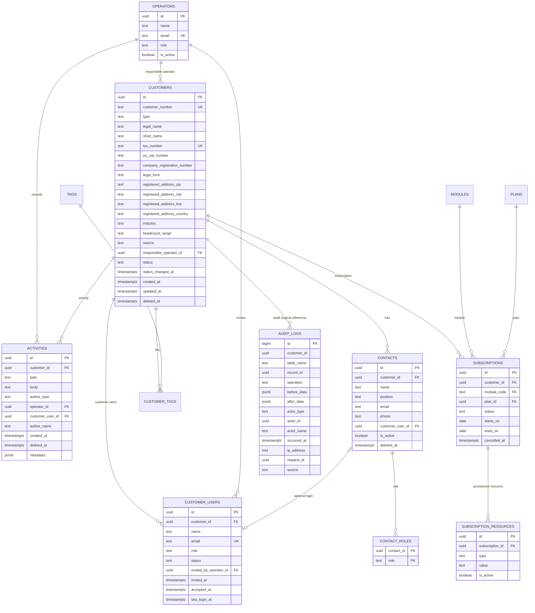

# Ügyfél-adatmodell — kinyert tartalom, javasolt táblák, naplózási stratégia

**Forrás:** [`docs/temp/12_ugyfelek_admin_mockup.html`](../temp/12_ugyfelek_admin_mockup.html)
**Készült:** 2026-11-15
**Állapot:** tervezési javaslat (nem implementáció, nem migráció)
**Cél:** az admin „Ügyfelek" képernyő mögé felállítható adatbázis-struktúra.

Rögzített kiindulópontok:

- a **tevékenység** és a **napló** minden cégre **egyetlen közös táblába** kerül,
  `customer_id` idegen kulccsal;
- a **belépő felhasználók** (`iam.customer_users`) mindig **egy céghez** tartoznak:
  nincs platform-szintű felhasználó és nincs több céghez tartozó tagság;
- **számlázási adatot egyelőre nem tárolunk**: nincs számlázási profil, fizetési mód,
  díj, pénznem és számlázási ciklus az adatbázisban.

---

## 0. Elnevezési konvenció

**Minden adatbázis-azonosító angol**: táblanév, oszlopnév, enum-típus, enum-érték,
index- és kényszernév. A magyar csak a felületi szövegben (UI copy) és ebben a
dokumentumban, prózában marad.

| Réteg | Nyelv | Példa |
|-------|-------|-------|
| Postgres séma, tábla, oszlop, enum | **angol** | `customer.customers.tax_number` |
| Enum-érték | **angol** | `status = 'suspended'` |
| Index / kényszer neve | **angol** | `customers_tax_number_key` |
| API JSON mező | **angol** (camelCase) | `taxNumber`, `customerNumber` |
| UI felirat | magyar | „Adószám", „Felfüggesztett" |
| Mockup kulcs (forrás) | magyar | `adoszam`, `rovidNev` |

A lenti táblázatok ezért mindig **két oszlopot** mutatnak: a mockupban látott magyar
kulcsot (nyomkövetéshez) és a javasolt angol adatbázis-nevet.

A repo mintája szerint (lásd `apps/api/src/db/schema.ts`): a táblanevek **többes
számban** (`api_keys`), az oszlopnevek `snake_case` alakban, minden oszlopnév
explicit kiírva.

---

## 1. Miről szól ez a dokumentum

A mockup egy belső rendszergazdai felület: ügyfél(cég)lista → ügyfél-adatlap, hét
tabbal (Áttekintés, Cégadatok, Kapcsolattartók, Felhasználók, Szolgáltatások,
Tevékenység, Napló), valamint egy ötlépéses „Új ügyfél" varázsló.

Ebből a dokumentumból kiderül:

1. milyen adatokat tartalmaz pontosan a mockup (mezők, értékkészletek, származtatott értékek),
2. milyen adatmodell javasolt ehhez (táblák, kulcsok, kényszerek, indexek),
3. mi az, ami a mockupból **nem** derül ki, és döntést igényel.

A mermaid diagramok ASCII azonosítókat használnak (ékezet nélkül), mert a mermaid
parser az ékezetes azonosítókat nem minden renderelőben tolerálja; a magyar
megfelelőket a táblázatok adják meg.

---

## 2. A mockupból kinyert tartalom

### 2.1 Képernyők és tabok

| # | Tab | Tartalom a mockupban |
|---|-----|----------------------|
| — | Ügyféllista | ügyfélszám, név, típus, adószám, státusz, modulok, kapcsolattartó, utolsó aktivitás; keresés + 4 szűrő + 2 gyorsszűrő chip; CSV export |
| 1 | Áttekintés | státusz, státuszváltás dátuma, szolgáltatások, elsődleges kapcsolattartó, utolsó aktivitás |
| 2 | Cégadatok | törzsadatok (jogi forma, adószám, közösségi adószám, cégjegyzékszám, székhely, iparág, létszám, forrás, felelős operátor, címkék, megjegyzés) |
| 3 | Kapcsolattartók | név, beosztás, e-mail, telefon, **szerepek (több is)**, „belépő felhasználó?" |
| 4 | Felhasználók | név, e-mail, szerep, státusz, utolsó belépés |
| 5 | Szolgáltatások | előfizetések modulonként: csomag, kiosztott erőforrás (postafiók, telefonszám, Telegram párosítás), usage metrika |
| 6 | Tevékenység | időrendi feed: típus, operátor, időpont, szöveg |
| 7 | Napló | időpont, ki (operátor / felhasználó / rendszer), tábla, művelet, régi → új diff |

A mockupban hivatkozott (de máshol nem dokumentált) döntés-azonosítók:
`SA-D6` (fogyasztói ügyfél tiltva), `SA-D8` (tagság, cégenként egy tulajdonos),
`SA-D12` (audit napló), `SA-D18` (meghívás), `SA-D20` (kapcsolattartó szerepek).

### 2.2 Értékkészletek — magyar felirat → angol enum

| Enum-típus | Mockup érték (HU) | Javasolt DB érték (EN) |
|------------|-------------------|------------------------|
| `customer_type` | `ceg`, `egyeni_vallalkozo`, `szervezet`, `adoszamos_maganszemely` | `company`, `sole_proprietor`, `organization`, `tax_number_individual` |
| `customer_type` (letiltva, `SA-D6`) | `maganszemely` / fogyasztó | `individual` (később, ha engedélyezett) |
| `customer_status` | `erdeklodo`, `regisztralt`, `proba`, `aktiv`, `felfuggesztett`, `megszunt`, `anonimizalt` | `prospect`, `registered`, `trial`, `active`, `suspended`, `churned`, `anonymized` |
| `customer_source` | `weboldal`, `ajanlas`, `szemelyes`, `kerdoiv`, `partner`, `manualis` | `website`, `referral`, `in_person`, `questionnaire`, `partner`, `manual` |
| `headcount_range` | `egyeni`, `2-5`, `6-20` | `sole`, `2_5`, `6_20` (+ `21_50`, `51_250`, `250_plus`) |
| `contact_role` | `elsodleges`, `technikai`, `riasztasi` | `primary`, `technical`, `alerting` |
| `customer_user_role` | `tulajdonos` | `owner` (+ `admin`, `member`, `viewer`) |
| `customer_user_status` | `aktiv` | `active` (+ `invited`, `inactive`) |
| `operator_role` | superadmin | `superadmin` (+ `operator`) |
| `subscription_status` | (a mockup csak modulnevet mutat) | `trial`, `active`, `suspended`, `expired`, `cancelled` |
| `activity_type` | `megjegyzes`, `hivas`, `email`, `talalkozo`, `statuszvaltas` | `note`, `call`, `email`, `meeting`, `status_change` (+ `system`) |
| `author_type` | `operator`, `felhasznalo`, `rendszer` | `operator`, `customer_user`, `system` (+ `api_key`) |
| `audit_operation` | `insert`, `update` | `insert`, `update` (+ `delete`, `soft_delete`) |
| `audit_source` | (a mockup nem tárgyalja) | `admin_api`, `web`, `worker`, `cron` |
| `resource_type` | postafiók, telefonszám, Telegram, Voice Agent | `mailbox`, `phone_number`, `telegram_link`, `voice_agent` |
| modul-kód | `Email`, `Voice`, `Admin` | `email`, `voice`, `admin` |

> A mockup naplójában szereplő táblanevek (`ugyfel`, `kapcsolattarto`,
> `ugyfel_tevekenyseg`) a mockup saját, magyar elnevezései. A valós
> `audit_logs.table_name` értékei a lenti angol táblanevek lesznek:
> `customers`, `contacts`, `activities`.

Formátumszabályok a mockupból:

- `customer_number`: `AIS-ÉÉÉÉHH-NNN` (pl. `AIS-202609-001`), automatikusan generált, egyedi.
- `tax_number`: `^\d{8}-[1-5]-\d{2}$` (8 számjegy, kötőjel, 1–5, kötőjel, 2 számjegy); egyediség ellenőrizendő.

### 2.3 Mezők blokkonként → javasolt hely

| Mockup kulcs (HU) | Jelentés | Javasolt DB oszlop (EN) |
|-------------------|----------|--------------------------|
| `id` | ügyfélszám | `customers.customer_number` (egyedi), **mellette** `customers.id` uuid elsődleges kulcs |
| `tipus` | ügyféltípus | `customers.type` |
| `nev` | hivatalos név | `customers.legal_name` |
| `rovidNev` | rövid név (a listában ez látszik) | `customers.short_name` |
| `adoszam` | adószám | `customers.tax_number` |
| `kozossegiAdoszam` | közösségi adószám | `customers.eu_vat_number` |
| `cjsz` | cégjegyzék / nyilvántartási szám | `customers.company_registration_number` |
| `jogiForma` | jogi forma | `customers.legal_form` |
| `szekhely.irsz` | székhely irányítószám | `customers.registered_address_zip` |
| `szekhely.telepules` | székhely település | `customers.registered_address_city` |
| `szekhely.cim` | székhely közterület | `customers.registered_address_line` |
| `szekhely.orszag` | székhely ország | `customers.registered_address_country` |
| `iparag` | iparág | `customers.industry` |
| `letszam` | létszám sáv | `customers.headcount_range` |
| `forras` | forrás | `customers.source` |
| `felelos` | felelős operátor | `customers.responsible_operator_id` (FK) |
| `statusz` | státusz | `customers.status` |
| `statuszValtozott` | státuszváltás dátuma | `customers.status_changed_at` |
| `megjegyzes` | cég-szintű megjegyzés | **nincs saját oszlop** — minden megjegyzés `activities` bejegyzés (lásd 5. pont, 1. döntés) |
| `cimkek[]` | címkék | `tags` + `customer_tags` |
| `kapcsolattartok[]` | kapcsolattartók | `contacts` + `contact_roles` |
| `kapcsolattartok[].felhasznalo` | belépő felhasználó? (boolean) | `contacts.customer_user_id` (FK), `NULL` = nem belépő |
| `felhasznalok[]` | belépő felhasználók | `customer_users` (`customer_id` FK-val, cégenként) |
| `modulok[]` | aktív modulok | **származtatott** a `subscriptions` táblából |
| `tevekenyseg[]` | tevékenység-feed | `activities` (`customer_id`-vel) |
| `auditNaplo[]` | audit napló | `audit_logs` (csak beszúrás) |

### 2.4 Származtatott értékek — ezeket **nem** tároljuk

A mockup több helyen olyan értéket mutat, ami más adatokból számolható. Ha ezeket
oszlopként is eltároljuk, előbb-utóbb szinkronban kell tartani őket, és el fognak
csúszni.

| Megjelenített érték | Számítás |
|--------------------|----------|
| `hiányosAdat` (⚠ a listában) | `tax_number IS NULL OR registered_address_zip IS NULL` |
| `utolsoAktivitas` | `max(activities.created_at)` |
| `modulok` | az aktív `subscriptions` sorainak `module_code` értékei |
| usage metrikák (feldolgozott levél/hó, fogadott hívás/hó) | a modul saját eseménytáblájából aggregálva (nem része ennek a modellnek) |
| `kapcsolattarto.felhasznalo` (boolean) | `contacts.customer_user_id IS NOT NULL` |

### 2.5 A mockup hibái / következetlenségei (a modell szempontjából fontosak)

1. **`utolsoBelepes` kevert formátum**: `"ma 09:12"`, `"tegnap 14:22"`, `"2026-10-15"` —
   valóságban `timestamptz`, a feliratot a UI generálja.
2. **`idopont` néhol idő nélküli** (`"2026-10-18"`), néhol idővel — egységesen `timestamptz`.
3. **`adoszam: ''` a hiányzó értékre** — adatbázisban `NULL`, nem üres string.
4. **`cimkek: []` string-tömb** — normalizálandó (`tags` + `customer_tags`), különben
   nincs szűrhető/statisztikázható címkehalmaz.
5. **`felhasznalo: true/false` a kapcsolattartón** — ez valójában egy hivatkozás a
   felhasználóra (`contacts.customer_user_id`), nem logikai kapcsoló.
6. **`modulok` a cég rekordján** — duplikált, származtatott adat.
7. **`auditNaplo` és `tevekenyseg` az ügyfél objektum alatt tárolva** — ez csak a UI-ra
   csoportosított nézet; a valós adatbázisban közös `activities` és `audit_logs` tábla
   van, `customer_id` hivatkozással.
8. **`anonimizalt` státusz** szerepel a címke-térképben, de a szűrőlistában nem.

---

## 3. Javasolt adatbázis-struktúra

### 3.1 Séma-felbontás

A repo konvenciója szerint (lásd `apps/api/src/db/schema.ts`, `platform` séma) a
séma-határ a modul-határt követi. Javaslat:

| Postgres séma | Táblák | Miért külön |
|---------------|--------|-------------|
| `customer` | `customers`, `tags`, `customer_tags`, `contacts`, `contact_roles` | az ügyfél-aggregátum; más modul innen csak olvas |
| `iam` | `customer_users`, `operators` | belépő felhasználók és a szolgáltató munkatársai |
| `service` | `modules`, `plans`, `subscriptions`, `subscription_resources` | előfizetés és kiosztott erőforrás |
| `activity` | `activities` | ügyfél-szintű üzleti feed, gyakori írás/olvasás |
| `audit` | `audit_logs` | csak beszúrás, hosszú visszatartás, külön grant |

> A `service` séma szándékosan **nem** tartalmaz árat, pénznemet, számlázási ciklust
> vagy számlázási profilt: számlázási adatot egyelőre nem tárolunk.

### 3.2 Táblák mezőszinten

#### `customer.customers`

| Oszlop | Típus | Megjegyzés |
|--------|-------|-----------|
| `id` | `uuid PK` | belső kulcs; minden hivatkozás erre mutat |
| `customer_number` | `text NOT NULL UNIQUE` | `AIS-ÉÉÉÉHH-NNN`, a listában megjelenő azonosító |
| `type` | `customer_type NOT NULL` | enum (2.2) |
| `legal_name` | `text NOT NULL` | hivatalos név (mockup: `nev`) |
| `short_name` | `text` | listában ez jelenik meg (mockup: `rovidNev`) |
| `tax_number` | `text` | `UNIQUE` **csak nem NULL értékre** (partial index), formátum-check |
| `eu_vat_number` | `text` | közösségi adószám |
| `company_registration_number` | `text` | cégjegyzék / nyilvántartási szám |
| `legal_form` | `text` | a varázsló kéri, a megjelenítés a típusból is levezethető |
| `registered_address_zip` | `text` | székhely irányítószám |
| `registered_address_city` | `text` | székhely település |
| `registered_address_line` | `text` | székhely közterület, házszám |
| `registered_address_country` | `text NOT NULL DEFAULT 'HU'` | székhely ország |
| `industry` | `text` | később lookup tábla |
| `headcount_range` | `headcount_range` | enum |
| `source` | `customer_source` | enum |
| `responsible_operator_id` | `uuid FK → iam.operators` | `ON DELETE SET NULL` |
| `status` | `customer_status NOT NULL` | enum |
| `status_changed_at` | `timestamptz NOT NULL` | a státuszváltást a service állítja |
| `created_at`, `updated_at` | `timestamptz NOT NULL` | repo konvenció: precision 3 |
| `deleted_at` | `timestamptz` | soft delete (repo minta: `deleted_at`) |

#### `customer.contacts` és `customer.contact_roles`

| `contacts` | Típus | Megjegyzés |
|---|---|---|
| `id` | `uuid PK` | |
| `customer_id` | `uuid FK → customers` | `ON DELETE CASCADE` |
| `name` | `text NOT NULL` | |
| `position` | `text` | beosztás |
| `email` | `text` | |
| `phone` | `text` | |
| `customer_user_id` | `uuid FK → iam.customer_users` | `NULL` = nem belépő; ez váltja a mockup boolean flagjét; ugyanahhoz a céghez kell tartoznia |
| `is_active` | `boolean NOT NULL DEFAULT true` | kilépett kontaktus megőrzése |
| `created_at`, `updated_at` | `timestamptz` | |
| `deleted_at` | `timestamptz` | soft delete |

| `contact_roles` | Típus | Megjegyzés |
|---|---|---|
| `contact_id` | `uuid FK → contacts` | összetett PK része |
| `role` | `contact_role` | összetett PK része (`primary`, `technical`, `alerting`) |

Megkötés: `UNIQUE (customer_id) WHERE role = 'primary' AND deleted_at IS NULL`
— a `customer_id` **denormalizálva van** a join táblába (5. pont, 4. döntés), így
az index triger nélkül kényszeríthető, hogy **egy elsődleges** kapcsolattartó
legyen cégenként.

#### `iam.customer_users`

Az ügyfélhez tartozó belépő felhasználók (**nem** platform-szintű identitás). A
felhasználói sor kötelezően egy céghez tartozik, ezért nincs külön tagság-tábla:
a szerep, a meghívás és a belépés állapota magán a felhasználói soron van, és a
cég törlésével a felhasználó is törlődik.

| Oszlop | Típus | Megjegyzés |
|--------|-------|-----------|
| `id` | `uuid PK` | |
| `customer_id` | `uuid FK → customer.customers NOT NULL` | `ON DELETE CASCADE`; a felhasználó életciklusa a cégéhez kötött |
| `name` | `text NOT NULL` | |
| `email` | `citext` / `text` + `UNIQUE lower(email)` | ezzel lép be; globálisan egyedi, mert a bejelentkezés e-mail alapú |
| `password_hash` | `text` | vagy külső identitás-azonosító (döntendő) |
| `role` | `customer_user_role NOT NULL` | `owner` / `admin` / `member` / `viewer` |
| `status` | `customer_user_status NOT NULL` | `invited` / `active` / `inactive` |
| `invited_by_operator_id` | `uuid FK → iam.operators` | `SA-D18`; a meghívó adminisztrátor |
| `invited_at`, `accepted_at` | `timestamptz` | |
| `last_login_at` | `timestamptz` | a mockup „utolsó belépés" oszlopa |
| `created_at`, `updated_at` | `timestamptz NOT NULL` | |

Megkötés: `UNIQUE (customer_id) WHERE role = 'owner' AND status = 'active'`
— cégenként pontosan egy tulajdonos (`SA-D8`).

#### `iam.operators`

A mockupban „Bejelentkezve mint **Kálmán** superadmin" és a napló `ki = operator`
— ők nem ügyfél-felhasználók, hanem a szolgáltató munkatársai, ezért külön
táblába kerülnek (más jogosultsági modell, más életciklus).

| Oszlop | Típus | Megjegyzés |
|--------|-------|-----------|
| `id` | `uuid PK` | |
| `name` | `text NOT NULL` | a naplóban megjelenő név pillanatképe |
| `email` | `text NOT NULL UNIQUE` | |
| `role` | `operator_role NOT NULL` | `superadmin` / `operator` (bővíthető) |
| `is_active` | `boolean NOT NULL` | |

#### `service.modules`, `service.plans`, `service.subscriptions`, `service.subscription_resources`

| `modules` (katalógus) | Típus | Megjegyzés |
|---|---|---|
| `code` | `text PK` | `email` / `voice` / `admin` |
| `name` | `text NOT NULL` | |
| `is_active` | `boolean NOT NULL` | |

| `plans` (csomagkatalógus) | Típus | Megjegyzés |
|---|---|---|
| `id` | `uuid PK` | |
| `module_code` | `text FK → modules` | |
| `name` | `text NOT NULL` | pl. „Alap csomag" → `basic` |
| `is_active` | `boolean NOT NULL` | |

| `subscriptions` | Típus | Megjegyzés |
|---|---|---|
| `id` | `uuid PK` | |
| `customer_id` | `uuid FK → customers` | |
| `module_code` | `text FK → modules` | |
| `plan_id` | `uuid FK → plans` | |
| `status` | `subscription_status NOT NULL` | `trial` / `active` / `suspended` / `expired` / `cancelled` |
| `starts_on`, `ends_on` | `date` | |
| `cancelled_at` | `timestamptz` | |
| `created_at`, `updated_at` | `timestamptz NOT NULL` | |

| `subscription_resources` (a „kapcsolatok" tábla) | Típus | Megjegyzés |
|---|---|---|
| `id` | `uuid PK` | |
| `subscription_id` | `uuid FK → subscriptions` `ON DELETE CASCADE` | |
| `type` | `resource_type NOT NULL` | `mailbox`, `phone_number`, `telegram_link`, `voice_agent` |
| `value` | `text NOT NULL` | pl. `+36 1 234 5678`, `info@pelda.hu` |
| `is_active` | `boolean NOT NULL` | |
| `created_at` | `timestamptz NOT NULL` | |

> **Megjegyzés a „kapcsolatokhoz egy tábla" kéréshez:** kétféleképpen érthető.
> (a) Ha az előfizetés és a cég összekötése kell: **nem kell külön tábla**, mert
> `subscriptions.customer_id` már 1:N kapcsolatot ad. (b) Ha a szolgáltatás konkrét
> kiosztott erőforrásai (postafiók, telefonszám) kellenek: **ez az**
> `subscription_resources`. A mockup mindkettőt sugallja (modul + „1 postafiók ·
> Telegram párosítva", „1 Voice Agent · +36 1 234 5678"), ezért a (b) táblát javaslom.

#### `activity.activities`

Minden cég bejegyzése **ebben az egy táblában** van, `customer_id` idegen kulccsal.

| Oszlop | Típus | Megjegyzés |
|--------|-------|-----------|
| `id` | `uuid PK` | |
| `customer_id` | `uuid FK → customer.customers NOT NULL` | az ügyfélhez kötés |
| `type` | `activity_type NOT NULL` | `note` / `call` / `email` / `meeting` / `status_change` / `system` |
| `body` | `text NOT NULL` | a bejegyzés szövege |
| `author_type` | `author_type NOT NULL` | `operator` / `customer_user` / `system` |
| `operator_id` | `uuid FK → iam.operators` | csak `author_type = 'operator'` esetén kitöltött |
| `customer_user_id` | `uuid FK → iam.customer_users` | csak `author_type = 'customer_user'` esetén kitöltött |
| `author_name` | `text NOT NULL` | pillanatkép: ha az operátor kilép, a bejegyzés olvasható marad |
| `created_at` | `timestamptz NOT NULL` | |
| `updated_at` | `timestamptz` | javítás nyoma |
| `deleted_at` | `timestamptz` | soft delete (a mockup nem töröl, de a javítás igen) |
| `metadata` | `jsonb` | típus-specifikus részletek (pl. hívás hossza) |

`CHECK`: `author_type = 'system'` → mindkét FK `NULL`; `operator` → `operator_id` kitöltve;
`customer_user` → `customer_user_id` kitöltve. FK nélküli `author_id` nincs (5. pont, 3. döntés).

Index: `(customer_id, created_at DESC)`, részleges `WHERE deleted_at IS NULL`.

#### `audit.audit_logs`

Minden cég auditbejegyzése **ebben az egy táblában** van, `customer_id` szerint
szűrhetően.

| Oszlop | Típus | Megjegyzés |
|--------|-------|-----------|
| `id` | `bigint GENERATED ALWAYS AS IDENTITY PK` | nagy volumenre; nem kell uuid |
| `customer_id` | `uuid` | **nem** FK (lásd lent), indexelt |
| `table_name` | `text NOT NULL` | érintett tábla logikai neve (pl. `customers`) |
| `record_id` | `uuid` | érintett rekord (nincs FK — a naplónak túl kell élnie) |
| `operation` | `audit_operation NOT NULL` | `insert` / `update` / `delete` / `soft_delete` |
| `before_data` | `jsonb` | változás előtti állapot (csak a változott mezők) |
| `after_data` | `jsonb` | változás utáni állapot |
| `actor_type` | `author_type NOT NULL` | `operator` / `customer_user` / `system` / `api_key` |
| `actor_id` | `uuid` | |
| `actor_name` | `text NOT NULL` | pillanatkép |
| `occurred_at` | `timestamptz NOT NULL` | partíciókulcs jelölt |
| `ip_address` | `inet` | |
| `user_agent` | `text` | |
| `request_id` | `uuid` | a repo már generál `requestId`-t (`meta.requestId`) — ez köti össze a naplót a kiszolgáló loggal |
| `source` | `audit_source` | `admin_api` / `web` / `worker` / `cron` |

Miért **nincs** FK az `audit_logs`-ban: a naplónak akkor is olvashatónak kell
maradnia, ha a hivatkozott rekord (vagy maga a cég) törlődik/anonimizálódik. A
`customer_id` ezért is marad `uuid` FK nélkül — anonimizáláskor a napló
`customer_id`-ja `NULL`-ra állítható, a `before_data`/`after_data` JSON-ból pedig
a személyes adat szkripttel tisztítható.

Megkötés: az alkalmazás szerepének `INSERT` joga van, `UPDATE`/`DELETE` **nincs**.

#### `customer.tags`, `customer.customer_tags`

| `tags` | Típus | Megjegyzés |
|---|---|---|
| `id` | `uuid PK` | |
| `name` | `text NOT NULL UNIQUE` | `premium`, `vip`, `accounting_partner`, … |
| `is_active` | `boolean NOT NULL` | |

| `customer_tags` | Típus | Megjegyzés |
|---|---|---|
| `customer_id` | `uuid FK → customers` | összetett PK része |
| `tag_id` | `uuid FK → tags` | összetett PK része |

### 3.3 Integritási szabályok

| Szabály | Megvalósítás |
|---------|--------------|
| ügyfélszám egyedi | `UNIQUE (customer_number)` |
| adószám egyedi, ha meg van adva | `CREATE UNIQUE INDEX customers_tax_number_key ON customer.customers (tax_number) WHERE tax_number IS NOT NULL AND deleted_at IS NULL` |
| adószám formátum | `CHECK (tax_number ~ '^\d{8}-[1-5]-\d{2}$')` |
| egy elsődleges kapcsolattartó | `UNIQUE` partial index a `contact_roles` táblán |
| egy aktív tulajdonos cégenként | `UNIQUE (customer_id) WHERE role = 'owner' AND status = 'active'` a `customer_users` táblán |
| a belépő felhasználó e-mailje egyedi | `CREATE UNIQUE INDEX customer_users_email_key ON iam.customer_users (lower(email))` |
| a kapcsolattartó belépő felhasználója ugyanahhoz a céghez tartozik | összetett FK: `contacts (customer_id, customer_user_id) → customer_users (customer_id, id)` |
| napló csak beszúrható | grant + (opcionálisan) `BEFORE UPDATE OR DELETE` triger, ami kivételt dob |

### 3.4 Indexek (minimum)

```text
activity.activities       (customer_id, created_at DESC) WHERE deleted_at IS NULL
audit.audit_logs          (customer_id, occurred_at DESC)
audit.audit_logs          (table_name, record_id)          -- egy rekord története
audit.audit_logs          (request_id)
customer.contacts         (customer_id, name)
service.subscriptions     (customer_id, status)
iam.customer_users        (customer_id)                    -- egy cég belépő felhasználói
```

---

## 4. Mermaid — entitás-diagram



---

## 5. Döntések (a korábbi nyitott kérdések lezárva)

| # | Kérdés | Döntés |
|---|--------|--------|
| 1 | Cég-szintű megjegyzés mező | **Nincs `customers.note`** — minden megjegyzés `activities` bejegyzés, a „+ Megjegyzés" gomb is oda ír. |
| 2 | Operátor vs. ügyfél-felhasználó | Két külön tábla: `iam.operators` (szolgáltató munkatársai) és `iam.customer_users` (cégenkénti belépők). A napló `actor_type`-sal különböztet; nincs közös „mindenki" tábla. |
| 3 | Polimorf szerző hivatkozás | Két külön FK oszlop (`operator_id`, `customer_user_id`) + `CHECK`, hogy pontosan az egyik legyen kitöltve (`system` esetén egyik sem). FK nélküli `author_id` nincs. |
| 4 | Egy elsődleges kapcsolattartó kényszerítése | **(a)** — `customer_id` denormalizálva a `contact_roles`-ba + `CHECK` a szülővel való egyezésre; így partial unique index kényszeríti, triger nélkül. |
| 5 | Anonimizálás | **Csak a `customers` sor** anonimizálódik. Az `audit_logs` `before_data` / `after_data` JSON-jához nem nyúlunk — a napló bizonyító ereje megmarad. |
| 6 | `headcount_range` skála | **Három érték**: `sole`, `2_5`, `6_20`. |

---

## 6. Következő lépések (implementációhoz)

1. Az 5. pont döntései rögzítve — a séma ezek szerint készül.
2. `apps/api/src/db/schema.ts` kiegészítése a `customer`, `iam`, `activity`,
   `audit` sémákkal (a repó mintája szerint: minden oszlopnév kiírva,
   `timestamptz` precision 3, soft delete). A `service` séma későbbi ütem.
3. Új Postgres sémák grantjei: `infra/postgres/init/02-schemas.sh`
   + `docs/Specs/Database-Local.md` frissítése.
4. `pnpm --filter @callback/api db:generate` → a generált SQL átnézése →
   `db:migrate`.
5. Az audit írás egyetlen belépési pontja (`AuditWriter`) + tesztek
   (minden művelet ír-e naplót, a napló nem módosítható).
6. Csak ezután az admin oldal (ügyféllista, adatlap, varázsló) — ez külön
   feature, a `docs/Specs/New-Admin-Page.md` checklistje szerint.
