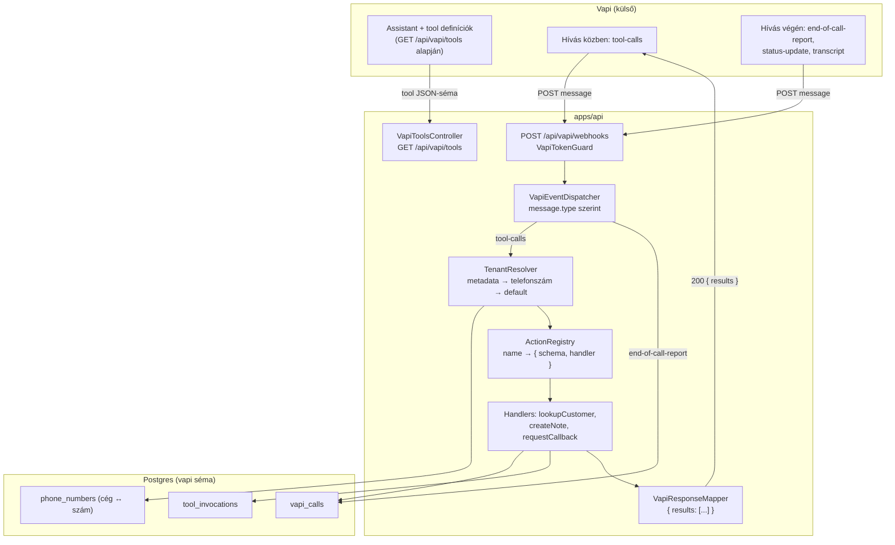
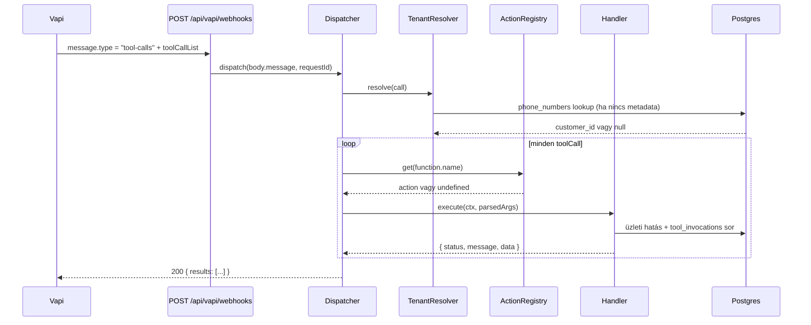

# Vapi integráció — tool-call fogadás + akció-registry (MVP implementációs terv)

**Készült:** 2026-11-15 20:15 (részletesítve: 2026-11-16 00:05)
**Állapot:** terv (nem implementáció)
**Scope:** összekötni a Vapi asszisztenst a saját backendünkkel **egyetlen webhook
végponton** + **bővíthető akció-registryvel**, hitelesítés és jogosultság nélkül.

Forrás (élő Vapi dokumentáció, 2026-11-15):

- <https://docs.vapi.ai/server-url/events> — a POST-olt üzenetek és az elvárt válasz
- <https://docs.vapi.ai/tools/custom-tools> — Function tool (`type: "function"`, `server.url`, `parameters`)
- <https://docs.vapi.ai/server-url/setting-server-urls> — Server URL, timeout, credential
- <https://docs.vapi.ai/api-reference/calls/create> — `metadata`, `assistantOverrides`
- <https://docs.vapi.ai/tools/static-variables-and-aliases/static-parameters> — későbbi prompt-injection védelem

---

## 0. Mit jelent az „kész" (MVP done)

Egy hívás során a Vapi asszisztens meghív egy akciót, a kérésünk eljut a backendig,
a backend **tudja, melyik cégről** van szó, lefuttatja a regiszterből kiválasztott
akciót, és a Vapi által elvárt JSON-t kapja vissza; a hívás végén a transcript és a
recording URL a mi adatbázisunkban van.

Konkrétan:

1. `POST /api/vapi/webhooks` fogadja a `tool-calls`, `end-of-call-report`,
   `status-update` és `transcript` üzeneteket, ismeretlen típust 200-zal nyugtáz.
2. `tool-calls` esetén a válasz `{ "results": [ { "name", "toolCallId", "result" } ] }`,
   akciónként pontosan egy elem, `200` státusszal, 2 másodpercen belül.
3. A cég feloldása `call.metadata.customerId` → hívott telefonszám → egyik sem
   (ekkor `unresolved_tenant`, a modell ezt mondja ki a hívónak).
4. Létezik 3 akció (`lookupCustomer`, `createNote`, `requestCallback`), és **új akció
   hozzáadása nem igényel módosítást a dispatcherben**.
5. A `GET /api/vapi/tools` visszaadja a regiszterből generált Vapi tool-definíciókat.
6. A hívás rekord (`vapi.vapi_calls`) és minden tool-hívás (`vapi.tool_invocations`)
   Postgresben van.

---

## 1. Amit a Vapi oldalán be kell állítani

| Hol | Mit | Érték (MVP) |
| --- | --- | --- |
| Vapi Dashboard → **Server URL** (assistant vagy szervezet szinten) | események célcíme | `https://<host>/api/vapi/webhooks` |
| ugyanott → **HTTP Headers** | megosztott token (nem credential, az később) | `x-aisztens-token: <VAPI_WEBHOOK_TOKEN>` |
| ugyanott → **Timeout** | tool-call válasz limit | 10 s (a backend 2 s alatt válaszol) |
| **Tools** (Function tool, `type: "function"`) | a 3 akció | `name` = registry kulcs; `parameters` = a `GET /api/vapi/tools` JSON-sémája |
| **Assistant → Model → Tools** | a 3 tool hozzárendelése | ugyanazok a tool-ok |
| **Assistant system prompt** | viselkedés | „Ha a hívó megjegyzést kér, hívd a `createNote`-ot. Ha visszahívást kér, a `requestCallback`-ot. Céginfóra a `lookupCustomer`." |
| **Assistant first message** | üdvözlés | cégspecifikus szöveg (később `assistant-request`-ből dinamikusan) |

> A tool-definíció kézzel is felvihető a dashboardon, de a cél az, hogy a
> `GET /api/vapi/tools` válasza legyen bemásolható/automatizálható forrás.

---

## 2. Wire contract (ellenőrzött)

### 2.1 Közös boríték

Minden esemény **egy POST**:

```json
{ "message": { "type": "<server-message-type>", "call": { /* Call objektum */ } } }
```

A `call` objektumból nekünk ennyi kell (a többit tároljuk nyersen):

```json
{
  "id": "call_abc123",
  "metadata": { "customerId": "3f2b…-uuid" },
  "customer": { "number": "+36301112233" },
  "phoneNumber": { "number": "+3612345678" }
}
```

Csak **4 típusra** vár választ a Vapi: `assistant-request`, `tool-calls`,
`transfer-destination-request`, `knowledge-base-request`. Minden más információ →
`200`, üres/nyugtázó test.

### 2.2 `tool-calls` (a lényeg)

```json
{
  "message": {
    "type": "tool-calls",
    "call": { "id": "call_abc123", "metadata": { "customerId": "…" } },
    "toolCallList": [
      {
        "id": "tc_1",
        "type": "function",
        "function": { "name": "createNote", "arguments": { "body": "visszahívást kért" } }
      }
    ],
    "toolWithToolCallList": [ { "type": "function", "function": { "name": "createNote", "parameters": {} }, "toolCall": { "…": "…" } } ]
  }
}
```

Kötelező kezelni:

- **több elem** a `toolCallList`-ben → mindegyikhez külön `results` elem;
- `arguments` lehet **objektum vagy JSON-string** (normalizálás: ha string, `JSON.parse`, hiba → `validation_error`);
- ismeretlen `function.name` → `unknown_action` eredmény, **nem** HTTP hiba.

### 2.3 Válasz (amit vissza kell adni)

```json
{
  "results": [
    { "name": "createNote", "toolCallId": "tc_1", "result": "{\"status\":\"ok\",\"message\":\"Megjegyzés rögzítve.\"}" }
  ]
}
```

- `result` **string** — a benne lévő JSON-t a modell olvassa fel;
- HTTP `200`;
- aszinkron akció esetén `result: "{\"status\":\"accepted\"}"` is elég (később).

### 2.4 `end-of-call-report` (hívás után)

```json
{
  "message": {
    "type": "end-of-call-report",
    "endedReason": "hangup",
    "call": { "id": "call_abc123" },
    "artifact": {
      "transcript": "AI: … User: …",
      "messages": [ { "role": "assistant", "message": "…" } ],
      "recording": { "url": "https://…" }
    }
  }
}
```

→ `vapi.vapi_calls` upsert (`ended_at`, `ended_reason`, `transcript`, `recording_url`,
`metadata` jsonb). Válasz: `200 { "received": true }`.

### 2.5 `status-update` és `transcript`

- `status-update`: `{ status: "ringing" | "in-progress" | "ended" | … }` → `vapi_calls.started_at/ended_at` frissítés.
- `transcript`: részleges/final szöveg → MVP-ben **nem tároljuk** (csak log), a teljes
  transcript az end-of-call-reportban jön.

### 2.6 Hitelesítés — a valóság vs. a repó jelenlegi feltevése

A Vapi **nem** HMAC-ot küld; a Server URL-hez *Custom Credential* vagy tetszőleges
HTTP header rendelhető. A repóban lévő
[`vapi-signature.guard.ts`](../../apps/api/src/vapi-webhooks/vapi-signature.guard.ts:36)
`X-Vapi-Signature` + HMAC feltevése tehát **nem** a Vapi mechanizmusa.

MVP: a HMAC guard helyére `VapiTokenGuard` (egyszerű `timingSafeEqual` a
`x-aisztens-token` fejlécen) lép; a valódi credential a későbbi ütem.
A Caddy `@vapi_match` szabálya (`infra/caddy/Caddyfile`) jelenleg
`X-Vapi-Signature` fejlécet követel — ezt a lépést **át kell írni**, különben a
kérés 405-tel elhal a proxy-n.

---

## 3. Ki dönti el, „melyik cég mit szeretne"

| Réteg | Ki dönt | MVP megoldás |
| --- | --- | --- |
| **Cég** | nem a modell | 1) `call.metadata.customerId` (uuid, validált), 2) `vapi.phone_numbers` lookup a **hívott** számra (`call.phoneNumber.number`), 3) `VAPI_DEFAULT_CUSTOMER_ID` (csak `APP_ENV=local`), 4) `unresolved_tenant` |
| **Akció** | a Vapi LLM-je | a tool `function.name` = registry kulcs; a választás a tool-leírásokból történik, nem mi találgatunk |
| **Paraméterek** | LLM tölti, mi validáljuk | akciónként Zod séma → `validation_error` a `result`-ban |
| **Jogosultság** | (később) | MVP: minden cég minden akciót hívhat |

Miért így: a modell **soha** nem kap olyan adatot, amiből cég-azonosítót kellene
kitalálnia — a cég a `call` objektumból jön, ami a Vapi oldalán a hívás indításakor
(outbound) vagy a telefonszám hozzárendeléskor (inbound) keletkezik. Ez a későbbi
jogosultsági réteg alapja is.

---

## 4. Architektúra



### Kérés-életút



---

## 5. Implementálandó fájlok

### 5.1 Shared contract — `packages/shared/src/contract/vapi/`

| Fájl | Tartalom |
| --- | --- |
| `vapi-event.interface.ts` | `VapiCall`, `VapiToolCall`, `VapiToolCallsMessage`, `VapiEndOfCallReportMessage`, `VapiWebhookBody`, `VapiToolDefinition` |
| `vapi-event.schema.ts` | Zod séma a bejövő borítékra (lásd lent) |
| `vapi-tool.const.ts` | `VAPI_ACTION_NAMES` konstansok (`lookupCustomer`, `createNote`, `requestCallback`) — egy helyen a nevek |

```ts
// vapi-event.schema.ts (kivonat)
const callSchema = z
  .object({
    id: z.string().min(1),
    metadata: z.record(z.unknown()).optional(),
    customer: z.object({ number: z.string().optional() }).partial().passthrough().optional(),
    phoneNumber: z.object({ number: z.string().optional() }).partial().passthrough().optional(),
  })
  .passthrough();

const toolCallSchema = z.object({
  id: z.string().min(1),
  type: z.literal('function'),
  function: z.object({
    name: z.string().min(1),
    arguments: z.union([z.record(z.unknown()), z.string()]).optional(),
  }),
});

export const vapiWebhookBodySchema = z.object({
  message: z
    .object({
      type: z.string().min(1),
      call: callSchema.optional(),
      toolCallList: z.array(toolCallSchema).min(1).optional(),
      artifact: z
        .object({
          transcript: z.string().optional(),
          messages: z.array(z.unknown()).optional(),
          recording: z.object({ url: z.string().optional() }).partial().passthrough().optional(),
        })
        .partial()
        .passthrough()
        .optional(),
      endedReason: z.string().optional(),
      status: z.string().optional(),
    })
    .passthrough(),
});
```

Miért `passthrough`: a Vapi verziói között jönnek-mennek mezők; a szerződés a
*minimum*, nem a teljes alak (ugyanaz az elv, mint a jelenlegi
[`vapi-event.dto.ts`](../../apps/api/src/vapi-webhooks/dto/vapi-event.dto.ts:17)-ben).

**Új függőség:** `zod-to-json-schema@3` (a Zod 3-hoz), mert a registry-ből JSON-Sémát
kell generálni a Vapi tool-definícióhoz (a repo Zod 3.24-en van, natív
`z.toJSONSchema` nincs). Alternatíva dependency nélkül: az akciók `parameters`
mezője kézzel írt JSON-Séma + külön Zod validátor — ez duplikáció, ezért nem javaslom.

### 5.2 Konfiguráció — `apps/api/src/vapi-webhooks/vapi-webhook-config.ts` (módosítás)

```ts
export interface VapiWebhookConfig {
  readonly token?: string;            // VAPI_WEBHOOK_TOKEN — MVP auth
  readonly defaultCustomerId?: string; // VAPI_DEFAULT_CUSTOMER_ID — csak local/dev
}
```

Env változók (`.env.local|dev|prod`, illetve `infra/.env`):

| Változó | Kötelező | Mire |
| --- | --- | --- |
| `VAPI_WEBHOOK_TOKEN` | igen | a Vapi `x-aisztens-token` fejlécének értéke |
| `VAPI_DEFAULT_CUSTOMER_ID` | nem | lokális fejlesztéshez fallback cég |
| `VAPI_API_KEY` | nem (később) | kimenő hívás indításához |
| `VAPI_WEBHOOK_SECRET` / `…TIMESTAMP_TOLERANCE_SEC` | törlendő | a HMAC guard megszűnik |

### 5.3 Adatbázis — `apps/api/src/db/schema.ts` (bővítés)

**Előfeltétel — ezeknek a tábláknak már létezniük kell** (a `vapi` séma új tábláin kívül):

| Tábla | Kell-e a Vapi MVP-hez | Miért | Honnan jön |
| --- | --- | --- | --- |
| `customer.customers` | **kötelező** | a cég azonosítása, `lookupCustomer` válasza, FK-cél | AIS-18 |
| `activity.activities` | **kötelező** | `createNote` / `requestCallback` ide ír; `customer_id` FK | AIS-177 |
| `iam.operators` | kötelező, de **üresen is elég** | az `activities.operator_id` FK-célja (`author_type='system'` esetén mindkét szerző-FK `NULL`) | AIS-18 |
| `customer.contacts` + `customer.contact_roles` | ajánlott | a `lookupCustomer` az elsődleges kapcsolattartót adja vissza | AIS-18 |
| `audit.audit_logs` | **nem kell** | csak akkor, ha a `createNote` auditot is ír (11. pont, 3. kérdés) | AIS-177 |

Nem kell: `tags`, `customer_tags`, `customer_users`, `service.*` — a Vapi integráció
ezeket nem érinti.

Vagyis a Vapi munka **az AIS-18 (customers) és AIS-177 (activities + operators) után
indulhat**. Nulla domain-függőségű változat is van (csak `lookupCustomer`, ami
kizárólag `customers`-t olvas), de a termék célfunkciója a jegyzet/visszahívás, ezért
a `customers` + `activities` pár a reális minimum.

Új séma: `vapi` (grant az `infra/postgres/init/02-schemas.sh`-ban).

A repó mintája szerint (mint a `platform.api_keys`, lásd
[`schema.ts`](../../apps/api/src/db/schema.ts:69)):

- **minden futásidejű alak Zod séma** a `packages/shared/src/contract/vapi/` alatt
  (`vapi-event.schema.ts`, `vapi-call.schema.ts`, `vapi-tool-invocation.schema.ts`,
  `vapi-phone-number.schema.ts`, akciónkénti paraméter-sémák), a típusok `z.infer`-rel;
- **a táblákat az `apps/api/src/db/schema.ts` deklarálja** (schema-as-code), az SQL-t a
  `db:generate` állítja elő — kézzel írt SQL és külön „séma script" nincs;
- a séma-szerződést a [`schema.spec.ts`](../../apps/api/src/db/schema.spec.ts:19)
  (`getTableConfig()` + a committed migráció szövege) ellenőrzi;
- DB-hozzáférés **csak repository-n át** (`@Inject(DATABASE)`), Drizzle-t csak a repository
  importál, a hibák `AppError`-leszármazottak.

Az alábbi blokk a `db/schema.ts`-be kerülő deklaráció vázlata (nem futtatható SQL):

```ts
export const vapiSchema = pgSchema('vapi');

export const vapiCalls = vapiSchema.table('vapi_calls', {
  id: text('id').primaryKey(),                    // Vapi call.id
  customerId: uuid('customer_id'),                // FK nélkül: unresolved is lehet
  assistantId: text('assistant_id'),
  phoneNumber: text('phone_number'),              // hívott szám
  callerNumber: text('caller_number'),            // hívó száma
  status: text('status').notNull().default('in-progress'),
  endedReason: text('ended_reason'),
  transcript: text('transcript'),
  recordingUrl: text('recording_url'),
  metadata: jsonb('metadata'),
  startedAt: timestamp('started_at', { withTimezone: true, precision: 3 }),
  endedAt: timestamp('ended_at', { withTimezone: true, precision: 3 }),
  createdAt: timestamp('created_at', { withTimezone: true, precision: 3 }).notNull().defaultNow(),
  updatedAt: timestamp('updated_at', { withTimezone: true, precision: 3 }).notNull().defaultNow().$onUpdate(() => new Date()),
});

export const vapiToolInvocations = vapiSchema.table('tool_invocations', {
  id: uuid('id').primaryKey().defaultRandom(),
  callId: text('call_id').notNull(),
  customerId: uuid('customer_id'),
  action: text('action').notNull(),
  toolCallId: text('tool_call_id').notNull(),
  arguments: jsonb('arguments'),
  result: jsonb('result'),
  status: text('status').notNull(),               // ok | error | validation_error | unknown_action | unresolved_tenant
  durationMs: integer('duration_ms').notNull(),
  requestId: uuid('request_id'),
  createdAt: timestamp('created_at', { withTimezone: true, precision: 3 }).notNull().defaultNow(),
});

export const vapiPhoneNumbers = vapiSchema.table('phone_numbers', {
  number: text('number').primaryKey(),            // E.164, a Vapi phoneNumber.number
  customerId: uuid('customer_id'),                // NULL = még nincs céghez rendelve
  label: text('label'),
  isActive: boolean('is_active').notNull().default(true),
  createdAt: timestamp('created_at', { withTimezone: true, precision: 3 }).notNull().defaultNow(),
});
```

Indexek: `vapi_calls (customer_id, created_at DESC)`, `tool_invocations (call_id)`,
`tool_invocations (customer_id, created_at DESC)`, `phone_numbers (customer_id)`.

Migráció: `pnpm --filter @callback/api db:generate` → SQL review → `build` →
`db:migrate` (a `dist/migrate.js` miatt a build előbb kell).

> A `phone_numbers` később beleolvad a `service.subscription_resources`-be
> (AIS-176); most azért külön, mert az előfizetés-modell még nincs meg.

### 5.4 Repository-k — `apps/api/src/vapi-webhooks/`

| Fájl | Felelősség |
| --- | --- |
| `vapi-call.repository.ts` / `.interface.ts` | `upsertCall`, `updateStatus`, `attachReport`, `findById` |
| `tool-invocation.repository.ts` / `.interface.ts` | `create(invocation)`, `listByCall(callId)` |
| `phone-number.repository.ts` / `.interface.ts` | `findCustomerIdByNumber(number)` |

Minta: a meglévő `api-keys.repository.ts` (Drizzle, injektált `Database`, `AppError`
hibák, unit teszt mock DB-vel).

### 5.5 `tenant-resolver.ts`

```ts
export interface TenantResolution {
  readonly customerId: string | null;
  readonly source: 'metadata' | 'phone' | 'default' | 'none';
}

@Injectable()
export class TenantResolver {
  constructor(
    private readonly phoneNumbers: PhoneNumberRepository,
    @Inject(VAPI_WEBHOOK_CONFIG) private readonly config: VapiWebhookConfig,
  ) {}

  async resolve(call: VapiCall | undefined): Promise<TenantResolution> {
    const fromMetadata = pickUuid(call?.metadata?.['customerId']);
    if (fromMetadata) return { customerId: fromMetadata, source: 'metadata' };

    const called = call?.phoneNumber?.number;
    if (called) {
      const byPhone = await this.phoneNumbers.findCustomerIdByNumber(called);
      if (byPhone) return { customerId: byPhone, source: 'phone' };
    }

    if (this.config.defaultCustomerId) {
      return { customerId: this.config.defaultCustomerId, source: 'default' };
    }
    return { customerId: null, source: 'none' };
  }
}
```

`pickUuid` **tiszta függvény** (`tenant-resolver.logic.ts`), külön tesztelve
(érvénytelen uuid → `null`, nem dob).

### 5.6 `vapi-event.dispatcher.ts`

```ts
@Injectable()
export class VapiEventDispatcher {
  constructor(
    private readonly tenants: TenantResolver,
    private readonly registry: ActionRegistry,
    private readonly invocations: ToolInvocationRepository,
    private readonly calls: VapiCallRepository,
    private readonly mapper: VapiResponseMapper,
  ) {}

  async dispatch(message: VapiMessage, requestId: string): Promise<VapiWebhookResponse> {
    switch (message.type) {
      case 'tool-calls':
        return this.handleToolCalls(message, requestId);
      case 'end-of-call-report':
        await this.handleEndOfCallReport(message);
        return { received: true };
      case 'status-update':
        await this.handleStatusUpdate(message);
        return { received: true };
      default:
        return { received: true }; // transcript, hang, speech-update, …
    }
  }

  private async handleToolCalls(message, requestId) {
    const tenant = await this.tenants.resolve(message.call);
    const results: VapiToolResult[] = [];

    for (const toolCall of message.toolCallList ?? []) {
      const started = Date.now();
      const outcome = await this.executeOne(toolCall, tenant, requestId);
      results.push(this.mapper.toResult(toolCall, outcome));
      await this.invocations.create({ …outcome, durationMs: Date.now() - started });
    }
    return { results };
  }
}
```

`executeOne` a teljes hibaág-tábla (6. pont) szerint: ismeretlen akció, hiányzó
tenant, érvénytelen argumentum, handler-hiba — **mind** `results` elem lesz, nem
kivétel. A dispatcher csak akkor dob, ha a body értelmezhetetlen (azt a controller
400-zal adja vissza).

### 5.7 Akció-registry — `apps/api/src/actions/`

| Fájl | Tartalom |
| --- | --- |
| `action.interface.ts` | `VapiAction<TArgs>`, `VapiActionContext`, `VapiActionResult` |
| `action.registry.ts` | `ActionRegistry` (Map, duplikátum-tiltás, `toolDefinitions()`) |
| `action.const.ts` | `VAPI_ACTIONS` token, `ACTION_STATUS` konstansok |
| `action.errors.ts` | `DuplicateActionError`, `UnknownActionError` |
| `handlers/lookup-customer.action.ts` | `lookupCustomer` |
| `handlers/create-note.action.ts` | `createNote` (→ `activity.activities`) |
| `handlers/request-callback.action.ts` | `requestCallback` |
| `actions.module.ts` | provider-ek + regisztráció bootstrap |

```ts
// action.interface.ts
export interface VapiActionContext {
  readonly customerId: string | null;
  readonly call: VapiCall | undefined;
  readonly requestId: string;
}

export interface VapiAction<TArgs> {
  readonly name: string;                 // = Vapi function.name
  readonly description: string;          // a modell ebből választ
  readonly parameters: z.ZodType<TArgs>;
  execute(context: VapiActionContext, args: TArgs): Promise<VapiActionResult>;
}

export type VapiActionResult =
  | { readonly status: 'ok'; readonly message: string; readonly data?: unknown }
  | { readonly status: 'error'; readonly message: string; readonly data?: unknown };
```

```ts
// action.registry.ts
@Injectable()
export class ActionRegistry {
  private readonly actions = new Map<string, VapiAction<never>>();

  register(action: VapiAction<never>): void {
    if (this.actions.has(action.name)) throw new DuplicateActionError(action.name);
    this.actions.set(action.name, action);
  }

  get(name: string): VapiAction<never> | undefined { return this.actions.get(name); }

  all(): readonly VapiAction<never>[] { return [...this.actions.values()]; }

  toolDefinitions(): VapiToolDefinition[] {
    return this.all().map((action) => ({
      type: 'function',
      function: {
        name: action.name,
        description: action.description,
        parameters: zodToJsonSchema(action.parameters, { target: 'jsonSchema7' }),
      },
    }));
  }
}
```

Regisztráció (Nest, kódmódosítás nélkül bővíthető):

```ts
// actions.module.ts
@Module({
  imports: [VapiDataModule],
  providers: [
    LookupCustomerAction, CreateNoteAction, RequestCallbackAction,
    ActionRegistry, ActionBootstrapService,
    { provide: VAPI_ACTIONS, inject: [LookupCustomerAction, CreateNoteAction, RequestCallbackAction],
      useFactory: (...actions: VapiAction<never>[]) => actions },
  ],
  exports: [ActionRegistry],
})
export class ActionsModule {}

// action-bootstrap.service.ts
@Injectable()
export class ActionBootstrapService implements OnModuleInit {
  constructor(private readonly registry: ActionRegistry,
              @Inject(VAPI_ACTIONS) private readonly actions: VapiAction<never>[]) {}
  onModuleInit(): void { this.actions.forEach((a) => this.registry.register(a)); }
}
```

**Új akció hozzáadása később:** új `*.action.ts` + bevétele a modul `providers` és
`inject` listájába. A dispatcher, a mapper és a Vapi oldal érintetlen.

### 5.8 A három MVP akció

| `name` | Paraméter (Zod) | Mit tesz | DB hatás |
| --- | --- | --- | --- |
| `lookupCustomer` | `{}` | visszaadja: `legalName`, `status`, elsődleges kapcsolattartó neve/telefonja, utolsó aktivitás ideje | olvasás (`customers`, `contacts`, `activities`) |
| `createNote` | `{ body: string (1..2000), type?: 'note' \| 'call' }` | megjegyzés a céghez | `activity.activities` insert (`author_type='system'`, `author_name='Vapi asszisztens'`) |
| `requestCallback` | `{ phone: string (E.164), reason?: string }` | visszahívási igény rögzítése | `activities` insert + `vapi_calls.metadata` flag |

Ha `customerId === null`: `lookupCustomer` → `unresolved_tenant` eredmény,
`createNote`/`requestCallback` → szintén `unresolved_tenant`, **nem** írunk cég
nélküli sort (később „unassigned” sor lehet).

### 5.9 `vapi-tools.controller.ts`

```ts
@SkipEnvelope()
@Controller('vapi/tools')
export class VapiToolsController {
  constructor(private readonly registry: ActionRegistry) {}

  @Get()
  list(): VapiToolDefinition[] { return this.registry.toolDefinitions(); }
}
```

Válasz (a Vapi `model.tools` tömbjébe másolható alak):

```json
[ { "type": "function",
    "function": { "name": "createNote",
                  "description": "Megjegyzés rögzítése az ügyfélhez.",
                  "parameters": { "type": "object",
                                  "properties": { "body": { "type": "string" } },
                                  "required": ["body"] } } } ]
```

### 5.10 Controller, guard, envelope, proxy

| Fájl | Változás |
| --- | --- |
| [`vapi-webhooks.controller.ts`](../../apps/api/src/vapi-webhooks/vapi-webhooks.controller.ts:39) | **egy** route: `@Post()` a `vapi/webhooks` controlleren; a két külön metódus helyett `dispatch`; `@SkipEnvelope()` marad |
| `vapi-token.guard.ts` | új, egyszerű token-ellenőrzés (`x-aisztens-token`), `UnauthorizedException` hibás/ hiányzó tokenre; **ha `VAPI_WEBHOOK_TOKEN` nincs beállítva → 500** (fail closed, ahogy a jelenlegi guard) |
| [`vapi-signature.guard.ts`](../../apps/api/src/vapi-webhooks/vapi-signature.guard.ts:78) + `vapi-signature.guard.spec.ts` | **törlés** (HMAC nem a Vapi mechanizmusa) — a tanulság a `docs/Specs/AI-Agent-Artifacts.md`-be kerül |
| [`vapi-webhooks.service.ts`](../../apps/api/src/vapi-webhooks/vapi-webhooks.service.ts:29) | in-memory store **törlés**, helyette repository-k |
| [`packages/shared/src/contract/endpoint.registry.ts`](../../packages/shared/src/contract/endpoint.registry.ts:41) | `ENVELOPE_EXEMPTIONS`: a két régi path helyett `/api/vapi/webhooks` és `/api/vapi/tools` |
| `apps/api/test/envelope-exemptions.e2e-spec.ts` | a kivételek listája frissül |
| [`infra/caddy/Caddyfile`](../../infra/caddy/Caddyfile:1) | a `@vapi_match` matcher: `X-Vapi-Signature` követelése helyett `path /api/vapi/*` + `method POST` (vagy a matcher törlése) |

A `main.ts` raw-body capture maradhat (ártalmatlan), de a HMAC megszűnésével nem
kötelező; a `ZodBodyPipe` **nem** használható a provider-body-ra (a hibaformátumot a
Vapi nem érti) — a controller a `vapiWebhookBodySchema.safeParse`-t hívja, és
`400`-zal tér vissza, ha a boríték értelmezhetetlen.

---

## 6. Hibakezelés és státuszkódok

### HTTP szint (a Vapi felé)

| Eset | Válasz | Miért |
| --- | --- | --- |
| érvényes token, feldolgozható body | `200` + `{ results }` vagy `{ received: true }` | provider-szerződés |
| hiányzó/rossz token | `401` | nem jut tovább |
| értelmezhetetlen body (nem JSON / nincs `message.type`) | `400` | nincs mit feldolgozni |
| belső hiba a dispatcherben (nem akció-hiba) | `500` | a Vapi retry-olhat; a hiba a logban `requestId`-vel |

### `result` szint (a modell felé) — ez a lényeg

| `status` | Mikor | `message` (a modell ezt mondja ki) |
| --- | --- | --- |
| `ok` | siker | pl. „Megjegyzés rögzítve.” |
| `error` | a handler dobott / DB hiba | „Most nem sikerült rögzíteni, kérlek próbáld újra később.” |
| `validation_error` | Zod hiba az `arguments`-on | „Hiányzó vagy hibás adat: body.” |
| `unknown_action` | nincs ilyen registry kulcs | „Ez a művelet nem elérhető.” |
| `unresolved_tenant` | nincs cég | „Nem sikerült azonosítani az ügyfelet.” |

Minden eset `200` + `results` — a Vapi nem kap 500-at egy üzleti hibára.

---

## 7. Tesztek

| Szint | Fájl | Esetek |
| --- | --- | --- |
| unit (pure) | `tenant-resolver.logic.spec.ts` | érvényes uuid, nem-uuid, hiányzó metadata |
| unit | `vapi-event.schema.spec.ts` (shared) | tool-calls minimum, arguments string vs objektum, artifact nélküli report |
| unit | `vapi-event.dispatcher.spec.ts` | `tool-calls` 1 és 3 elemmel; ismeretlen típus → `{received:true}`; `end-of-call-report` → upsert hívás |
| unit | `action.registry.spec.ts` | regisztráció, duplikátum → hiba, `toolDefinitions()` JSON-séma alak |
| unit | `vapi-response.mapper.spec.ts` | `result` mindig string; több results sorrendje stabil |
| unit | `handlers/*.spec.ts` | siker, validációs hiba, `customerId=null` → `unresolved_tenant`, repository hiba → `error` |
| e2e | `test/vapi-webhooks.e2e-spec.ts` (átírás) | 401 rossz token; 200 tool-calls valós payload-fixture-rel; 200 end-of-call-report; envelope-mentesség |
| contract | `test/envelope-exemptions.e2e-spec.ts` | új path-ok |

Fixture-ök: `apps/api/src/vapi-webhooks/test/mocks/vapi-*.mock.ts` (a repo
szabálya szerint a mock/fixture nem a tesztfájlban él).

---

## 8. Implementációs sorrend

| # | Lépés | Elfogadás |
| --- | --- | --- |
| 1 | `vapi` séma + 3 tábla migráció + grantek | `db:generate`/`db:migrate`/`db:check` zöld, `_postgres-init-schemas-test.sh` friss |
| 2 | shared `vapi` sémák + `zod-to-json-schema` dep | `packages/shared` teszt zöld, séma-teszt lefedi a 2 argumentum-alakot |
| 3 | config + `VapiTokenGuard` + régi HMAC guard törlése + Caddy matcher | e2e: rossz token → 401, jó token → továbbjut |
| 4 | repository-k (3 db) | unit tesztek mock DB-vel |
| 5 | `TenantResolver` | 4 ág tesztelve (metadata / phone / default / none) |
| 6 | `ActionRegistry` + bootstrap + 3 handler | registry és handler tesztek zöldek |
| 7 | `VapiEventDispatcher` + `VapiResponseMapper` + controller egy route-ra | e2e tool-calls 3 elemmel, 3 `results` |
| 8 | `GET /api/vapi/tools` + `ENVELOPE_EXEMPTIONS` frissítés | a válasz bemásolható a Vapi assistant configba |
| 9 | `end-of-call-report` + `status-update` mentése | e2e: `vapi_calls` sor transcripttel |

Javasolt ticket-felbontás (ha Jira kell): 1–3 „infra+auth”, 4–6 „registry”,
7–8 „webhook+api”, 9 „hívás perzisztencia”, plusz egy külön „Vapi beállítás és
próbahívás” ticket a dashboard-lépésekhez.

---

## 9. Kézi ellenőrzés

```bash
# 1) tool-calls szimuláció
curl -s -X POST http://localhost:3000/api/vapi/webhooks \
  -H 'content-type: application/json' -H 'x-aisztens-token: dev' \
  -d '{"message":{"type":"tool-calls","call":{"id":"call_1","metadata":{"customerId":"<uuid>"}},
       "toolCallList":[{"id":"tc1","type":"function",
       "function":{"name":"createNote","arguments":{"body":"visszahívást kért"}}}]}}'
# → {"results":[{"name":"createNote","toolCallId":"tc1","result":"{\"status\":\"ok\",…}"}]}

# 2) tool-definíciók
curl -s http://localhost:3000/api/vapi/tools -H 'x-aisztens-token: dev' | jq .

# 3) end-of-call-report
curl -s -X POST http://localhost:3000/api/vapi/webhooks \
  -H 'content-type: application/json' -H 'x-aisztens-token: dev' \
  -d '{"message":{"type":"end-of-call-report","endedReason":"hangup","call":{"id":"call_1"},
       "artifact":{"transcript":"AI: …","recording":{"url":"https://…"}}}}'
# → {"received":true} és a vapi_calls sor frissül
```

Vapi oldal: `vapi tool test <tool-id>`, majd egy teszt-hívás, végül a Dashboard
**Webhook logs** nézetében a kérés/válasz pár ellenőrzése.

---

## 10. Későbbi ütemek (most tudatosan kimarad)

- Valódi hitelesítés: Vapi Custom Credential (aláírt token), HMAC helyett.
- Jogosultság: melyik cég melyik akciót hívhatja (`customer_actions` engedélylista).
- Előfizetés/modul alapú korlátozás (a `service` séma, AIS-176 világa).
- `assistant-request`: cég szerinti dinamikus assistant (első üzenet, hang, prompt).
- `transfer-destination-request`: élő operátorhoz irányítás.
- Aszinkron végrehajtás (pg-boss/BullMQ), retry, dead-letter, idempotencia kulcs.
- `audit_logs` írás az `AuditWriter`-rel (`request_id` korreláció).
- Statikus paraméterek / `variableExtractionPlan` a prompt-injection ellen.
- Kimenő hívás indítása (`POST /api/vapi/calls` → Vapi API `POST /call`).

---

## 11. Döntést igénylő pontok (implementáció előtt)

1. **Inbound vagy outbound az első hívás?** A terv inbound-ra optimalizál
   (hívott szám → cég). Ha az első élmény kimenő hívás, akkor a
   `call.metadata.customerId` a kötelező út, és a `phone_numbers` tábla későbbre csúszik.
2. **Kap-e a cég saját telefonszámot az MVP-ben?** Ha igen, a `phone_numbers` tábla
   feltöltése admin felületet igényel (most kézi SQL/seed).
3. **`createNote` írjon-e `audit_logs`-ba is?** A terv most nem ír (AIS-177 még nincs
   kész); ha igen, a `createNote` az `AuditWriter`-en keresztül ír.
