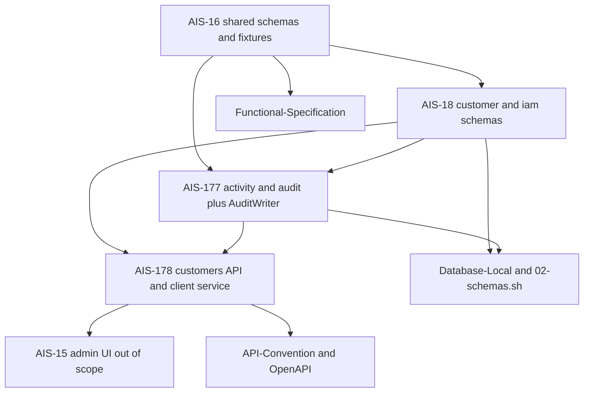

# AIS-14 — Admin customer data layer: implementation plan

**Parent story:** AIS-14 `Admin - cég adatbázis` (data layer only; UI is AIS-15)
**Subtasks:** AIS-16 design · AIS-18 `customer` + `iam` schemas · AIS-177 `activity` + `audit` + `AuditWriter` · AIS-178 `customers` API
**Deferred:** AIS-176 (`service` schema, subscriptions) — explicitly out of scope
**Reference slice:** `api-keys` (AIS-39 → AIS-40 → AIS-41), `docs/Specs/API-Convention.md`, `docs/Specs/Database-Local.md`

---

## 0. Answer to the question: one by one, or all at once?

**Recommendation: one by one — four merges, in the ticket order, on one branch.**

```text
AIS-14-customers-data-layer (branch)
  commit 1  AIS-16:  feat(shared): add customers contract schemas and fixture
  commit 2  AIS-18:  feat(db): add customer and iam schemas with migration
  commit 3  AIS-177: feat(db,api): add activity and audit schemas with AuditWriter
  commit 4  AIS-178: feat(api): add customers endpoints and client service
```

Rationale, in order of weight:

| # | Reason | Consequence of merging everything at once |
| --- | --- | --- |
| 1 | The migration is the only irreversible artefact. Two migrations (`customer`+`iam`, then `activity`+`audit`) are reviewable and independently revertible. | One migration creating 9 tables, 8 enums, 4 schemas and 3 indexes cannot be reviewed line by line, and cannot be partially backed out when the review finds one wrong constraint. |
| 2 | The DoDs are verifiable separately; each subtask closes with its own evidence. | A single opaque "story DoD" makes it impossible to say which layer broke when CI goes red. |
| 3 | The gates are cross-package (`shared` → `api-client` → `admin`). A new registry entry breaks `api-client` coverage; a new error code breaks the admin copy parity test. Small diffs keep a red gate attributable. | A 2 000-line diff with three red gates has no bisect point. |
| 4 | AIS-178 alone is ~22 endpoints across 6 resources. It deserves a dedicated review pass. | Reviewer fatigue is where schema mistakes survive. |

**What "one by one" does *not* mean:** four branches and four rebase cycles. It means **one branch, four commits, four review checkpoints** — each checkpoint green (`pnpm test`, `pnpm lint`, `pnpm -r build`) before the next commits are written. Merging can happen per checkpoint (four PRs) or once at the end (one PR, four commits), whichever the reviewer prefers; the *commits* must stay separate so the ticket–code link (`AIS-18: ...`) is preserved.

---

## 1. Dependency and gate map



Hard rule discovered during analysis: **the shared registry entry, the API client service method and the Nest controller must land in the same commit.** Three gates enforce this:

- `packages/api-client/test/service-coverage.test.ts` — every `operationId` namespace needs a factory in `packages/api-client/src/service.registry.ts`;
- `packages/shared/test/endpoint-registry.test.ts` — every entry needs a payload in `SAMPLE_PAYLOADS`;
- `apps/api/test/envelope-contract.e2e-spec.ts` — every enveloped controller route must be registered, and the OpenAPI document is generated from the registry.

Therefore `customers.contract.ts` (the registry file) belongs to **AIS-178**, not AIS-16. AIS-16 delivers the *decision record* of the operation list and error codes; the file itself is written where it can be backed by a controller.

---

## 2. Pre-flight findings (things the ticket text does not say)

These were verified against the code and must be decided/handled before implementation starts.

| # | Finding | Handling |
| --- | --- | --- |
| F1 | `ErrorContext` / `RequestContext` carry only `requestId` + `method`. There is **no admin authentication yet**, so `AuditWriter` has no actor to record. | **Decision needed** (§7 D-A). Default proposal: `actor_type='system'`, `actor_name='system'`, `source='admin_api'` until the auth story lands, and a single `AuditActorSupplier` abstraction the auth story then implements. |
| F2 | `audit_logs` immutability **cannot be enforced by grants**: migrations run as the `aisztens` app role, which owns the table, and an owner has `UPDATE`/`DELETE` regardless of `GRANT`. | Enforce with a `BEFORE UPDATE OR DELETE` trigger that raises; keep the grants as documented intent for the human roles. AIS-177 test asserts the raise. |
| F3 | `infra/postgres/init/02-schemas.sh` runs **before** migrations and **only on an empty volume**, so it cannot `GRANT` on tables. | Schema `USAGE` + `CREATE` go there; table-level grants, the trigger and default privileges go into a hand-written `drizzle-kit generate --custom` migration, so `db:generate` never rewrites them. |
| F4 | `db:migrate` runs `dist/migrate.js`. | Local flow is always `pnpm --filter @callback/api build` → `db:migrate`. Already in AIS-18; repeated in the runbook step. |
| F5 | New `API_ERROR_CODE` values break `apps/admin/src/lib/api-error-code.test.ts`, which asserts the admin catalogue has exactly the shared code set. | Any commit that adds a code also adds its Hungarian copy to `apps/admin/src/lib/api-error-code.const.ts` and `error-message.const.ts`. |
| F6 | The composite FK `contacts (customer_id, customer_user_id) → customer_users (customer_id, id)` needs `UNIQUE (customer_id, id)` on `iam.customer_users`, which the ticket does not list. | Add the unique index in AIS-18. |
| F7 | `customer_number` (`AIS-YYYYMM-NNN`) has no generation strategy defined. A `count(*)`-based generator races under concurrent inserts. | **Decision needed** (§7 D-B). Default proposal: a `customer.number_counters` row per `YYYYMM` updated with `UPDATE ... RETURNING`, inside the same transaction as the insert. |
| F8 | Jira still links `docs/temp/2026-11-15-ugyfel-adatmodell-es-naplo-terv.md`; the document now lives at [`docs/plans/2026-11-15--13-15-00-ugyfel-adatmodell-es-naplo-terv.md`](2026-11-15--13-15-00-ugyfel-adatmodell-es-naplo-terv.md). | Reference the new path in AIS-16 output; optionally fix the Jira description. |
| F9 | `inet` and `bigint` identity columns are new column types for this repo (only `uuid`/`text`/`timestamp` exist today). | AIS-177 uses `inet('ip_address')` and `bigint('id', { mode: 'number' }).generatedAlwaysAsIdentity()`; both need a `schema.spec.ts` assertion so a Drizzle upgrade cannot silently change them. |

---

## 3. AIS-16 — contract design (no API surface yet)

**Deliverable:** the field set is frozen in code and in the specs; nothing registers an endpoint.

1. `packages/shared/src/contract/customers/`
   - `customers.const.ts` — `CUSTOMERS_PATH`, param constants, sort columns.
   - `customers.enums.ts` — the 9 enums as `z.enum` + exported union types (`customer_type`, `customer_status`, `customer_source`, `headcount_range`, `contact_role`, `customer_user_role`, `customer_user_status`, `operator_role`, `activity_type`, `author_type`, `audit_operation`, `audit_source`). Reuse the SQL enum value lists as the single source, so AIS-18 and AIS-178 cannot drift.
   - `customers.schema.ts` — `customerSchema` (read), `customerListSchema`, `createCustomerSchema`, `updateCustomerSchema` (with `updatedAt` concurrency token, mirroring `api-keys.update.ts`), `contactSchema`, `customerUserSchema`, `activitySchema`, `auditLogSchema`. Every optional read field is `nullable()`, every optional request field is omitted-or-valid, `.strict()` on requests.
   - `customers.list-query.ts` — list-query built from the shared factory with search over `legalName`/`taxNumber`/`customerNumber` and filters `type`, `status`, `source`, `responsibleOperatorId`.
   - `customers.fixture.ts` — `VALID_CUSTOMER`, `VALID_CUSTOMER_LIST`, `VALID_CREATE_CUSTOMER_REQUEST`, `VALID_UPDATE_CUSTOMER_REQUEST`.
   - `customers.interface.ts` — row/view types and the enum unions re-exported.
2. Format schemas: **reuse** `hu-tax-number.schema.ts`, `hu-postal-code.schema.ts`, `phone.schema.ts`, `email.schema.ts` (AIS-112). No new regex. Add `customer-number.schema.ts` only if the `AIS-YYYYMM-NNN` format needs a client-side parse.
3. Tests in `packages/shared/test/`: `customer.schema.test.ts`, `customer-list-query.test.ts`, `customer-number.schema.test.ts` — happy path, missing required field, wrong tax-number format, non-E.164 phone, unknown key rejection, `null`-vs-absent behaviour.
4. Docs: `docs/Specs/Functional-Specification.md` gets the customer feature row; `docs/Specs/API-Convention.md` §4.1 gains the `customers` list filters as an example (it is currently the only resource with four filters).
5. Explicitly **not** in this commit: `customers.contract.ts`, error codes (they belong with the endpoints in AIS-178 — a code no endpoint emits would fail the "codes in use" review).

**Exit criteria:** `pnpm --filter @callback/shared test` green; no route, no migration, no registry change.

---

## 4. AIS-18 — `customer` + `iam` schemas

1. `apps/api/src/db/schema.ts` — add `pgEnum`s and `pgSchema('customer')`, `pgSchema('iam')` following the existing file's conventions: every column spelled out, `TIMESTAMP_PRECISION = 3`, `deleted_at` on `customers`/`contacts`, named unique constraints (`customers_customer_number_key`, `customers_tax_number_key`, `customer_users_email_key`, `tags_name_key`, `operators_email_key`) so `23505` → `409` can be mapped by constraint name, as `api-keys.error-guard.ts` already does.
2. Constraints the ticket implies but does not list (F6): `UNIQUE (customer_id, id)` on `customer_users` for the composite FK; `UNIQUE (customer_id) WHERE role = 'owner' AND status = 'active'` via a partial `uniqueIndex(...).where(...)`; partial unique tax number with `WHERE tax_number IS NOT NULL AND deleted_at IS NULL`; `CHECK (tax_number ~ '^\d{8}-[1-5]-\d{2}$')`.
3. `customer.number_counters` (F7) — one row per `YYYYMM`, `last_value integer`, updated with `UPDATE ... RETURNING` inside the insert transaction.
4. `infra/postgres/init/02-schemas.sh` — add `customer` and `iam` to the `CREATE SCHEMA` list and to the `USAGE` matrix, and `customer, iam` to the `CREATE` grant of the app role. Update the header grant matrix table.
5. `scripts/test/_postgres-init-schemas-test.sh` — expect the two new schemas.
6. `apps/api/src/db/schema.spec.ts` — table list, named constraints, enum labels, `NOT NULL`/nullable columns, soft-delete columns; assert `customers` has **no** `note` and **no** billing column.
7. Migration: `pnpm --filter @callback/api db:generate` → review the SQL (`CREATE TYPE` order, `CREATE SCHEMA IF NOT EXISTS`, FK order) → commit SQL + snapshot.
8. `docs/Specs/Database-Local.md` — new section under §9 for the `customer` and `iam` schemas: why they are not in `platform`, the constraint list, and that no billing column exists.

**Exit criteria:** `db:generate`, `db:check`, `build` + `db:migrate` on a fresh local volume, `schema.spec.ts`, `_postgres-init-schemas-test.sh` green.

---

## 5. AIS-177 — `activity` + `audit` + `AuditWriter`

1. Schema: `pgSchema('activity')`, `pgSchema('audit')`; `activities` with the two-FK author pattern and the `CHECK` (`system` → both NULL, `operator` → only `operator_id`, `customer_user` → only `customer_user_id`); partial index `(customer_id, created_at DESC) WHERE deleted_at IS NULL`; `audit_logs` with `bigint` identity PK, no FKs, `inet`, three indexes.
2. `apps/api/src/audit/`
   - `audit-writer.interface.ts` — `AuditWriteInput` + `AuditWriter` interface (one method: `write(entry, transaction)`).
   - `audit-writer.service.ts` — `@Injectable()`, injected `DATABASE`, takes the row from an explicit transaction handle so a business write and its audit row commit together; builds the diff from `before_data`/`after_data` and narrows it to changed keys (`audit-diff.logic.ts`, pure, fully unit-tested).
   - `audit-actor.interface.ts` + `audit-actor.provider.ts` — the single seam for F1: today returns `{ type: 'system', name: 'system' }` and reads `requestId`/`ip`/`user-agent` from the context; the auth story replaces the provider only.
   - `audit.module.ts` — exports `AuditWriter`.
3. Immutability (F2): `drizzle-kit generate --custom --name=audit-immutability` migration containing the `raise_exception` trigger plus the documented grants. Rationale written in the migration header and in `Database-Local.md`.
4. `infra/postgres/init/02-schemas.sh` — `activity`, `audit` in the schema/USAGE lists; app role gets `USAGE` but **not** `CREATE` on `audit`… **unless** the migration needs it. Decision: the migration still creates the table, so `CREATE` stays; the trigger is the guard.
5. Tests: `audit-writer.service.spec.ts` (each operation writes exactly one row, unused transaction rolls back both), `audit-diff.logic.spec.ts` (added/removed/changed keys, JSON null vs missing), `activities` CHECK branches (3 cases) at repository level, e2e `audit-immutability.e2e-spec.ts` proving `UPDATE`/`DELETE` raise.

**Exit criteria:** migration applied, trigger raises in a real DB, `Database-Local.md` updated, `pnpm test` green.

---

## 6. AIS-178 — `customers` API + client service

1. Shared: `customers.contract.ts` with one entry per operation (`customers.list`, `.findById`, `.create`, `.update`, `.updateStatus`, `.remove`, `.listActivities`, `.createActivity`, `.updateActivity`, `.removeActivity`, `.listAuditLogs`, `.listContacts`, `.createContact`, `.updateContact`, `.removeContact`, `.listTags`, `.attachTag`, `.detachTag`, `.listCustomerUsers`, `.inviteCustomerUser`, …), plus `SAMPLE_PAYLOADS` entries in `packages/shared/test/endpoint-registry.test.ts`. New error codes in `error-code.const.ts` + status map + admin copy (F5): `CUSTOMER_NUMBER_CONFLICT`, `CUSTOMER_TAX_NUMBER_CONFLICT`, `CUSTOMER_OWNER_CONFLICT`, `CUSTOMER_PRIMARY_CONTACT_CONFLICT` — all `409`.
2. `apps/api/src/customers/` — the `api-keys` file layout, one file per responsibility: `constants`, `errors` (+ `error-guard` mapping the five named constraints), `filter` (soft-delete), `mapper`, `logic` (paging arithmetic, status-change derivation, `hasMissingData`, `lastActivityAt`), `repository.interface` + `repository`, `service` + `service.interface`, `controller`, `module`. `customers.module.ts` imports `AuditModule`; every write goes through one transaction: row write → `AuditWriter.write`.
3. `packages/api-client/src/customers/` — `customers.const.ts`, `customers.interface.ts`, `customers.service.ts` using `clientPathOf('<operationId>')`; one line in `service.registry.ts`. Tests: success + error for each method, reusing the existing `fetch.mock.ts`.
4. Derived fields computed in SQL, never stored: `lastActivityAt` via a lateral `max(created_at)`, `hasMissingData` via a `CASE`. Both are list projections, so the repository returns them and the mapper only renames.
5. e2e `customers.e2e-spec.ts`: create → list (search + filter) → detail → write activity → the audit row is visible in `GET /:id/audit-logs`; plus `409` cases (duplicate tax number, second owner, second primary contact) and `404`/`422` cases. Uses the existing `database-gate.ts` loud-skip pattern.
6. Docs: `docs/Specs/API-Convention.md` §1.1/§4.1/error-code table; OpenAPI is generated, so `openapi.e2e-spec.ts` proves parity.

**Exit criteria:** all five DoD checks green (`pnpm test`, `pnpm lint`, `pnpm -r build`, `pnpm test:e2e`, `pnpm quality`), existing api-keys behaviour untouched.

---

## 7. Decisions the plan needs confirmed

| Id | Question | Proposal (used unless you change it) |
| --- | --- | --- |
| D-A | Who is the audit actor before admin auth exists? | `actor_type='system'`, `actor_name='system'`, `source='admin_api'` behind an `AuditActorProvider` seam; the auth story implements it without touching the schema. |
| D-B | How is `customer_number` generated? | `customer.number_counters` per `YYYYMM`, `UPDATE ... RETURNING` in the insert transaction; `409` with retry-once on the unique constraint. |
| D-C | Does AIS-16 ship `customers.contract.ts`? | No — registry + client service + controller land together in AIS-178 (see §1). |
| D-D | Are changes/additions audited per resource table (`contacts`, `customer_users`, `tags`) or only for `customers` + `activities`? | Every write in the resource group, `table_name` naming the affected table; cheaper to add now than to backfill. |

---

## 8. Risk register

| Risk | Mitigation |
| --- | --- |
| A hand-edited migration is later rewritten by `db:generate` | Trigger and grants live in a `--custom` migration; the header says "do not regenerate"; `db:check` stays green. |
| Partial unique indexes expressed incorrectly by Drizzle | Assert the generated SQL in the review checklist and in `schema.spec.ts`; keep the predicate literal in one place. |
| The 22-endpoint surface is under-specified | AIS-16 freezes the operation list as a table in the plan/spec; AIS-178 implements only that list, and the envelope-contract e2e fails on any extra route. |
| Admin copy drifts from the error catalogue | The parity test (F5) is the gate; both files change in the same commit. |
| Subscription columns creep back in | `schema.spec.ts` asserts the absence of `service.*`, billing and `note` columns; AIS-176 owns the follow-up. |

---

## 9. Documentation deliverables (per repo rules)

- Plan: this file (`docs/plans/...`).
- History entries: one per merged checkpoint, `docs/history/<timestamp>-ais-<n>-<slug>.md`.
- Milestone: after AIS-177 and AIS-178 land — the audit-immutability/trigger decision and the schema-split rationale are exactly the "future contributor needs context" case → `docs/milestones/<timestamp>-ais-14-customer-data-layer.milestone.md` (English).
- Living specs: `Database-Local.md` (AIS-18, AIS-177), `API-Convention.md` (AIS-16 echo, AIS-178), `Functional-Specification.md` (AIS-16).

---

## 10. Verification commands per checkpoint

```text
shared:  pnpm --filter @callback/shared test
db:      pnpm --filter @callback/api db:generate
         pnpm --filter @callback/api db:check
         pnpm --filter @callback/api build
         pnpm --filter @callback/api db:migrate
infra:   bash scripts/test/_postgres-init-schemas-test.sh
api:     pnpm --filter @callback/api test
         pnpm --filter @callback/api test:e2e
client:  pnpm --filter @callback/api-client test
admin:   pnpm --filter @callback/admin test
all:     pnpm quality && pnpm lint && pnpm -r build && pnpm test
```
