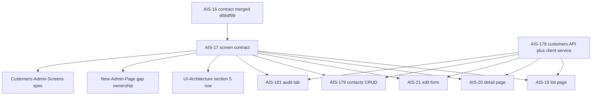

# AIS-17 — Admin customer screens (list, detail): screen-design plan

**Ticket:** AIS-17 `Admin - terv: admin oldal (lista, adatlap)` (subtask of AIS-15 `Admin - cég felület`)
**Design input:** AIS-16 (contract, merged as `d68df99`), [`docs/plans/2026-11-22--00-10-00-ais-14-customers-data-layer-plan.md`](2026-11-22--00-10-00-ais-14-customers-data-layer-plan.md:1), mockup [`docs/temp/12_ugyfelek_admin_mockup.html`](../../docs/temp/12_ugyfelek_admin_mockup.html:1) (untracked, layout reference only)
**Consumers:** AIS-19 (list) · AIS-20 (detail) · AIS-21 (edit form) · AIS-179 (contacts) · AIS-181 (audit tab)
**It is not:** an implementation ticket. No component, no route, no test, no dependency is produced here.

---

## 0. What AIS-17 delivers — and what it explicitly does not

AIS-17 is a **design contract**. Its output is documentation, and its value is that the five
implementation tickets can only write domain code.

| Deliverable | File | Why it is the deliverable |
| --- | --- | --- |
| The screen contract: routes, URL parameters, element→primitive mapping, four-state matrix, decision record | **new** `docs/Specs/Customers-Admin-Screens.md` (living spec) | The ticket asks for element→primitive mapping and the four states per view; a spec doc is the only place a later reader looks for it |
| The page's row in the per-page state plan | `docs/Specs/UI-Architecture.md` §5 | AIS-17 DoD, last bullet |
| The two AIS-174 gaps get an owner | `docs/Specs/New-Admin-Page.md` §2 / §3 | The customers list is the first page that needs both; leaving the rule as-is makes the next page copy a stale statement |
| Decision record D1–D6 (inherited/frozen) + D7–D11 (new, resolved here) | the new spec doc §8 | The ticket's own DoD requires the decisions to be recorded |
| Narrative close-out | `docs/history/<ts>-ais-17-customers-admin-screen-design.md` | Repo documentation rule |
| Decision-grade summary | `docs/milestones/<ts>-customers-admin-screen-contract.milestone.md` | Milestones rule: a feature whose design decisions must survive the chat |

**Out of scope, on purpose:** every mockup block that AIS-16 already excluded — billing data
("Számlázási adatok", "Havi díj"), IBAN, module/subscription blocks, a `note` field. AIS-16 `D4`,
`D9` and the deferred AIS-176 decide those; the mockup is a **layout** reference, not a field list.

---

## 1. Pre-flight findings (verified against the code, not assumed)

| # | Finding | Consequence for the plan |
| --- | --- | --- |
| F1 | `packages/shared/src/contract/customers/` has **no** `customers.contract.ts`, and `endpoint.registry.ts` has no `customers.*` operation. AIS-14 plan `D-C` places the registry, the API client service and the Nest controller in **AIS-178**. | The screen contract names operations (`customers.list`, `customers.findById`, …) by **operationId**, never a live client method. All five implementation tickets are blocked on AIS-178 (see §2). |
| F2 | `apps/admin/src/` has no `pages/customers`, no `features/customers`, no `entities/customer` (the only entity is `entities/api-key`). | The spec must name the files each successor ticket creates, otherwise the layer order in New-Admin-Page §2 gets invented per ticket. |
| F3 | `customerSchema` ([`customers.schema.ts`](../../packages/shared/src/contract/customers/customers.schema.ts:109)) carries `customerNumber`, `type`, `legalName`, `shortName`, `taxNumber`, `status`, `lastActivityAt`, `hasMissingData` — but **no** primary contact. Contacts exist only on `customerDetailSchema.contacts[].roles`. | AIS-17 `D1` requires a primary-contact column that the list contract cannot serve today → **D9** (list projection in AIS-178, or drop the column). |
| F4 | `useListParams(schema)` parses only the list-query schema fields (`page`, `limit`, `sort`, `order`, `q`, `type`, `status`, `source`, `responsibleOperatorId`); `tab` is not one of them. `react.coding-standards.md` §6.2 forbids a component reading `searchParams` itself. | The detail page's `?tab=` needs its own URL reader: `features/api/use-tab-param.ts` + `use-tab-param.logic.ts` (pure tab parsing/fallback), first consumer = customers detail. Must be in the spec, built in AIS-20. |
| F5 | `zustand` is **not** installed (AIS-130 / UI-Architecture §5, §7 row `planned`). | The wizard **does** get a page-local store (**D11**), so `/customers` becomes the first page with one: AIS-19 installs `zustand`, flips UI-Architecture §7's row to `installed` and ships the store test (init → setStep → patch → reset) in the same change. |
| F6 | The mockup's wizard has **5** steps — `1 Típus`, `2 Adószám & név`, `3 Cím & számlázás`, `4 Kapcsolattartó`, `5 Ellenőrzés` ([mockup line 192](../../docs/temp/12_ugyfelek_admin_mockup.html:192)). | Step 3 drops to **Cím** (billing data is excluded); step 4 stutters because a contact is a separate entity with its own CRUD (AIS-16 `D5`, AIS-179). Proposed wizard: **4 steps** — see §4.4. |
| F7 | `New-Admin-Page.md` §2 states the two **documented gaps**: no search/filter UI, no per-row action. AIS-17 `D2`/`D3` require both. | The customers list is the page that closes both gaps. §2's wording and §3's exception table must be updated here, not silently by AIS-19 → **D7**. |
| F8 | `New-Admin-Page.md` §2 (~line 77) and UI-Architecture §5 (~line 975) state the standard list's `EmptyState` carries **no** action button ("two competing create affordances is one too many"), while AIS-17 `D4` requires a CTA in the empty state. | Direct conflict between two closed decisions → **D8**: a documented, named exception for `/customers`. |
| F9 | `DataTable` already takes `rowActions`; `DropdownMenu`, `ConfirmDialog`, `EntityDialog`, `DescriptionList`, `StatusBadge`, `Skeleton`, `EmptyState`, `PageErrorState`, `FormField`, `FormSection`, `FormActions`, `Textarea`, `DatePicker`, `Pagination` all exist in `packages/ui` / `apps/admin/src/components`. | No new primitive is needed by AIS-17's screens. The spec may state that as a finding: **`packages/ui` changes: none**. |
| F10 | The audit-log diff rendering has a precedent: `packages/ui/src/lib/json.logic.ts` (`toPrettyJson`) used by `LogEntryRow`'s `JSON kibontása` toggle (AIS-163). | The audit tab reuses that logic; the spec must forbid a second JSON renderer. |
| F11 | `StatusBadge` only renders a given `variant`; the `status → variant` mapping belongs in `entities/customer`. Seven statuses (`prospect`, `registered`, `trial`, `active`, `suspended`, `churned`, `anonymized`) vs. five badge variants. | The spec must freeze the mapping table → **D10**, and place it in `entities/customer/customer.mapper.ts`. |
| F12 | `DescriptionList` supports `columns: 1 \| 2` plus `isLoading` / `empty`, but has no grouping. | The detail "Cégadatok" tab groups by `Card` + `DescriptionList` per group (not `FormSection`, which is a form fieldset) → **D12**. |

---

## 2. Dependency order (why this plan is design-only)



The design can be written now; the five UI tickets cannot start before `AIS-178` registers the
operations, because a hook with no client method cannot be written and a mocked service would become
a second contract.

---

## 3. The document AIS-17 writes: `docs/Specs/Customers-Admin-Screens.md`

Fixed section list, so the implementation tickets have one place to read:

| § | Content | Satisfies in AIS-17 DoD |
| --- | --- | --- |
| 1 | **Routes and URL contract** — `/customers`, `/customers/new`, `/customers/:id?tab=`, `/customers/:id/edit`, plus the contact/user sub-dialogs; which of them are registry children, which path constant owns which path | `D5`, `D6` |
| 2 | **List screen** — element→primitive table, column order (D1), server-side search and the four filters, sort contract, four-state matrix, loading = `DataTable` skeleton (never a spinner) | element mapping, four states, `D1`, `D2`, `D3`, `D4` |
| 3 | **Detail screen** — six tabs, one element→primitive table per tab, four-state matrix per tab + the 404 copy for an unknown id | element mapping, four states |
| 4 | **Create wizard** — the four steps, the fields per step, which schema validates which step, the state owner (see D11) | element mapping, four states, wizard store row |
| 5 | **Edit surface** — `useAppForm` + `updateCustomerSchema`, `FormSection` grouping, `updatedAt` concurrency, field-error routing via `toFieldErrors` | element mapping |
| 6 | **State plan text** — the exact row that goes into `UI-Architecture.md` §5 | state-row bullet |
| 7 | **Exclusion list** — billing, IBAN, subscriptions, module/fee columns, `note` field, with the ticket reference that owns each | none (prevents scope creep) |
| 8 | **Decision record** — `D1`–`D6` inherited verbatim + `D7`–`D12` decided here | `D1`–`D6` bullet |
| 9 | **Test matrix per view** — what each successor ticket must cover (logic branches, states, error surfaces) | supports the successor DoDs |

The doc starts with `**Utolsó frissítés:** 2026-11-22` because `pnpm quality:docs` rule **R3**
fails a `docs/Specs` document without it.

---

## 4. Content decisions the document must record

### 4.1 List columns (D1, frozen) and what the contract can actually serve

| # | Column | Contract source | Note |
| --- | --- | --- | --- |
| 1 | Ügyfélszám | `customerNumber` | sortable (`customerNumber`) |
| 2 | Név | `shortName ?? legalName` | mapper decides the fallback, one place |
| 3 | Típus | `type` | enum label from `customers.enums.ts` |
| 4 | Adószám | `taxNumber` (`null` → „—” + hiányos jelzés) | never a literal placeholder in JSX |
| 5 | Státusz | `status` → `StatusBadge` | mapping is **D10** |
| 6 | Elsődleges kapcsolattartó | **not in the row** (F3) | **D9** |
| 7 | Utolsó aktivitás | `lastActivityAt` | `lib/date.ts` formatting, `null` → „—” |
| 8 | Hiányos adat jelzés | `hasMissingData` | icon/badge in the row, `aria-label` required |

### 4.2 Four states per view (the matrix the spec must fill)

| View | Loading | Empty | Error | Success |
| --- | --- | --- | --- | --- |
| List | `DataTable` skeleton rows + `sr-only` sentence | `EmptyState` with CTA (`D4`, exception `D8`) | `PageErrorState` + retry when `errorSurface === 'page'`; `banner` left to the layout | table + `Pagination` |
| Detail (per tab) | `DescriptionList is_loading` / `Skeleton` for `DataTable` tabs | per-tab copy (e.g. „Nincs rögzített tevékenység”) | `PageErrorState` + retry; 404 = its own copy, not a generic error | tab content |
| Wizard | submit `isLoading` on `FormActions` | n/a (no collection) | `field` → the input, `page` → the form's `Alert`/capture toast | close + toast + list invalidation |
| Edit | initial read skeleton | n/a | `field` → input; `409 STALE_WRITE` → `page` tier, window stays open (AIS-172 precedent) | close + toast + invalidation |

### 4.3 Tabs in the URL

`?tab=overview|data|contacts|users|activity|audit`, default `overview`, invalid value falls back to
the default **instead of throwing** (the `useListParams` rule). Reader:
`features/api/use-tab-param.ts` + pure `use-tab-param.logic.ts` (`parseTab`, `toTabPatch`), tested;
one URL write per user interaction.

### 4.4 Wizard shape (correcting the mockup, F6)

| Step | Title | Fields | Validated by |
| --- | --- | --- | --- |
| 1 | Típus | `type` (radio group; `individual` absent from the enum) | step schema |
| 2 | Adószám & név | `legalName` (required), `shortName`, `taxNumber`, `euVatNumber`, `companyRegistrationNumber`, `legalForm` | step schema |
| 3 | Cím | `registeredAddressZip`, `…City`, `…Line`, `…Country` (default `HU`) | step schema |
| 4 | Ellenőrzés | read-only `DescriptionList` of everything + submit | `createCustomerSchema` |

Contacts, users, tags are **not** wizard steps: they are separate resources with their own CRUD
(AIS-16 `D5`, AIS-179). The mockup's step 4 and the billing half of its step 3 are dropped, and the
spec says why.

The wizard's state is a **page-local Zustand store** (**D11**, confirmed):

| Concern | Owner | Why |
| --- | --- | --- |
| Which step is open | the **URL** (`?step=1..4`) | reload, back button and a copied link must land on the same step |
| The step's own inputs | `useAppForm` (react-hook-form) | form state is always RHF (§0.3 / §6) |
| The values carried **between** steps | `pages/customers/customers-wizard.store.ts` | two sibling step components share them; RHF seeds `defaultValues` on mount only, so a per-step form cannot hand a value to the next step without a store |
| Reset on leave | the store factory is created once per mount (provider in the page folder) | navigation away disposes it — no draft leaks into the next wizard run |

The store carries only **transient draft data** (`customerType`, typed-but-unsubmitted names/address
fields) and the actions `setStepDraft`, `reset`; it never holds a server payload and never mirrors the
URL's `step`.

---

## 5. Decisions to confirm (D7–D12)

`D1`–`D6` are closed in the ticket and are copied into the spec unchanged. The following are the
questions the ticket leaves open; each has a proposal that is used unless you change it.

| Id | Question | Proposal (default) |
| --- | --- | --- |
| **D7** | The customers list closes the two AIS-174 gaps (search input, per-row action). In which ticket? | **In AIS-19, this page.** The contract already exposes `q` and the four filters; shipping half the list and "fixing" it later would produce two list implementations. `New-Admin-Page.md` §2 gets the ownership sentence, AIS-19 becomes the first page that exercises `search`. |
| **D8** | `EmptyState` with a CTA contradicts AIS-174 ("two competing create affordances"). | **Documented exception for `/customers`** in `New-Admin-Page.md` §3: the header action and the empty-state CTA both navigate to `/customers/new`, and AIS-17 `D4` was closed with that requirement. The rule keeps its default for every other page. |
| **D9** | Primary-contact column vs. the list contract (F3). | **AIS-178 adds a derived list projection `primaryContactName`** (`contacts` where `roles` contains `primary`), documented next to `lastActivityAt`/`hasMissingData` as derived-not-stored. Fallback if that is rejected: the column is dropped and the information lives on the detail's Overview tab only. |
| **D10** | `status` → badge variant, 7 statuses into 5 variants. | `active` → `success`; `trial` → `info`; `prospect` → `neutral`; `registered` → `info`; `suspended` → `warning`; `churned` → `danger`; `anonymized` → `neutral` + the label „Anonimizált”. Lives in `entities/customer/customer.mapper.ts`, covered by a table test. |
| **D11** | Does the wizard need a page-local Zustand store? (AIS-17 DoD mentions one; `zustand` is not installed.) | **Yes — page-local store (confirmed).** `pages/customers/customers-wizard.store.ts` holds the transient draft carried between the steps plus `reset`; the step itself lives in the URL (`?step=`) and each step's inputs stay in `useAppForm`. `zustand` is installed by AIS-19 in the same change, UI-Architecture §7's `zustand` row flips to `installed`, and the store ships with tests (init → action → selector → reset). The store is created by a `CustomersWizardStoreProvider` inside the page folder and never exported outside it. |
| **D12** | How is the "Cégadatok" tab grouped? | `Card` per group + `DescriptionList` inside (`columns: 2`), because `FormSection` is a `<fieldset>` for form controls, and the tab is read-only. |
| **D13** | Where does the AIS-17 spec live? | **New living spec** `docs/Specs/Customers-Admin-Screens.md`, linked from UI-Architecture §5's row and from `Functional-Specification.md` O1. Alternative: fold it into UI-Architecture §5, which would make that document a per-feature catalogue — not recommended. |

---

## 6. Ordered work (each step is one reviewable change)

| # | File | What must exist | Done when |
| --- | --- | --- | --- |
| 1 | `docs/Specs/Customers-Admin-Screens.md` (new) | Header (`**Utolsó frissítés:**`), metadata (ticket, consumers, out-of-scope), §1 route/URL contract | every route named with its owner path constant (`app/app.const.ts` for the list, `customers.const.ts` for page-owned paths) |
| 2 | same | §2 list: column table (§4.1), element→primitive table, filter/sort/search contract, four-state matrix | every ticket-named element (header, filters, table, pager, skeleton, empty, error, row actions) has a primitive |
| 3 | same | §3 detail: six tabs × element→primitive + four-state matrix + 404 copy | `?tab=` contract (§4.3) written, including the invalid-value fallback |
| 4 | same | §4 wizard: 4 steps, fields, step validation, the store contract (shape, actions, reset rule, provider placement) per D11 | step count, dropped mockup parts and the store's boundaries are explained |
| 5 | same | §5 edit surface + §7 exclusion list | billing/subscription/`note`/IBAN each named with its owning ticket |
| 6 | same | §8 decisions: `D1`–`D6` verbatim + `D7`–`D12` resolved with rationale | no open question left in the document |
| 7 | same | §9 test matrix per view | each successor ticket can copy its own row into its DoD |
| 8 | `docs/Specs/UI-Architecture.md` §5 | The `pages/customers` row: server state (hooks to be created in AIS-19…181), URL state (list params + `tab` + `step`), page store decision (D11), form state (`useAppForm` + shared schemas) + `**Utolsó frissítés:**` bump | row present, §7 `zustand` row untouched (still not installed) |
| 9 | `docs/Specs/New-Admin-Page.md` §2/§3 | The two documented gaps get the owner `AIS-19`; §3 exception table gains the customers empty-state CTA row; date bump | the doc no longer claims "no page exposes `search`" without a pointer |
| 10 | `docs/Specs/Functional-Specification.md` | O1 row's "felület: AIS-15" gets the pointer to the new spec doc; date bump | link resolves (R1) |
| 11 | — | `pnpm quality:docs` and `pnpm test:quality` | both green, no new `§N` reference without a matching section |
| 12 | `docs/history/<YYYY-MM-DD--HH-ii-ss>-ais-17-customers-admin-screen-design.md` | The narrative: what was decided, what was found, which tickets unblocked | file exists, English filename |
| 13 | `docs/milestones/<YYYY-MM-DD--HH-ii-ss>-customers-admin-screen-contract.milestone.md` | One page: the design contract, the D7–D12 decisions, the mockup exclusions | ≤ ~700 words |

### AIS-17 DoD → evidence

| DoD bullet | Satisfied by |
| --- | --- |
| Every screen element names its primitive and pattern | steps 2–5, and F9 records that no `packages/ui` change is needed |
| The four states exist for every view | step 2/3 matrices, §4.2 |
| `D1`–`D6` recorded | step 6 |
| State-plan row in UI-Architecture §5 (`pages/customers`, tab in the URL, wizard store) | step 8 — the row names the store per `D11`, the `?tab=`/`?step=` URL state and the form state |

---

## 7. Risks

| Risk | Mitigation |
| --- | --- |
| The spec drifts from the mockup, and a later ticket "restores" billing or subscription blocks | The exclusion list (§7 of the doc) names each block with the owning ticket; AIS-17's own DoD already forbids a second visual concept |
| The screen contract is written against an API that does not exist yet (F1) | Operations are named by `operationId`; `D9` is the only place the design asks AIS-178 for something new, and it is a contract change, not a UI workaround |
| The wizard store grows into a second source of truth (URL step, RHF values, or a server payload copied in) | `D11` fixes its boundary to transient draft data only, `reset` is part of the contract, and the §7 `zustand` row plus the store test are the machine-checkable proof |
| `?tab=`/`?step=` readers grow into a second `useListParams` | One generic hook per parameter family, in `features/api/`, with pure logic + tests; no component reads `searchParams` |
| The customers page closes the AIS-174 gaps and no other page learns the pattern | `New-Admin-Page.md` §2 is updated in the same change (step 9), so the next page reads the new rule, not the old absence |
| `quality:docs` red by a new document | Step 11 is a gate, not an afterthought: date header, resolvable relative links, `§N` references that exist |

---

## 8. Verification commands

```text
docs gates:  pnpm quality:docs
             pnpm test:quality
full gate:   pnpm quality
```

There is no code to typecheck in this ticket; the only executable proof is the documentation gate.
