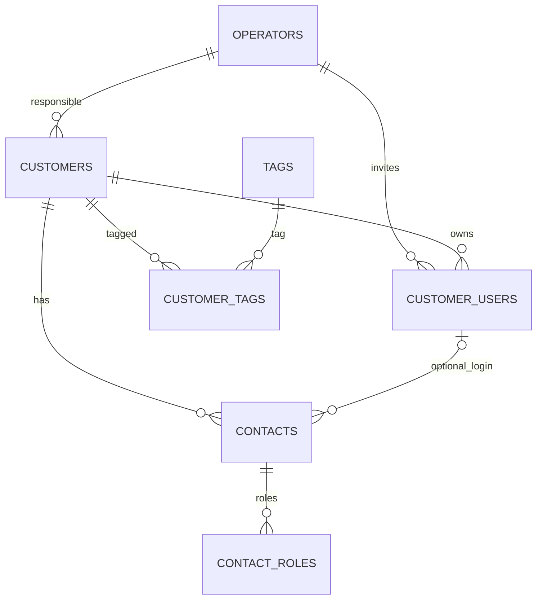

# AIS-18 — `customer` and `iam` database tables (implementation plan)

**Ticket:** AIS-18 `Admin - impl: adatbázis táblák létrehozás` (subtask of AIS-14)
**Contract source:** AIS-16 → [`customers.schema.ts`](../../packages/shared/src/contract/customers/customers.schema.ts:1), [`customers.enums.ts`](../../packages/shared/src/contract/customers/customers.enums.ts:1)
**Data model:** [`2026-11-15--13-15-00-ugyfel-adatmodell-es-naplo-terv.md`](2026-11-15--13-15-00-ugyfel-adatmodell-es-naplo-terv.md) §3
**Pattern source:** [`api_keys`](../../apps/api/src/db/schema.ts:69) (AIS-39 / AIS-108)
**Scope:** schema-as-code + migration + snapshot + bootstrap grants + tests + docs. **No** repository, service, controller or UI — those are AIS-178 / AIS-177 / AIS-19.

---

## 1. Goal

Eight Postgres enum types and seven tables in two new schemas (`customer`, `iam`), generated into a
versioned Drizzle migration, so AIS-177 (activity + audit) and AIS-178 (customers API) can build on a
schema that already carries every constraint the contract promises.

Deliberately **not** in this ticket: `activity` and `audit` schemas (AIS-177 owns them and their grants),
the `service` schema (AIS-176), any billing column, `customers.note`.

---

## 2. Decisions

| #   | Question | Decision |
| --- | --- | --- |
| D1 | Where do the enum **values** come from? | From the exported tuples in `@callback/shared` (`CUSTOMER_TYPE_VALUES`, …). The DB enums and the Zod contract then cannot drift. |
| D2 | `customer_number` generation | **Not** in this ticket. The column is `text NOT NULL` with a named unique constraint; the generator belongs to AIS-178 (see §8). |
| D3 | One file or a folder for the schema? | Keep the single [`schema.ts`](../../apps/api/src/db/schema.ts:1). It stays under ~350 lines and `drizzle.config.ts` already points at it. |
| D4 | `iam.operators` timestamps | Ticket-strict: `id, name, email, role, is_active` only. No `created_at`/`updated_at`. |
| D5 | “One primary contact” via `CHECK` | A table `CHECK` cannot read `contacts.customer_id`. Use a **composite FK** `contact_roles (contact_id, customer_id) → contacts (id, customer_id)`, which needs `UNIQUE (id, customer_id)` on `contacts`. Same mechanism for `contacts → customer_users`. |
| D6 | Soft-deleted contact keeps the `primary` role | `contact_roles` has no `deleted_at`, so a partial unique index would stay occupied forever. Rule for AIS-178: deleting a contact deletes its `contact_roles` rows (roles are not history). |
| D7 | `password_hash` nullability | Nullable — an `invited` user has no password yet. |
| D8 | Empty-value defaults | `registered_address_country` defaults to `'HU'`; `is_active` defaults to `true` on `tags`, `contacts`, `operators`. No DB default for `status` (the API sends `'prospect'`). |

---

## 3. Shape



Creation order matters, because Drizzle emits foreign keys inline in `CREATE TABLE`:

`iam.operators` → `customer.customers` → `customer.tags` → `customer.customer_tags` →
`iam.customer_users` → `customer.contacts` → `customer.contact_roles`

`customer.contacts` points at `iam.customer_users` and `iam.customer_users` points back at
`customer.customers`. That cross-schema pair is intentional: a customer user is **owned** by a customer
(`ON DELETE CASCADE`), while a contact **optionally links** to one.

---

## 4. Enums

| Schema | Type | Values (source tuple) |
| --- | --- | --- |
| `customer` | `customer_type` | `CUSTOMER_TYPE_VALUES` |
| `customer` | `customer_status` | `CUSTOMER_STATUS_VALUES` |
| `customer` | `customer_source` | `CUSTOMER_SOURCE_VALUES` |
| `customer` | `headcount_range` | `HEADCOUNT_RANGE_VALUES` |
| `customer` | `contact_role` | `CONTACT_ROLE_VALUES` |
| `iam` | `customer_user_role` | `CUSTOMER_USER_ROLE_VALUES` |
| `iam` | `customer_user_status` | `CUSTOMER_USER_STATUS_VALUES` |
| `iam` | `operator_role` | `OPERATOR_ROLE_VALUES` |

Declared as `customerSchema.enum('customer_type', [...CUSTOMER_TYPE_VALUES])` (the spread is needed
because Drizzle expects a mutable tuple).

---

## 5. Tables

Every column name is spelled out in `snake_case` (no `casing` option in this config). Every timestamp is
`timestamptz` with `precision: 3`, reusing the existing `TIMESTAMP_PRECISION` constant.

### `iam.operators`

| Column | Type | Constraints |
| --- | --- | --- |
| `id` | `uuid` | PK, `defaultRandom()` |
| `name` | `text` | NOT NULL |
| `email` | `text` | NOT NULL, UNIQUE `operators_email_key` |
| `role` | `operator_role` | NOT NULL |
| `is_active` | `boolean` | NOT NULL, `default(true)` |

### `customer.customers`

| Column | Type | Constraints |
| --- | --- | --- |
| `id` | `uuid` | PK, `defaultRandom()` |
| `customer_number` | `text` | NOT NULL, UNIQUE `customers_customer_number_key` |
| `type` | `customer_type` | NOT NULL |
| `legal_name` | `text` | NOT NULL |
| `short_name` | `text` | nullable |
| `tax_number` | `text` | nullable, partial unique + format check (below) |
| `eu_vat_number` | `text` | nullable |
| `company_registration_number` | `text` | nullable |
| `legal_form` | `text` | nullable |
| `registered_address_zip` | `text` | nullable |
| `registered_address_city` | `text` | nullable |
| `registered_address_line` | `text` | nullable |
| `registered_address_country` | `text` | NOT NULL, `default('HU')` |
| `industry` | `text` | nullable |
| `headcount_range` | `headcount_range` | nullable |
| `source` | `customer_source` | nullable |
| `responsible_operator_id` | `uuid` | nullable, FK → `iam.operators(id)` `ON DELETE SET NULL` |
| `status` | `customer_status` | NOT NULL |
| `status_changed_at` | `timestamptz(3)` | NOT NULL, `defaultNow()` |
| `created_at` / `updated_at` | `timestamptz(3)` | NOT NULL, `defaultNow()`, `updatedAt` uses `$onUpdate` |
| `deleted_at` | `timestamptz(3)` | nullable — soft delete |

### `customer.tags`

| Column | Type | Constraints |
| --- | --- | --- |
| `id` | `uuid` | PK, `defaultRandom()` |
| `name` | `text` | NOT NULL, UNIQUE `tags_name_key` |
| `is_active` | `boolean` | NOT NULL, `default(true)` |

### `customer.customer_tags`

| Column | Type | Constraints |
| --- | --- | --- |
| `customer_id` | `uuid` | NOT NULL, FK → `customers(id)` `ON DELETE CASCADE` |
| `tag_id` | `uuid` | NOT NULL, FK → `tags(id)` `ON DELETE CASCADE` |

Composite PK `customer_tags_pkey (customer_id, tag_id)`; index `customer_tags_tag_id_idx (tag_id)`.

### `iam.customer_users`

| Column | Type | Constraints |
| --- | --- | --- |
| `id` | `uuid` | PK, `defaultRandom()` |
| `customer_id` | `uuid` | NOT NULL, FK → `customer.customers(id)` `ON DELETE CASCADE` |
| `name` | `text` | NOT NULL |
| `email` | `text` | NOT NULL, unique index `customer_users_email_key` on `lower(email)` |
| `password_hash` | `text` | nullable (D7) |
| `role` | `customer_user_role` | NOT NULL |
| `status` | `customer_user_status` | NOT NULL |
| `invited_by_operator_id` | `uuid` | nullable, FK → `iam.operators(id)` `ON DELETE SET NULL` |
| `invited_at` / `accepted_at` / `last_login_at` | `timestamptz(3)` | nullable |
| `created_at` / `updated_at` | `timestamptz(3)` | NOT NULL, `defaultNow()`, `$onUpdate` |

Also: UNIQUE `customer_users_customer_id_id_key (customer_id, id)` — the target of the `contacts`
composite FK — plus UNIQUE index `customer_users_customer_owner_key (customer_id)` `WHERE role = 'owner' AND status = 'active'` and index `customer_users_customer_id_idx (customer_id)`.

### `customer.contacts`

| Column | Type | Constraints |
| --- | --- | --- |
| `id` | `uuid` | PK, `defaultRandom()` |
| `customer_id` | `uuid` | NOT NULL, FK → `customers(id)` `ON DELETE CASCADE` |
| `name` | `text` | NOT NULL |
| `position` | `text` | nullable |
| `email` | `text` | nullable |
| `phone` | `text` | nullable |
| `customer_user_id` | `uuid` | nullable — `NULL` = not a login user |
| `is_active` | `boolean` | NOT NULL, `default(true)` |
| `created_at` / `updated_at` | `timestamptz(3)` | NOT NULL, `defaultNow()`, `$onUpdate` |
| `deleted_at` | `timestamptz(3)` | nullable |

Also: UNIQUE `contacts_id_customer_id_key (id, customer_id)` (FK target), index
`contacts_customer_id_name_idx (customer_id, name)`, and the composite FK
`(customer_id, customer_user_id) → iam.customer_users (customer_id, id)` with default `NO ACTION`.
`MATCH SIMPLE` behaviour is what we want: when `customer_user_id IS NULL` the FK is not checked.

### `customer.contact_roles`

| Column | Type | Constraints |
| --- | --- | --- |
| `contact_id` | `uuid` | NOT NULL |
| `role` | `contact_role` | NOT NULL |
| `customer_id` | `uuid` | NOT NULL — denormalised, so the index below can be partial |

Composite PK `contact_roles_pkey (contact_id, role)`; composite FK
`(contact_id, customer_id) → contacts (id, customer_id)` `ON DELETE CASCADE`; UNIQUE index
`contact_roles_primary_key (customer_id)` `WHERE role = 'primary'`.

### `customers` checks

```sql
CONSTRAINT "customers_tax_number_format_check"
  CHECK (tax_number IS NULL OR tax_number ~ '^\d{8}-[1-5]-\d{2}$')
CREATE UNIQUE INDEX "customers_tax_number_key"
  ON "customer"."customers" ("tax_number")
  WHERE "tax_number" IS NOT NULL AND "deleted_at" IS NULL
```

---

## 6. Bootstrap grants — `infra/postgres/init/02-schemas.sh`

The app role must be able to create objects in the two new schemas, otherwise `db:migrate` stops with
`permission denied for schema customer`.

| Schema | `aisztens` (app) | `tkovari` | `krak` |
| --- | --- | --- | --- |
| `platform` | USAGE + CREATE | USAGE | USAGE |
| `email` | USAGE | USAGE | USAGE |
| `customer` | USAGE + **CREATE** | USAGE | USAGE |
| `iam` | USAGE + **CREATE** | USAGE | USAGE |

Changes: two `CREATE SCHEMA IF NOT EXISTS` lines, `customer`/`iam` added to the USAGE `VALUES` list, and
the CREATE `VALUES` list grows from `('platform')` to `('platform'),('customer'),('iam')`. Header comment
(the grant matrix) and the `\echo` message follow.

> On an existing `pgdata` volume the init scripts never run again. Re-apply them manually (command in
> [`Database-Local.md`](../../docs/Specs/Database-Local.md:160)) before `db:migrate`, otherwise the
> migration's own `CREATE SCHEMA IF NOT EXISTS` creates the schema with the app role as owner — it works,
> but the ownership and the grant matrix then differ from a fresh droplet.

---

## 7. Files

| File | Change |
| --- | --- |
| [`apps/api/src/db/schema.ts`](../../apps/api/src/db/schema.ts:1) | + 8 `pgEnum`s, + 7 tables, + row types (`CustomerRow`, `NewCustomerRow`, …); new header note for AIS-18 |
| `apps/api/drizzle/0005_*.sql` + `meta/0005_snapshot.json` | **new, generated** by `db:generate`, committed |
| [`apps/api/src/db/schema.spec.ts`](../../apps/api/src/db/schema.spec.ts:1) | + per-table contract blocks (columns, nullability, defaults, named constraints, indexes, checks, FKs) + assertions on the generated `0005` SQL |
| [`infra/postgres/init/02-schemas.sh`](../../infra/postgres/init/02-schemas.sh:1) | two new schemas, updated CREATE/USAGE lists, updated matrix comment |
| [`scripts/test/_postgres-init-schemas-test.sh`](../../scripts/test/_postgres-init-schemas-test.sh:1) | expected values 2→4 schemas, 6→12 USAGE, 1→3 CREATE; CREATE loop over three schemas |
| [`scripts/test/lib/20-cross-service.sh`](../../scripts/test/lib/20-cross-service.sh:118) | the same three smoke SQL literals and expected counts |
| [`docs/Specs/Database-Local.md`](../../docs/Specs/Database-Local.md:1) | bootstrap table + grant matrix, new section on the `customer`/`iam` tables and their constraints, header date |
| [`docs/Specs/Infrastructure-Docker.md`](../../docs/Specs/Infrastructure-Docker.md:169) | §6.2 grant matrix, smoke expectation note (2/6/1 → 4/12/3), header date |
| `docs/history/…-ais-18-customer-iam-schemas.md` | change narrative (mandatory) |
| `docs/milestones/…-ais-18-customer-iam-schemas.milestone.md` | decision-grade summary (multi-file, infra-touching change) |

`knip` ignores `apps/api`, so the new exports do not trip the dead-code gate before AIS-178 uses them.

---

## 8. Follow-ups (explicitly out of scope)

- **`customer_number` generation (AIS-178).** Simplest working approach: inside the create transaction,
  `SELECT max(customer_number) ... WHERE customer_number LIKE 'AIS-<YYYYMM>-%'`, increment, insert, and
  retry once on `23505 customers_customer_number_key`. If monthly volume ever makes that too hot, a
  two-column `customer.customer_number_counters (period, last_value)` table is a drop-in replacement —
  it is not needed today.
- `activity` / `audit` schemas and `AuditWriter` — AIS-177.
- List-filter indexes (`status`, `type`, `responsible_operator_id`) — add when AIS-178 measures the list
  query, not speculatively.

---

## 9. Verification

```bash
pnpm --filter @callback/api db:generate     # writes 0005_*.sql + meta snapshot
pnpm --filter @callback/api db:check
pnpm --filter @callback/api build           # db:migrate runs dist/migrate.js
pnpm --filter @callback/api db:migrate
pnpm --filter @callback/api test
bash scripts/test/_postgres-init-schemas-test.sh
pnpm quality:docs
```

Manual database checks:

```bash
docker compose --env-file infra/.env.local -f infra/docker-compose.db.yml \
  exec -T postgres psql -U aisztens -d aisztens_db \
  -c "\dt customer.*" -c "\dt iam.*" -c "\d+ customer.contact_roles"
```

Expected: seven tables, the eight enum types, every named constraint and partial index from §5, and no
`note`, billing or subscription column anywhere.

---

## 10. Risks

| Risk | Mitigation |
| --- | --- |
| Wrong `CREATE TABLE` order breaks the inline FKs | Keep the order in §3; `db:generate` emits it in definition order |
| Composite FK rejected by Postgres (`no unique constraint matching given keys`) | The two `UNIQUE (…, id)` targets in §5 exist for exactly this reason — assert them in `schema.spec.ts` |
| Existing local volume has no `customer`/`iam` schema | Re-run `02-schemas.sh` before `db:migrate` (§6) |
| `schema.spec.ts` hardcodes the migration filename | Reference the generated name once, in a single `MIGRATION_FILE` constant, like the existing `0002`/`0003`/`0004` blocks |
| Grants test and smoke test drift apart | Update both in the same change; both assert the same 4/12/3 numbers |
