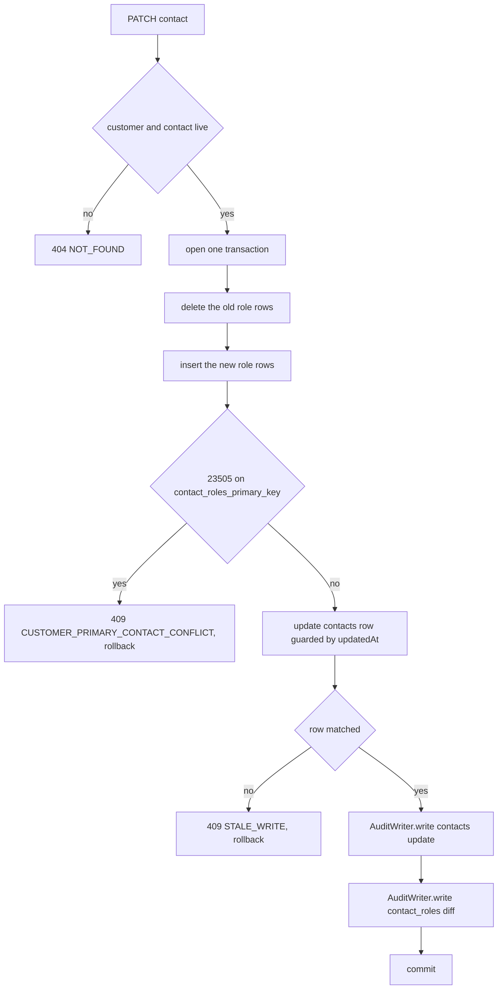

# AIS-178 / slice d — customer contacts and their roles

**Ticket:** AIS-178 `Admin - impl: customers API és kapcsolódó erőforrások` (subtask of AIS-14)
**Slice lettering:** `a` contract · `b` `apps/api` customers CRUD · `c` api-client service (**all
shipped**), **`d` = this plan** (contacts + contact roles); `e` = tags + customer users, `f` =
activities + audit-log read.
**Parent plans:** [`2026-11-22--18-50-00-ais-178-customers-api-plan.md`](./2026-11-22--18-50-00-ais-178-customers-api-plan.md:1),
[`2026-11-22--22-16-00-ais-178-b-customers-api-slice-plan.md`](./2026-11-22--22-16-00-ais-178-b-customers-api-slice-plan.md:1) §9,
[`2026-11-23--15-30-00-ais-178-c-customers-api-client-plan.md`](./2026-11-23--15-30-00-ais-178-c-customers-api-client-plan.md:1).
**Gap analysis this plan closes:** [`2026-11-23--15-23-00-ais-14-gap-analysis.md`](../history/2026-11-23--15-23-00-ais-14-gap-analysis.md:1) item **M2**.
**Suggested branch:** `AIS-178-customer-contacts`
**Commit titles:** `AIS-178: feat(api): add customer contacts and contact roles`,
`AIS-178: feat(api-client): add the customer contacts methods`

---

## 0. Why this slice exists

The `customers` detail response already publishes `contacts[]` with their `roles[]`
(`customerDetailSchema`), the tables exist with their invariant indexes, and
`AUDIT_TABLE_NAMES` already lists `contacts` and `contact_roles` — but **nothing can write them**.
Two consequences, both visible in the product:

- the contact card of the detail page is read-only by construction, because the array it renders can
  never be filled;
- the database enforces "one `primary` contact per customer" (`contact_roles_primary_key`), but no
  code maps that violation to an answer, so the admin would receive a `500` instead of the `409` the
  AIS-14 DoD requires.

Slice d closes the pair of DoD lines "the `409` cases are tested: … second `primary` contact" and
"every write produces exactly one audit row" for the contact aggregate.

---

## 1. Decisions

| # | Question | Decision |
| --- | --- | --- |
| D1 | Scope | Contacts **and** their roles, end to end: contract → controller → service → repository → client methods → tests. Nothing else (tags, users, activities are slices e/f). |
| D2 | How are roles written? | As part of the contact payload (`roles: ContactRole[]`), which is what `createContactSchema` / `updateContactSchema` already publish. **One request replaces the set**: roles are a set, not a sub-resource with its own id, and a replace is atomic. No `PUT /roles` endpoint. |
| D3 | Is the contact list paginated? | **Yes** — `GET /:id/contacts` uses the shared `listQuerySchema` (`page`, `limit`, `order`, `q`) and returns `meta.pagination`, like every other collection. No resource `sort` allow-list: the order is `name`, `order` flips it. |
| D4 | Second `primary` contact | `23505` on `contact_roles_primary_key` → `409 CUSTOMER_PRIMARY_CONTACT_CONFLICT`, classified by **constraint name** (never a pre-check). |
| D5 | Contact linked to a user of another customer | The composite FK `contacts_customer_user_id_fkey` raises `23503`; that is a *semantic* failure, so → `422 SEMANTIC_VALIDATION_FAILED` with `details[0].path = 'customerUserId'`. The code already exists and is currently unused — this is its first legitimate consumer. |
| D6 | Delete semantics | **Soft delete** on `contacts` (`deleted_at`), **hard delete** of its `contact_roles` rows. The role table deliberately has no `deleted_at` (AIS-18): keeping the rows would leave the `primary` slot occupied forever. |
| D7 | Audit shape of a delete | Two rows, one per affected table: `contact_roles` `delete` (`recordId: null`, `before` carries `contact_id` + the removed roles) and `contacts` `soft_delete` (`recordId: contactId`). Both in the **same transaction**. |
| D8 | Optimistic concurrency | `updateContact` requires `updatedAt` (the schema already does) and compares it in the `WHERE`; a miss is `409 STALE_WRITE`, exactly like `customers.update`. `remove` carries no token (b-plan `D5`). |
| D9 | New error code | Exactly one: `CUSTOMER_PRIMARY_CONTACT_CONFLICT` (`409`). The role mismatch needs **no** new code (D5). |
| D10 | Registry namespace | The four operations stay under `customers.*` (`customers.listContacts`, `createContact`, `updateContact`, `removeContact`), so the AIS-110 gate looks for methods `listContacts`/`createContact`/`updateContact`/`removeContact` **on the existing `CustomersService`** — no second client service, no registry namespace change. |

---

## 2. Pre-flight findings (verified in the code)

| # | Finding | Consequence |
| --- | --- | --- |
| F1 | `contactSchema` already carries `roles`, `customerId`, `createdAt`, `updatedAt`; `createContactSchema`/`updateContactSchema` exist with `.strict()` and `updatedAt` on the patch (`customers.schema.ts`) | Only a **list** schema is missing; the rest is reusable as-is. |
| F2 | `contact_roles_primary_key` is a **partial unique index** on `(customer_id) WHERE role = 'primary'` (`0005_colossal_hobgoblin.sql:112`) | A second primary answers `23505` with `constraint = 'contact_roles_primary_key'` — D4 needs no pre-check. |
| F3 | `contacts_customer_user_id_fkey` is a **composite** FK `(customer_id, customer_user_id) → iam.customer_users(customer_id, id)` (`0005:106`) | A user from another customer fails at the DB, not in the service → D5. |
| F4 | `contact_roles_contact_id_fkey` is `(contact_id, customer_id) → contacts(id, customer_id) ON DELETE cascade` (`0005:104`) | The role row cannot point at another customer's contact; deleting a contact row cascades, but a **soft** delete does not — D6 must delete the rows explicitly. |
| F5 | `contacts` has `updated_at` (`$onUpdate`) and `deleted_at`; `contact_roles` has neither | `update` uses the version token; `remove` writes `deleted_at` and drops the roles. `contact_roles` writes never carry a token. |
| F6 | `AUDIT_TABLE_NAMES` already contains `contacts` and `contact_roles`; the writer accepts `operation: 'delete'` with `recordId: null` | No audit-module change is needed — only the call sites. |
| F7 | `findPostgresError()` (`db/postgres-error.logic.ts`, slice b) already walks the cause chain by `code` + `constraintName` | Both new classifications reuse it; no new driver-error parsing. |
| F8 | `ERROR_CODE_CATALOGUE` in the admin is a **total** `Record<ApiErrorCode, …>` (`api-error-code.const.ts:57`) | Adding the new code to `@callback/shared` **breaks `apps/admin` typecheck** until the Hungarian copy and the catalogue entry land. That is the guard, not an accident. |
| F9 | `customers.service.ts` already injects `AUDIT_WRITER` and opens one transaction per write via `repository.runInTransaction()` | The contact service mirrors that composition; the audit row cannot land outside the write. |
| F10 | The detail read (`customers.repository.findById`) already returns live contacts with their roles; the list projection `primaryContactName` joins a **live** contact with the `primary` role | After a contact soft delete + role removal the projection must fall back to `null` — that is the observable end of D6. |
| F11 | `packages/api-client` has `getList` + the generic `ListRequest<TQuery>`, and `toListQueryParams` forwards resource filters | The contacts list needs no transport change. |
| F12 | `customers.e2e-spec.ts` keeps its ledger rows (append-only) and cleans business rows in `afterAll` | The new e2e suite must do the same and must not `DELETE` from `audit.audit_logs`. |

---

## 3. Deliverables

### 3.1 `packages/shared` (contract)

| File | Change |
| --- | --- |
| `contract/error-code.const.ts` | `CUSTOMER_PRIMARY_CONTACT_CONFLICT` + `API_ERROR_CODE_STATUS[...] = 409` |
| `contract/customers/customers.const.ts` | `CUSTOMERS_CONTACT_ID_PARAM = ':contactId'` (the `:contactId` placeholder lives in one place) |
| `contract/customers/customers.schema.ts` | `contactListSchema = z.array(contactSchema)` |
| `contract/customers/customers.contract.ts` | four entries: `customers.listContacts` (`GET …/:id/contacts`, `listQuerySchema`, `queryParameters: LIST_QUERY_PARAMETERS`, `examplePagination`), `customers.createContact` (`POST`, 201), `customers.updateContact` (`PATCH …/contacts/:contactId`), `customers.removeContact` (`DELETE …/contacts/:contactId`, `noPayloadSchema`) — each with the exact `errors` it can answer (`VALIDATION_FAILED`, `NOT_FOUND`, `STALE_WRITE`, `CUSTOMER_PRIMARY_CONTACT_CONFLICT`, `SEMANTIC_VALIDATION_FAILED`) |
| `contract/customers/customers.fixture.ts` | a `VALID_CONTACT_LIST` sample (two contacts) for the published examples |
| `test/error-code.test.ts` | one case asserting the new code resolves to `409` |

### 3.2 `apps/api/src/customers/` (server)

New files, mirroring the `customers.*` layering one-for-one:

| File | Content |
| --- | --- |
| `customers-contacts.const.ts` | route segment `':id/contacts'`, DI token `CUSTOMER_CONTACTS_REPOSITORY`, constraint names (`CONTACT_PRIMARY_ROLE_CONSTRAINT = 'contact_roles_primary_key'`, `CONTACT_USER_FK_CONSTRAINT = 'contacts_customer_user_id_fkey'`), table names |
| `customers-contacts.interface.ts` | `ContactPatch`, `ContactRowList`, `ContactWithRoles`, `PaginatedContacts` |
| `customers-contacts.errors.ts` | `PrimaryContactConflictError`, `ContactUserMismatchError` (no Nest import) |
| `customers-contacts.error-guard.ts` | `isPrimaryContactConflict()`, `isContactUserMismatch()` over `findPostgresError` |
| `customers-contacts.mapper.ts` | `toContact` (row + roles → `Contact`), `toNewContactRow`, `toContactPatch`, `toContactAuditPayload`, `toRoleRows` — all pure |
| `customers-contacts.repository.interface.ts` / `.repository.ts` | `findPage(customerId, query)`, `findById(customerId, contactId)`, `findAnyById`, `create(tx)`, `updateById(tx)`, `softDeleteById(tx)`, `replaceRoles(tx)`, `deleteRoles(tx)`, `runInTransaction` |
| `customers-contacts.service.ts` | orchestration: resolve the parent (`404` if no live customer), one transaction per write, `AuditWriter.write` per D7, error translation (D4/D5/D8) |
| `customers-contacts.controller.ts` | four routes under `@Controller(CUSTOMERS_ROUTE)`, `ZodValidationPipe(customerIdSchema)` + `ZodValidationPipe(contactIdSchema)` on the params, `ZodQueryPipe(listQuerySchema)` on the list, `responses.ok(...)`, `@Req()` + `toAuditRequestFacts` on the three mutations |
| `customers.module.ts` | register the new controller + service + repository token |
| `test/mocks/customers-contacts.mock.ts` | row fixtures, repository mock, writer mock |

`contactIdSchema` (a uuid) joins `customerIdSchema` in the contract, so a malformed id is a `400`
before Postgres sees it (`22P02` → `500` otherwise).

### 3.3 `packages/api-client` (client)

| File | Change |
| --- | --- |
| `customers/customers.const.ts` | `CUSTOMERS_CONTACTS_PATH = clientPathOf('customers.listContacts')`, `CUSTOMERS_CONTACT_PATH = clientPathOf('customers.updateContact')` |
| `customers/customers.path.ts` | `toCustomerContactsPath(id)`, `toCustomerContactPath(id, contactId)` (both encode) |
| `customers/customers.interface.ts` | `listContacts(id, query)`, `createContact(id, input)`, `updateContact(id, contactId, input)`, `removeContact(id, contactId)` |
| `customers/customers.service.ts` | the four implementations: `getList` for the list, `post`/`patch`/`delete` for the rest |
| `test/mocks/customer.mock.ts` | `VALID_CONTACT`, `SECOND_CONTACT`, `VALID_CONTACTS_PAGE`, `VALID_CREATE_CONTACT_INPUT`, `VALID_UPDATE_CONTACT_INPUT` re-exported from the shared fixtures |
| `test/customers.service.test.ts` | the four new describe blocks (see §5) |

### 3.4 `apps/admin` (copy only, no UI)

`error-message.const.ts` gains `CUSTOMER_PRIMARY_CONTACT_CONFLICT_MESSAGE` and a field-level
`CUSTOMER_PRIMARY_CONTACT_FIELD_MESSAGE`; `api-error-code.const.ts` wires them (`fieldMessage` set,
because the role picker is an input the user can change). AIS-179 consumes it.

---

## 4. Routes and behaviour

| operationId | verb | path (under `/api`) | success | audit |
| --- | --- | --- | --- | --- |
| `customers.listContacts` | GET | `/admin/customers/:id/contacts?page&limit&order&q` | `200` + `meta.pagination` | — |
| `customers.createContact` | POST | `/admin/customers/:id/contacts` | `201` `Contact` | `contacts` `insert` (+ `contact_roles` `insert` when roles are given) |
| `customers.updateContact` | PATCH | `/admin/customers/:id/contacts/:contactId` | `200` `Contact` | `contacts` `update`; `contact_roles` diff when the role set changes |
| `customers.removeContact` | DELETE | `/admin/customers/:id/contacts/:contactId` | `200`, `data: null` | `contact_roles` `delete` + `contacts` `soft_delete` (D7) |

The write path of `updateContact`, i.e. where the role replace and the two ledger rows have to line up:



Behaviour that must hold:

1. Every route answers `404` when the **customer** is not live, and `404` when the contact is not a
   live contact **of that customer** (the lookup is always scoped by both ids — no cross-customer
   access by guessing a uuid).
2. The list filters `q` over `name`, `email`, `phone`, ignores soft-deleted contacts, and orders by
   `name` (`order` flips it) with `id` as the tie-breaker.
3. `create`/`update` replace the role set atomically: the previous `primary` is removed before the
   new one is inserted, so "move the primary flag" is one request and never trips D4 by accident.
   Swapping two contacts' primacy in **two** requests can still hit D4 — that is the honest `409`.
4. `customerUserId` must belong to the same customer → otherwise `422 SEMANTIC_VALIDATION_FAILED`
   (D5), with the field path.
5. `remove` deletes the role rows, soft-deletes the contact, and the customer list's
   `primaryContactName` becomes `null` (F10).
6. A repeat `remove` is `404`, and it writes no ledger row.
7. Every mutation writes inside the transaction opened by the repository; the ledger rows and the
   business rows commit together or not at all.

---

## 5. Tests

| Suite | Coverage |
| --- | --- |
| `customers-contacts.logic`/`mapper.spec.ts` | role-set diffing, `Date` → ISO, `null` vs `undefined` in the patch, silent-drop of unchanged roles |
| `customers-contacts.error-guard.spec.ts` | `23505` on `contact_roles_primary_key`; `23503` on `contacts_customer_user_id_fkey`; the cross case (a tax-number conflict is neither) |
| `customers-contacts.repository.spec.ts` | mocked `Database`: every read scoped by `customer_id` **and** `deleted_at IS NULL`; the page + count share one `WHERE`; `replaceRoles` deletes then inserts; `deleteRoles` is a single statement |
| `customers-contacts.service.spec.ts` | parent `404`; contact `404`; one audit row per table (D7); `409` on the second primary; `422` on the foreign user; `STALE_WRITE` vs `404` classification; empty patch writes nothing |
| `customers-contacts.controller.spec.ts` | `201` on create, `data: null` on delete, pipes produce the validated payload, audit facts built from the request |
| `apps/api/test/customer-contacts.e2e-spec.ts` (real Postgres, DB gate) | create → list (with `q` + pagination) → patch → **second primary `409`** → repeat delete `404` → `contact_roles` count `0` → `primaryContactName` `null` → ledger rows counted per mutation |
| `packages/api-client/test/customers.service.test.ts` | the four new methods: paths and `:contactId` substitution, list query, `404`, `409 CUSTOMER_PRIMARY_CONTACT_CONFLICT`, `422 SEMANTIC_VALIDATION_FAILED` with `issues[0].path = 'customerUserId'`, `null` payload, abort signal |
| gates | `service-coverage` (four new operation ids must resolve to four methods), `envelope-contract`, `openapi`, `apps/admin` typecheck + copy parity (F8) |

---

## 6. Risks

| Risk | Mitigation |
| --- | --- |
| The admin build breaks as soon as the code is added | That is F8 working as designed: the shared change and the admin copy land in the **same** commit. |
| A role-set replace loses the previous primary's role silently | The service records the `contact_roles` diff (removed + added) in the ledger; the e2e asserts it. |
| A soft delete leaves the `primary` slot occupied | `deleteRoles` runs in the same transaction as the soft delete, and the e2e asserts both the row count and the `primaryContactName` projection. |
| Two controllers on the same base path confuse the envelope gate | The gate matches **verb + full path**; the four new paths are distinct. Run `envelope-contract` before pushing. |
| Paginating a bounded list adds noise | Accepted: every collection in this API carries `meta.pagination`, and the client already has `getList`. A customer with 3 contacts still gets one page. |
| The e2e pollutes the ledger | Same hygiene as `customers.e2e-spec.ts`: tagged user agent, business rows cleaned in `afterAll`, ledger untouched. |

---

## 7. Verification

```bash
pnpm --filter @callback/shared test
pnpm --filter @callback/api-client test          # service-coverage must stay green
pnpm --filter @callback/admin test               # copy parity
pnpm --filter @callback/api test                 # unit specs
pnpm --filter @callback/api test:e2e             # needs DATABASE_URL + db:up
pnpm typecheck && pnpm lint && pnpm quality
pnpm -r build
```

Definition of done for slice d:

- [ ] The four routes are mounted and the `envelope-contract` + `openapi` suites are green.
- [ ] `service-coverage` reports the four new methods on `CustomersService` (no new namespace).
- [ ] A second `primary` contact answers `409 CUSTOMER_PRIMARY_CONTACT_CONFLICT`; a foreign
      `customerUserId` answers `422 SEMANTIC_VALIDATION_FAILED`.
- [ ] Deleting a contact removes its role rows, frees the `primary` slot, and leaves the ledger with
      a `delete` row for `contact_roles` and a `soft_delete` row for `contacts`.
- [ ] The admin copy for the new code exists (typecheck proves it).
- [ ] `pnpm typecheck`, `lint`, `test`, `quality` and `-r build` green; history entry written.

---

## 8. Out of scope

- **Tags and customer users** (slice e, including `CUSTOMER_OWNER_CONFLICT` and the invite flow).
- **Activities and the audit-log read endpoint** (slice f) — the "Napló" and activity tabs.
- **Admin UI** — AIS-179 builds the contacts tab on these methods; this slice only ships the copy.
- **Contact-level auth or invitations** — a contact that is also a login user is linked here, but
  the invitation state machine belongs to slice e.
