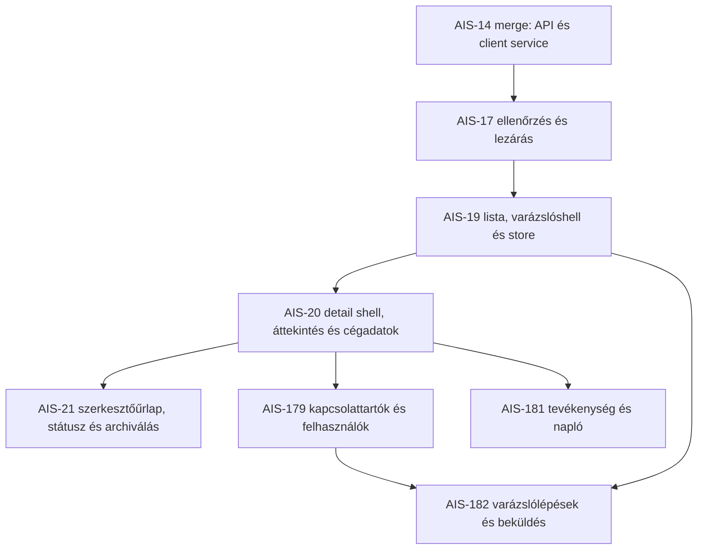

# AIS-15 ügyfél-admin — implementációs hullámterv (AIS-17 · AIS-19 · AIS-20 · AIS-21 · AIS-179 · AIS-181 · AIS-182)

**Történet:** AIS-15 `Admin - cég felület` (résztickets: AIS-17, AIS-19, AIS-20, AIS-21, AIS-179, AIS-181, AIS-182)
**Dátum:** 2026-11-23 · **Előzmény:** [`2026-11-22--14-20-00-ais-17-customers-admin-screen-design-plan.md`](2026-11-22--14-20-00-ais-17-customers-admin-screen-design-plan.md:1) (képernyőterv, átadva)
**Képernyőszerződés (a tartalom irányadója):** [`Customers-Admin-Screens.md`](../Specs/Customers-Admin-Screens.md:1) (`D1`–`D16`)
**Folyamatszerződés (a fájlsorrend irányadója):** [`New-Admin-Page.md`](../Specs/New-Admin-Page.md:1) · [`UI-Architecture.md`](../Specs/UI-Architecture.md:1)
**API-szerződés (leszállítva):** [`customers.contract.ts`](../../packages/shared/src/contract/customers/customers.contract.ts:142:1) — 21 művelet
**Ajánlott branch:** minden tickethez külön branch a `main` ágáról az AIS-14 merge után (`AIS-19-customers-list`, `AIS-20-customer-detail`, …)

---

## 0. Mit ír le ez a terv

Egy tervet ad az egész hullámhoz, ticketenként egy-egy fejezettel. Az A–G szakaszok a tényleges munkát írják le; a §10 minden ticketre érvényes kaput ad; a §11 azon elemeket sorolja fel, amelyekhez **Jira szövegmódosítás**, nem pedig kód szükséges.

### 0.1 A hullámra vonatkozó megerősített döntések

| Azonosító | Kérdés | Döntés |
| --- | --- | --- |
| **D-W1** | Az `AIS-21` a „címkék” mezőt sorolja a szerkesztőűrlapon, azonban az `updateCustomerSchema` nem tartalmaz `tagIds` mezőt ([`customers.schema.ts`](../../packages/shared/src/contract/customers/customers.schema.ts:386:1)) | A címkék **nem** űrlapmezők. A Cégadatok fülön chip-sáv jelenik meg *Hozzáadás* művelettel (`createTag`, név alapján létrehozás vagy csatolás) és chipenkénti *Eltávolítás* művelettel (`detachTag`), mindegyik saját mutation. Az `attachTag` akkor használható, ha a katalógusazonosító már ismert. |
| **D-W2** | Az `AIS-19` kér egy `responsibleOperatorId` szűrőt, de **nincs** operátordirektórium-végpont vagy művelet | A szűrő **halasztott**: nem szerepel az AIS-19 szűrősorában és nem része az URL-szerződésnek. A közös séma megtartja a paramétert (a szerveroldali támogatás már létezik), ezért későbbi hozzáadása bővítő jellegű lenne. Követő ticket szükséges (§11 Q-1). |
| **D-W3** | Az `AIS-179` lapozott, URL-szűrt kapcsolattartói és felhasználói listákat kér; nincs `listCustomerUsers` művelet, a `customers.listContacts` viszont létezik, a detail payload pedig mindkettőt tartalmazza | Mindkét fül a **detail payloadból** olvas (`contacts`, `customerUsers`), **lapozó nélkül** és **URL-listaállapot nélkül**. Csak az aktivitás és a napló lapozott (`listActivities` / `listAuditLogs`). |
| **D-W4** | Az `AIS-181` „saját bejegyzés” szerkesztésről/törlésről ír; az API-nak nincs szerző ellenőrzése (az admin hitelesítés az AIS-73/74 előtt nincs) | A UI **csak** azokban a sorokban jeleníti meg a szerkesztést/törlést, amelyeknél `authorType === 'operator'`. Ez kliensoldali szabály; a szerver az AIS-73/74-ig megengedő marad. |
| **D-W5** | A specifikáció a varázsló útvonalát, store-ját és a `zustand` telepítését az **AIS-19**-hez rendeli, míg az AIS-182 maga a varázsló ticket | Megosztás: az **AIS-19** létrehozza a `/customers/new` útvonalat, a store-t, providert és teszteket, telepíti a `zustandot`, valamint előkészíti a shell-oldalt; az **AIS-182** megvalósítja az 1–4. lépéseket, a lépéslogikát és a beküldést. Nem marad bekötetlen placeholder: a shell már az első lépést megjeleníti. |
| **D-W6** | Az `AIS-182` szerint a varázsló „a céget … és az első kapcsolattartót” hozza létre egy lépésben; a képernyőszerződés elhagyja a kapcsolattartói lépést (`D5`, §4.4), az API-ban pedig nincs együttes tranzakció | A varázsló **egyetlen** `POST /customers` kérést küld. Siker esetén a `/customers/:id?tab=contacts` címre navigál; a kapcsolattartót ott, külön dialógussal adják hozzá. Egy kérés, nincs félkész céglétrehozás. |

### 0.2 Mit nem ír le ez a terv

- **Nem** szerződésmódosítás: a hullám nem módosít semmit a `packages/shared` alatt.
- **Nem** az AIS-14 lezárása: az API merge előfeltétel, amelyet a [`2026-11-23--21-20-00-ais-14-closeout-plan.md`](2026-11-23--21-20-00-ais-14-closeout-plan.md:1) követ.
- Nem ad hozzá `packages/ui` primitívet. A fülstrip az oldal része marad (`D16`).

---

## 1. Mért állapot (ebben a munkamenetben ellenőrzött, nem feltételezett)

| # | Megállapítás | Következmény |
| --- | --- | --- |
| **F1** | Az AIS-17 eredménye már létezik: [`Customers-Admin-Screens.md`](../Specs/Customers-Admin-Screens.md:1) (383 sor, `D1`–`D16`), az [`UI-Architecture.md`](../Specs/UI-Architecture.md:964:1) §5 sora, a [`New-Admin-Page.md`](../Specs/New-Admin-Page.md:87:1) §2/§3 részei, valamint history és milestone. A ticket továbbra is `To Do`. | Az A szakasz **ellenőrzés + delta + lezárás**, nem új tervezés. |
| **F2** | 21 `customers.*` művelet létezik a registryben és a [`customers.service.ts`](../../packages/api-client/src/customers/customers.service.ts:96:1) fájlban; a `createCustomersService` exportált. | Ebben a hullámban nem kell `api-client` metódust írni. |
| **F3** | A [`services/api-client.ts`](../../apps/admin/src/services/api-client.ts:59:1) **csak** az `apiKeysService` példányt hozza létre. | Az AIS-19 első lépése bedrótozza a customers service-t a composition rootba. |
| **F4** | Az `apps/admin` alatt nincs `pages/customers`, `features/customers` vagy `entities/customer`; a [`package.json`](../../apps/admin/package.json:20:1) nem tartalmaz `zustandot`. | Az egész rétegstack új; a `zustandot` az AIS-19 telepíti (`D11`/`D-W5`). |
| **F5** | A `primaryContactName` már létezik a lista sorában ([`customers.schema.ts`](../../packages/shared/src/contract/customers/customers.schema.ts:195:1)), mindkét fixture rendelkezésre áll. | Az AIS-17 `D9` leszállítva; a lista 6. oszlopa a tervek szerint implementálható. |
| **F6** | Az [`api-error-code.const.ts`](../../apps/admin/src/lib/api-error-code.const.ts:64:1) teljes katalógusa már tartalmazza a `STALE_WRITE`, `SEMANTIC_VALIDATION_FAILED`, `CUSTOMER_TAX_NUMBER_CONFLICT`, `CUSTOMER_PRIMARY_CONTACT_CONFLICT`, `CUSTOMER_OWNER_CONFLICT`, `CUSTOMER_USER_EMAIL_CONFLICT`, `CUSTOMER_USER_IN_USE_CONFLICT` és `CUSTOMER_NUMBER_CONFLICT` kódokat. | Nincs szükség új hibaszövegre; a conflict kódok a megfelelő mezőhöz rendelhetők. |
| **F7** | A `customerDetailSchema` tartalmazza a `tags`, `contacts` és `customerUsers` adatokat ([`customers.schema.ts`](../../packages/shared/src/contract/customers/customers.schema.ts:262:1)). | A `D-W3` API-változtatás nélkül implementálható. |
| **F8** | A `useListParams` biztosítja a `params`, `setParam`, `setParams` és `resetParams` API-t ([`use-list-params.interface.ts`](../../apps/admin/src/features/api/use-list-params.interface.ts:34:1)). | Egy URL-módosítás minden interakcióhoz elérhető; a `?tab=`/`?step=`hez szükséges az új generikus reader. |
| **F9** | Az `activityListQuerySchema` nem tartalmaz `q` és `sort` mezőt; az `auditLogListQuerySchema` hozzáadja a `tableName`, `operation`, `actorId`, `from` és `to` mezőket. | Az aktivitásfeed a `page`/`limit`/`order` szerint lapoz; a naplófül négy szűrőt ad az URL-hez. |
| **F10** | Minden szükséges primitív létezik: `PageShell`, `DataTable`, `Pagination`, `Skeleton`, `EmptyState`, `DescriptionList`, `StatusBadge`, `Badge`, `EntityDialog`, `ConfirmDialog`, `DropdownMenu`, `Combobox`, `Select`, `RadioGroup`, `Textarea`, `FormSection`, `FormActions`, `FormField`, `toPrettyJson`. | A hullám nem érinti a `packages/ui` csomagot. |
| **F11** | A `CUSTOMER_SORT_FIELDS` / `CUSTOMER_DEFAULT_SORT` a [`customers.const.ts`](../../packages/shared/src/contract/customers/customers.const.ts:1) fájlban van; ismeretlen rendezési oszlop `400`-at ad. | A `DataTable` rendezése csak az engedélyezett oszlopokat kínálhatja. |

---

## 2. Hullám sorrendje



A sorrend indoka: az AIS-19 létrehozza az útvonal-registry bejegyzéseket, a közös page constot, a query keyeket és a `use-tab-param` hookot, így minden későbbi ticket egy meglévő page mappát bővíthet, nem pedig újat talál ki. Az AIS-21 státusz/archiválási műveletei az AIS-20 által épített detail headerhez kapcsolódnak, ezért nem előzhetik meg. Az AIS-182 a `/customers/:id?tab=contacts` címre navigál, ezért az AIS-179 után következhet.

---

## 3. A — AIS-17: ellenőrzés és lezárás (csak delta)

Az AIS-17 **dokumentációs ticket** marad. Nem készül új terv: a hullám négy döntése négy mondatot módosít az élő specifikációban, majd a ticket `Done` állapotba kerül.

### 3.1 Ellenőrzés (nincs szerkesztés)

| DoD pont | Bizonyíték | Eredmény |
| --- | --- | --- |
| Minden képernyőelem megnevezi a primitívét | [`Customers-Admin-Screens.md`](../Specs/Customers-Admin-Screens.md:78:1) §2.1, §3.1–§3.2, §4.1, §5 | átment |
| Négy állapot minden nézethez | §2.4, §3.3, §4.3 és §5 (`409 STALE_WRITE` sor) | átment |
| `D1`–`D6` rögzítve | §8.1 | átment |
| Állapotterv a UI-Architecture §5-ben | [`UI-Architecture.md`](../Specs/UI-Architecture.md:964:1) | átment |

### 3.2 A specifikációban alkalmazandó delta

Mindegyik sor kis, célzott szerkesztés; a fejléc `**Utolsó frissítés:**` sora `2026-11-23`-ra módosul.

| # | Fájl | Szakasz | Változtatás |
| --- | --- | --- | --- |
| A1 | `Customers-Admin-Screens.md` | §2.1 elem-táblázat | A felelős operátor szűrősora **halasztottként** legyen jelölve: „nincs operátordirektórium-művelet”; a szűrőreset sor maradjon. |
| A2 | ugyanaz | §2.3 | „A négy szerződéses szűrő” → „a három implementált szűrő (type, status, source); a negyedik az A1 szerint halasztott”. |
| A3 | ugyanaz | §3.2 + §3.3 | A `contacts` és `users` a **detail payloadból** olvas; mindkét sorhoz kerüljön „nincs lapozó, nincs URL-listaállapot”, a `DataTable isLoading` állítás helyett a detail saját loading állapota legyen. |
| A4 | ugyanaz | §3.2 `activity` sor | Ezt adjuk hozzá: szerkesztés/törlés csak azokban a sorokban jelenjen meg, ahol `authorType === 'operator'` (`D-W4`). |
| A5 | ugyanaz | §4.1, §5 | Távolítsuk el a `címkék` mezőt az űrlapmezők közül; a §5-ben szerepeljen: a címkék chip-műveletek (`createTag` / `attachTag` / `detachTag`) a Cégadatok fülön (`D-W1`). |
| A6 | ugyanaz | §4.4 | Az `AIS-182` eltérés: a varázsló **csak a céget** hozza létre; az első kapcsolattartót a detail kapcsolattartók fülén adják hozzá (`D-W6`). |
| A7 | ugyanaz | §10 fájltérkép | Egészítsük ki a tervben ténylegesen létrejövő hooknevekkel (§4.2), és jelöljük az `AIS-19` tulajdonába tartozó `use-tab-param` hookot. |
| A8 | `UI-Architecture.md` | §5 `pages/customers` sor | „négy szűrő” → három implementált szűrő és egy halasztott; jegyezze fel, hogy a kapcsolattartó/felhasználó füleken nincs URL-listaállapot. Dátumfrissítés. |
| A9 | `New-Admin-Page.md` | §2 | „a keresőmező és a négy szerződéses szűrő” → három szűrő, a negyedik halasztott (A1). Dátumfrissítés. |

### 3.3 Lezárás

| # | Művelet | Készen akkor, ha |
| --- | --- | --- |
| A10 | `docs/history/<ts>-ais-15-customers-admin-wave-plan.md` | Ez a munkamenet összefoglalása: négy ellentmondás, `D-W1`–`D-W6`, delta |
| A11 | `pnpm quality:docs` + `pnpm test:quality` | zöld; minden link és `§N` feloldható |
| A12 | Jira: AIS-17 → **Done** megjegyzéssel, amely felsorolja a specifikációt, a §5 sort, a két ellenőrzőlista-módosítást és a terv linkjét | `Done`, és a megjegyzés tartalmazza a commit nevét |

A12-höz nincs szükség milestone-ra — a döntésminőségű rekord már létezik ([`2026-11-22--14-33-00-customers-admin-screen-contract.milestone.md`](../milestones/2026-11-22--14-33-00-customers-admin-screen-contract.milestone.md:1)); az A1–A9 az ezt korrigáló módosításokat írja le a history bejegyzésben. Minden **implementációs** tickethez (AIS-19…182) külön milestone tartozik a szabály szerint.

---

## 4. B — AIS-19: ügyféllista (+ varázsló shell, store, `zustand`)

### 4.1 Sorrendben végrehajtandó munka

| # | Fájl | Mi legyen benne |
| --- | --- | --- |
| B1 | [`services/api-client.ts`](../../apps/admin/src/services/api-client.ts:59:1) | `export const customersService: CustomersService = createCustomersService(httpClient);`, az `apiKeysService` exporthoz hasonló doc-comment. |
| B2 | `features/customers/customers.const.ts` | `CUSTOMERS_QUERY_KEYS = createEntityQueryKeys<CustomerListQuery>('customers')`; oldalméretek: `LIST_QUERY_DEFAULT_LIMIT`, `50`, `LIST_QUERY_MAX_LIMIT`. |
| B3 | `features/customers/customers.interface.ts` | Az oldal által használt szűk eredménytípusok (`CustomersListResult`: `rows`, `meta`, `isLoading`, `errorMessage`, `errorSurface`, `refetch`). |
| B4 | `features/customers/customers.logic.ts` | Tiszta segédfüggvények: `toListRequest(params)`, `toSortPatch(column, direction)` → `{ sort, order, page: 1 }`, `hasActiveFilters(params)`; nincs JSX, nincs hook, nincs I/O. |
| B5 | `features/customers/use-customers-list.ts` | `useApiList` a `customersService.list` fölött; `queryKey: CUSTOMERS_QUERY_KEYS.list(params)`; fagyasztott `emptyData: EMPTY_CUSTOMERS`. |
| B6 | `features/customers/use-archive-customer.ts` | `useApiMutation` a `customersService.remove` fölött, `invalidateKeys: [CUSTOMERS_QUERY_KEYS.all]`, `meta.successMessage`. |
| B7 | `entities/customer/customer.interface.ts` | Nézetmodell: `CustomerRowViewModel` (`id`, `customerNumber`, `displayName`, `typeLabel`, `taxNumberText`, `status`, `primaryContactText`, `lastActivityText`, `hasMissingData`). |
| B8 | `entities/customer/customer.const.ts` | Oszlopfejlécek, típus/forrás címkék, `CUSTOMER_STATUS_BADGE_VARIANT` (`D10` táblázat), hiányzó adat `aria-label`. |
| B9 | `entities/customer/customer.mapper.ts` | Tiszta `toCustomerRowViewModel(dto)` és `toStatusVariant(status)`; a `null` renderer („—”, „Nincs”) és a `lib/date.ts` formázás itt, soha JSX-ben. |
| B10 | `entities/customer/components/CustomerStatusBadge.tsx` | Vékony `StatusBadge` wrapper, amely a domain státuszt veszi át, így az oldalak nem implementálhatják újra a mappinget. |
| B11 | `features/api/use-tab-param.logic.ts` + `use-tab-param.ts` + teszt | `parseAllowedValue(value, allowed, fallback)`; a hook `value` + `setValue` értéket ad, mindig **egy** URL-módosítással; itt `step`, AIS-20-ban `tab`. |
| B12 | `pages/customers/customers.const.ts` | `CUSTOMERS_CREATE_ROUTE_PATH`, `CUSTOMER_DETAIL_ROUTE_PATH`, `CUSTOMER_EDIT_ROUTE_PATH`, `CUSTOMER_CREATE_LABEL`, `CUSTOMERS_WIZARD_STEPS`, üresállapot-szövegek. |
| B13 | `pages/customers/customers-wizard.store.ts` + `customers-wizard.provider.tsx` | Store factory (`draft`, `step`, `setDraft`, `setStep`, `reset`) és provider/selector pár `D11` szerint; a mappán kívül nem exportálható. |
| B14 | `pages/customers/CustomersPage.tsx` | Kompozíció: `PageShell` (cím, felirat, „Új cég” link) → szűrősor → táblázat → lapozó; `<Outlet/>` nem kell, mert a detail/edit testvér útvonalak. |
| B15 | `pages/customers/ui/CustomersFilters.tsx` | Debounced `Input type=search` (`q`) + `Select` ×3 (`type`, `status`, `source`) + reset `Button` egy `setParams` hívással; operátorszűrő nélkül (`D-W2`). |
| B16 | `pages/customers/ui/CustomersTable.tsx` | `DataTable` a specifikáció §2.2 szerinti 8 oszloppal; URL-alapú rendezés; *Megnyitás*, *Szerkesztés*, *Archiválás* menüelemek; névcellában `Link`. |
| B17 | `pages/customers/ui/ArchiveCustomerDialog.tsx` | `ConfirmDialog`; nyitási flag helyi `useState` (AIS-173 kivétel); megerősítés → `use-archive-customer`. |
| B18 | `pages/customers/CustomerCreatePage.tsx` | A varázsló **shellje**: provider, a `CUSTOMERS_WIZARD_STEPS` lépéssora és az 1. lépés body a store draftból; az AIS-182 cseréli le a bodykat. |
| B19 | [`app/app.const.ts`](../../apps/admin/src/app/app.const.ts:1) | `APP_ROUTE_CUSTOMERS_PATH = '/customers'`, `APP_CUSTOMERS_LABEL`. |
| B20 | [`app/router/route-registry.tsx`](../../apps/admin/src/app/router/route-registry.tsx:64:1) | Két bejegyzés: `/customers` (`navLabel`), `/customers/new` (`navLabel: null`, `breadcrumbParentPath: '/customers'`). |
| B21 | [`package.json`](../../apps/admin/package.json:20:1) | `zustand` dependency (`pnpm --filter @callback/admin add zustand`) a B13 módosításával együtt. |
| B22 | `test/mocks/handlers/customers.handlers.ts` | MSW handler a `GET /api/admin/customers` (oldal, szűrt üres eredmény, hiba) és a `DELETE /:id` műveletekhez; fixture a `@callback/shared/customers.fixture.ts`ből. |
| B23 | Dokumentáció | Az [`UI-Architecture.md`](../Specs/UI-Architecture.md:1128:1) §7 `zustand` sora `installed` lesz; a [`Customers-Admin-Screens.md`](../Specs/Customers-Admin-Screens.md:1) §10 felsorolja a tényleges hookokat. |

### 4.2 Kötelező tesztek (a specifikáció §9 „Lista” és „Store” sora alapján)

- `customer.mapper.test.ts` — mind a 7 státuszhoz variant; `shortName ?? legalName`; null adószám; null elsődleges kapcsolattartó; null `lastActivityAt`; `hasMissingData` jelölők.
- `customers.logic.test.ts` — a `toSortPatch` nullázza a `page` értéket; a `hasActiveFilters` egyenként és kombinációban.
- `use-customers-list.test.tsx` — loading → skeleton sorok; success több sorral; üres szűrő nélkül; üres szűrővel; hiba (`500`) és `errorSurface === 'page'`; retry meghívja a `refetch`et.
- `CustomersPage.test.tsx` — minden szűrő egyszer írja az URL-t; rendezéskor `sort`+`order` és `page` törlése; sor menüpontok navigálnak; archiváló dialógus megerősítése/mégse.
- `customers-wizard.store.test.ts` — `init → setDraft → setStep → reset`; selector stabilitás.
- `use-tab-param.logic.test.ts` — érvényes, hiányzó és érvénytelen érték → fallback.

### 4.3 Kész van (DoD)

- [ ] A `/customers` elérhető a navigációból; az URL kizárólag `page`/`limit`/`sort`/`order`/`q`/`type`/`status`/`source` értékeket hordoz.
- [ ] Szűrt URL másolása/beillesztése helyreállítja a nézetet; vissza/előre működik.
- [ ] Négy állapot: `DataTable` / `EmptyState` / `PageErrorState` / táblázat+lapozó.
- [ ] `zustand` telepítve, §7 sor frissítve, store teszt zöld, store nem exportálódik a `pages/customers/` mappán kívül.
- [ ] Nincs `fetch`, palette class vagy kézi táblázatjelölés; `pnpm quality` zöld.

---

## 5. C — AIS-20: detail shell + Áttekintés és Cégadatok fülek

| # | Fájl | Mi legyen benne |
| --- | --- | --- |
| C1 | `features/customers/use-customer-detail.ts` | `useApiDetail` a `customersService.findById` fölött, `CUSTOMERS_QUERY_KEYS.detail(id)` kulcs, `enabled: id !== undefined`. |
| C2 | `entities/customer/customer.mapper.ts` | `toCustomerDetailViewModel(dto)` → azonosító, jogi, cím és besorolási csoport plusz áttekintő mezők; dátumformázás itt. |
| C3 | `entities/customer/customer.interface.ts` | `CustomerDetailViewModel` négy csoporttal, mindegyik `{ label, value }` tömb. |
| C4 | `pages/customers/customer/CustomerDetailPage.tsx` | `PageShell` (visszalink `/customers`, cím `shortName ?? legalName`, alcím `customerNumber`), fülstrip, `<Outlet/>`, négy állapot és 404 ág. |
| C5 | `pages/customers/ui/CustomerTabs.tsx` | Feliratozott `<nav>` `Button` primitívvel (`ghost`/`primary`); az állapot `?tab=` és `use-tab-param`. |
| C6 | `pages/customers/customer/ui/CustomerOverviewTab.tsx` | `StatusBadge` + `DescriptionList` (státusz, `statusChangedAt`, elsődleges kapcsolattartó, utolsó aktivitás) + hiányzóadat-`Alert`. |
| C7 | `pages/customers/customer/ui/CustomerDataTab.tsx` | Négy `Card` csoport, mindegyikben `DescriptionList columns={2}` (`D12`). |
| C8 | `pages/customers/customer/ui/CustomerDetailError.tsx` | 404 szöveg: „Ez a cég nem található.” + visszalink; 5xx → `PageErrorState` + retry. |
| C9 | `pages/customers/customers.const.ts` | `CUSTOMER_DETAIL_TABS` (érték+címke), `CUSTOMER_TAB_VALUES`, `toCustomerTab(value)` fallback `overview` értékkel. |
| C10 | [`app/router/route-registry.tsx`](../../apps/admin/src/app/router/route-registry.tsx:64:1) | Detail bejegyzés (`resolveBreadcrumbLabel: (params) => params.id`), gyermek slot, jelenleg üres az AIS-179 előtt. |

**Tesztek:** fül értelmezése (érvényes/hiányzó/hibás → `overview`); fülváltás egyszer írja az URL-t; 404 szöveg jelenik meg általános hiba helyett; 500-ra `PageErrorState` és retry; loading: `Skeleton` + `DescriptionList isLoading`; a státusz-badge az AIS-19-ből érkezik, nincs második mapping.

**DoD:** nincs saját kulcs-érték jelölés; ismeretlen `?tab=` csendesen visszaáll; a fülkeret készen áll a későbbi négy fülre anélkül, hogy a `CustomerDetailPage`-et érintené.

---

## 6. D — AIS-21: szerkesztőfelület és a detail header írási műveletei

| # | Fájl | Mi legyen benne |
| --- | --- | --- |
| D1 | `features/customers/use-update-customer.ts` | `useApiMutation` a `customersService.update` fölött; `invalidateKeys: [CUSTOMERS_QUERY_KEYS.all]`; `meta.successMessage`. |
| D2 | `features/customers/use-update-customer-status.ts` | Mutation az `updateStatus` fölött, ugyanaz az invalidáció. |
| D3 | `features/customers/use-archive-customer.ts` | AIS-19-ből újrahasználva; a header *Archiválás* pontja `ConfirmDialogot` nyit, siker után `/customers`re navigál. |
| D4 | `features/customers/use-customer-tags.ts` | `createTag`, `attachTag`, `detachTag` mutationök, mindegyik invalidálja a detail keyet (`D-W1`). |
| D5 | `pages/customers/customer/edit/CustomerEditPage.tsx` | Először detail lekérés (`use-customer-detail`), majd az űrlap **`updatedAt` alapján keyelve**, hogy friss adat érje a mezőket. |
| D6 | `pages/customers/customer/edit/ui/CustomerEditForm.tsx` | `useAppForm` + `updateCustomerSchema`; négy `FormSection` (Azonosítók read-only összefoglaló / Jogi adatok / Cím / Besorolás); `FormActions`; `updatedAt` mindig elküldve. |
| D7 | `pages/customers/customer/ui/CustomerDetailHeaderActions.tsx` | AIS-20 headerének bővítése: *Szerkesztés* link + `DropdownMenu` (*Státusz váltása*, *Archiválás*) — az írási műveletek itt, nem AIS-20-ban. |
| D8 | `pages/customers/customer/ui/CustomerTagsCard.tsx` | Chip-sáv + *Új címke* és chipenkénti eltávolítás a Cégadatok fülön (`D-W1`). |
| D9 | `pages/customers/customer/edit/customer-edit.logic.ts` | Tiszta: `toUpdatePayload(values, dto)` (csak változott mezők + `updatedAt`), `isStaleWrite(error)`, `toEditErrorSurface(error)`. |
| D10 | [`app/router/route-registry.tsx`](../../apps/admin/src/app/router/route-registry.tsx:64:1) | `/customers/:id/edit` testvér útvonal. |

**Hibairányítás (a ticket lényege):** `422` → `toFieldErrors(details[].path)` a mezőkre; `409 CUSTOMER_TAX_NUMBER_CONFLICT` → `taxNumber` mező (a katalógus mezőüzenetet tartalmaz, F6); `409 STALE_WRITE` → **oldalszintű**, az űrlap nyitva marad és újraolvas (nincs mezőüzenet — a katalógusban `fieldMessage: null`); `5xx` → `PageErrorState` vagy toast.

**Tesztek:** érvényes mentés elküldi az `updatedAt`et és csak a változott mezőket; `422` a megnevezett mezőre kerül; `409 STALE_WRITE` oldalszintű üzenetet ad és újraolvas; `409` adószám konfliktus a mezőre kerül; `5xx`; szerződés szerint read-only mezők (`customerNumber`, `status`, `createdAt`, `updatedAt`, `hasMissingData`) nem inputok; címke-hozzáadás/eltávolítás invalidálja a detailt.

**DoD:** nincs kézi RHF setup; a státuszváltás **nem** űrlapmező (`D15`); a felületen nem módosítanak címkéket `PATCH`-hel.

---

## 7. E — AIS-179: Kapcsolattartók és Felhasználók fülek

| # | Fájl | Mi legyen benne |
| --- | --- | --- |
| E1 | `features/customers/use-customer-contacts.ts` | `createContact` / `updateContact` / `removeContact` mutationök; detail invalidáció; a lista a **detailből** olvas (`D-W3`). |
| E2 | `features/customers/use-customer-users.ts` | `inviteCustomerUser` / `updateCustomerUser` / `removeCustomerUser` mutationök; a lista a detailből olvas. |
| E3 | `entities/customer/customer.const.ts` | `CONTACT_ROLE_LABELS` (`primary` / `technical` / `alerting`), `CUSTOMER_USER_ROLE_LABELS` (`owner` / `admin` / `member` / `viewer`), `CUSTOMER_USER_STATUS_LABELS` (`invited` / `active` / `inactive`), badge mapping. |
| E4 | `entities/customer/customer.mapper.ts` | `toContactViewModels(contacts)` (szerepkörök badge-listaként, „belépő” jelölés `customerUserId !== null` alapján), `toCustomerUserViewModels(users)`. |
| E5 | `pages/customers/customer/ui/CustomerContactsTab.tsx` | `DataTable` lapozó nélkül, sor műveletei: szerkesztés/archiválás; üres állapot „Nincs kapcsolattartó” CTA-val. |
| E6 | `pages/customers/customer/ui/ContactCreateDialog.tsx` / `ContactEditDialog.tsx` | Route-alapú `EntityDialog` a detail entry gyerekeként; `useAppForm` és közös kapcsolattartói schemák; szerepkör többválasztás (a séma szerinti Checkbox vagy Select). |
| E7 | `pages/customers/customer/ui/CustomerUsersTab.tsx` | `DataTable` lapozó nélkül, szerepkör/státusz `StatusBadge`, műveletek szerepkör/státusz szerkesztése, függő meghívó visszavonása. |
| E8 | `pages/customers/customer/ui/CustomerUserInviteDialog.tsx` | `EntityDialog`; `useAppForm` + meghívási séma; e-mail konfliktus a mezőre. |
| E9 | `pages/customers/customer/ui/CustomerUserEditDialog.tsx` | Szerepkör/státusz szerkesztés; `CUSTOMER_OWNER_CONFLICT` a szerepkör vezérlőre. |
| E10 | `pages/customers/customers.const.ts` | `/customers/:id/contacts/new`, `/customers/:id/contacts/:contactId/edit`, `/customers/:id/users/invite`, `/customers/:id/users/:userId/edit` útvonalak és címek. |
| E11 | [`app/router/route-registry.tsx`](../../apps/admin/src/app/router/route-registry.tsx:64:1) | Négy `children` bejegyzés a detail entry alatt (`navLabel: null`). |

**Conflict irányítás:** `CUSTOMER_PRIMARY_CONTACT_CONFLICT` → szerepkör vezérlő („már van elsődleges kapcsolattartó”); `CUSTOMER_USER_EMAIL_CONFLICT` → e-mail mező; `CUSTOMER_OWNER_CONFLICT` → szerepkör vezérlő; `CUSTOMER_USER_IN_USE_CONFLICT` → `Alert` a dialógusban (a függő meghívó hivatkozott); `422 SEMANTIC_VALIDATION_FAILED` `customerUserId` útvonalon → a kapcsolattartó „belépő felhasználó” választója.

**Tesztek:** logic (szerepkör→label/badge, elsődleges és „belépő” jelölő); minden hook loading/error/success; lista renderelés; űrlapvalidációs hiba; conflict helyes vezérlőn; mindkét fül üres állapota.

**DoD:** egyik fülön nincs lapozó vagy URL-listaállapot (a specifikáció is ezt rögzíti, A3); minden dialógus útvonal; csak `packages/ui` primitívek.

---

## 8. F — AIS-181: Tevékenység és Napló fülek

| # | Fájl | Mi legyen benne |
| --- | --- | --- |
| F1 | `features/customers/use-customer-activities.ts` | `useApiList` a `listActivities` fölött `useListParams(activityListQuerySchema)` segítségével (`page`, `limit`, `order`); `createActivity` / `updateActivity` / `removeActivity` mutationök detail és activity-list invalidációval. |
| F2 | `features/customers/use-customer-audit-logs.ts` | `useApiList` a `listAuditLogs` fölött `useListParams(auditLogListQuerySchema)` segítségével (`page`, `limit`, `order`, `tableName`, `operation`, `actorId`, `from`, `to`). |
| F3 | `pages/customers/customer/ui/customer-activity.logic.ts` | Tiszta: `toActivityViewModels(rows)` (kind→label/badge, szerző neve, `canEdit(authorType)` → `D-W4`), `toAuditLogViewModels(rows)` (actor, műveleti címke, változás összefoglaló). |
| F4 | `pages/customers/customer/ui/CustomerActivityTab.tsx` | `Card` feed legújabb első sorrendben + jegyzetűrlap (`Textarea` + `FormActions` `useAppForm`ban) + `Pagination`; üres: „Nincs rögzített tevékenység”, az űrlap továbbra is használható. |
| F5 | `pages/customers/customer/ui/customer-audit.logic.ts` (vagy F3) | `toChangedFields(payload)` → rendezett `{ field, before, after }` lista a kibontott sorhoz. |
| F6 | `pages/customers/customer/ui/CustomerAuditTab.tsx` | Read-only `DataTable` + szűrők (`Select` table/operation, actor input, `DatePicker` from/to) + kibontás, `toPrettyJson` újrahasználása. |
| F7 | `pages/customers/customer/ui/ActivityEditDialog.tsx` / `ActivityDeleteDialog.tsx` | `EntityDialog` `Textarea` mezővel (szerkesztés) és `ConfirmDialog` (soft delete). |

**Read-only garancia:** a naplófül **nem** jelenít mutáló vezérlőt — nincs sor-művelet, űrlap vagy törlés. A sor kibontása read-only.

**Tesztek:** feed loading/empty/error; jegyzet létrehozása invalidálja a detailt (`lastActivityAt` változik); `canEdit` false `system` és `customer_user` sorokra; audit szűrők mindegyike egyszer írja az URL-t; fordított `from`/`to` esetén `422` üzenet; diff előtte/utána; a naplófülön nincs mutáló gomb.

**DoD:** mindkét fül URL-lapozású; mindkettőhöz üres állapot; a naplófül bizonyíthatóan read-only (teszt ellenőrzi, hogy nincs mutáló vezérlő).

---

## 9. G — AIS-182: a varázsló lépései és beküldése

| # | Fájl | Mi legyen benne |
| --- | --- | --- |
| G1 | `pages/customers/customers-wizard.logic.ts` | Tiszta `nextStep`, `previousStep`, `canLeaveStep(values, step)` a lépésenkénti schemák ellenőrzésével; `toCreatePayload(draft)`. |
| G2 | `features/customers/use-create-customer.ts` | `useApiMutation` a `customersService.create` fölött; `invalidateKeys: [CUSTOMERS_QUERY_KEYS.all]`; sikerkor navigáció `/customers/:id?tab=contacts`re (`D-W6`). |
| G3 | `pages/customers/CustomerCreatePage.tsx` | Lecseréli az AIS-19 shell bodyit: 1. lépés `RadioGroup` (type), 2. név/adószám (`Input`, `Select` jogi forma), 3. cím (`Input` ×3 + `Select` country, alapértelmezett `HU`), 4. összefoglaló (`Card` + `DescriptionList`) + `FormActions`. |
| G4 | `pages/customers/ui/CustomerWizardStepper.tsx` | Lépéssor a `CUSTOMERS_WIZARD_STEPS` alapján; aktív lépés `?step=`ből. |
| G5 | `pages/customers/customers.const.ts` | Lépésenkénti mezőlisták és szövegek (a tesztek ellenőrzik, nem duplikálják őket). |

**Viselkedés:** a `zustand` draft (`D11`) lépésváltáskor megmarad; érvénytelen `?step=` → `1`; „Mégse” → `navigate('/customers')` + `reset`; submit `isLoading` esetén letiltja a gombot és a mégse műveletet; `409 CUSTOMER_TAX_NUMBER_CONFLICT` → adószám mező; `422` → `toFieldErrors` + ugrás a hibás lépésre; `5xx` → űrlap `Alert` vagy toast.

**Tesztek:** `nextStep`/`previousStep` határok; `canLeaveStep` lépésenként (kötelező mezők, adószámformátum); draft lépésváltáskor megmarad; `reset` töröl; érvénytelen `?step=` → `1`; siker: navigáció, toast és invalidáció; `409`/`422` irányítás; mégse bezár és reset; **egy** kérés indul (a harness számolja a `POST /customers` hívásokat — `D-W6` garancia).

**DoD:** megszakított varázsló nem hoz létre céget; a submit loading/hibaállapotai láthatók; a `docs/Specs/UI-Architecture.md` §5 már rögzíti a store-t (AIS-19), ezért ez a ticket csak azt erősíti meg, hogy a store szerződése változatlan.

---

## 10. Ticketenkénti kapu (minden szakasz ezt ismétli)

```bash
pnpm quality          # layers, knip dead-code, palette, themes, field-errors, docs
pnpm test:quality     # a kapuk saját fixtureei
pnpm typecheck && pnpm lint && pnpm -r build
pnpm --filter @callback/admin test
```

Commit címek (előbb a kulcs, conventional type, ≤72 karakter):

```text
AIS-19: feat(admin): add the customers list page with URL state
AIS-20: feat(admin): add the customer detail shell and its first two tabs
AIS-21: feat(admin): add the customer edit form and header actions
AIS-179: feat(admin): add the customer contacts and users tabs
AIS-181: feat(admin): add the customer activity and audit tabs
AIS-182: feat(admin): add the new customer wizard
AIS-17: docs(specs): record the wave decisions in the screen contract
```

Minden ticket írjon `docs/history/<ts>-…md` bejegyzést, és többfájlú feature munka lévén `docs/milestones/<ts>-….milestone.md` dokumentumot is (a szabály „a döntéseket megőrző feature” esete).

---

## 11. Jira szövegmódosítást vagy követőticketet igénylő elemek

| Azonosító | Elem | Művelet |
| --- | --- | --- |
| **Q-1** | A `responsibleOperatorId` szűrőhöz operátordirektórium kell (`GET /operators` vagy hasonló), ami nem létezik | Követőticket; addig a szűrő halasztott (`D-W2`) és a specifikáció is ezt írja. |
| **Q-2** | Nincs `listCustomerUsers` művelet | A `D-W3` szerint nem szükséges; későbbi lapozáshoz előbb szerződésmódosítás kell (AIS-16 család). |
| **Q-3** | Az `updateCustomerSchema` nem tartalmaz `tagIds` mezőt | A `D-W1` szerint nem szükséges; tömeges címkemódosítás szerződésmódosítást igényelne. |
| **Q-4** | Az AIS-182 leírása szerint a varázsló az első kapcsolattartót is létrehozza | Módosítsuk a ticket szövegét a `D-W6` szerint (csak cég, utána kapcsolattartók fül). |
| **Q-5** | Az AIS-17 `To Do`, pedig az eredménye elkészült | Az A12 szakaszban állítsuk `Done`-ra. |

---

## 12. Kockázatok

| Kockázat | Mérséklés |
| --- | --- |
| A lista az API merge előtt jelenik meg, feltételezett payload alapján | `F2`/`F3`: a service már létezik és a közös schemák alapján típusos; az AIS-19 az AIS-14 merge-től függ. |
| A `zustand` fogyasztó nélkül kerül be, és ez a dead-code gate-et véteti | A store-t ugyanabban a módosításban a varázsló shell használja (B13/B18), és a teszt importálja. |
| Egy page közvetlenül olvassa a `searchParams` értékét `?tab=`/`?step=` esetén | Egy generikus reader (`use-tab-param`) az AIS-19-ben; a `useListParams` érintetlen. |
| A kapcsolattartó/felhasználó fülek utólag URL-listaállapotot kapnak | A `D-W3` és az A3 delta szerint írott szerződés: nincs lapozó. |
| Az aktivitás szerkesztés/törlés szabályát szerveroldali kényszernek tekintik | A `D-W4` kliensoldali szabályként szerepel; a szerver az AIS-73/74-ig megengedő marad. |
| A címkechip-módosítás újra megnyitja a PATCH szerződést | A `D-W1` szerint a chipek `createTag`/`attachTag`/`detachTag` műveleteket hívnak; az `updateCustomerSchema` nem változik. |
| Kétféle `status → badge` implementáció | A mapping az `entities/customer`ben él és egyszer tesztelt; a detail importálja. |
| A későbbi ticketek újratervelik a page mappát | Az AIS-19 először létrehozza az útvonalakat, constokat és hookokat; a későbbi ticketek ezekre építenek. |

---

## 13. Az egész hullám ellenőrzése

```bash
pnpm quality && pnpm test:quality
pnpm typecheck && pnpm lint && pnpm -r build && pnpm test
pnpm --filter @callback/admin test:cov     # logic, stores, hooks, components
```

Manuális ellenőrzés (helyi stack): a `/customers` szűrőkkel az URL-ben → URL másolása → reload; `/customers/:id` fülváltások; `/customers/:id/edit` mentés után lejárt `updatedAt` (két fül); kapcsolattartó/felhasználó dialógusok valódi útvonalként; aktivitásjegyzet növeli a `lastActivityAt`et; audit sor kibontása pretty JSONné és nincs akció; varázsló vissza/előre lépése megtartja a draftot, és pontosan egy céget hoz létre.

---

## 14. A terv készültségi kritériumai

- [ ] Az A1–A9 alkalmazva; `pnpm quality:docs` és `pnpm test:quality` zöld; az AIS-17 bizonyítékokkal `Done` állapotú.
- [ ] Az AIS-19…AIS-182 a §2 sorrendben készült el, minden tickethez saját history bejegyzés, milestone és zöld kapu tartozik.
- [ ] A hullám nem módosítja a `packages/shared` és `packages/ui` csomagokat.
- [ ] Minden képernyő loading / empty / error / success állapotú; a listák állapota ott van az URL-ben, ahol a `D-W3` ezt engedi.
- [ ] A Q-1…Q-5 Jira-ticketekben oldva, nem kódkommentekben.
