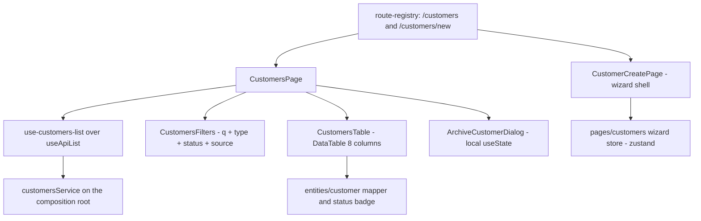

# AIS-19 — customers list page, wizard shell and the first page store

**Date:** 2026-11-25 00:10 (Europe/Budapest)
**Ticket:** AIS-19 `Admin - impl: admin oldal: céglista` — subtask of AIS-15 `Admin - cég felület`
**Branch:** `AIS-15-customers-admin`, cut from `main` after `AIS-14-company-admin` is merged
(pattern of `AIS-14-company-admin`). AIS-19 is the **first slice** on it.
**Scope:** `apps/admin` + `docs/Specs` + one dependency (`zustand`). **No** `packages/shared`,
**no** `apps/api`, **no** `packages/ui` change.
**Screen contract (authority):** [`Customers-Admin-Screens.md`](../Specs/Customers-Admin-Screens.md)
§2 (list), §4 (wizard), §1 (routes and URL parameters), §10 (file map).
**Work breakdown:** [`2026-11-23--23-05-00-ais-15-customers-admin-implementation-wave-plan.md`](2026-11-23--23-05-00-ais-15-customers-admin-implementation-wave-plan.md)
§4 `B1`–`B23`.
**Depends on (already on `main`):** AIS-14 / AIS-178 — `customers` API, `CustomersService`,
[`customerListQuerySchema`](../../packages/shared/src/contract/customers/customers.list-query.ts:54).
**Consumed by:** AIS-20 (detail shell), AIS-21 (edit), AIS-179 (contacts/users), AIS-182 (wizard steps).

---

## 0. Branch — the first executable step

Product decision (2026-11-25): the whole AIS-15 wave shares **one branch named after the story**, the
way `AIS-14-company-admin` carried the entire AIS-14 data layer. The per-subtask branch names in the
wave plan header (`AIS-19-customers-list`, `AIS-20-customer-detail`, …) are therefore superseded — the
branch is `AIS-15-customers-admin`, and AIS-19, AIS-20, AIS-21, AIS-179, AIS-181 and AIS-182 each land
as their own commit on it.

Precondition: `apps/admin/src` contains **no** `pages/customers`, **no** `features/customers`, **no**
`entities/customer`, and [`package.json`](../../apps/admin/package.json:20) has **no** `zustand` —
verified, so the whole layer stack is new.

**Step 1 — land the AIS-14 branch on `main`.** PR #12 is merged, but two documentation commits
(`943e7bb`, `79d1ae2`) sit on top of that merge commit and are not on `main`. If `main` is still at the
PR merge commit, the merge is a fast-forward and needs no message of its own; if `main` moved, a merge
commit is created and its title follows the convention.

```powershell
git fetch origin --prune
git status -sb                                    # expect a clean tree, no tracked modifications
git log --oneline origin/main..AIS-14-company-admin   # expect the two documentation commits
git switch main
git pull --ff-only
git merge --no-ff AIS-14-company-admin -m "AIS-14: docs(specs): merge the outstanding close-out documentation into main"
git push origin main
```

`--no-ff` is deliberate even when a fast-forward is possible: a named merge commit is the only reliable
marker in `git log` that the AIS-14 branch was folded in, and it keeps the two documentation commits
visually grouped. If `git log origin/main..AIS-14-company-admin` is **empty**, everything is already on
`main` — skip the merge and say so, rather than creating an empty merge commit.

**Step 2 — cut the wave branch.**

```powershell
git switch main
git switch -c AIS-15-customers-admin
git push -u origin AIS-15-customers-admin
git status -sb                                    # expect: ## AIS-15-customers-admin...origin/AIS-15-customers-admin
```

**`D0` — the base is `main` *after* the merge, never the AIS-14 branch tip.** Two consequences worth
stating: (a) the screen contract this plan cites must be the version on `main` — guard with
`git diff origin/AIS-14-company-admin -- docs/Specs/Customers-Admin-Screens.md`, which must be empty
after step 1; (b) every later slice of the wave extends the same branch, so AIS-20 must not be started
on a second branch cut from `main`.

---

## 1. The ticket text is stale in four places — the spec wins

AIS-19 was written on 2026-10-15 and three later decisions invalidated parts of it. Reading the DoD
literally would produce work the API cannot support.

| Ticket says | Reality today | Follow |
| --- | --- | --- |
| Filters: `q`, type, status, source **and `felelős operátor`** | `responsibleOperatorId` was removed everywhere (AIS-189, migration `0008`) and the operator directory was never built (wave plan `D-W2`). The contract schema has exactly three filters. | **Three filters + `q`.** The screen contract §2.3 says "there is no fourth" — do not add it, do not add it disabled. |
| `packages/api-client/src/customers/customers.service.ts` is in scope | Shipped by AIS-178: `createCustomersService`, 21 operations, typed over `@callback/shared`. | Only the **composition-root wiring** is left (§4 step 1). Write no service code. |
| `features/customers/use-customers.ts` | The screen contract, the wave plan and `UI-Architecture` §5 all name `use-customers-list.ts`. | `use-customers-list.ts` — one name, no alias. |
| DoD: add the `pages/customers` row to `UI-Architecture` §5 | The row already exists (AIS-17). What is genuinely missing is the **`zustand` row flip in §7** and the store's own state plan. | Verify + refine §5, flip §7 (§6 step 3). |

One more item the ticket does not mention but the standard mandates: the **empty-state CTA**. The
generic rule says an `EmptyState` carries no action (two competing create affordances), AIS-17 `D4`
requires one here, and [`New-Admin-Page.md`](../Specs/New-Admin-Page.md) §3 already records this page
as the named exception. Implement it; do not re-open the decision.

---

## 2. What ships



Nine deliverables, in the order the layers must land:

1. `customersService` wired into the admin composition root — the only module that may build a service.
2. `features/customers/*` — query keys, result types, pure logic, `use-customers-list`, `use-archive-customer`.
3. `entities/customer/*` — row view model, pure mapper, status → badge variant, thin `CustomerStatusBadge`.
4. `features/api/use-tab-param.ts` + `.logic.ts` — the generic `?step=`/`?tab=` reader (first consumer is this page, second is AIS-20).
5. `pages/customers/*` — page consts, `CustomersPage`, filters, table, archive dialog, wizard shell, store + provider.
6. `zustand` installed; store, provider and selector all inside `pages/customers/`.
7. Route registry: `/customers` (nav) and `/customers/new` (child, `navLabel: null`, parent crumb `/customers`).
8. MSW handlers + fixtures under `test/mocks/**`, and the test suite of §5.
9. Docs: `UI-Architecture` §7 flip + §5 refinement, screen-contract file map, history, milestone.

---

## 3. Decisions

| # | Decision | Why |
| --- | --- | --- |
| **D1** | Every list value (`page`, `limit`, `sort`, `order`, `q`, `type`, `status`, `source`) lives in the **URL** through one `useListParams(customerListQuerySchema)` call; `params` is both the request and the query key. | Rule §6.1 step 1; the DoD requires a copyable link and a working back button. |
| **D2** | One user interaction = **one** `setParams` write. Sort click writes `sort` + `order` **and** resets `page` in the same call; reset writes all defaults in one call. | Two `setParam` calls rebuild the URL from the same pre-render value — the first change is lost and two history entries appear. |
| **D3** | Columns come from the mapper, never from JSX conditionals: `shortName ?? legalName`, `null` tax number → `—` + missing-data marker, `null` primary contact → `Nincs`, `null` activity → `—`. | Rule §11 anti-patterns; the marker is also the only place `hasMissingData` is read. |
| **D4** | The archive confirmation dialog keeps its open flag in **local `useState`**. | AIS-173 exception: a confirmation has no address of its own, so it is not a route and not a store. |
| **D5** | `zustand` is installed **in this change** and consumed by the wizard shell in the same commit; the §7 row flips to `installed`. | UI-Architecture §6.4 and AIS-17 `D11`; an unused store fails `pnpm quality:dead-code`. |
| **D6** | The wizard's step lives in the **URL** (`?step=1..4`), the draft lives in the **store**, the current step's inputs live in **`useAppForm`**. The store mirrors `?step=` only on mount. | `?step=` must survive a reload; react-hook-form seeds `defaultValues` on mount only, so a value cannot cross a step without a store. |
| **D7** | AIS-19 ships the wizard **shell** (provider, stepper, step 1 body, cancel) — not four steps and not the submit. | Wave plan `D-W5`: the shell is what makes the store a real consumer; AIS-182 fills the steps. |
| **D8** | `features/api/use-tab-param.logic.ts` exposes a pure `parseAllowedValue(value, allowed, fallback)`; an invalid `?step=` falls back to `1` and **never throws**. | Same contract `use-list-params` gives for list fields; a component never reads `searchParams` itself. |
| **D9** | `DataTable` renders skeleton rows while loading and one `sr-only` sentence; no spinner on the page. | Screen contract §2.4; the header and the filters stay interactive. |
| **D10** | A failed `DELETE` is reported by the notification capture (`meta.successMessage` / the existing error surface); the page adds no toast of its own. | One owner per message; the capture already covers write failures. |
| **D11** | Any pure helper that ends up with no call site is **deleted** rather than shipped for later. | `knip` fails the build on unused exports (`quality:dead-code`). |

---

## 4. Ordered work

Each step is a separate edit; steps compile in this order and nothing above depends on something below.

| # | File | Content |
| --- | --- | --- |
| 1 | [`services/api-client.ts`](../../apps/admin/src/services/api-client.ts:59) | `export const customersService: CustomersService = createCustomersService(httpClient);` with a doc comment in the style of the existing `apiKeysService` export. |
| 2 | `features/customers/customers.const.ts` | `CUSTOMERS_QUERY_KEYS = createEntityQueryKeys<CustomerListQuery>('customers')`; `CUSTOMERS_LIMIT_OPTIONS` (`LIST_QUERY_DEFAULT_LIMIT`, `50`, `LIST_QUERY_MAX_LIMIT`). |
| 3 | `features/customers/customers.interface.ts` | `CustomersListResult` — `rows`, `meta`, `isLoading`, `errorMessage`, `errorSurface`, `refetch`. Nothing wider than the page needs. |
| 4 | `features/customers/customers.logic.ts` | Pure: `toSortPatch(column, direction)` → `{ sort, order, page: 1 }`, `hasActiveFilters(params)`. No JSX, no hook, no I/O. |
| 5 | `features/customers/use-customers-list.ts` | `useApiList` over `customersService.list`, key `CUSTOMERS_QUERY_KEYS.list(params)`, frozen `EMPTY_CUSTOMERS`. Same shape as [`use-api-keys.ts`](../../apps/admin/src/features/api-keys/use-api-keys.ts:1). |
| 6 | `features/customers/use-archive-customer.ts` | `useApiMutation` over `customersService.remove`; `invalidateKeys: [CUSTOMERS_QUERY_KEYS.all]`. Reused by AIS-21. |
| 7 | `entities/customer/customer.interface.ts` | `CustomerRowViewModel` — `id`, `customerNumber`, `displayName`, `typeLabel`, `taxNumberText`, `status`, `statusLabel`, `primaryContactText`, `lastActivityText`, `hasMissingData`. |
| 8 | `entities/customer/customer.const.ts` | Column headers, type/source labels, `CUSTOMER_STATUS_BADGE_VARIANT` (AIS-17 `D10`: 7 statuses → 5 variants, `anonymized` → neutral + „Anonimizált"), missing-data `aria-label`. |
| 9 | `entities/customer/customer.mapper.ts` | Pure `toCustomerRowViewModel(dto)` + `toStatusVariant(status)`; the `—` / `Nincs` renderers and [`lib/date.ts`](../../apps/admin/src/lib/date.ts:1) formatting live here. |
| 10 | `entities/customer/components/CustomerStatusBadge.tsx` | Thin `StatusBadge` wrapper taking the domain status, so no page re-implements the mapping. |
| 11 | `features/api/use-tab-param.logic.ts` + `use-tab-param.ts` | `parseAllowedValue`; the hook returns `{ value, setValue }` with exactly one URL write per set. |
| 12 | `pages/customers/customers.const.ts` | Route paths (`/customers`, `/customers/new`), `CUSTOMERS_PAGE_TITLE/SUBTITLE`, `CUSTOMERS_CREATE_LABEL`, `CUSTOMERS_WIZARD_STEPS`, empty-state copy (both variants: "no rows at all" and "no rows for this filter"). |
| 13 | `pages/customers/customers-wizard.store.ts` + `customers-wizard.provider.tsx` | Factory (`draft`, `step`, `setDraft`, `setStep`, `reset`), provider creating one instance per mount, `useCustomersWizardStore(selector)`. **No** `persist`. Nothing exported outside the folder. |
| 14 | `pages/customers/CustomersPage.tsx` | Composition only: `PageShell` (title, subtitle, „Új cég" `Link` + `buttonVariants()` + `PlusIcon`) → `CustomersFilters` → `CustomersTable` → `Pagination`; the four states. No `<Outlet/>` — detail and edit are sibling routes (`D14`). |
| 15 | `pages/customers/ui/CustomersFilters.tsx` | Debounced `Input type="search"` for `q`, three `Select`s (`type`, `status`, `source`), one ghost `Button` reset → one `setParams` with the schema defaults. |
| 16 | `pages/customers/ui/CustomersTable.tsx` | `DataTable` with the 8 contract columns, `aria-sort`, URL-driven sort, `rowActions` = *Megnyitás* / *Szerkesztés* / *Archiválás*, name cell as `Link` to `/customers/:id`. |
| 17 | `pages/customers/ui/ArchiveCustomerDialog.tsx` | `ConfirmDialog` (`D4`), confirm → `use-archive-customer`, cancel → close. |
| 18 | `pages/customers/CustomerCreatePage.tsx` | Wizard shell: provider, `CUSTOMERS_WIZARD_STEPS` stepper, step 1 body from the store draft, „Mégre" → `navigate('/customers')` + `reset()`. AIS-182 replaces the bodies. |
| 19 | [`app/app.const.ts`](../../apps/admin/src/app/app.const.ts:1) | `APP_ROUTE_CUSTOMERS_PATH = '/customers'`, `APP_CUSTOMERS_LABEL`. |
| 20 | [`app/router/route-registry.tsx`](../../apps/admin/src/app/router/route-registry.tsx:64) | Two entries: `/customers` (`navLabel`, crumb, parent home) and `/customers/new` (`navLabel: null`, crumb „Új cég", `breadcrumbParentPath: '/customers'`). |
| 21 | [`package.json`](../../apps/admin/package.json:20) | `zustand` — `pnpm --filter @callback/admin add zustand`; `pnpm-lock.yaml` in the same commit. |
| 22 | `test/mocks/handlers/customers.handlers.ts` + `test/mocks/customer.mock.ts` | MSW: paged `GET /api/admin/customers`, a filtered empty page, a `500`; fixtures derived from [`customers.fixture.ts`](../../packages/shared/src/contract/customers/customers.fixture.ts:1). Shared fixtures live in `test/mocks/`, never inside a test file. |
| 23 | Docs (§6) | §7 flip, §5 refinement, screen-contract file map, history, milestone. |

---

## 5. Tests

Tests never hit the network; the service layer is mocked (MSW for the hook, plain doubles elsewhere).

| File | Cases |
| --- | --- |
| `entities/customer/customer.mapper.test.ts` | all 7 statuses → variant (table test), `shortName ?? legalName`, `null` tax number, `null` primary contact, `null` `lastActivityAt`, `hasMissingData` marker text, `anonymized` label |
| `features/customers/customers.logic.test.ts` | `toSortPatch` resets `page` to `1`; `hasActiveFilters` with each filter alone and in combination; no active filter on defaults |
| `features/customers/use-customers-list.test.tsx` | loading (skeleton rows + `sr-only`), success with several rows, empty without filter, empty with filter, `500` → `errorSurface === 'page'`, retry calls `refetch` |
| `features/api/use-tab-param.logic.test.ts` | valid value, missing value, invalid value → fallback; never throws |
| `features/api/use-tab-param.test.tsx` | one URL write per `setValue`, back/forward restores the step |
| `pages/customers/customers-wizard.store.test.ts` | `init → setDraft → setStep → reset`, selector stability, no persistence |
| `pages/customers/ui/CustomersFilters.test.tsx` | each filter writes the URL **once**; search is debounced; reset writes defaults in one call |
| `pages/customers/ui/CustomersTable.test.tsx` | 8 columns in order, `aria-sort` on the sorted column, three row-menu items, name cell is a link |
| `pages/customers/ui/ArchiveCustomerDialog.test.tsx` | confirm calls the mutation, cancel does not, open flag stays local |
| `pages/customers/CustomersPage.test.tsx` | four states render through the shared primitives; no inline `<table>` markup |
| `pages/customers/CustomerCreatePage.test.tsx` | provider present, stepper renders the four titled steps, step 1 reads the draft, cancel navigates and resets |
| [`app/router/route-registry.test.ts`](../../apps/admin/src/app/router/route-registry.test.ts:1) | the two new entries, `navLabel`, crumb parent of `/customers/new` |

---

## 6. Documentation and gates

| Doc | Change |
| --- | --- |
| [`UI-Architecture.md`](../Specs/UI-Architecture.md:1128) §7 | `zustand` row → **installed**, naming `pages/customers/customers-wizard.store.ts` as the first store; `Utolsó frissítés` bump |
| `UI-Architecture.md` §5 | verify the `pages/customers` row against the code that now exists (three filters, list params in the URL, wizard draft in the page store, step in the URL); date bump |
| [`Customers-Admin-Screens.md`](../Specs/Customers-Admin-Screens.md:366) §10 | file map marks the hooks and files that now exist; date bump |
| [`New-Admin-Page.md`](../Specs/New-Admin-Page.md) §2/§3 | only if the wording drifted: the two documented gaps are now **closed**, the empty-state CTA exception is now **implemented**. Verify before editing — both were written by AIS-17 |
| `docs/history/<ts>-ais-19-customers-list.md` | change summary |
| `docs/milestones/<ts>-ais-19-customers-list.milestone.md` | mandatory: first page store, first install of `zustand`, first search/filter UI, the `use-tab-param` contract |

Gates, in this order, each one a single command:

```text
pnpm quality            # layers, dead-code, tokens, themes, field-errors, docs
pnpm test:quality
pnpm typecheck
pnpm lint
pnpm --filter @callback/admin test
pnpm build
```

`pnpm quality:docs` is the one that fails on a stale date bump or a broken relative link — run it after
the doc edits, not before.

---

## 7. Risks

| Risk | Mitigation |
| --- | --- |
| The `zustand` dependency lands with no consumer and `quality:dead-code` fails | The store, provider and wizard shell land in the same commit and the store test imports the factory (`D5`, `D7`). |
| A component reads `searchParams` directly for `?step=` | `use-tab-param` is the only reader (`D8`); the layer gate and code review both look for it. |
| Two sort writes produce two history entries and a lost change | `D2`: `setParams` only, never two `setParam` calls. |
| Someone re-adds the responsible-operator filter because the ticket says so | §1 records the removal; the contract schema has no such field, so the build fails first. |
| A second `status → badge` mapping appears in the detail page later | The mapping lives once in `entities/customer`; AIS-20 imports `CustomerStatusBadge`. |
| `CustomersPage` renders its own `<table>` instead of `DataTable` | DoD bullet; `quality:tokens` catches palette classes, review catches the markup. |
| The wizard draft survives a reload and resurrects a stale form | No `persist` in the store (`D6`); the provider is per mount. |

---

## 8. Definition of done

- [ ] `/customers` reachable from the navigation; the URL carries **only** `page`, `limit`, `sort`, `order`, `q`, `type`, `status`, `source`.
- [ ] A copied filtered URL restores the view; back and forward work; an invalid value falls back to the default.
- [ ] Sorting writes `sort` + `order` and resets `page` in one URL write.
- [ ] Eight contract columns, `aria-sort` present, row menu with *Megnyitás* / *Szerkesztés* / *Archiválás*.
- [ ] Four states through the shared primitives: `DataTable` skeleton / `EmptyState` with CTA / `PageErrorState` + retry / table + pager.
- [ ] `zustand` installed, §7 flipped, store test green, store not imported outside `pages/customers/`.
- [ ] No `fetch` outside `packages/api-client`, no colour literal or palette class, no hand-written table markup.
- [ ] `pnpm quality`, `pnpm test:quality`, `pnpm typecheck`, `pnpm lint`, `pnpm build`, admin tests all green.
- [ ] History entry and milestone written; AIS-19 → `Done` with the evidence and the §1 deviations recorded in the ticket comment.

---

## 9. Commit plan

Single-commit work is acceptable here (one vertical slice), but if the branch is split, the order is:
wiring + features + entities → page + store + registry + dependency → tests → docs.

```text
AIS-19: feat(admin): add the customers list page with URL state and the wizard shell store
```

The branch is named after the **story** (`AIS-15`), so the branch-derived key would be `AIS-15` — that
is exactly the case where the session-ticket rule wins: the key is taken from the ticket being worked
(**AIS-19**), because an `AIS-15: feat(admin): …` title for the list page would lose the link to the
subtask. AIS-20, AIS-21, AIS-179, AIS-181 and AIS-182 follow the same pattern, each with its own key,
and the wave's pull-request title carries `AIS-15` as the story. Documentation may ride in the same
commit; a separate docs commit is only justified if the gates need it:

```text
AIS-19: docs(specs): flip the zustand row and record the customers file map
```
