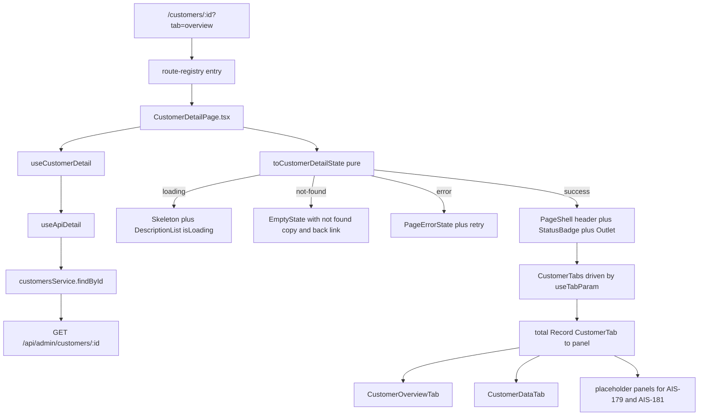

# AIS-20 — customer detail page (shell + Áttekintés és Cégadatok tabs)

**Ticket:** [AIS-20](https://zakzag.atlassian.net/browse/AIS-20) — `Admin - impl: admin oldal: cég adatlap (megjelenítés)` (parent story AIS-15)
**Date:** 2026-11-25
**Status:** plan — awaiting approval
**Normative sources, in precedence order:**

1. [`New-Admin-Page.md`](../Specs/New-Admin-Page.md:41) — which files, in which order (`§2`, step 9 → 15).
2. [`Customers-Admin-Screens.md`](../Specs/Customers-Admin-Screens.md:148) — what the detail screen contains (`§3`).
3. [`UI-Architecture.md`](../Specs/UI-Architecture.md:956) — primitives (`§4`) and the state plan (`§5`).
4. [`.roo/rules/react.coding-standards.md`](../../.roo/rules/react.coding-standards.md:1) — layer and state rules.
5. [`2026-11-23--23-05-00-ais-15-customers-admin-implementation-wave-plan.md`](2026-11-23--23-05-00-ais-15-customers-admin-implementation-wave-plan.md:161) — the wave plan; it **loses** to points 1–4 wherever they disagree (two such drifts are resolved in §3 below).

---

## 1. Why this ticket is smaller than it looks

Every prerequisite of AIS-20 is already merged, so the ticket is **one page plus its read path**, not a stack of layers:

| Prerequisite | Status | What it already gives us |
| --- | --- | --- |
| AIS-17 (screen contract) | Done | routes, tab names, header, the four states, `D12` (groups), `D-W3` |
| AIS-19 (list page) | Done | page folder, `customers.const.ts`, `customers.logic.ts` (`toCustomerDetailRoute`), `CustomerStatusBadge`, entity mapper + label tables, `useTabParam`, `zustand` |
| AIS-178 (API + api-client) | Done | `GET /api/admin/customers/:id` on the server **and** `customersService.findById` returning `CustomerDetail` |
| AIS-110 / AIS-114 | Done | `CUSTOMERS_QUERY_KEYS.detail(id)`, `useApiDetail` |
| AIS-120 (MSW harness) | Done | `customers.handlers.ts`, `handler-envelope.ts`, `render-hook-with-query.mock.tsx` |
| AIS-115 (form pattern) | Done | not needed here — the detail page renders no form |

**Consequences:** `packages/shared`, `packages/api-client`, `apps/api` and `packages/ui` are **untouched**. No migration, no contract change, no new dependency, no new primitive.

---

## 2. Scope

**In scope**

- Route `/customers/:id` with a breadcrumb, a back link to the list and a page header (name + `customerNumber` + `StatusBadge`).
- Six-tab frame driven by `?tab=overview|data|contacts|users|activity|audit` — linkable, reload-safe, unknown value falls back to `overview`.
- `overview` tab: status + `statusChangedAt`, primary contact, last activity, missing-data notice.
- `data` tab: four `Card` groups, each a `DescriptionList` (`columns={2}`) — `D12`.
- Four explicit states: loading (`Skeleton` + `DescriptionList isLoading`), **404 with its own copy**, page error (`PageErrorState` + retry), success.
- `<Outlet/>` for the AIS-179 overlay children (contact / invite routes).

**Explicitly out of scope** (owned by later tickets, do not pre-build)

| Item | Owner |
| --- | --- |
| bodies of the `contacts`, `users`, `activity`, `audit` tabs | AIS-179 / AIS-181 |
| `Szerkesztés` link, *Státusz váltása* / *Archiválás* header menu | AIS-21 (wave plan `D7`) — see **open decision Q1** |
| tag chips on the `data` tab | AIS-21 (`D-W1`, wave plan `D8`) |
| editing, status change, archive writes | AIS-21 |
| a `packages/ui` `Tabs` primitive | not needed: the strip stays a page part (screen contract §3.1) |

---

## 3. Decisions

| # | Decision | Why |
| --- | --- | --- |
| **D1** | The page lives in the **flat** folder `apps/admin/src/pages/customers/`, not in a `pages/customers/customer/` subfolder. Detail-only parts go to `pages/customers/ui/`. | Screen contract §1 fixes one page folder for all four customers screens; AIS-19 already built the const/logic/entity there; `react.coding-standards.md` `§0.4` says one page = one folder, and splitting the detail parts out of it would put one page in two folders. **Supersedes** wave plan `C4`, `C6`–`C8`. |
| **D2** | The read path is `useApiDetail` + `CUSTOMERS_QUERY_KEYS.detail(id)`, with `enabled: id !== undefined`. | Generic hook (AIS-114) already owns the four states; the detail key is already produced by `createEntityQueryKeys('customers')`; the list cache is never reused for the detail (screen contract §3). |
| **D3** | The **404 is its own state**, decided by a pure function `toCustomerDetailState({ isLoading, error, data })` in `customers.logic.ts`, not by an `if` in the component. | The ticket's DoD asks for a separate copy; a component may not branch on `error.code`/`status` (`png quality:field-errors` allowlists `*.logic.ts`), and a pure function is testable without React. This is a deliberate step beyond the `ApiKeyViewDialog` shape, which branches inline. |
| **D4** | The tab is **URL state**: `useTabParam({ paramName: 'tab', allowed: CUSTOMER_TAB_VALUES, fallback: 'overview' })`. No store, no `useState`, no second narrowing helper. | `useTabParam` (AIS-19) already provides the fallback and the single-write guarantee; wave plan `C9`'s `toCustomerTab()` would duplicate `parseAllowedValue` and add a dead export. |
| **D5** | The tab strip is a page part — `ui/CustomerTabs.tsx`: labelled `<nav>`, `Button` `variant="ghost"`/`primary`, active tab carries `aria-current="page"`. It is **not** a WAI-ARIA `tablist`. | Screen contract §3.1. Each tab has its own address, so `role="tab"` + `aria-controls` would claim an in-place panel switch the URL does not have; `aria-current` is the honest signal for "current view". |
| **D6** | Tab bodies are resolved by a **total** `Record<CustomerTab, ComponentType>` in `ui/customer-tab-content.tsx`. A new `CUSTOMER_TAB_VALUES` entry without a panel is a compile error. | Wave plan `C4`/`DoD`: AIS-179/181 must add their tab **without touching `CustomerDetailPage`**. A `switch` with a `default` would silently render the wrong panel. |
| **D7** | Every formatting decision lives in `entities/customer/customer.mapper.ts`; JSX renders view models only. Dates go through `lib/date.ts` (`formatDateTime`). | Ticket key decision 2; `CUSTOMER_EMPTY_VALUE_LABEL` (`—`) covers every `null`, exactly like the list row mapper. |
| **D8** | The page renders `<Outlet/>` from day one. | Screen contract §1: contact / invite surfaces are overlay **children** of the detail entry (AIS-179). Adding it later would touch the page for no benefit. |
| **D9** | Loading = one `Skeleton` block in the header + `DescriptionList isLoading` inside the tabs. | Screen contract §3.1 — never a spinner; `Skeleton` and `DescriptionList isLoading` both exist. |
| **D10** | Copy lives in `customers.const.ts` (page) and `entities/customer/customer.const.ts` (field labels); tests import the same constants. | AIS-19 convention; keeps the Hungarian wording out of JSX and out of test literals. |
| **D11** | No `packages/ui` change, no new npm dependency. | Screen contract §0.1. |

---

## 4. Flow



---

## 5. Ordered work (layer order, per `New-Admin-Page.md` §2)

### Step 9 — feature hook (`features/`)

| File | Change |
| --- | --- |
| `apps/admin/src/features/customers/use-customer-detail.ts` | **New.** `useCustomerDetail(id: string \| undefined): CustomersDetailResult` → `useApiDetail<CustomerDetail>({ queryKey: CUSTOMERS_QUERY_KEYS.detail(id ?? ''), queryFn: () => customersService.findById(id ?? ''), enabled: id !== undefined })`. Adapter only — no logic, like `use-customers-list.ts`. |
| `apps/admin/src/features/customers/customers.interface.ts` | **Extend.** `CustomersDetailResult = { readonly customer: CustomerDetail \| null } & UseApiDetailResult<CustomerDetail>`. |

Note: `ApiQueryFn` is deliberately parameterless (MSW/jsdom signal limitation, `api-hooks.interface.ts:50`), so the service call is `() => customersService.findById(id)`.

### Step 10 — entity (`entities/customer/`)

| File | Change |
| --- | --- |
| `customer.interface.ts` | **Extend.** `CustomerTabField = { readOnly label: string; value: ReactNode }`-free shape — use `DescriptionListItem`-compatible `{ label, value }`; `CustomerDetailGroup = { id: string; title: string; items: readonly DescriptionListItem[] }`; `CustomerDetailViewModel = { displayName, customerNumber, status, statusLabel, statusVariant, overview: readonly DescriptionListItem[], groups: readonly CustomerDetailGroup[], hasMissingData }`. Import `DescriptionListItem` as a **type only** from `@callback/ui`. |
| `customer.const.ts` | **Extend.** `CUSTOMER_DETAIL_OVERVIEW_LABELS` (státusz, státuszváltás dátuma, elsődleges kapcsolattartó, utolsó aktivitás), `CUSTOMER_DETAIL_FIELD_LABELS` (every contract field, one `Record`), `CUSTOMER_DETAIL_GROUP_TITLES` (Azonosítók / Jogi adatok / Cím / Egyéb), `CUSTOMER_HEADCOUNT_RANGE_LABELS` (`sole` → „Egyéni”, `2_5`, `6_20`). Country is a free ISO-3166 alpha-2 string, so it is rendered as-is — no label map. |
| `customer.mapper.ts` | **Extend.** `toCustomerDetailViewModel(dto: CustomerDetail): CustomerDetailViewModel` — reuses `toDisplayName`, `toStatusVariant`, `formatDateTime`, and `CUSTOMER_EMPTY_VALUE_LABEL` for every `null`; builds the overview pairs and the four groups. |

Group content (`D12`):

| Group | Fields |
| --- | --- |
| Azonosítók | `customerNumber` (mono), `type`, `source`, `createdAt`, `updatedAt` |
| Jogi adatok | `legalName`, `shortName`, `taxNumber`, `euVatNumber`, `companyRegistrationNumber`, `legalForm` |
| Cím | `registeredAddressZip`, `registeredAddressCity`, `registeredAddressLine`, `registeredAddressCountry` |
| Egyéb | `industry`, `headcountRange`, `lastActivityAt` |

### Step 11 — page (`pages/customers/`)

| File | Change |
| --- | --- |
| `customers.const.ts` | **Extend.** `CUSTOMER_DETAIL_PARAM = 'id'`, `CUSTOMER_DETAIL_TAB_PARAM = 'tab'`, `CUSTOMER_DETAIL_TABS` (`{ value, label }[]`, order fixed by screen contract §3.2), `CUSTOMER_TAB_VALUES` **derived** from `CUSTOMER_DETAIL_TABS`, `CUSTOMER_DETAIL_DEFAULT_TAB = 'overview'`, `CUSTOMER_DETAIL_BACK_LABEL`, `CUSTOMER_DETAIL_LOADING_MESSAGE`, `CUSTOMER_DETAIL_ERROR_TITLE`, `CUSTOMER_DETAIL_NOT_FOUND_TITLE` („Ez a cég nem található.”), `CUSTOMER_DETAIL_NOT_FOUND_MESSAGE`, `CUSTOMER_DETAIL_BACK_TO_LIST_LABEL`, `CUSTOMER_DETAIL_TAB_PLACEHOLDER_TITLE` / `_DESCRIPTION` („Ez a fül a következő fejlesztésben érkezik.”), `CUSTOMER_DETAIL_MISSING_DATA_TITLE`. |
| `customers.interface.ts` | **Extend.** `CustomerTab` (`typeof CUSTOMER_TAB_VALUES[number]`), `CustomerTabsProps` (`{ tab, onTabChange }`), `CustomerTabPanelProps` (`{ customer: CustomerDetailViewModel }`), `CustomerDetailState = 'loading' \| 'not-found' \| 'error' \| 'success'`, `CustomerDetailStateInput`. |
| `customers.logic.ts` | **Extend.** `toCustomerDetailState(input: CustomerDetailStateInput): CustomerDetailState` — order: `isLoading` → `not-found` (`isNotFoundFailure(error)`) → `error` (`errorSurface === 'page'`) → `success`. Pure, no React; `isNotFoundFailure` comes from `lib/error-surface.logic.ts`. |
| `ui/CustomerTabs.tsx` | **New.** Labelled `<nav>` (`aria-label` from const) with one `Button` per `CUSTOMER_DETAIL_TABS` entry: `variant="primary"` + `aria-current="page"` for the active one, `variant="ghost"` otherwise; `type="button"`; `onTabChange(value)`. |
| `ui/CustomerOverviewTab.tsx` | **New.** `DescriptionList` from the view model's `overview` pairs, `CustomerStatusBadge` for the status row, and an `Alert variant="warning"` when `hasMissingData`. |
| `ui/CustomerDataTab.tsx` | **New.** One `Card` per group (`title`), each `DescriptionList columns={2}`. |
| `ui/customer-tab-content.tsx` | **New.** `CUSTOMER_TAB_PANELS: Readonly<Record<CustomerTab, ComponentType<CustomerTabPanelProps>>>` — `overview` and `data` map to the two tabs above, the other four map to a local `CustomerTabPlaceholder` (a `Card` with the tab title + the placeholder copy). This is the file AIS-179/181 edit, not the page. |
| `CustomerDetailPage.tsx` | **New.** `useParams()[CUSTOMER_DETAIL_PARAM]`, `useCustomerDetail(id)`, `useTabParam`, `useMemo` mapper, then `PageShell`: `back` = `<Link to={CUSTOMERS_LIST_ROUTE_PATH}>`, `title` = `displayName`, `subtitle` = `customerNumber`, `actions` = the `CustomerStatusBadge` in a `flex items-center gap-3` group (AIS-21 appends the edit link and the header menu into that same group). Body switches on `toCustomerDetailState`; success renders `<CustomerTabs/>` + the resolved panel + `<Outlet/>`. |

Page composition order (screen contract §3.1): back link → title + subtitle + status → tab strip → panel. Loading keeps the shell (a `Skeleton` for the title, `sr-only` loading sentence) so the page does not jump when data arrives.

### Step 12 — route

| File | Change |
| --- | --- |
| `apps/admin/src/app/router/route-registry.tsx` | **One** entry: `path: CUSTOMER_DETAIL_ROUTE_PATH`, `navLabel: null`, `element: <CustomerDetailPage />`, `protected: true`, `breadcrumbLabel: null`, `breadcrumbParentPath: APP_ROUTE_CUSTOMERS_PATH`, `resolveBreadcrumbLabel: (params) => params[CUSTOMER_DETAIL_PARAM]`. **Sibling** of the list, not a child (`D14`) — the detail replaces the list instead of floating above it. No `children` yet; AIS-179 adds them. |

### Step 14 — mocks (`apps/admin/src/test/mocks/`)

| File | Change |
| --- | --- |
| `handlers/customers.handlers.ts` | **Extend.** `customersDetailSuccess` (`200`, body `VALID_CUSTOMER_DETAIL` from `@callback/shared` — the fixture already exists), `customersDetailNotFound` (`404 NOT_FOUND`), `customersDetailServerError` (`500 INTERNAL_ERROR`); add `customersDetailSuccess` to the default `customersHandlers` set. |
| `handlers/customers.handlers.ts` | Re-export `CUSTOMER_DETAIL_FIXTURE` next to `CUSTOMER_FIXTURE`, so assertions read the same object the handler served. |

### Step 15 — docs

| File | Change |
| --- | --- |
| [`UI-Architecture.md`](../Specs/UI-Architecture.md:967) `§5` | Update the `pages/customers` row: the detail page is delivered, `?tab=` is **URL** state (six values, no store), the detail read is `useApiDetail`, and the four later tabs carry no state of their own (`D-W3`). Refresh the `**Utolsó frissítés:**` line at the top of the file. |
| [`Customers-Admin-Screens.md`](../Specs/Customers-Admin-Screens.md:3) `§10` | ✅ the AIS-20 rows of the file map, refresh `**Utolsó frissítés:**` (already `2026-11-25`, add the AIS-20 sentence). |
| `docs/history/<YYYY-MM-DD--HH-ii-ss>-ais-20-customer-detail-page.md` | Change summary after implementation (required by `.roo/rules/instructions.md`). |
| `docs/milestones/…` | **Not planned.** No non-trivial diagnosis, no multi-service change; the design decisions are preserved in the two specs above and in this plan. Revisit only if implementation uncovers something those documents cannot express. |

---

## 6. Tests (mandatory coverage per `react.coding-standards.md` §10)

| File | Cases |
| --- | --- |
| `features/customers/use-customer-detail.test.tsx` | loading; success (`data` mapped from the fixture); **404** → `errorSurface === 'page'` + `isNotFoundFailure(error)` true; **500** → message + `page`; `id === undefined` → `enabled` false, no request; `refetch` re-issues the call |
| `entities/customer/customer.mapper.test.ts` | `toCustomerDetailViewModel`: all four groups in fixed order; every `null` → `—`; `shortName ?? legalName`; `headcountRange` and `source` labels; `statusChangedAt`/`createdAt`/`updatedAt` formatted, never raw ISO; `hasMissingData` passes through |
| `pages/customers/customers.logic.test.ts` | `toCustomerDetailState` — loading wins over a stale error; `404` → `not-found`; `500` → `error`; `banner`-tier failure is not the page's; success; abort-like (`silent`) never renders a page error |
| `pages/customers/CustomerDetailPage.test.tsx` | loading skeleton; success shows title, `customerNumber` and the status badge; **404 copy + back link** instead of a generic error; **500** → `PageErrorState` + retry; default tab `overview`; `?tab=data` deep link renders the data tab; click on users tab writes `?tab=users` in **one** URL change; `?tab=nonsense` falls back to `overview` |
| `pages/customers/ui/CustomerTabs.test.tsx` | renders six buttons with the constant labels; active one has `aria-current="page"` and `primary`; `onTabChange` receives the clicked value; the `<nav>` has an accessible name |
| `pages/customers/ui/CustomerOverviewTab.test.tsx` | overview pairs; missing-data alert only when the flag is set |
| `pages/customers/ui/CustomerDataTab.test.tsx` | four `Card`s with their `DescriptionList`s; `columns={2}` |
| `app/router/route-registry.test.ts` | the detail entry exists, is a sibling of the list, its path literal equals `CUSTOMER_DETAIL_ROUTE_PATH`, and its breadcrumb parent is `/customers` |

Rules kept: mocks and fixtures in `src/test/mocks/**`, never inline in a test; the network is the only mocked boundary (real `customersService` + `httpClient` under MSW); no real timers.

---

## 7. Risks and how they are handled

| Risk | Handling |
| --- | --- |
| `pnpm quality:dead-code` — a new export without a consumer (e.g. a `toCustomerTab` helper) | skip the helper (`D4`); every new constant is read by the page or a test in the same change |
| `pnpm quality:field-errors` — the page branching on `error` | the branch is `toCustomerDetailState` in `*.logic.ts` (`D3`) |
| `pnpm quality:palette` / tokens — the tab strip could tempt a colour literal | `Button` variants only; no `className` colour, no `[data-theme]` |
| `pnpm quality:docs` — `§N` references and the `**Utolsó frissítés:**` line | both touched specs are updated in the same change (§5, step 15) |
| A page test that needs the detail endpoint but only the list handler is registered | `customersDetailSuccess` joins the default handler set (step 14) |
| A dead `Szerkesztés` link (its target `/customers/:id/edit` is mounted by AIS-21) | avoided: Q1 resolved as **A** — AIS-20 renders no edit action |
| Breadcrumb shows a raw uuid | screen contract §1 fixes `resolveBreadcrumbLabel: (params) => params.id`; a data-aware crumb needs the read inside the breadcrumb, out of scope |

---

## 8. Resolved decisions (2026-11-25, before implementation)

**Q1 — header actions → answer A.** The ticket's description says the header shows name + `StatusBadge` + a *Szerkesztés* button; the screen contract §3.1 lists *Szerkesztés* + a *Státusz váltása / Archiválás* menu; wave plan `D7` assigns **both** to AIS-21 („az írási műveletek itt, nem AIS-20-ban”).

Chosen: **follow the wave plan.** AIS-20 renders name + `customerNumber` + `StatusBadge` and **no** edit/status/archive action. Reason: the `Szerkesztés` link would point at `/customers/:id/edit`, which AIS-21 mounts, so until then it would fall into the `*` catch-all; adding the action once, in AIS-21, is cheaper than adding it twice. The AIS-21 ticket takes over the `actions` group this page already renders.

**Q2 — page folder → flat.** The ticket and the wave plan say `pages/customers/customer/…`; the screen contract §1 and the shipped AIS-19 code say one folder, `apps/admin/src/pages/customers/`.

Chosen: **flat `pages/customers/`** (`D1`), with detail-only parts under `pages/customers/ui/`. Wave plan `C4` and `C6`–`C8` are superseded; AIS-21/179/181 inherit the flat layout, so their `pages/customers/customer/edit/…` and `pages/customers/customer/ui/…` paths become `pages/customers/CustomerEditPage.tsx` and `pages/customers/ui/…`.

---

## 9. Definition of done (ticket checklist → evidence)

| Ticket DoD | Where it is satisfied |
| --- | --- |
| Az adatlap `DescriptionList`-et használ, nincs saját kulcs–érték markup | `CustomerOverviewTab`, `CustomerDataTab`; no `<dl>` anywhere in `pages/` |
| A tab-keret működik, az ismeretlen `?tab=` az alapértelmezettre esik vissza | `useTabParam` + `CUSTOMER_TAB_VALUES`; page test on `?tab=nonsense` |
| A loading `Skeleton`, a 404 és az 5xx külön állapot | `toCustomerDetailState` + `Skeleton`/`EmptyState`/`PageErrorState`; logic + page tests |
| Hook-teszt MSW-vel: loading, success, 404, 500 | `use-customer-detail.test.tsx` |
| `docs/Specs/UI-Architecture.md` §5 state-table row for `pages/customers` | step 15 |

```bash
pnpm quality          # layers + dead code + tokens + field errors + docs
pnpm test:quality     # the gates' own fixtures
pnpm typecheck && pnpm -r build && pnpm -r lint && pnpm test
```

**Suggested commit title:** `AIS-20: feat(admin): add the customer detail shell and its first two tabs`
