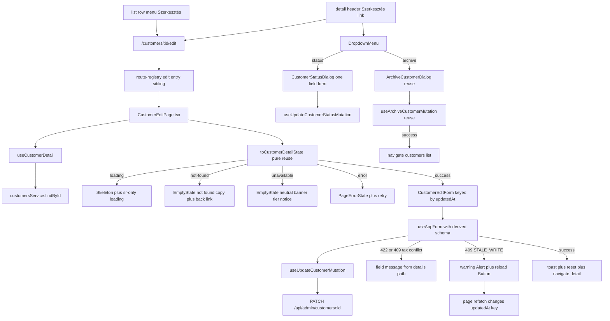

# AIS-21 — customer edit page + detail header write actions

**Ticket:** [AIS-21](https://zakzag.atlassian.net/browse/AIS-21) — `Admin - impl: admin oldal: cég adatlap (módosítás)` (parent story AIS-15)
**Date:** 2026-11-25
**Status:** plan — awaiting approval
**Scope decision (2026-11-25):** the edit page + form **and** the detail header actions (*Szerkesztés*, *Státusz váltása*, *Archiválás*). The **tags chip card is deferred** to a follow-up ticket.

**Normative sources, in precedence order:**

1. [`New-Admin-Page.md`](../Specs/New-Admin-Page.md:41) — which files, in which order (`§2`, steps 9 → 15).
2. [`Customers-Admin-Screens.md`](../Specs/Customers-Admin-Screens.md:279) — what the edit surface contains (`§5`) and the route map (`§1`).
3. [`UI-Architecture.md`](../Specs/UI-Architecture.md:990) — primitives (`§4`), the state plan (`§5`), the AIS-173 `useState` exception (`§6.3`).
4. [`react.coding-standards.md`](../../.roo/rules/react.coding-standards.md:1) — layer and state rules.
5. [`2026-11-23--23-05-00-ais-15-customers-admin-implementation-wave-plan.md`](2026-11-23--23-05-00-ais-15-customers-admin-implementation-wave-plan.md:182) — wave plan `D1`–`D10`; it **loses** to points 1–4 where they disagree (one such drift is resolved in `D5`, another in `D15`).

---

## 1. Measured state (verified in this session, not assumed)

| # | Finding | Consequence |
| --- | --- | --- |
| **F1** | AIS-20 is **implemented**: [`CustomerDetailPage.tsx`](../../apps/admin/src/pages/customers/CustomerDetailPage.tsx:53), `useCustomerDetail`, `toCustomerDetailState`, `CUSTOMER_TAB_PANELS`, the detail route entry | no detail-page read work; the edit page reuses the same hook and state rule |
| **F2** | `customersService.update(id, input)` exists ([`customers.service.ts`](../../packages/api-client/src/customers/customers.service.ts:124)) and `updateCustomerSchema` is the registry `requestSchema` (required `updatedAt`, `.strict()`, no `status`, no `tagIds`) | **no** `packages/shared` / `packages/api-client` change |
| **F3** | [`toCustomerEditRoute()`](../../apps/admin/src/pages/customers/customers.logic.ts:51) already exists **and is already called** by the list row menu ([`CustomersTable.tsx`](../../apps/admin/src/pages/customers/ui/CustomersTable.tsx:146)) — but no route is mounted for it | today the row's *Szerkesztés* lands on the `*` catch-all. Mounting the route is mandatory, not optional |
| **F4** | The detail header renders **only** `CustomerStatusBadge` ([`CustomerDetailPage.tsx`](../../apps/admin/src/pages/customers/CustomerDetailPage.tsx:156)); AIS-20's plan `Q1` hands the whole `actions` group to AIS-21 | header actions are this ticket's work, not a new idea |
| **F5** | `useAppForm` + `toFieldErrors` + `toErrorSurface` + `isStaleWriteFailure` exist; [`ApiKeyEditDialogForm.tsx`](../../apps/admin/src/pages/api-keys/ui/ApiKeyEditDialogForm.tsx:54) is the reference edit form (derived schema, `isStaleWriteFailure` → `onStaleWrite`, remount by `updatedAt`) | the form is an assembly of existing parts |
| **F6** | `ERROR_CODE_CATALOGUE` already carries copy for `STALE_WRITE` (`fieldMessage: null`) and `CUSTOMER_TAX_NUMBER_CONFLICT` (`fieldMessage` set), and `SEMANTIC_VALIDATION_FAILED` maps to `FIELD_INVALID_MESSAGE` | no new copy for errors; the stale write **cannot** be a field error by construction |
| **F7** | `CUSTOMER_DETAIL_FIELD_LABELS` ([`customer.const.ts`](../../apps/admin/src/entities/customer/customer.const.ts:118)) already names every contract field; `CUSTOMER_TYPE_FILTER_OPTIONS` / `_STATUS_` / `_SOURCE_` already exist as `SelectOption[]` | the edit form does not invent a second label table |
| **F8** | `useArchiveCustomerMutation` + `ArchiveCustomerDialog` are shipped by AIS-19 | the header's *Archiválás* is a reuse, not a new mutation |
| **F9** | The contract has **no** `responsibleOperatorId` — removed together with its list column on 2026-11-24 — and there is no operator-directory endpoint | the ticket's „felelős operátor" field **cannot** be built (see `Q1`) |
| **F10** | `updateCustomerSchema` has no `tagIds`, and the tag routes are separate (`POST` / `PATCH` / `DELETE …/tags`) | tags are not form fields (`D-W1`); the chip card is deferred here (`D15`) |

---

## 2. Scope

**In scope**

- Route `/customers/:id/edit` (sibling of the detail, its own address, breadcrumb under `/customers`).
- The page's read: loading / 404 / banner-tier / error + retry / success, reusing `toCustomerDetailState`.
- The edit form (`useAppForm` + `updateCustomerSchema`-derived schema): 14 inputs in four `FormSection`s, `FormActions`, field errors from `details[].path`, tax-number conflict on its field, **stale write as a page-level notice with a reload button**, success toast + detail invalidation + `reset`.
- Detail header actions: *Szerkesztés* link, *Státusz váltása* (one-field dialog over `PATCH /:id/status`), *Archiválás* (existing confirm + mutation, then navigate to the list).

**Explicitly out of scope** (do not pre-build)

| Item | Owner |
| --- | --- |
| tags chip card on the `data` tab (`createTag` / `detachTag`) | follow-up ticket (`D15`, `Q2`) |
| `attachTag` wiring | needs a tag-catalogue read the API does not publish |
| „felelős operátor" field / filter | impossible today (`F9`, `Q1`) |
| bodies of the `contacts` / `users` / `activity` / `audit` tabs | AIS-179 / AIS-181 |
| any `packages/ui` primitive or new npm dependency | not needed (`F5`, `D14`) |

---

## 3. Decisions

| # | Decision | Why |
| --- | --- | --- |
| **D1** | The edit surface is a **page** (`PageShell` + a page-owned read + `FormActions`), **not** an `EntityDialog` overlay. | Screen contract `D5`/`§5` gives it its own address and `FormSection`/`FormActions`; `EntityDialog` has deliberately no `open` prop (route-only), and a 14-input record does not belong in a modal footer. |
| **D2** | `CUSTOMER_EDIT_ROUTE_PATH = '/customers/:id/edit'` is added to [`customers.const.ts`](../../apps/admin/src/pages/customers/customers.const.ts:46), and `toCustomerEditRoute()` is rewritten to build from it. The registry mounts the same constant. | `New-Admin-Page.md` §2 step 12 rule 2–3: one literal, N consumers; today the template exists only as a string concatenation in the logic file, so the registry would retype it. |
| **D3** | The page reuses **`toCustomerDetailState`** as its state rule; the form mounts only in `success`, **keyed by `data.updatedAt`**. | The five states and their precedence are already pure and tested (AIS-20 `D3`). The key is the `AIS-172` precedent: `useAppForm` seeds `defaultValues` on mount only, so a re-read can reach the inputs through a remount and by no other route. |
| **D4** | `customerEditFormSchema` is **derived**: `updateCustomerSchema.omit({ updatedAt: true })` with only three fields restated, because their form shape differs — `taxNumber`, `registeredAddressZip` accept `''`. `type`, `legalName`, `registeredAddressCountry` stay required. | AIS-112/`AIS-131` rule: limits and messages live in the contract; the client may not accept what the server rejects. Empty string is a form state, not a wire value. |
| **D5** | The submit body carries **every** editable field plus `updatedAt`, with `''` → `null` for the optional ones. | The form shows the whole record, so an emptied field is an explicit clear (`undefined` = leave, `null` = clear); the server's audit writer keeps only the changed keys (`auditLogSchema` doc), so a full body cannot record a false change; and it removes a branch that `FormActions` cannot express (it has no `disabled` prop, so "nothing changed → block submit" is not available). **Supersedes wave plan `D9`** ("only the changed fields"). |
| **D6** | `409 STALE_WRITE` is a **page-level notice inside the form**: `Alert variant="warning"` + a *reload* `Button`, plus the re-throw so `useAppForm` still maps the failure. The flag is local `useState` in the form; the reload button calls the page's `refetch`, the new `updatedAt` changes the `key`, and the form remounts without the flag. | Ticket key decision 2 and DoD: the stale write must not appear among field errors (the catalogue gives it no `fieldMessage`, `F6`), and the operator needs a next step, not a refusal. The decision function (`isStaleWriteFailure`) already lives in an allowlisted module, so no component branches on a code. |
| **D7** | Field failures come from `toFieldErrors` with `fieldPaths` in **visual order** and `defaultPathByCode = { CUSTOMER_TAX_NUMBER_CONFLICT: 'taxNumber' }`. | AIS-111 `D3`: only the first error takes focus, so the order is the contract. The tax-number conflict is the one `409` that is genuinely about an input (`F6`). |
| **D8** | Success is `useAppForm`'s own sequence: `reset(defaultValues)` → `notify.success(CUSTOMERS_UPDATE_SUCCESS_MESSAGE)` → `onSuccess()` = navigate to the detail page. The mutation carries **no** `meta.successMessage`. | `New-Admin-Page.md` step 15/`AIS-136`: a page never sets `meta.successMessage`; the form's notify port owns the success copy. Invalidation of `CUSTOMERS_QUERY_KEYS.all` happens inside the mutation, before navigation. |
| **D9** | Cancel is `FormActions onCancel` → `navigate(toCustomerDetailRoute(id))`. The form never navigates itself. | Ticket key decision 4. The page owns routing; the form only reports. |
| **D10** | Read-only-by-contract fields are **not** inputs: `customerNumber`, `status`, `createdAt`, `updatedAt`, `hasMissingData`. They render as a `DescriptionList` (status through `CustomerStatusBadge`) inside the first `FormSection` (*Azonosítók*). | Screen contract `§5` closing paragraph. Showing them keeps the operator oriented without offering a control the `PATCH` would reject (`.strict()`). |
| **D11** | `ui/CustomerDetailHeaderActions.tsx` replaces the detail page's single-badge `actions` slot with one `flex` group: `CustomerStatusBadge` + *Szerkesztés* (`Link` + `buttonVariants`) + a `DropdownMenu` (*Státusz váltása*, *Archiválás* `tone: 'danger'`). | AIS-20 `Q1` and wave plan `D7`: adding the action once, here, is cheaper than twice; `F4` says the slot exists and is empty. |
| **D12** | Both header dialogs are **non-navigable modals** → their open flag is local `useState` in `CustomerDetailHeaderActions`, not a route. | UI-Architecture §6.3 / AIS-173: nothing links to them, nothing reloads into them, and the archive confirmation AIS-19 already ships uses exactly this exception — two sibling menu items must behave alike. It also leaves the detail route's `children` slot to AIS-179. |
| **D13** | The status change is its own mutation **and its own one-field form**: `useAppForm` over `updateCustomerStatusSchema` minus `updatedAt`, a `Select` of the seven statuses, submit → `{ status, updatedAt }`, success → notify + close + invalidation. The dialogs are built on `Dialog` (controlled `open`), not `EntityDialog`. | Screen contract / ticket key decision 5: a status change writes `statusChangedAt` and its own audit row, so it must not ride the field `PATCH`. `EntityDialog` is route-element-only (`F5`), so a non-navigable modal needs `Dialog`. |
| **D14** | *Archiválás* reuses `useArchiveCustomerMutation` + `ArchiveCustomerDialog`; success navigates to `/customers`. No new package code, no new dependency. | `F8`; an archived entity has no detail page left to stay on. |
| **D15** | The **tags chip card is deferred** to a follow-up ticket; the edit form carries no tag control. | It needs `CustomerDetailViewModel.tags`, an add control and a per-chip detach mutation — a feature of its own, absent from this ticket's DoD. Recorded in `Customers-Admin-Screens.md` §5 as a follow-up owner. |

---

## 4. Flow



---

## 5. Ordered work (layer order, per `New-Admin-Page.md` §2)

### Step 9 — feature hooks (`features/customers/`)

| File | Change |
| --- | --- |
| [`customers.const.ts`](../../apps/admin/src/features/customers/customers.const.ts:1) | **Extend.** `CUSTOMERS_UPDATE_SUCCESS_MESSAGE` („A cég adatai mentve."), `CUSTOMERS_STATUS_SUCCESS_MESSAGE` („A cég státusza módosítva."), `CUSTOMER_UPDATE_FIELD_PATHS` (readonly, visual order, 14 entries), `CUSTOMER_UPDATE_DEFAULT_PATH_BY_CODE` (`{ [API_ERROR_CODE.CUSTOMER_TAX_NUMBER_CONFLICT]: 'taxNumber' }`). |
| [`customers.interface.ts`](../../apps/admin/src/features/customers/customers.interface.ts:1) | **Extend.** `UseUpdateCustomerResult = { updateCustomer: (input: UpdateCustomerInput) => Promise<Customer> } & ApiErrorView & { readonly isPending: boolean }` and the same shape for the status write. |
| `use-update-customer.ts` | **New.** `useApiMutation<Customer, UpdateCustomerInput>` over `(input) => customersService.update(id, input)`, `invalidateKeys: [CUSTOMERS_QUERY_KEYS.all]`, no `meta` (`D8`). Adapter only. |
| `use-update-customer-status.ts` | **New.** Same shape over `customersService.updateStatus`, same invalidation prefix. |

### Step 11 — page (`pages/customers/`)

| File | Change |
| --- | --- |
| [`customers.const.ts`](../../apps/admin/src/pages/customers/customers.const.ts:46) | **Extend.** `CUSTOMER_EDIT_ROUTE_PATH`; edit copy (`CUSTOMER_EDIT_PAGE_TITLE` „Cég szerkesztése", `CUSTOMER_EDIT_LOADING_MESSAGE`, `CUSTOMER_EDIT_ERROR_TITLE`, `CUSTOMER_EDIT_SUBMIT_LABEL` „Mentés", `CUSTOMER_EDIT_CANCEL_LABEL` „Mégse", `CUSTOMER_EDIT_FORM_ERROR_TITLE`); `CUSTOMER_EDIT_SECTION_TITLES` (Azonosítók / Jogi adatok / Cím / Besorolás); `CUSTOMER_EDIT_FIELD_IDS`; `CUSTOMER_EDIT_FIELD_HINTS` (tax number format, ISO country, optional-field hint); stale-write copy (`CUSTOMER_EDIT_STALE_TITLE`, `CUSTOMER_EDIT_STALE_DESCRIPTION` per ticket wording, `CUSTOMER_EDIT_STALE_RELOAD_LABEL`); `CUSTOMER_COUNTRY_OPTIONS` + `CUSTOMER_EDIT_HEADCOUNT_OPTIONS`; header-action copy (`CUSTOMER_DETAIL_EDIT_LABEL` „Szerkesztés", `CUSTOMER_DETAIL_ACTIONS_TRIGGER_LABEL`, `CUSTOMER_DETAIL_ACTIONS` / `CUSTOMER_DETAIL_ACTION_IDS` (status, archive), status dialog copy + `CUSTOMERS_STATUS_OPTIONS`). Field **labels** are taken from `CUSTOMER_DETAIL_FIELD_LABELS` (`F7`) — no second table. |
| [`customers.interface.ts`](../../apps/admin/src/pages/customers/customers.interface.ts:1) | **Extend.** `CustomerEditValues` (all 14 form fields as `string`), `CustomerEditFormProps` (`customer`, `onCancel`, `onReload`), `CustomerDetailHeaderActionsProps` (`customer`, `onArchived`), `CustomerStatusDialogProps` (`open`, `onOpenChange`, `customerId`, `currentStatus`, `updatedAt`, `onSaved`). |
| `customer-edit.logic.ts` | **New, pure.** `customerEditFormSchema` (`D4`); `toCustomerEditValues(dto: CustomerDetail): CustomerEditValues` (`null` → `''`, uppercase country); `toUpdateCustomerPayload(values, updatedAt): UpdateCustomerInput` (`D5`, `''` → `null` on the optional fields, required three always sent); `toCountryOptions(current)` (curated list + the current value appended when it is not in it, so an existing customer can never lose its country). |
| `CustomerEditPage.tsx` | **New.** `useParams()[CUSTOMER_DETAIL_PARAM]` → `useCustomerDetail(id)` → `toCustomerDetailState`; `PageShell` (`back` = detail link, title = edit title, subtitle = `displayName`); body switches on the state; success renders `<CustomerEditForm key={data.updatedAt} …/>`; owns `navigate` for cancel/success and passes `detail.refetch` as `onReload`. |
| `ui/CustomerEditForm.tsx` | **New.** `useAppForm<CustomerEditValues>` (`schema`, `defaultValues` from `toCustomerEditValues`, `fieldPaths`, `submit`, `defaultPathByCode`, `notify`, `successMessage`, `onSuccess`); four `FormSection`s — *Azonosítók* = read-only `DescriptionList` + `CustomerStatusBadge` (`D10`), *Jogi adatok* = type/legalName/shortName/taxNumber/euVatNumber/companyRegistrationNumber/legalForm, *Cím* = zip/city/line/country, *Besorolás* = industry/headcountRange/source; `FormField` → `Input` / `Select`; residue `formError` `Alert`; stale-write `Alert` + reload `Button` (`D6`); `FormActions` with `onCancel`. |
| `ui/CustomerDetailHeaderActions.tsx` | **New.** Badge + edit `Link` + `DropdownMenu`; two `useState` flags (status dialog, archive confirm, `D12`); renders `CustomerStatusDialog` and `ArchiveCustomerDialog`; archive success → `onArchived()` (page navigates to the list, `D14`). |
| `ui/CustomerStatusDialog.tsx` | **New.** `Dialog` + `useAppForm` over the status-only schema: one `FormField` + `Select` of `CUSTOMERS_STATUS_OPTIONS` (seven statuses, current one preselected), footer buttons submit/cancel; success → notify + close + `onSaved()`. |
| [`CustomerDetailPage.tsx`](../../apps/admin/src/pages/customers/CustomerDetailPage.tsx:156) | **Edit.** The `actions` slot becomes `<div className="flex items-center gap-3"><CustomerStatusBadge …/><CustomerDetailHeaderActions customer={data} onArchived={…}/></div>`; the page gains the archive navigation handler. |
| [`customers.logic.ts`](../../apps/admin/src/pages/customers/customers.logic.ts:51) | **Edit.** `toCustomerEditRoute()` builds from `CUSTOMER_EDIT_ROUTE_PATH` (`D2`); the existing test keeps passing unchanged. |

### Step 12 — route

| File | Change |
| --- | --- |
| [`route-registry.tsx`](../../apps/admin/src/app/router/route-registry.tsx:154) | **One** entry: `path: CUSTOMER_EDIT_ROUTE_PATH`, `navLabel: null`, `element: <CustomerEditPage />`, `protected: true`, `breadcrumbLabel: null`, `breadcrumbParentPath: APP_ROUTE_CUSTOMERS_PATH`, `resolveBreadcrumbLabel: (params) => params[CUSTOMER_DETAIL_PARAM]`. Sibling of the detail, no children. |

### Step 14 — mocks (`apps/admin/src/test/mocks/`)

| File | Change |
| --- | --- |
| [`handlers/customers.handlers.ts`](../../apps/admin/src/test/mocks/handlers/customers.handlers.ts:1) | **Extend.** `customersUpdateSuccess` (`PATCH` → `200`, body = the fixture row with the submitted changes applied), `customersUpdateValidationError` (`422 SEMANTIC_VALIDATION_FAILED` with `details: [{ path: 'legalName', … }]`), `customersUpdateTaxConflict` (`409 CUSTOMER_TAX_NUMBER_CONFLICT`), `customersUpdateStaleWrite` (`409 STALE_WRITE`), `customersUpdateServerError` (`500`), `customersStatusSuccess`, `customersStatusStaleWrite`. Each is exported individually (`server.use(...)` per test); the default set stays unchanged. |

### Step 15 — docs

| File | Change |
| --- | --- |
| [`UI-Architecture.md`](../Specs/UI-Architecture.md:993) `§5` | Update the `pages/customers` row: the edit page delivers `useUpdateCustomer`, the form runs `useAppForm` with the derived schema, the **stale write is a in-form page-level notice with a reload action**, and the two header dialogs are non-navigable modals whose open flag is local `useState` (§6.3 exception, like the archive confirmation). Refresh `**Utolsó frissítés:**`. |
| [`Customers-Admin-Screens.md`](../Specs/Customers-Admin-Screens.md:279) `§5`, `§10` | ✅ the AIS-21 rows of the file map; state that the **tags chip card is handed to a follow-up ticket** (`D15`); note that the header actions are delivered. Refresh `**Utolsó frissítés:**`. |
| `docs/history/<YYYY-MM-DD--HH-ii-ss>-ais-21-customer-edit-page.md` | Change summary after implementation (`.roo/rules/instructions.md`). |
| `docs/milestones/<YYYY-MM-DD--HH-ii-ss>-customer-edit-and-header-actions.milestone.md` | **Required** (multi-file feature whose decisions must survive: `D5`, `D6`, `D12`, `D15`). |

---

## 6. Tests (mandatory coverage per `react.coding-standards.md` §10)

| File | Cases |
| --- | --- |
| `pages/customers/customer-edit.logic.test.ts` | schema: empty text fields accepted, `type`/`legalName`/country required, malformed tax number and postal code rejected; `toCustomerEditValues`: every `null` → `''`, country upper-cased; `toUpdateCustomerPayload`: empty optional → `null`, required three always present, `updatedAt` always present, no server-managed key in the body; `toCountryOptions`: known country present once, unknown current value appended, `HU` first |
| `features/customers/use-update-customer.test.tsx` | success → returns the row and invalidates the `customers` prefix; `409 STALE_WRITE` → `errorSurface === 'page'` and `isStaleWriteFailure(error)`; `422` → field-mappable issues survive; `500` → message + `page` |
| `features/customers/use-update-customer-status.test.tsx` | success, `409 STALE_WRITE`, `500`, and the request body carries only `status` + `updatedAt` |
| `pages/customers/CustomerEditPage.test.tsx` | loading skeleton; **404 copy** + back link; banner tier → neutral notice (no repeated sentence); `500` → `PageErrorState` + retry calls `refetch`; success renders the 14 inputs and **no** input for `customerNumber`/`status`; save sends `updatedAt` and `null` for a cleared field; `422` → message under `legalName` and focus moves there; `409` tax conflict → message under `taxNumber` (not a page alert); `409 STALE_WRITE` → warning `Alert` + reload button, and clicking reload re-reads and re-seeds the inputs with the new values; success → `navigate('/customers/<id>')` + toast |
| `pages/customers/ui/CustomerEditForm.test.tsx` | four sections with their titles; invalid form submits **no** request; cancel calls `onCancel`; both optional selects expose an empty option |
| `pages/customers/ui/CustomerDetailHeaderActions.test.tsx` | edit link href = `/customers/<id>/edit`; menu lists the two items and `Archiválás` is `danger`; status dialog: current status preselected, submit sends the chosen status, success closes and notifies; archive confirm → `archiveCustomer(id)` then `onArchived`; cancel closes without a request |
| `pages/customers/CustomerDetailPage.test.tsx` | **extend:** the header now renders the edit link and the actions menu next to the badge |
| `app/router/route-registry.test.ts` | the edit entry exists, is a sibling of the detail, its path literal equals `CUSTOMER_EDIT_ROUTE_PATH`, and its breadcrumb parent is `/customers` |

Rules kept: mocks and fixtures live in `src/test/mocks/**`, never inline; the network is the only mocked boundary (real `customersService` + `httpClient` under MSW); no real timers; no real `fetch` assertions.

---

## 7. Risks and how they are handled

| Risk | Handling |
| --- | --- |
| `pnpm quality:field-errors` — a component branching on a status/code | the only branch is `isStaleWriteFailure(error)` (already in an allowlisted `*.logic.ts`), exactly as `ApiKeyEditDialogForm` does it; the state decision stays in `toCustomerDetailState` |
| `pnpm quality:dead-code` — a new export without a consumer | every new constant is read by a component **or** its test in the same change; `attachTag` is deliberately **not** wired (`D15`) |
| Two different 404 copies on detail and edit | the edit page reuses `CUSTOMER_DETAIL_NOT_FOUND_*` instead of adding a second pair |
| The stale-write notice double-speaks with the capture toast | the notice says what to **do** („töltse újra"), the toast says what happened; the notice owns the action, the toast owns the announcement — no sentence is repeated verbatim |
| Form remount loop after a reload | the key is `updatedAt`; a refetch that returns the same version leaves the key unchanged, so no remount happens |
| `FormActions` has no `disabled` prop, so “no changes” cannot be blocked | resolved by `D5`: the body always carries the full editable set, so a submit with unchanged values is a legal, idempotent `PATCH` |
| The header's *Archiválás* leaves the user on a page whose entity is gone | `D14`: the page navigates to the list on success; the detail query is invalidated by the mutation |
| The edit route shadowing the detail route | the registry mounts `/customers/:id/edit` as its **own** sibling entry (not a child of `:id`), so the more specific path wins and no `children` slot is consumed before AIS-179 |
| `pnpm quality:docs` — `§N` references and the `**Utolsó frissítés:**` lines | both touched specs are updated in the same change (§5 step 15) |

---

## 8. Open questions and entries that need Jira text changes

| # | Item | Action |
| --- | --- | --- |
| **Q1** | The ticket lists a „felelős operátor" field; the contract has no such field (`F9`) and there is no operator directory | record in the Jira ticket that the field is **not buildable**; it is already deferred in the wave plan (`D-W2`, `Q-1`) |
| **Q2** | The ticket lists „címkék" among form fields, but `updateCustomerSchema` has no `tagIds` (`F10`), and the chip card is deferred by this plan | record in the Jira ticket: tags are **not** form fields; the chip card gets a follow-up ticket |
| **Q3** | Both header dialogs are non-navigable modals (local `useState`), while §6.2 of the rules prefers the URL for dialogs | accepted with rationale in `D12`; the decision is recorded in `UI-Architecture.md` §5 in the same change, so a reviewer sees it as a decision, not an omission |

---

## 9. Definition of done (ticket checklist → evidence)

| Ticket DoD | Where it is satisfied |
| --- | --- |
| Az űrlap a `useAppForm` mintát használja; nincs saját RHF-setup | `ui/CustomerEditForm.tsx`; no `useForm` outside `features/forms` |
| A mezőhibák a `details[].path`-ból jönnek, a generikus leképezéssel | `toFieldErrors` + `fieldPaths` + `defaultPathByCode` (`D7`); page test for `422` |
| A `409 STALE_WRITE` oldalszintű hiba + újratöltés gomb (nem mezőhiba) | `D6`; form test + page test |
| A siker toast + az adatlap frissül | `D8` + `invalidateKeys: [CUSTOMERS_QUERY_KEYS.all]` |
| Form-teszt MSW-vel: valid mentés, mezőhiba, stale write, 5xx | §6 rows 1–4 |
| `docs/Specs/UI-Architecture.md` §5 state-táblája frissül | step 15 |
| A mentés gomb pending alatt disabled; a „mégse" az adatlapra navigál | `FormActions isSubmitting` / `onCancel` (`D9`) |
| A státuszváltás nem az űrlapon történik | `CustomerStatusDialog` over `PATCH /:id/status` (`D13`) |

```bash
pnpm quality          # layers + dead code + tokens + field errors + docs
pnpm test:quality     # the gates' own fixtures
pnpm typecheck && pnpm -r build && pnpm -r lint && pnpm test
```

**Suggested commit title:** `AIS-21: feat(admin): add the customer edit page and header actions`
