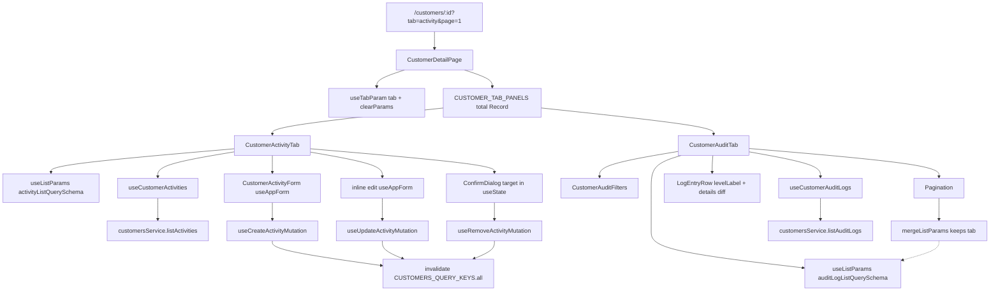

# AIS-181 — customer detail: the *Tevékenység* and *Napló* tabs

**Ticket:** [AIS-181](https://zakzag.atlassian.net/browse/AIS-181) — `Admin - impl: cég adatlap — Tevékenység és Napló tabok` (parent story AIS-15)
**Date:** 2026-11-25
**Status:** plan — awaiting approval
**Normative sources, in precedence order:**

1. [`Customers-Admin-Screens.md`](../Specs/Customers-Admin-Screens.md:183) — what the two tabs contain (`§3.2`, `§3.3`) and the `D-W3`/`D-W4` decisions.
2. [`UI-Architecture.md`](../Specs/UI-Architecture.md:991) — the state plan (`§5`), the form pattern (`§4.4`) and the primitive set (`§4`).
3. [`New-Admin-Page.md`](../Specs/New-Admin-Page.md:41) — the layer order of a page change (`§2`, steps 9 → 15).
4. [`.roo/rules/react.coding-standards.md`](../../.roo/rules/react.coding-standards.md:1) — layer, state and styling rules.
5. [`2026-11-23--23-05-00-ais-15-customers-admin-implementation-wave-plan.md`](2026-11-23--23-05-00-ais-15-customers-admin-implementation-wave-plan.md:229) — wave slice `F` (F1–F6); it **loses** to points 1–4 (three drifts are resolved in §3, `D1`, `D8`, `D9`).

---

## 1. Why this ticket is smaller than it looks

Everything the two tabs read and write already exists; what is missing is the **presentation** and one URL rule:

| Prerequisite | Status | What it already gives us |
| --- | --- | --- |
| AIS-177 (schema) | Done | `activity.activities` (soft delete, `author_*` check) and `audit.audit_logs` (append-only triggers) |
| AIS-178 (API) | Done | `GET/POST/PATCH/DELETE …/activities` and `GET …/audit-logs`, both paginated through the shared envelope |
| AIS-178 (api-client) | Done | `listActivities`, `createActivity`, `updateActivity`, `removeActivity`, `listAuditLogs` in [`customers.service.ts`](../../packages/api-client/src/customers/customers.service.ts:282) |
| AIS-178 (contract) | Done | `activitySchema` / `auditLogSchema`, `activityListQuerySchema` / `auditLogListQuerySchema`, `VALID_ACTIVITY` / `VALID_AUDIT_LOG(List)` fixtures |
| AIS-114 / AIS-119 | Done | `useApiList`, `useApiMutation`, `useListParams`, `useTabParam` |
| AIS-20 | Done | the six-tab frame; both tab bodies are a **total `Record`** entry, so the page itself stays untouched — [`customer-tab-panels.tsx`](../../apps/admin/src/pages/customers/ui/customer-tab-panels.tsx:43) |
| AIS-179 | Done | the sibling tabs' shape (mapper + `ui/` parts + `useAppForm` + `ConfirmDialog` target in `useState`) |

**Consequences:** `apps/api`, `packages/shared` and `packages/api-client` are **untouched**. No migration, no contract change, no new npm dependency, no new route, no new primitive — one **optional prop** on an existing primitive (§3, `D8`).

---

## 2. Scope

**In scope**

- `activity` tab — *Tevékenység*: newest-first feed (type badge, author, timestamp, body), the “Megjegyzés hozzáadása” form, edit and soft delete **only** on `authorType === 'operator'` rows (`D-W4`), paging in the URL.
- `audit` tab — *Napló*: read-only rows (timestamp, who, table, operation) with an expandable before → after diff, four URL filters (`tableName`, `operation`, author, date range), paging in the URL.
- Two feature hooks (`use-customer-activities`, `use-customer-audit-logs`), two entity mappers, two page-level logic modules, five `ui/` components.
- Two small, general fixes to the URL hooks so that a paged list can live on a route that also carries `?tab=` (§3, `D4`, `D5`).
- Docs: `Customers-Admin-Screens.md`, `UI-Architecture.md`, a `docs/history/` entry and one milestone.

**Explicitly out of scope** (do not pre-build)

| Item | Owner / reason |
| --- | --- |
| server-side author enforcement of activity edit/delete | AIS-73/74 (authentication); the UI rule is client-side by `D-W4` |
| an operator/user **directory** for the audit author filter | no endpoint exists; `D9` derives the choices from the page |
| tag chips on the `data` tab, wizard steps, customer edit form | AIS-21 / AIS-182 |
| a `packages/ui` audit renderer, a `Timeline` primitive, `DataTable` row expansion | `D8` — the existing `LogEntryRow` already is the expandable-JSON renderer |
| audit export / retention views | product backlog, nothing in the contract |

---

## 3. Decisions

| # | Decision | Why |
| --- | --- | --- |
| **D1** | Everything new lives in the **flat** `apps/admin/src/pages/customers/` folder (`ui/` for components, `*.logic.ts` next to the page) and in `entities/customer/`. Wave slice `F3`–`F6`'s `pages/customers/customer/ui/…` path is **superseded**. | AIS-20 `D1` fixed one folder per page; AIS-179 already shipped `customer-contact.logic.ts` + `ui/CustomerContactsTab.tsx` there. |
| **D2** | Reads: `useCustomerActivities(customerId)` and `useCustomerAuditLogs(customerId)` are `useApiList` adapters; the params come from `useListParams(activityListQuerySchema)` / `useListParams(auditLogListQuerySchema)` inside the **tab** component. | The tab owns its list state; the page keeps owning only `?tab=` (`§6.2`: one hook per resource list). |
| **D3** | Child query keys are declared in [`customers.const.ts`](../../apps/admin/src/features/customers/customers.const.ts:36) as `CUSTOMER_ACTIVITIES_QUERY_KEYS` / `CUSTOMER_AUDIT_LOGS_QUERY_KEYS`, each **spread from** `CUSTOMERS_QUERY_KEYS.all` (`['customers', 'activities', customerId, params]`). | `createEntityQueryKeys` only models `all`/`list`/`detail`; deriving from `all` keeps one invalidation prefix, so an activity write refreshes the feed **and** the detail (`lastActivityAt` is derived from activities). |
| **D4** | `useListParams` learns to **preserve foreign query params**: `writeParams` starts from the current search params, deletes only the keys it owns (the schema's keys) and then sets the serialised list params. Pure helper `mergeListParams(current, next, defaults)` in [`use-list-params.logic.ts`](../../apps/admin/src/features/api/use-list-params.logic.ts:191). | Today [`use-list-params.ts`](../../apps/admin/src/features/api/use-list-params.ts:74) builds a **fresh** `URLSearchParams`, so the first pager click on `/customers/:id?tab=activity` would silently drop `tab` and throw the user back to *Áttekintés*. That is a defect, not a preference — and the fix is a strict superset for the two existing callers (they carry no other params). **This is the one change outside the page's own layer.** |
| **D5** | `useTabParam` takes an optional `clearParams: readonly string[]`, deleted **in the same** `setSearchParams` call as the tab write; the detail page passes `CUSTOMER_TAB_LIST_PARAM_NAMES` (the union of both tabs' query keys). | Both tabs page through the same `page`/`limit` keys, so `?tab=activity&page=3` must not become `?tab=audit&page=3` (an empty audit page). One interaction = one write, so no second `setSearchParams`. |
| **D6** | `activity` tab: `Card` feed (newest first) + type `Badge` + author + `formatDateTime` + body (`whitespace-pre-line`), the note form **above** the feed, `Pagination` below. Loading = `Skeleton` cards, empty = `EmptyState` „Nincs rögzített tevékenység” **with the form still usable**, error = `PageErrorState` scoped to the tab. | Screen contract `§3.2`/`§3.3`. The form must stay reachable when the feed is empty — otherwise a fresh customer could never receive its first note. |
| **D7** | Edit is an **inline** editor inside the feed item; delete is a `ConfirmDialog` whose target is a local `useState` in the tab. Neither gets a route. | The AIS-173 exception: an inline editor and a confirmation have no address of their own, nothing links to them and nothing reloads into them; the wave plan's “child overlay route” would add two routes, two breadcrumb rules and two tests for surfaces the operator passes through in one click. |
| **D8** | `audit` tab renders **`LogEntryRow` per entry** (level chip + operation label + timestamp header, author as the message, table + record id as the one-line detail, the before → after diff as the expandable `details`), inside a labelled `<ol>`. `DataTable` is **not** used. | `DataTable` has no row-expansion contract ([`data-table.interface.ts`](../../packages/ui/src/components/data-table/data-table.interface.ts:44)) and adding one is a primitive change with no second consumer; `LogEntryRow` already **is** the “expandable JSON detail” renderer the screen contract forbids duplicating ([`LogEntryRow.tsx`](../../packages/ui/src/components/log-drawer/LogEntryRow.tsx:191)), and AIS-181's own description points at it. Deviation from `§3.2`/wave `F6` is recorded in the spec update. |
| **D9** | `LogEntryRow` gains **one optional prop**: `levelLabel?: string`, defaulting to `LOG_LEVEL_LABELS[level]`. | Its header prints a *severity* word (“Sikeres”, “Figyelmeztetés”), but an audited operation is `insert`/`update`/`delete`/`soft_delete`; the glyph and `data-level` keep carrying severity, the label carries the operation. Backwards compatible, one line of render code, testable; `packages/ui` gains no new component. |
| **D10** | Audit filters: `tableName` and `operation` as `Select`s over `AUDIT_LOG_TABLE_VALUES` / `AUDIT_OPERATION_VALUES`; **author** as a `Select` whose options are the distinct `{ actorId, actorName }` pairs **seen on the current page** (rows with `actorId === null`, i.e. `system`, are excluded); `from`/`to` as `DatePicker`s with `to.min = from`. | A free-text uuid input is unusable: `setParam` `safeParse`s the candidate and silently resets an invalid value, so a half-typed uuid would erase itself. Offering only valid uuids keeps the hook's “invalid → default, never throw” rule while still filtering by author. |
| **D11** | `from`/`to` conversion is one pure function `toAuditRangeBounds(fromDay, toDay)` → `{ from?: string; to?: string }`: `from` = local start of the chosen day, `to` = local start of the **next** day (exclusive upper bound of the inclusive filter). Built on the shared `dateOnlyToLocalIsoInstant`. | The contract's `from`/`to` are ISO **instants**; a `DatePicker` yields a calendar day. A `to = <day>T00:00` would silently exclude the selected day, and doing the arithmetic in a component would make it untestable and timezone-fragile. |
| **D12** | Activity writes invalidate `CUSTOMERS_QUERY_KEYS.all` (one rule, no hand-patched cache). | The feed **and** the list/detail projections (`lastActivityAt`) must refresh together, or the operator sees two truths. |
| **D13** | A `409 STALE_WRITE` on the activity edit closes the inline editor and refetches the feed; the token sent back is `updatedAt ?? createdAt`. | The contract's token is the last write instant (`activities.updated_at` is nullable), so `updatedAt` alone would reject the first edit of every entry. |
| **D14** | All copy lives in `customers.const.ts` (page) and `customer.const.ts` (entity); no Hungarian literal in JSX or in a test. | AIS-19/179 convention; label tables are `Record`s over the closed unions, so a new enum member fails the build instead of rendering `undefined`. |
| **D15** | The audit tab imports **only** `listAuditLogs`: no mutation hook, no button that writes. | The DoD's “nincs mutáló művelet” is a property of the module graph, not of a `disabled` flag. |

---

## 4. Flow

---

## 5. Ordered work (layer order, per `New-Admin-Page.md` §2)

### Step 9a — the two generic URL hooks (the only shared-layer change)

| File | Change |
| --- | --- |
| [`features/api/use-list-params.logic.ts`](../../apps/admin/src/features/api/use-list-params.logic.ts:191) | **Extend.** `mergeListParams<TParams>(current: URLSearchParams, next: URLSearchParams, ownedKeys: readonly string[]): URLSearchParams` — clone `current`, delete `ownedKeys`, then copy `next`'s entries. Pure, no mutation of the inputs. |
| [`features/api/use-list-params.ts`](../../apps/admin/src/features/api/use-list-params.ts:74) | **Change.** `writeParams` calls `mergeListParams(searchParams, toListParamsUrlSearchParams(next, defaults), Object.keys(defaults))`. Doc block gains the “never destroy a parameter the hook does not own” rule (`D4`). |
| [`features/api/use-tab-param.interface.ts`](apps/admin/src/features/api/use-tab-param.interface.ts:1) | **Extend.** `UseTabParamOptions<…>.clearParams?: readonly string[]`. |
| [`features/api/use-tab-param.ts`](../../apps/admin/src/features/api/use-tab-param.ts:40) | **Change.** `setValue` deletes every name in `clearParams` from the cloned params **before** writing the tab (`D5`). |
| [`features/api/use-tab-param.logic.ts`](apps/admin/src/features/api/use-tab-param.logic.ts:1) | **Extend.** `applyTabWrite(params, { paramName, value, fallback, clearParams })` extracted so the delete-set + set-or-remove rule stays pure and testable. |

Both changes keep their defaults: a caller that passes nothing behaves exactly as today.

### Step 9b — feature hooks (`features/customers/`)

| File | Change |
| --- | --- |
| `features/customers/customers.const.ts` | **Extend.** `CUSTOMER_ACTIVITIES_QUERY_KEYS`, `CUSTOMER_AUDIT_LOGS_QUERY_KEYS` (derived from `CUSTOMERS_QUERY_KEYS.all`), `CUSTOMER_ACTIVITY_CREATE_SUCCESS_MESSAGE`, `…_UPDATE_…`, `…_REMOVE_…`, `CUSTOMER_ACTIVITY_FIELD_PATHS: readonly ('type' \| 'body')[]`. |
| `features/customers/customers.interface.ts` | **Extend.** `CustomerActivitiesResult = { rows: readonly Activity[] } & UseApiListResult<readonly Activity[]>`, `CustomerAuditLogsResult` (same for `AuditLog`), `UseCreateActivityResult`, `UseUpdateActivityResult`, `UseRemoveActivityResult`, `CustomerActivityFormValues`, `CustomerActivityEditFormValues`. |
| `features/customers/use-customer-activities.ts` | **New.** `useCustomerActivities(customerId, query)`: `useApiList({ queryKey: CUSTOMER_ACTIVITIES_QUERY_KEYS.list(customerId, query), queryFn: () => customersService.listActivities(customerId, query), emptyData: EMPTY_ACTIVITY_LIST })`. Plus `useCreateActivityMutation(customerId)`, `useUpdateActivityMutation(customerId, activityId)`, `useRemoveActivityMutation(customerId, activityId)` — all `invalidateKeys: [CUSTOMERS_QUERY_KEYS.all]` (`D12`); `successMessage` only on the remove mutation (the two forms announce through `useAppForm`'s notify port, never twice). `EMPTY_ACTIVITY_LIST` is a frozen `[]`. |
| `features/customers/use-customer-audit-logs.ts` | **New.** `useCustomerAuditLogs(customerId, query)` over `customersService.listAuditLogs`, key `CUSTOMER_AUDIT_LOGS_QUERY_KEYS.list`, `emptyData: EMPTY_AUDIT_LOG_LIST` (frozen). **No mutation** in this file (`D15`). |

### Step 10 — entity (`entities/customer/`)

| File | Change |
| --- | --- |
| `entities/customer/customer.interface.ts` | **Extend.** `CustomerActivityViewModel` (`id`, `type`, `typeLabel`, `typeVariant`, `authorName`, `authorTypeText`, `createdAtText`, `body`, `canEdit`, `updateToken`), `CustomerActivityViewModels`, `AuditLogDiffField` (`label`, `beforeText`, `afterText`, `changed`), `CustomerAuditLogViewModel` (`id`, `occurredAtText`, `occurredAtMs`, `operation`, `operationLabel`, `level`, `tableName`, `tableLabel`, `actorName`, `actorId`, `actorTypeText`, `recordIdText`, `diffFields`, `requestId`), `CustomerAuditLogViewModels`, `AuditLogActorOption`. `level` is typed as `ToastLevel` (type-only import from `@callback/ui`), exactly as `BadgeVariant` already is. |
| `entities/customer/customer.const.ts` | **Extend.** `CUSTOMER_ACTIVITY_TYPE_LABELS` and `CUSTOMER_ACTIVITY_TYPE_VARIANTS` (`Record<ActivityType, …>`: note→neutral, call→info, email→info, meeting→info, status_change→warning, system→neutral), `CUSTOMER_ACTIVITY_WRITABLE_TYPES` (`note`, `call`, `email`, `meeting` — the two server-written kinds excluded), `CUSTOMER_AUDIT_OPERATION_LABELS` and `CUSTOMER_AUDIT_OPERATION_LEVELS` (`Record<AuditOperation, ToastLevel>`: insert→success, update→info, soft_delete→warning, delete→danger), `CUSTOMER_AUDIT_TABLE_LABELS` (`Record<AuditLogTable, string>`), `CUSTOMER_AUDIT_ACTOR_TYPE_LABELS` (`Record<AuthorType, string>`), `CUSTOMER_AUDIT_FIELD_LABELS` (a **partial** map of the known wire fields → Hungarian, with the wire name as fallback), `CUSTOMER_AUDIT_NO_CHANGES_LABEL`. |
| `entities/customer/customer-activity.mapper.ts` | **New.** `toCustomerActivityViewModels(rows): CustomerActivityViewModels` — label/variant from the type tables, `canEdit = authorType === 'operator'` (`D-W4`), `createdAtText = formatDateTime(createdAt)`, `updateToken = updatedAt ?? createdAt` (`D13`), `authorTypeText` from the author-type table. Pure, no React. |
| `entities/customer/customer-audit-log.mapper.ts` | **New.** `toCustomerAuditLogViewModels(rows)`, plus `toAuditLogDiffFields(before, after): readonly AuditLogDiffField[]` (union of keys, `after` order first then `before`-only keys, `—` for a missing side, `toJsonValueText` for objects) and `toAuditActorOptions(rows)` (dedup by `actorId`, drop `null`). Pure. |

### Step 11 — page (`pages/customers/`)

| File | Change |
| --- | --- |
| `pages/customers/customer-activity.logic.ts` | **New.** `customerActivityFormSchema` (derived from `createActivitySchema`: `type` from `CUSTOMER_ACTIVITY_WRITABLE_TYPES`, `body` non-empty + `ACTIVITY_BODY_MAX_LENGTH`), `customerActivityEditSchema` (derived from `updateActivitySchema` without the token), `EMPTY_ACTIVITY_FORM_VALUES`, `toCustomerActivityFormValues(activity)`, `toActivityTypeOptions()`, `toCreateActivityInput(values)`, `toUpdateActivityInput(values, updateToken)`. |
| `pages/customers/customer-audit-log.logic.ts` | **New.** `toAuditTableOptions()`, `toAuditOperationOptions()`, `toAuditRangeBounds(fromDay, toDay)` (`D11`), `hasActiveAuditFilters(params)`. |
| `pages/customers/customers.const.ts` | **Extend.** Activity copy: `CUSTOMER_ACTIVITY_TITLE`, `CUSTOMER_ACTIVITY_EMPTY_TITLE`/`_DESCRIPTION`, `CUSTOMER_ACTIVITY_FORM_TITLE`, `CUSTOMER_ACTIVITY_BODY_LABEL`, `CUSTOMER_ACTIVITY_TYPE_LABEL`, `CUSTOMER_ACTIVITY_SUBMIT_LABEL`/`_PENDING_LABEL`, `CUSTOMER_ACTIVITY_EDIT_LABEL`, `CUSTOMER_ACTIVITY_SAVE_LABEL`, `CUSTOMER_ACTIVITY_DELETE_LABEL`, `CUSTOMER_ACTIVITY_DELETE_DIALOG_*`, `CUSTOMER_ACTIVITY_FORM_ERROR_TITLE`, field ids. Audit copy: `CUSTOMER_AUDIT_TITLE`, `CUSTOMER_AUDIT_EMPTY_TITLE`/`_DESCRIPTION`, `CUSTOMER_AUDIT_FILTER_*` labels, `CUSTOMER_AUDIT_CLEAR_FILTERS_LABEL`, `CUSTOMER_AUDIT_LIST_LABEL`. New shared: `CUSTOMER_TAB_LIST_PARAM_NAMES: readonly string[]` (union of both list-query keys, `D5`), `CUSTOMER_TAB_PAGING_LIMIT_OPTIONS` (reuse `CUSTOMERS_LIMIT_OPTIONS`). Placeholder copy (`CUSTOMER_DETAIL_TAB_PLACEHOLDER_*`) **removed**. |
| `pages/customers/customers.interface.ts` | **Extend.** `CustomerActivityTabProps` (= `CustomerTabPanelProps`), `CustomerActivityFeedItemProps`, `CustomerActivityFormProps`, `CustomerActivityEditFormProps`, `CustomerAuditTabProps`, `CustomerAuditFiltersProps`, `CustomerAuditDeleteTarget` (alias of `CustomerActivityViewModel`). |
| `pages/customers/ui/CustomerActivityTab.tsx` | **New.** `useListParams(activityListQuerySchema)` → `useCustomerActivities` → `useMemo(toCustomerActivityViewModels)`. Renders the form, the feed (`<ol>` of `CustomerActivityFeedItem`), `Pagination` (only when `meta !== null`), the four states (`D6`). Owns `editingId` and `deleteTarget` in `useState` (`D7`). |
| `pages/customers/ui/CustomerActivityForm.tsx` | **New.** `useAppForm` over `customerActivityFormSchema`; `Select` (type) + `Textarea` (body, `rows`) + `FormActions`; submit → `useCreateActivityMutation`; `notify: useNotifier()`, `successMessage`. |
| `pages/customers/ui/CustomerActivityFeedItem.tsx` | **New.** `Card` with badge/author/time header; body, or `CustomerActivityEditForm` while editing; “Szerkesztés” / “Törlés” buttons **only** when `activity.canEdit`. |
| `pages/customers/ui/CustomerActivityEditForm.tsx` | **New.** `useAppForm` over `customerActivityEditSchema`, seeded with the entry's body; `409 STALE_WRITE` → `onStaleWrite()` + re-throw (`D13`). |
| `pages/customers/ui/CustomerAuditFilters.tsx` | **New.** Four labelled controls (`Select` ×3, `DatePicker` ×2 with `to.min = from`) + “Szűrők törlése”; each interaction is **one** `setParam`/`setParams` write (`D10`, `D11`). |
| `pages/customers/ui/CustomerAuditTab.tsx` | **New.** `useListParams(auditLogListQuerySchema)` → `useCustomerAuditLogs` → `useMemo(toCustomerAuditLogViewModels)` → `<ol>` of `LogEntryRow` (mapped through `toAuditLogEntryItem`), `Pagination`, the four states, and the filters. **No** write control anywhere (`D15`). |
| `pages/customers/ui/customer-tab-panels.tsx` | **Change.** `activity` → `CustomerActivityTab`, `audit` → `CustomerAuditTab`; delete `CustomerTabPlaceholder` and the placeholder imports. Nothing else in the file moves. |
| [`pages/customers/CustomerDetailPage.tsx`](../../apps/admin/src/pages/customers/CustomerDetailPage.tsx:61) | **One-line change.** `useTabParam({ …, clearParams: CUSTOMER_TAB_LIST_PARAM_NAMES })` (`D5`). The page still knows nothing about how many tabs there are or what they render. |

Page composition order for both tabs: tab heading/toolbar → filters (audit) or form (activity) → list → pager.

### Step 14 — mocks (`apps/admin/src/test/mocks/`)

| File | Change |
| --- | --- |
| `test/mocks/handlers/customers.handlers.ts` | **Extend.** `customersActivitiesSuccess` (`200` + `VALID_ACTIVITY_LIST` + `meta.pagination`), `customersActivitiesEmpty` (`totalPages: 0`), `customersActivitiesServerError` (`500`), `customerActivityCreateSuccess` (`201` + `VALID_ACTIVITY`), `customerActivityUpdateSuccess` (`200`), `customerActivityUpdateStale` (`409 STALE_WRITE`), `customerActivityRemoveSuccess` (`200` + `data: null`), `customersAuditLogsSuccess` (`200` + `VALID_AUDIT_LOG_LIST` + pagination), `customersAuditLogsEmpty`, `customersAuditLogsServerError`. Paths from the api-client's `toCustomerActivitiesPath` / `toCustomerAuditLogsPath`, so a route rename cannot leave a stale handler. |
| `test/mocks/handlers/customers.handlers.ts` | Re-export `CUSTOMER_ACTIVITY_FIXTURE` / `CUSTOMER_AUDIT_LOG_FIXTURE` = the shared `VALID_ACTIVITY` / `VALID_AUDIT_LOG`, so assertions read the object that was served. |
| `test/mocks/customer-activity.mock.ts` | **New** (only if the shared fixtures lack it): a `customer_user`-authored row and a `system` row, so `canEdit` and the actor-option filter are testable without hand-built literals in a test file. |

### Step 15 — docs

| File | Change |
| --- | --- |
| [`Customers-Admin-Screens.md`](../Specs/Customers-Admin-Screens.md:191) `§3.2`, `§3.3`, `§10` | `audit` row: `DataTable` → `LogEntryRow` list with the four fields and the expandable diff, plus the `levelLabel` note (`D8`/`D9`); `activity` row: inline edit + `ConfirmDialog` target (`D7`); the file map gets ✅ on the two AIS-181 rows; refresh `**Utolsó frissítés:**`. |
| [`UI-Architecture.md`](../Specs/UI-Architecture.md:991) `§4`, `§5` | `§4`: `LogEntryRow`'s optional `levelLabel`. `§5`: the `pages/customers` row gains “the two list tabs page in the URL (`activityListQuerySchema`/`auditLogListQuerySchema`), the inline editor and the delete confirmation are **local** `useState`, no store”; note that `useListParams` now preserves foreign params and that a tab switch clears the list keys. Refresh the header date. |
| `docs/history/<YYYY-MM-DD--HH-ii-ss>-ais-181-customer-activity-and-audit-tabs.md` | Change summary after implementation (required by `.roo/rules/instructions.md`). |
| `docs/milestones/<YYYY-MM-DD--HH-ii-ss>-url-params-and-audit-rows.milestone.md` | **Planned**, because the `?tab=` wipe (D4) is a bug whose root cause is not visible from the symptom (“the tab jumps back on page 2”), and because the ticket changes a shared hook, a primitive prop and a screen contract. |

---

## 6. Tests (mandatory coverage per `react.coding-standards.md` §10)

| File | Cases |
| --- | --- |
| `features/api/use-list-params.logic.test.ts` | `mergeListParams` keeps `tab`, replaces `page`/`limit`, drops the default-omitted keys, does not mutate either input, works on an empty current set |
| `features/api/use-list-params.test.tsx` | a page click on `/customers/x?tab=audit` keeps `tab`; two `setParam`-free interactions produce one history entry; invalid `page` still falls back |
| `features/api/use-tab-param.test.tsx` | `clearParams` deletes the named keys in the **same** write; the fallback write deletes the tab param; `clearParams` untouched when the value equals the fallback |
| `entities/customer/customer-activity.mapper.test.ts` | all six types → label + variant; `canEdit` true **only** for `operator` (`customer_user`, `system`, `api_key` → false); time formatted, never raw ISO; `updateToken` = `updatedAt`, and = `createdAt` when `updatedAt` is `null` |
| `entities/customer/customer-audit-log.mapper.test.ts` | diff: `after`-only keys (insert), `before`-only keys (soft delete), both (update), unchanged key omitted, `null` side → `—`, object value → JSON text, stable order; operation → level for all four; `tableName` label fallback for an unknown table; actor options dedup and `actorId === null` excluded |
| `features/customers/use-customer-activities.test.tsx` | loading; empty (`totalPages: 0`); error with `errorSurface`; success rows; create posts and refetches the customers prefix (detail + feed); update sends `updatedAt ?? createdAt`; `409` → `errorSurface`; remove resolves `null` and invalidates |
| `features/customers/use-customer-audit-logs.test.tsx` | the request carries `page`, `limit`, `tableName`, `operation`, `actorId`, `from`, `to`; empty; error; **no** write request is ever issued by this hook's module (asserted through the handler call log) |
| `pages/customers/customer-activity.logic.test.ts` | schema accepts a full body, rejects an empty one, rejects an over-long one, rejects a server-written type; `toCreateActivityInput` trims the body and sends the chosen type; `toUpdateActivityInput` always sends the concurrency token and only the changed fields; `toActivityTypeOptions` offers exactly the four writable kinds |
| `pages/customers/customer-audit-log.logic.test.ts` | `toAuditRangeBounds`: `from` only, `to` only, both, none, a DST boundary day (the next-day start is 23 or 25 hours away), an invalid day → `undefined`; `hasActiveAuditFilters` |
| `pages/customers/ui/CustomerActivityTab.test.tsx` | entries render newest first with badge/author/time/body; actions only on operator rows; note submit → POST + reset + refetch; empty state **with** the form; error state; pager writes `page`; edit opens the inline form and saves; delete opens the confirmation and calls DELETE |
| `pages/customers/ui/CustomerAuditTab.test.tsx` | rows show label/actor/table/time; expanding reveals the diff and the pretty-JSON toggle; each filter writes the URL **once**; “Szűrők törlése” clears all four; empty; error; pager; **no** element with a write label exists (`queryByRole('button', { name: /törlés\|szerkesztés/i })` is `null`) |
| `pages/customers/CustomerDetailPage.test.tsx` (extend) | `?tab=activity` and `?tab=audit` render their panels; a pager click keeps `?tab=`; a tab switch drops `page` |
| `packages/ui/test/log-entry-row.test.tsx` (extend) | `levelLabel` replaces the severity word; absent → the default label; the glyph and `data-level` stay the severity's |

Rules kept: mocks/fixtures in `src/test/mocks/**`, never inline; the network is the only mocked boundary (real service + `httpClient` under MSW); no real timers (the copy-feedback timer is already faked in the primitive's test).

---

## 7. Risks and open questions

| # | Risk | Mitigation |
| --- | --- | --- |
| R1 | `useListParams` is shared with `/api-keys` and `/customers` | The change only **adds** preservation; the existing suites plus the two new cases pin the behaviour, and `mergeListParams` is pure and separately tested |
| R2 | `LogEntryRow` used outside `LogDrawer` | The row is a self-contained `
`+`role="region"`; a render test in isolation asserts it needs no drawer context |
| R3 | Both tabs share `page`/`limit` in one URL | `D5` clears them in the same tab write; a page test asserts it |
| R4 | A failed `actorId` filter would empty the page for good | Options are always valid uuids and “Szűrők törlése” is one write away; `hasActiveAuditFilters` drives its enabled state |

**Open questions for approval**

| # | Question | Recommendation |
| --- | --- | --- |
| Q1 | Audit rows as `LogEntryRow` (with the `levelLabel` prop) instead of a `DataTable` with row expansion? | **Yes** (`D8`/`D9`): no second renderer, no new primitive, JSON diff + copy for free |
| Q2 | Note form: a type `Select` with the four operator-writable kinds, or note-only? | **Four kinds** — the feed mixes them, and hiding the choice would force a `note` for every phone call |
| Q3 | Activity edit inline (local state) instead of a child overlay route? | **Inline** (`D7`): nothing links to it, nothing reloads into it |

---

## 8. Definition of done

- [ ] Both tabs render with loading / empty / error / success, paged from the URL, and the pager never loses `?tab=`.
- [ ] The audit tab renders no mutating control and imports no mutation hook.
- [ ] Activity edit/delete appear only on `authorType === 'operator'` rows.
- [ ] `pnpm quality` (lint, types, `quality:themes`, `quality:palette`, `quality:field-errors`, `quality:docs`, dead-code) is green; no `any`, no colour literal, no palette class.
- [ ] `Customers-Admin-Screens.md` and `UI-Architecture.md` updated in the same change; `docs/history/` entry and the milestone written.
- [ ] Commit title: `AIS-181: feat(admin): add the customer activity and audit tabs`.
