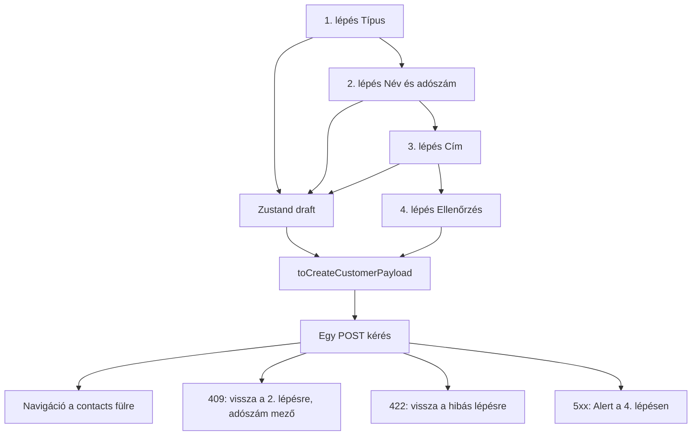

# AIS-182 — az új ügyfél varázsló lépései és beküldése

**Történet:** AIS-182 `Admin - impl: új ügyfél varázsló` (szülő: AIS-15)
**Dátum:** 2026-11-25
**Előzmény:** [`2026-11-23--23-05-00-ais-15-customers-admin-implementation-wave-plan.md`](2026-11-23--23-05-00-ais-15-customers-admin-implementation-wave-plan.md:1) §9-G, [`Customers-Admin-Screens.md`](../Specs/Customers-Admin-Screens.md:216) §4.1–§4.4

---

## 1. Kiindulás — mi van már meg, és mi hiányzik

Az `AIS-19` a varázsló **héját** szállította (`D-W5`): az útvonalat, a page store-t, a providert, a lépéssávot és az **1. lépés** body-ját. Ez a ticket a hiányzó három lépést, a lépéslogikát és a beküldést adja.

| Már megvan (AIS-19) | Állapot |
| --- | --- |
| [`CustomerCreatePage.tsx`](../../apps/admin/src/pages/customers/CustomerCreatePage.tsx:1) | shell: provider, `CustomerWizardStepMirror`, lépéssáv, 1. lépés, „Mégse” |
| [`customers-wizard.store.ts`](../../apps/admin/src/pages/customers/customers-wizard.store.ts:1) + provider | `draft`, `step`, `setDraft`, `setStep`, `reset` |
| [`customers-wizard.interface.ts`](../../apps/admin/src/pages/customers/customers-wizard.interface.ts:1) | `CustomerWizardStep = '1'..'4'`, store szerződés |
| [`CustomerWizardStepper.tsx`](../../apps/admin/src/pages/customers/ui/CustomerWizardStepper.tsx:1) | `nav` + `Button` sor, `aria-current="step"` |
| `?step=` olvasás | [`use-tab-param.ts`](../../apps/admin/src/features/api/use-tab-param.ts:1), érvénytelen érték → `1` |
| MSW | csak `GET` / `PATCH` / `DELETE` handler van, **`POST /customers` nincs** |

**Hiányzik:** `customers-wizard.logic.ts`, `use-create-customer.ts`, a 2–4. lépés body-ja, a „Tovább / Vissza / Létrehozás” navigáció, a beküldés és a hozzá tartozó tesztek + MSW handlerek.

---

## 2. Döntések

| # | Döntés | Indok |
| --- | --- | --- |
| **D1** | A **létrehozás egyetlen** `POST /api/admin/customers` kérés; siker után `navigate(toCustomerTabRoute(id, 'contacts'))` | `D-W6`: az API-nak nincs customer+contact tranzakciója, egy második kérés félkész céget hagyna maga után |
| **D2** | A store **szerződése változatlan** (`draft`, `step`, `setDraft`, `setStep`, `reset`) | a ticket DoD-ja kimondja; a store-t az AIS-19 hozta létre |
| **D3** | Egy lépés akkor érhető el a lépéssávban, ha **minden előző lépés érvényes** (`isStepReachable(draft, step)`) — a legnagyobb elért lépés ebből **levezetett**, nem külön állapot | a felhasználói döntés „csak a már elért legnagyobb lépésig” + a D2 miatt a frontier nem kerülhet a store-ba; a levezetés tiszta, tesztelhető, és reload után is konzisztens a `?step=` értékkel |
| **D4** | `useAppForm` a **2. és 3. lépésen**; az **1. lépés** kontrollált `RadioGroup` + `canLeaveStep`, a **4. lépés** read-only összegzés | a `RadioGroup` csak `value`/`onChange` párost ismer (nincs `register`-elhető input), a 4. lépésnek nincs bemenete. A képernyőszerződés §4.1 sorát ezért **frissíteni kell** ugyanebben a változásban |
| **D5** | `legalForm` fix `Select`, új `CUSTOMER_LEGAL_FORM_OPTIONS` konstanssal (Kft., Zrt., Bt., Nyrt., Kkt., E.v., Egyéb) | felhasználói döntés; a szerződés `string` marad, a lista UI-kényelem, a beküldött érték a rövidítés |
| **D6** | A `toOptionalFormatSchema` (üres stringet elfogadó, egyébként a közös sémára delegáló wrapper) kikerül a [`customer-edit.logic.ts`](../../apps/admin/src/pages/customers/customer-edit.logic.ts:77)-ből egy közös [`lib/optional-format.schema.ts`](../../apps/admin/src/lib/optional-format.schema.ts:1)-be, és a edit + wizard is onnan importálja | DRY: a varázslónak ugyanaz kell (üres `taxNumber` / `zip`), a duplikálás két helyen tartaná karban a magyar formátum-szöveget |
| **D7** | A `useCreateCustomerMutation` **nem navigál**; a navigáció a 4. lépés komponensében van a `await` után | `features` réteg nem ismerhet routert (`react.coding-standards.md` §2); a hullámterv §9-G2 megfogalmazását ez pontosítja |
| **D8** | `409` / `422` esetén a hiba a **hibás lépés bemenetére** kerül: a page a `toFieldErrors`-szel kiszámolt hibát `unknown`-ként átadja a lépés komponensének, az `useAppForm.setServerError`-ral alkalmazza, és a page átnavigál a hibás lépésre | a `useAppForm` meglévő mapping pipeline-ját használjuk (nincs második, kézzel írt path→message tábla); a store szerződése nem változik (D2) |

---

## 3. Folyamat

---

## 4. Fájltérkép

| # | Fájl | Változás |
| --- | --- | --- |
| 1 | [`apps/admin/src/lib/optional-format.schema.ts`](../../apps/admin/src/lib/optional-format.schema.ts:1) | **új**: a `toOptionalFormatSchema` kiemelve (D6), JSDoc-kal |
| 2 | [`apps/admin/src/pages/customers/customer-edit.logic.ts`](../../apps/admin/src/pages/customers/customer-edit.logic.ts:77) | a helyi wrapper törlése, import a `lib`-ből; viselkedés változatlan |
| 3 | [`apps/admin/src/pages/customers/customers-wizard.logic.ts`](../../apps/admin/src/pages/customers/customers-wizard.logic.ts:1) | **új, tiszta**: `nextStep`, `previousStep`, `canLeaveStep(draft, step)`, `isStepReachable(draft, step)`, `toCreateCustomerPayload(draft)`, `toWizardSummary(draft)`, `toWizardStepOfField(path)`, a lépés-sémák (`createCustomerSchema`-ból `pick`+`extend`) |
| 4 | [`apps/admin/src/pages/customers/customers-wizard.errors.ts`](../../apps/admin/src/pages/customers/customers-wizard.errors.ts:1) | **+** `CustomersWizardIncompleteError` (hiányos draft a payload-építésnél) |
| 5 | [`apps/admin/src/pages/customers/customers-wizard.interface.ts`](../../apps/admin/src/pages/customers/customers-wizard.interface.ts:1) | **+** `CustomerNameValues`, `CustomerAddressValues`, `CustomerWizardFieldName`, `CustomerWizardStepFormProps`; a store szerződés **változatlan** (D2) |
| 6 | [`apps/admin/src/pages/customers/customers.interface.ts`](../../apps/admin/src/pages/customers/customers.interface.ts:99) | **+** `CustomerWizardStepperProps.reachableStep` (D3), lépés-body proppok |
| 7 | [`apps/admin/src/pages/customers/customers.const.ts`](../../apps/admin/src/pages/customers/customers.const.ts:191) | **+** `CUSTOMER_LEGAL_FORM_OPTIONS`, `CUSTOMER_WIZARD_FIELD_IDS`, `CUSTOMERS_WIZARD_NEXT/BACK/SUBMIT_LABEL`, `CUSTOMERS_WIZARD_STEP_ERROR_TITLE`, `CUSTOMERS_WIZARD_REVIEW_LABELS`, `CUSTOMERS_WIZARD_EMPTY_VALUE` |
| 8 | [`apps/admin/src/features/customers/use-create-customer.ts`](../../apps/admin/src/features/customers/use-create-customer.ts:1) | **új**: `useApiMutation` a `customersService.create` fölött, `invalidateKeys: [CUSTOMERS_QUERY_KEYS.all]`, `mutationKey: ['customers','create']` |
| 9 | [`apps/admin/src/features/customers/customers.interface.ts`](../../apps/admin/src/features/customers/customers.interface.ts:95) | **+** `UseCreateCustomerResult`, `CustomerCreateFieldName` |
| 10 | [`apps/admin/src/features/customers/customers.const.ts`](../../apps/admin/src/features/customers/customers.const.ts:76) | **+** `CUSTOMERS_CREATE_SUCCESS_MESSAGE`, `CUSTOMER_CREATE_FIELD_PATHS`, `CUSTOMER_CREATE_DEFAULT_PATH_BY_CODE` (`CUSTOMER_TAX_NUMBER_CONFLICT → taxNumber`) |
| 11 | [`apps/admin/src/pages/customers/ui/CustomerNameStep.tsx`](../../apps/admin/src/pages/customers/ui/CustomerNameStep.tsx:1) | **új**: 2. lépés `useAppForm`-mal (`Input` ×5 + `Select` a `legalForm`-hoz, D5) |
| 12 | [`apps/admin/src/pages/customers/ui/CustomerAddressStep.tsx`](../../apps/admin/src/pages/customers/ui/CustomerAddressStep.tsx:1) | **új**: 3. lépés (`Input` zip/city/line + `Select` country, alapértelmezés `HU`) |
| 13 | [`apps/admin/src/pages/customers/ui/CustomerReviewStep.tsx`](../../apps/admin/src/pages/customers/ui/CustomerReviewStep.tsx:1) | **új**: 4. lépés — `Card` + `DescriptionList` + `FormActions` + hiba `Alert` |
| 14 | [`apps/admin/src/pages/customers/CustomerCreatePage.tsx`](../../apps/admin/src/pages/customers/CustomerCreatePage.tsx:1) | a body-k kiváltása, `reachableStep` a lépéssávnak, a beküldés + navigáció + `reset` bekötése, „Mégse” változatlan |
| 15 | [`apps/admin/src/pages/customers/ui/CustomerWizardStepper.tsx`](../../apps/admin/src/pages/customers/ui/CustomerWizardStepper.tsx:18) | a nem elérhető lépések `disabled` + `aria-disabled`, a `reachableStep` szerint |
| 16 | [`apps/admin/src/test/mocks/handlers/customers.handlers.ts`](../../apps/admin/src/test/mocks/handlers/customers.handlers.ts:58) | **+** `customersCreateSuccess`, `customersCreateTaxConflict` (`details[0].path = taxNumber`), `customersCreateValidationError`, `customersCreateServerError`; felvétel a `customersHandlers` alapkészletbe |

**Nem változik:** `packages/shared` és `packages/ui` (a hullámterv kizárja), a store, a `?step=` hook, az útvonal-registry.

---

## 5. Tesztek

| Teszt | Kötelező fedés |
| --- | --- |
| `customers-wizard.logic.test.ts` | `nextStep`/`previousStep` határok (`1`→`2`, `4`→`null`); `canLeaveStep` lépésenként: típus hiánya, üres `legalName`, érvénytelen/hibás ellenőrző-számú adószám, érvénytelen irányítószám; `isStepReachable` (üres draft → csak `1`, hiányos `legalName` → `1`, teljes 1–2 → `3` elérhető); `toCreateCustomerPayload` (üres stringek kimaradnak, `registeredAddressCountry` default `HU`, hiányos draft → `CustomersWizardIncompleteError`); `toWizardSummary` (hiányzó érték a placeholder-rel); `toWizardStepOfField` minden mezőre |
| `lib/optional-format.schema.test.ts` | üres string átmegy, érvényes érték átmegy, hibás érték a közös séma issue-ját hozza |
| `use-create-customer.test.tsx` | siker → `customers` prefix invalidálása; hiba → `errorMessage`/`errorSurface`; `isPending` igaz/hamis |
| `CustomerCreatePage.test.tsx` (bővítés) | érvénytelen `?step=9` → `1` (megvan); a lépéssáv letiltja a nem elérhető lépéseket; a 2. lépés „Tovább” üres `legalName`-nel nem vált; a draft megmarad 2→3→1 úton; az összegzés a draftot mutatja; beküldés → **pontosan egy** `POST /customers` (request recorder), navigáció `/customers/<id>?tab=contacts`, toast, invalidálás; `409` → 2. lépés + adószám mező hiba; `500` → `Alert` a 4. lépésen; „Mégse” → lista + `reset` (megvan) |
| `CustomerWizardStepper.test.tsx` | aktív lépés `aria-current`, elérhető lépések kattinthatók, azon túliak `disabled` |
| `CustomerNameStep.test.tsx`, `CustomerAddressStep.test.tsx`, `CustomerReviewStep.test.tsx` | lépés-specifikus szabályok: hibaüzenet a mező alatt, ország default `HU`, `Létrehozás` pending állapota (`isLoading`), „Vissza” callback |
| store teszt | változatlan, zöld marad (a szerződés nem bővül — D2) |

---

## 6. Dokumentáció (kötelező, ugyanabban a változásban)

1. [`Customers-Admin-Screens.md`](../Specs/Customers-Admin-Screens.md:220) — §4.1: a D4 pontosítás (mely lépés `useAppForm`), a D3 elérhetőségi szabály és a D5 jogi forma lista; §4.2 táblázat változatlan; §10: az AIS-182 ✅ jelölése a tényleges fájllistával; `**Utolsó frissítés:**` bump.
2. [`UI-Architecture.md`](../Specs/UI-Architecture.md:368) §5 — ellenőrzés: a store sora nem változik (D2), ezért csak akkor módosul, ha a lépés-elérhetőség leírása megkívánja.
3. `docs/history/<YYYY-MM-DD--HH-ii-ss>-ais-182-customer-wizard-steps.md` — a változás narratívája.
4. `docs/milestones/<YYYY-MM-DD--HH-ii-ss>-ais-182-customer-wizard-submit.milestone.md` — angol nyelvű, egy oldalas döntés-összefoglaló (egy kérés garancia, D3 elérhetőség, D8 hibairányítás).

---

## 7. Kockázatok és elvetett alternatívák

| Kockázat | Kezelés |
| --- | --- |
| A `?step=4` kézzel megnyitott cím hiányos drafttal | a 4. lépés `toCreateCustomerPayload`-t hív, ami `CustomersWizardIncompleteError`-t dob → a page a hibás lépésre irányít (a beküldés nem indul el) |
| A lépésenkénti séma eltér a szerződéstől | minden lépés-séma a `createCustomerSchema`-ból `pick`/`extend`-del készül; a beküldés előtt a **teljes** `createCustomerSchema` is lefut |
| Duplikált formátum-wrapper a két logic fájlban | D6: közös `lib` helper |
| Elvetett: `maxStep` a store-ban | sérti a D2 DoD-t |
| Elvetett: navigáció a `useCreateCustomerMutation`-ben | rétegszabály (`features` nem ismer routert) |
| Elvetett: kézzel írt path→message tábla a `422`-höz | a `useAppForm.setServerError` + `toFieldErrors` már megvan (D8) |

---

## 8. Definition of Done

- [ ] megszakított varázsló nem hoz létre céget (nincs `POST`, amíg a 4. lépés be nem küld)
- [ ] pontosan **egy** `POST /api/admin/customers` indul, ezt a teszt rekorderrel bizonyítja
- [ ] siker → toast + navigáció a `/customers/:id?tab=contacts` címre + `customers` invalidálás + `reset`
- [ ] `409 CUSTOMER_TAX_NUMBER_CONFLICT` → 2. lépés, adószám mező; `422` → hibás lépés; `5xx` → `Alert` a 4. lépésen
- [ ] loading / error állapot a beküldésnél (`FormActions isSubmitting`, letiltott „Mégse”)
- [ ] a store szerződése változatlan
- [ ] `pnpm quality`, `pnpm test:quality`, `pnpm -r lint && pnpm typecheck && pnpm -r build && pnpm test` zöld
- [ ] specs + history + milestone frissítve
