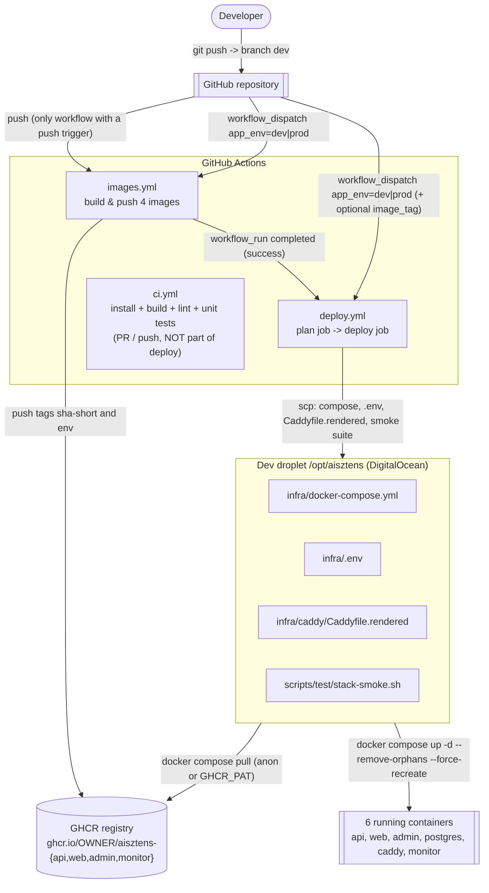
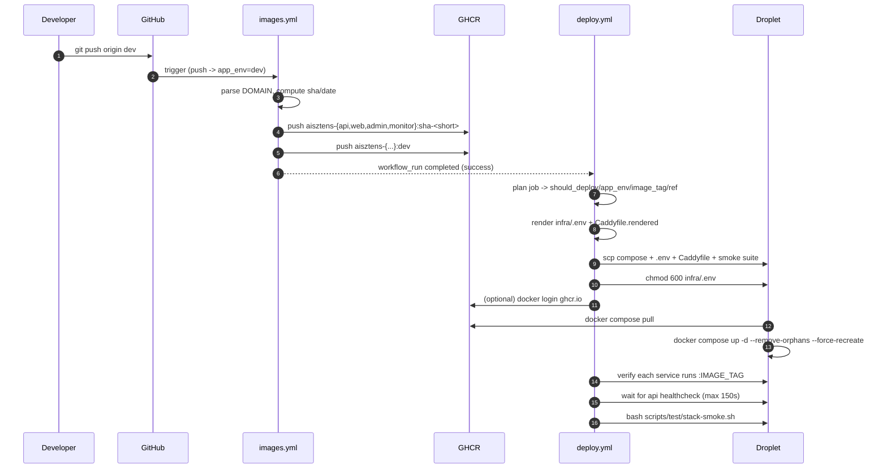

# AIsztens — Image-build & Deploy Process (working document)

**Created:** 2026-10-13
**Status:** TEMPORARY working document (under `docs/temp/`) — used to review the
current CI/CD pipeline before updating the living specs in `docs/Specs/`.
**Scope:** how a commit becomes a running container on the **dev** droplet.
`prod` is not provisioned yet: the pipeline already supports it, but only a
manual `workflow_dispatch` with `app_env=prod` (plus a GitHub `production`
environment) can target it.

---

## 1. The model in one sentence

The **droplet never builds and never receives source code**. GitHub Actions
compiles the monorepo into **four Docker images**, pushes them to **GHCR**, and a
second workflow ships **four small files** (compose, `.env`, rendered Caddyfile,
smoke suite) to the droplet and runs `docker compose pull && up -d`.

Old model (retired 2026-10-08): the whole repo was uploaded, `pnpm install` +
`pnpm build` ran **on the droplet**, and the Caddy container bind-mounted the SPA
`dist/` folders from the host.

---

## 2. Pipeline overview



Key asymmetry: **`images.yml` is the only workflow with a `push` trigger**.
`deploy.yml` reacts to `images.yml` through `workflow_run`, so a build and its
deploy can never race (the deploy always waits for the image it will pull).

---

## 3. Workflow-by-workflow

### 3.1 `.github/workflows/images.yml` — build & push

| Aspect      | Value                                                                                                     |
| ----------- | --------------------------------------------------------------------------------------------------------- |
| Triggers    | `push` to branch `dev` (→ always `app_env=dev`); `workflow_dispatch` with input `app_env` (`dev`\|`prod`) |
| Run name    | `Build and push images (<app_env>)` — the `(dev)`/`(prod)` suffix is later **parsed by `deploy.yml`**     |
| Permissions | `contents: read`, `packages: write` (pushes GHCR with the built-in `GITHUB_TOKEN`, no PAT)                |
| Concurrency | `images-<workflow>-<ref>`, `cancel-in-progress: true`                                                     |
| Job         | one job `build-and-push` on `ubuntu-latest`, `timeout-minutes: 20`                                        |

Steps:

1. **Checkout** the repo.
2. **Resolve APP_ENV and parse DOMAIN** — picks `INFRA_ENV_DEV`/`INFRA_ENV_PROD`
   from the `app_env` input, `grep`s `DOMAIN=` out of that multi-line secret and
   emits `app_env`, `domain`, `api_base=https://api.<domain>/api`.
3. **Log in to GHCR** (`docker/login-action`) with `GITHUB_TOKEN`.
4. **Set up Buildx** (for GHA layer cache + multi-tag push).
5. **Compute image metadata**: `short_sha` (`${GITHUB_SHA::7}`), `commit_hash`
   (full SHA), `deploy_date` (UTC ISO-8601). One source of truth → api/web/admin
   all report the same revision metadata.
6. **Build + push 4 images** (`docker/build-push-action`), each with **two tags**:
   - `sha-<short>` — immutable, what the droplet pins (rollback target);
   - `<app_env>` — mutable convenience pointer (`dev` / `prod`).

| Image              | Dockerfile                 | Build context     | Build args                                                             |
| ------------------ | -------------------------- | ----------------- | ---------------------------------------------------------------------- |
| `aisztens-api`     | `infra/app/Dockerfile`     | repo root         | `APP_ENV`, `COMMIT_HASH`, `DEPLOY_DATE`                                |
| `aisztens-web`     | `infra/web/Dockerfile`     | repo root         | `APP_ENV`, `VITE_API_BASE_URL`, `VITE_DEPLOY_DATE`, `VITE_COMMIT_HASH` |
| `aisztens-admin`   | `infra/admin/Dockerfile`   | repo root         | `APP_ENV`, `VITE_API_BASE_URL`, `VITE_DEPLOY_DATE`, `VITE_COMMIT_HASH` |
| `aisztens-monitor` | `infra/monitor/Dockerfile` | `./infra/monitor` | _(none)_                                                               |

### 3.2 `.github/workflows/deploy.yml` — ship & start

| Aspect      | Value                                                                                                                                      |
| ----------- | ------------------------------------------------------------------------------------------------------------------------------------------ |
| Triggers    | `workflow_run` on **Build and push images** `completed`; `workflow_dispatch` with `app_env` + optional `image_tag`. **No `push` trigger.** |
| Permissions | `contents: read`                                                                                                                           |
| Env         | `REMOTE_DIR: /opt/aisztens`                                                                                                                |
| Jobs        | `plan` (decision) → `deploy` (`needs: plan`, `if: needs.plan.outputs.should_deploy == 'true'`)                                             |

**`plan` job** — runs [`.github/scripts/deploy-plan.sh`](../../.github/scripts/deploy-plan.sh),
no secrets, no SSH. It writes `should_deploy`, `app_env`, `image_tag`, `ref`
to `GITHUB_OUTPUT`:

- `workflow_dispatch`: `app_env` must be `dev`/`prod`; `ref = github.sha`;
  `image_tag = inputs.image_tag` (validated) or `sha-<short>`.
- `workflow_run`: requires `conclusion == success`; the env is recovered from the
  upstream **run-name** (`… (dev)` / `… (prod)`); `ref = workflow_run.head_sha`;
  `image_tag = sha-<short>`. A `push`-triggered build defaults to `(dev)`.

Why a `plan` job instead of `matrix` + job-level `if:`: `jobs.<id>.if` is
evaluated **before** the matrix expands, so `matrix.*` is not available there
(`Unrecognized named-value: 'matrix'`). `needs.plan.outputs.*` **is** allowed in
`if:`, `name:` and `environment:`.

**`deploy` job** — `environment: prod ? 'production' : 'dev'`,
`concurrency: deploy-<app_env>`, `timeout-minutes: 20`. Steps:

1. **Checkout** at `needs.plan.outputs.ref`, sparse: `.github/scripts`,
   `infra/docker-compose.yml`, `infra/caddy/Caddyfile`, `scripts/test`.
2. **Resolve INFRA_ENV and IMAGE_TAG** — re-validates the selected secret and tag.
3. **Render `infra/.env`** — [`.github/scripts/render-infra-env.sh`](../../.github/scripts/render-infra-env.sh)
   takes the `INFRA_ENV_*` secret, **strips** the four workflow-owned keys
   (`APP_ENV`, `IMAGE_TAG`, `GHCR_OWNER`, `REGISTRY`) if present, and **appends**
   the authoritative values last.
4. **Render the Caddyfile** — `sed s|<DOMAIN>|…|` + `s|<ACME_EMAIL>|…|` from the
   rendered `infra/.env` → `infra/caddy/Caddyfile.rendered`, with placeholder and
   `|`-character guards.
5. **scp** compose + `.env` + `Caddyfile.rendered` + `scripts/test/*` to the droplet.
   5a. **chmod 600** `infra/.env` on the droplet (scp lands it 0644; 600 is the
   documented posture).
6. **docker login ghcr.io** — only when the `GHCR_PAT` secret is set (private repo).
7. **Pull + start** (no `--build`):
   `docker compose --env-file infra/.env -f infra/docker-compose.yml pull`
   then `APP_ENV=<env> docker compose … up -d --remove-orphans --force-recreate`.
   7a. **Verify every service runs `IMAGE_TAG`** — `ps --format '{{.Service}} {{.Image}}'`,
   api/web/admin/monitor must contain `:<image_tag>`. Fails the workflow on a
   stale/hand-pinned image.
8. **Wait for api healthcheck** — up to 150 s (30 × 5 s); warns but does not fail.
9. **Run the smoke suite** on the droplet (`bash scripts/test/stack-smoke.sh`).
10. **On failure**, dump `docker compose ps` + last 500 log lines per service.

### 3.3 `.github/workflows/ci.yml` — not part of deploy

Runs on PRs into `main`/`dev` and on push to `dev`: `pnpm install --frozen-lockfile`,
`pnpm -r build`, `pnpm -r lint`, `pnpm --filter @callback/api test`. It never
touches the droplet or GHCR.

### 3.4 `deploy/deploy.sh` — the manual mirror (optional path)

An operator can run the same delivery from a laptop:

```bash
./deploy/deploy.sh up dev      # or: bash deploy/deploy.sh up dev / .\deploy\deploy.ps1 up dev
```

It performs the same three actions as `deploy.yml`: render the Caddyfile and
`infra/.env` (appending `APP_ENV`, `IMAGE_TAG`, `GHCR_OWNER`, `REGISTRY`), scp
the three files as `deployer`, then `docker compose pull && up -d --remove-orphans`
and `verify_up_result`. It does **not** build images — they must already exist in
GHCR (produced by `images.yml`). `local` is not a valid target.

---

## 4. Variables — where they come from and what they do

### 4.1 Trigger inputs

| Variable           | Workflow                   | Source                     | Default | Effect                                                                                                                                    |
| ------------------ | -------------------------- | -------------------------- | ------- | ----------------------------------------------------------------------------------------------------------------------------------------- |
| `inputs.app_env`   | `images.yml`, `deploy.yml` | `workflow_dispatch` choice | `dev`   | selects `dev`\|`prod`; picks the `INFRA_ENV_*` secret, the image env tag, the GitHub Environment and the `deploy-<env>` concurrency group |
| `inputs.image_tag` | `deploy.yml`               | `workflow_dispatch` string | `''`    | overrides the auto `sha-<short>` (re-deploy an older image); validated as a Docker tag                                                    |
| push to `dev`      | `images.yml`               | git                        | —       | implicit `app_env=dev` build                                                                                                              |

### 4.2 GitHub built-in contexts

| Value                                             | Used in                                    | Purpose                                             |
| ------------------------------------------------- | ------------------------------------------ | --------------------------------------------------- |
| `github.sha`                                      | images.yml metadata; deploy.yml `HEAD_SHA` | commit being built / dispatched                     |
| `github.repository_owner`                         | `GHCR_OWNER` fallback                      | image namespace                                     |
| `github.actor`                                    | GHCR login username                        | `docker login ghcr.io -u <actor>`                   |
| `github.workflow` / `github.ref`                  | images.yml concurrency group               | cancel superseded builds                            |
| `github.event_name`                               | deploy-plan.sh                             | `workflow_dispatch` vs `workflow_run`               |
| `github.event.workflow_run.conclusion`            | deploy-plan.sh                             | gate: only `success` deploys                        |
| `github.event.workflow_run.event` / `head_branch` | deploy-plan.sh                             | info in the decision reason                         |
| `github.event.workflow_run.head_sha`              | deploy-plan.sh                             | the commit `images.yml` built → `ref` + `image_tag` |
| `github.event.workflow_run.display_title`         | deploy-plan.sh                             | parsed for the `(dev)`/`(prod)` suffix              |

### 4.3 Repository variables

| Variable     | Source                                | Default                   | Effect                                                                        |
| ------------ | ------------------------------------- | ------------------------- | ----------------------------------------------------------------------------- |
| `GHCR_OWNER` | repo/org variable (`vars.GHCR_OWNER`) | `github.repository_owner` | owner segment of every image reference; **must** match between build and pull |

### 4.4 Secrets

| Secret            | Required     | Purpose                                                                                                        |
| ----------------- | ------------ | -------------------------------------------------------------------------------------------------------------- |
| `DROPLET_HOST`    | yes (deploy) | droplet IPv4 / hostname for ssh + scp                                                                          |
| `DROPLET_SSH_KEY` | yes (deploy) | passphrase-less deploy private key; logs in as `deployer`                                                      |
| `INFRA_ENV_DEV`   | yes (dev)    | full contents of `infra/.env.dev` — the static runtime config                                                  |
| `INFRA_ENV_PROD`  | yes (prod)   | full contents of `infra/.env.prod`                                                                             |
| `GHCR_PAT`        | optional     | PAT with `read:packages`; only needed when the repo/package is private (enables `docker login` on the droplet) |
| `GITHUB_TOKEN`    | automatic    | GHCR push in `images.yml` (`packages: write`)                                                                  |

### 4.5 Values derived inside the workflows

| Value         | Formula                                            | Where it goes                                                |
| ------------- | -------------------------------------------------- | ------------------------------------------------------------ |
| `app_env`     | input or run-name suffix                           | env tag, GitHub Environment, `deploy-<env>` group, `APP_ENV` |
| `domain`      | `grep '^DOMAIN='` from the `INFRA_ENV_*` secret    | Caddyfile render, `api_base`                                 |
| `api_base`    | `https://api.<domain>/api`                         | `VITE_API_BASE_URL` build arg                                |
| `short_sha`   | `${GITHUB_SHA::7}`                                 | image tag `sha-<short>`                                      |
| `commit_hash` | `${GITHUB_SHA}`                                    | `COMMIT_HASH` / `VITE_COMMIT_HASH`                           |
| `deploy_date` | `date -u +%Y-%m-%dT%H:%M:%SZ`                      | `DEPLOY_DATE` / `VITE_DEPLOY_DATE`                           |
| `image_tag`   | `sha-<short>` or dispatch override                 | `IMAGE_TAG` in `infra/.env` → image pin                      |
| `ref`         | `github.sha` (dispatch) or `workflow_run.head_sha` | checkout ref of the deploy job                               |

### 4.6 Build args baked into the images (immutable at runtime)

| Image       | Build arg                                                              | Landed as                                      | Visible at                                  |
| ----------- | ---------------------------------------------------------------------- | ---------------------------------------------- | ------------------------------------------- |
| api         | `APP_ENV`, `COMMIT_HASH`, `DEPLOY_DATE`                                | `ENV` in the runtime stage                     | `GET /healthz` → `commitHash`, `deployDate` |
| web / admin | `APP_ENV`, `VITE_API_BASE_URL`, `VITE_DEPLOY_DATE`, `VITE_COMMIT_HASH` | `ENV` in the build stage (Vite reads `VITE_*`) | SPA bundle (footer build-info line)         |
| monitor     | —                                                                      | —                                              | —                                           |

Local builds pass none of these, so `/healthz` returns `null` and the SPA footer
shows `—`: graceful degradation, not an error.

### 4.7 Runtime env file on the droplet — `infra/.env`

Written by `deploy.yml` (step 3) — or by `deploy/deploy.sh` — and read by every
remote `docker compose --env-file infra/.env` command. Two parts:

**A. Workflow-owned keys (always appended last, stripped from the secret if duplicated):**

| Key          | Value         | Consumed by                       |
| ------------ | ------------- | --------------------------------- |
| `APP_ENV`    | `dev`\|`prod` | compose `api.environment.APP_ENV` |
| `IMAGE_TAG`  | `sha-<short>` | every `image:` reference          |
| `GHCR_OWNER` | org/user      | image namespace                   |
| `REGISTRY`   | `ghcr.io`     | image namespace                   |

**B. Static keys from the `INFRA_ENV_*` secret** (schema in [`infra/.env.example`](../../infra/.env.example)):

`DOMAIN`, `ACME_EMAIL`, `API_PORT`, `CORS_ORIGINS`, `VAPI_WEBHOOK_SECRET`,
`POSTGRES_DB`, `POSTGRES_USER`, `POSTGRES_PASSWORD`, `AISZTENS_DB_USER`,
`AISZTENS_DB_PASSWORD`, `TKOVARI_DB_PASSWORD`, `KRAK_DB_PASSWORD`,
`MONITOR_TARGET_URL`, `MONITOR_INTERVAL_SECONDS`, `MONITOR_ALERT_WEBHOOK_URL`.

### 4.8 How compose turns these into image references

[`infra/docker-compose.yml`](../../infra/docker-compose.yml) interpolates:

```
${REGISTRY:-ghcr.io}/${GHCR_OWNER:-local}/aisztens-api:${IMAGE_TAG:-latest}
```

so a deploy-time `.env` change (`IMAGE_TAG`, `GHCR_OWNER`) is the only lever that
selects which revision the droplet runs. `postgres` (`postgres:16-alpine`) and
`caddy` (`caddy:2-alpine`) are floating upstream tags and are **not** pinned by
`IMAGE_TAG`.

---

## 5. End-to-end sequence



---

## 6. Rollback & re-deploy

- **Re-pin an older revision:** `workflow_dispatch` `deploy.yml` with
  `app_env=dev` and `image_tag=sha-<old-short>` (the image must still exist in GHCR).
- **On the droplet:** set `IMAGE_TAG=sha-<old-short>` in `infra/.env` and run
  `docker compose --env-file infra/.env -f infra/docker-compose.yml pull && up -d --force-recreate`.
- The previous `sha-<short>` is always the rollback target; `pgdata` and
  `caddy_data` volumes survive a rollback (no data loss).

---

## 7. Statements that are no longer true (superseded by the image-based model)

The following were true **before 2026-10-08** and must not appear as current in
the living specs:

| Retired statement                                                                 | Reality now                                                                             |
| --------------------------------------------------------------------------------- | --------------------------------------------------------------------------------------- |
| The repo is rsynced to the droplet; `pnpm install` / `pnpm build` run on the host | Only 4 small files are scp'd; the droplet has no source tree and never runs pnpm        |
| `deploy.sh:ensure_spa_env()` seeds `apps/*/.env.dev` on the host before a build   | Function removed; the SPA base URL is the `VITE_API_BASE_URL` build arg in `images.yml` |
| `deploy.sh:prune_legacy_stack()` removes legacy containers before `up`            | Function removed; `up -d --remove-orphans` handles orphan removal                       |
| Caddy bind-mounts `/srv/web` + `/srv/admin` and serves SPAs with `file_server`    | Caddy `reverse_proxy web:80` / `admin:80`; the bundle is baked into the image           |
| `apps/{web,admin}/dist` and `WEB_DIST_PATH`/`ADMIN_DIST_PATH` exist on the host   | No host `dist/`; bundles live at `/usr/share/nginx/html` inside the containers          |
| `deploy.yml` uses a 2-entry `matrix` (`dev`,`prod`) with a job-level `if:`        | Replaced by a `plan` job (`deploy-plan.sh`) + `needs.plan.outputs.*`                    |
| `deploy.yml` has a `push` trigger                                                 | Removed; `images.yml` takes the push and `deploy.yml` follows via `workflow_run`        |
| The droplet builds with `docker compose up -d --build`                            | No `--build`; `pull` + `up -d --force-recreate`                                         |
