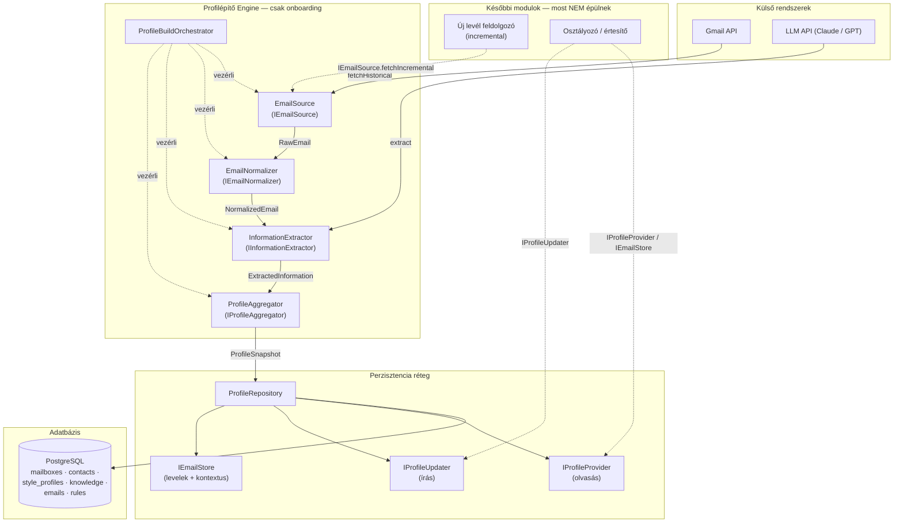
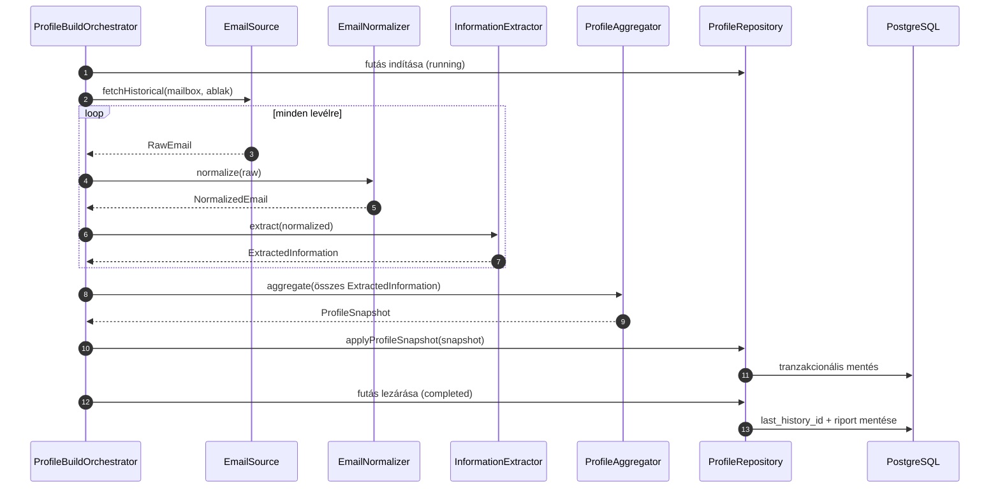

# Email Engine — Profilépítő engine terve (MVP)

**Státusz:** terv (tervezési dokumentum)
**Készült:** 2026-10-15
**Forrásdokumentum:** [`docs/temp/Email-modul-MVP.md`](Email-modul-MVP.md)
**Hatókör:** kizárólag a **profilépítő / onboarding** fázis. Az újonnan érkező
leveleket feldolgozó és a profilt folyamatosan frissítő modulok **nincsenek** ebben
a tervben — a terv viszont úgy készül, hogy azok később változtatás nélkül
ráépülhessenek.

---

## 1. Cél és hatókör

### 1.1 Mit csinál az engine

Az onboarding során (R1) a bekötött Gmail-postafiók **múltbeli levelezéséből**
(alapból az utolsó 30 nap, A12/D50) felépíti a cég profilját adó, strukturált
adatbázist. A profil négy pillérre épül:

1. **Kapcsolati profilok** — kik írnak, kik a gyakori/kiemelt partnerek (VIP),
   milyen szerepben jelennek meg.
2. **Stílusprofilok** — hogyan ír a tulajdonos (alap stílusprofil, A6), és hogyan
   írnak a gyakori feladók (U13, D17/D18).
3. **Cég-tudásbázis / kontextus** — témák, projektek, ügyfelek, beszállítók,
   szolgáltatások (a kontextusfüggő besorolás U2 alapja).
4. **Levél-összefoglalók és kinyert jellemzők** — a későbbi osztályozás,
   visszakeresés (U15) és válaszpiszkozat (U12) alapanyaga.
5. **Besorolási szabályok kezdőhalmaza** — az AI által javasolt kiemelt feladók és
   domain-szabályok (D14, A11), jóváhagyásra előkészítve.

Az engine egy **snapshot**: egyszer fut le az onboardingkor, és **csak** a fenti
profilt állítja elő.

### 1.2 Mit NEM csinál az engine

- Nem figyeli / nem tölti le az újonnan érkező leveleket.
- Nem frissíti a profilt futás közben, nem módosít semmit utólag.
- Nem osztályoz és nem küld értesítést (nincs Telegram-küldés).
- Nem generál válaszpiszkozatot, nem kezel piszkozatokat.
- Nem töröl adatot (a megőrzési szabályok érvényesítése későbbi ütemezett feladat).

### 1.3 Miért így van tervezve

Az engine minden komponense és interfésze úgy van kialakítva, hogy a később
megírandó, **egyenként érkező leveleket feldolgozó** modul (incremental pipeline)
ugyanazokat az interfészeket hívja. A különbség csak az orchestrációban van:
az onboarding a teljes múltat egyszerre dolgozza fel, a későbbi modul pedig
levélenként hívja ugyanezt a csővezetéket, majd egy **inkrementális profilfrissítő**
lépést futtat.

---

## 2. Tervezési elvek

| Elv                                             | Mit jelent itt                                                                                                                |
| :---------------------------------------------- | :---------------------------------------------------------------------------------------------------------------------------- |
| **Egy felelősség (SRP)**                        | A letöltés, a normalizálás, az AI-kinyerés, az aggregálás és a perzisztálás külön komponens.                                  |
| **Absztrakciókra építés (DIP)**                 | A komponensek interfészeken keresztül beszélnek egymással; a Gmail-kliens és az LLM-kliens cserélhető.                        |
| **Determinisztikus kód vs. AI**                 | A mechanikus lépések (fetch, tisztítás, tárolás) determinisztikus kód; az LLM csak a _megértést_ (kinyerés, összegzés) végzi. |
| **Idempotencia + folytathatóság**               | Az onboarding félbeszakadhat (hiba, újraindítás); a futás állapota mentett, a már elemzett levelek nem dolgozódnak fel újra.  |
| **Tenant-izoláció**                             | Minden adat a postafiókhoz (`mailbox`) kötődik; a fiók és a postafiók külön entitás (D45).                                    |
| **Nyílt a bővítésre, zárt a módosításra (OCP)** | Új kinyerési szabály vagy új postafiók-provider hozzáadása új komponens, nem meglévő kód átírása.                             |

---

## 3. Pipeline és komponensek

### 3.1 A pipeline áttekintése

```
Gmail API ──fetch──▶ Normalizálás ──▶ AI kinyerés ──▶ Aggregálás ──▶ Profil (DB)
      (EmailSource)   (EmailNormalizer)  (InformationExtractor)  (ProfileAggregator)  (ProfileRepository)
```

A pipeline **lineáris és moduláris**: minden lépés egy-egy jól körülhatárolt
komponens, saját bemenettel és kimenettel. A komponenseket az orchestrátor fűzi
össze, így az egyes lépések külön is tesztelhetők, cserélhetők, és a későbbi
incremental modul újra tudja használni őket.

### 3.2 A komponensek szerepe

#### 3.2.1 `ProfileBuildOrchestrator` (vezérlő)

- **Felelősség:** az onboarding teljes folyamatának vezérlése. Beolvassa a
  beállításokat (`history_window_days`, A12/D50), elindítja a fetch→normalizál→
  kinyer→aggregál láncot, kezeli az újrapróbálkozást és a félbeszakadt futás
  folytatását.
- **Bemenet:** `mailboxId`, `historyWindowDays`, esetleges AI-paraméterek.
- **Kimenet:** kész profil a DB-ben + egy összegző riport (pl. hány contact, hány
  javasolt VIP, hány tudásbázis-bejegyzés) a jóváhagyási lépéshez (D14).
- **Kulcsdöntés:** az orchestrátor **nem** ismeri a Gmail és az LLM konkrét
  implementációját, csak a lenti interfészeket.

#### 3.2.2 `EmailSource` (letöltés / ingestion)

- **Felelősség:** kapcsolódás a Gmail API-hoz, a megadott időablak leveleinek
  letöltése lapozással (pagination), részleges hibák tűrése, a `historyId`
  rögzítése a későbbi inkrementális letöltéshez.
- **Bemenet:** `mailbox`, `windowStart`, `windowEnd`.
- **Kimenet:** `RawEmail` folyam (`AsyncIterable`): fejléc, törzs, label-ek,
  thread-azonosító.

#### 3.2.3 `EmailNormalizer` (normalizálás / parser)

- **Felelősség:** a nyers levélből tiszta, strukturált forma előállítása.
  HTML→szöveg, idézett részek és aláírások kezelése, feladó/címzettek/tárgy/idő
  normalizálása. A mellékleteket **nem tároljuk** (D19), csak a metaadatukat
  (név, típus, méret) tartjuk meg, ha kell.
- **Bemenet:** `RawEmail`.
- **Kimenet:** `NormalizedEmail` — tiszta szövegtörzs + strukturált fejléc.

#### 3.2.4 `InformationExtractor` (AI-kinyerés)

- **Felelősség:** az LLM segítségével a szövegből strukturált adatok kinyerése.
  Ez az egyetlen komponens, amely LLM-et hív.
- **Kinyert adatok:**
  - **Entitások:** személy/cég neve, e-mail, szerepkör, domain.
  - **Stílusjegyek:** formalitás, hangnem, megszólítás, zárás, terjedelem,
    tegezés/magázás.
  - **Témák:** kulcsszavak, projektnevek, ügyfél-típusok, szolgáltatások.
  - **Sürgősségi jelek (U6):** határidő, összeg, kérés — ez lesz a sürgős
    besorolás alapja a későbbi osztályozónál.
- **Bemenet:** `NormalizedEmail`, opcionálisan a már felépült profil (kontextus).
- **Kimenet:** `ExtractedInformation` (strukturált JSON séma).

#### 3.2.5 `ProfileAggregator` (aggregálás / szintézis)

- **Felelősség:** a sok levélből kinyert adat összegzése profillá.
  - Azonos e-mail cím → egy `contact` (összevonás).
  - Gyakorisági statisztikák (levélszám, irány, utolsó kapcsolat).
  - Stílusjegyek összegzése (domináns/átlagos jellemzők).
  - Témák klaszterezése → tudásbázis-bejegyzések.
  - **VIP-javaslat** készítése a gyakori/fontos feladókra (D14).
- **Bemenet:** `ExtractedInformation[]`.
- **Kimenet:** `ProfileSnapshot` — a repository által írandó entitások halmaza.

#### 3.2.6 `ProfileRepository` (perzisztencia)

- **Felelősség:** a profil írása és olvasása. **Ez az egyetlen komponens, amely az
  adatbázishoz nyúl.**
- A repository három, a későbbi modulok által is használt interfészt valósít meg
  (lásd 5. fejezet): `IProfileProvider`, `IProfileUpdater`, `IEmailStore`.

---

## 4. A komponensek viszonya

- Az **orchestrátor** csak az interfészeket ismeri, és sorban meghívja:
  `EmailSource` → `EmailNormalizer` → `InformationExtractor` → `ProfileAggregator`
  → `ProfileRepository`.
- Az **adatáramlás egyirányú**: minden komponens a kimenetét adja át a
  következőnek, és nem nyúl vissza az előző belső állapotához.
- A **repository** az egyetlen írási pont; az aggregátor csak _memóriában_
  épít `ProfileSnapshot`-ot, és a repositoryra bízza a tranzakcionális mentést.
- Az **LLM** és a **Gmail** külső rendszerként jelennek meg, adapterek mögött.
- A **későbbi modulok** ugyanazt a négy feldolgozó komponenst hívják egyesével
  (levélenként), és a repository író-interfészeivel frissítik a profilt.

---

## 5. Interfészek a későbbi modulok számára

A később megírandó, egyenként érkező leveleket feldolgozó modul **ugyanezeken** az
interfészeken keresztül dolgozik. A feldolgozó interfészek kimenetei megegyeznek a
pipeline köztes típusaival, ezért a komponensek változtatás nélkül újrahasználhatók.

### 5.1 Feldolgozó interfészek (a pipeline komponensei)

```ts
interface IEmailSource {
  // Onboarding: a teljes múlt feltérképezése (A12/D50)
  fetchHistorical(
    mailbox: Mailbox,
    window: TimeWindow,
  ): AsyncIterable<RawEmail>;
  // Későbbi modul: inkrementális letöltés a historyId-től
  fetchIncremental(
    mailbox: Mailbox,
    sinceHistoryId: string,
  ): AsyncIterable<RawEmail>;
}

interface IEmailNormalizer {
  normalize(raw: RawEmail): NormalizedEmail;
}

interface IInformationExtractor {
  extract(
    email: NormalizedEmail,
    context?: ProfileContext,
  ): Promise<ExtractedInformation>;
}

interface IProfileAggregator {
  aggregate(items: ExtractedInformation[]): ProfileSnapshot;
}
```

### 5.2 Perzisztencia-interfészek (írás + olvasás)

```ts
interface IProfileProvider {
  getContact(mailboxId: string, email: string): Promise<Contact | null>;
  listContacts(mailboxId: string): Promise<Contact[]>;
  getStyleProfile(contactId: string): Promise<ContactStyleProfile | null>;
  getKnowledgeBase(mailboxId: string): Promise<KnowledgeEntry[]>;
  listRules(mailboxId: string): Promise<ClassificationRule[]>;
}

interface IProfileUpdater {
  upsertContact(contact: Contact): Promise<void>;
  updateStyleProfile(
    contactId: string,
    patch: Partial<ContactStyleProfile>,
  ): Promise<void>;
  addKnowledgeEntry(entry: KnowledgeEntry): Promise<void>;
  upsertRule(rule: ClassificationRule): Promise<void>;
  applyProfileSnapshot(snapshot: ProfileSnapshot): Promise<void>; // tranzakcionális mentés
}

interface IEmailStore {
  saveEmail(email: EmailRecord, analysis: EmailAnalysis): Promise<void>;
  getRecentContext(
    mailboxId: string,
    contactId: string,
    limit: number,
  ): Promise<EmailSummary[]>;
}
```

### 5.3 Miért pont így

- A **feldolgozó interfészek** a pipeline komponensei, így az incremental modul
  csak a `fetchHistorical` helyett a `fetchIncremental`-t hívja, a többi lépés
  azonos.
- A **repository-interfészek** írás/olvasás szerint vannak szétválasztva
  (CQRS-szerűen), hogy a jövőbeli modulok csak annyi jogot kapjanak, amennyi kell:
  az osztályozó olvas (`IProfileProvider`, `IEmailStore`), a profilfrissítő ír
  (`IProfileUpdater`).
- Minden metódus `mailboxId`-val kötött, ez garantálja a tenant-izolációt.

---

## 6. Adatbázis táblák

Az adatbázis PostgreSQL (a projekt meglévő stack-je). Minden tábla UUID elsődleges
kulcsot és `mailbox_id` tenant-kulcsot használ, kivéve a globális `accounts`
táblát. A kapcsolat: `account 1—N mailbox 1—N minden_más`.

> A `accounts` tábla feltételezhetően már létezik a rendszerben (AIsztens-fiók,
> D45); az email engine csak hivatkozik rá, nem tervezi újra.

### 6.1 `mailboxes` — bekötött postafiók

| Oszlop                     | Típus                | Leírás                                                         |
| :------------------------- | :------------------- | :------------------------------------------------------------- |
| `id`                       | UUID                 | PK                                                             |
| `account_id`               | UUID FK → `accounts` | Tulajdonos fiók (D45)                                          |
| `provider`                 | enum (`gmail`)       | Csak Gmail az MVP-ben (A1)                                     |
| `email_address`            | text                 | A postafiók címe                                               |
| `oauth_ref`                | text                 | Tárolt hozzáférés referenciája (leválasztáskor törlődik)       |
| `status`                   | enum                 | `connected` / `paused` / `disconnected`                        |
| `history_id`               | bigint               | Gmail `historyId` az inkrementális letöltéshez (későbbi modul) |
| `created_at`, `updated_at` | timestamptz          |                                                                |

### 6.2 `mailbox_settings` — postafiók-beállítások

| Oszlop       | Típus                 | Leírás                                                                               |
| :----------- | :-------------------- | :----------------------------------------------------------------------------------- |
| `id`         | UUID                  | PK                                                                                   |
| `mailbox_id` | UUID FK → `mailboxes` |                                                                                      |
| `key`        | text                  | pl. `urgency_threshold_hours` (A10), `history_window_days` (A12), `quiet_hours` (A8) |
| `value`      | jsonb                 | A beállítás értéke                                                                   |
| `updated_at` | timestamptz           |                                                                                      |

### 6.3 `contacts` — kapcsolati profilok

| Oszlop                          | Típus                         | Leírás                    |
| :------------------------------ | :---------------------------- | :------------------------ |
| `id`                            | UUID                          | PK                        |
| `mailbox_id`                    | UUID FK → `mailboxes`         | Tenant-izoláció           |
| `email`                         | citext                        | Egyedi a mailbox-on belül |
| `display_name`                  | text                          |                           |
| `company_name`                  | text                          |                           |
| `domain`                        | text                          |                           |
| `role`                          | text                          | Szerepkör, ha kiderül     |
| `is_vip`                        | boolean                       | Kiemelt feladó (A11/U17b) |
| `source`                        | enum (`ai`,`user`,`feedback`) | Ki vette fel (D47)        |
| `message_count`                 | int                           |                           |
| `first_seen_at`, `last_seen_at` | timestamptz                   |                           |

### 6.4 `contact_style_profiles` — feladónkénti stílusprofil (U13)

| Oszlop              | Típus                | Leírás                            |
| :------------------ | :------------------- | :-------------------------------- |
| `id`                | UUID                 | PK                                |
| `contact_id`        | UUID FK → `contacts` |                                   |
| `formality`         | enum                 | `formal` / `neutral` / `informal` |
| `tone`              | text                 | Hangnem (pl. udvarias, közvetlen) |
| `salutation`        | text                 | Megszólítás                       |
| `closing`           | text                 | Zárás                             |
| `preferred_length`  | enum                 | `short` / `medium` / `long`       |
| `language_register` | enum                 | `tegezes` / `magazas`             |
| `confidence`        | numeric              | A becslés megbízhatósága          |
| `updated_at`        | timestamptz          |                                   |

### 6.5 `owner_style_profiles` — a tulajdonos saját stílusa (A6)

| Oszlop                                                                                | Típus                 | Leírás |
| :------------------------------------------------------------------------------------ | :-------------------- | :----- |
| `id`                                                                                  | UUID                  | PK     |
| `mailbox_id`                                                                          | UUID FK → `mailboxes` |        |
| `formality`, `tone`, `salutation`, `closing`, `preferred_length`, `language_register` | mint a 6.4-ben        |        |
| `confidence`                                                                          | numeric               |        |
| `updated_at`                                                                          | timestamptz           |        |

### 6.6 `knowledge_entries` — cég-tudásbázis (U2 kontextus)

| Oszlop        | Típus                         | Leírás                                                |
| :------------ | :---------------------------- | :---------------------------------------------------- |
| `id`          | UUID                          | PK                                                    |
| `mailbox_id`  | UUID FK → `mailboxes`         |                                                       |
| `entity_type` | enum                          | `client` / `vendor` / `project` / `topic` / `service` |
| `name`        | text                          |                                                       |
| `description` | text                          | Rövid leírás/kontextus                                |
| `keywords`    | text[]                        | Kereshető kulcsszavak                                 |
| `metadata`    | jsonb                         | Egyéb (pl. kapcsolattartó, összeg)                    |
| `confidence`  | numeric                       |                                                       |
| `source`      | enum (`ai`,`user`,`feedback`) |                                                       |
| `created_at`  | timestamptz                   |                                                       |

### 6.7 `emails` — normalizált levelek + összefoglalók

| Oszlop        | Típus                 | Leírás                                                     |
| :------------ | :-------------------- | :--------------------------------------------------------- |
| `id`          | UUID                  | PK                                                         |
| `mailbox_id`  | UUID FK → `mailboxes` |                                                            |
| `external_id` | text                  | Gmail message id (egyedi a mailbox-on belül)               |
| `thread_id`   | text                  |                                                            |
| `subject`     | text                  |                                                            |
| `snippet`     | text                  |                                                            |
| `summary`     | text                  | AI-összefoglaló (U5)                                       |
| `body_text`   | text                  | Teljes szöveg — a 14 napos megőrzés szerint kezelendő (R3) |
| `received_at` | timestamptz           |                                                            |
| `direction`   | enum                  | `inbound` / `outbound`                                     |
| `labels`      | text[]                | Gmail-címkék                                               |

### 6.8 `email_contacts` — levél ↔ kapcsolat kapcsolótábla

| Oszlop       | Típus                | Leírás                       |
| :----------- | :------------------- | :--------------------------- |
| `email_id`   | UUID FK → `emails`   |                              |
| `contact_id` | UUID FK → `contacts` |                              |
| `role`       | enum                 | `from` / `to` / `cc` / `bcc` |

### 6.9 `email_analyses` — kinyert jellemzők levélenként

| Oszlop                     | Típus              | Leírás                                                               |
| :------------------------- | :----------------- | :------------------------------------------------------------------- |
| `id`                       | UUID               | PK                                                                   |
| `email_id`                 | UUID FK → `emails` |                                                                      |
| `extraction`               | jsonb              | Entitások, stílusjegyek, témák                                       |
| `suggested_classification` | enum               | `urgent` / `important` / `maybe_interesting` / `newsletter` / `spam` |
| `urgency_indicators`       | jsonb              | Határidő, összeg, kérés (U6)                                         |
| `ai_model`                 | text               | Melyik modell elemezte                                               |
| `created_at`               | timestamptz        |                                                                      |

### 6.10 `classification_rules` — besorolási szabályok (A5, A11)

| Oszlop       | Típus                         | Leírás                                                                  |
| :----------- | :---------------------------- | :---------------------------------------------------------------------- |
| `id`         | UUID                          | PK                                                                      |
| `mailbox_id` | UUID FK → `mailboxes`         |                                                                         |
| `rule_type`  | enum                          | `vip_sender` / `blocked_sender` / `always_urgent_topic` / `domain_rule` |
| `pattern`    | text                          | E-mail cím / domain / téma                                              |
| `source`     | enum (`ai`,`user`,`feedback`) | D47                                                                     |
| `is_active`  | boolean                       |                                                                         |
| `created_at` | timestamptz                   |                                                                         |

### 6.11 `profile_build_runs` — az orchestrátor futásállapota

| Oszlop                       | Típus                 | Leírás                                           |
| :--------------------------- | :-------------------- | :----------------------------------------------- |
| `id`                         | UUID                  | PK                                               |
| `mailbox_id`                 | UUID FK → `mailboxes` |                                                  |
| `status`                     | enum                  | `running` / `completed` / `failed`               |
| `window_start`, `window_end` | timestamptz           | Az elemzett időablak                             |
| `emails_fetched`             | int                   |                                                  |
| `emails_processed`           | int                   |                                                  |
| `last_history_id`            | bigint                | A folytatáshoz / későbbi inkrementális fetch-hez |
| `error`                      | jsonb                 | Hiba esetén                                      |
| `started_at`, `finished_at`  | timestamptz           |                                                  |

---

## 7. Komponens diagram (Mermaid)



---

## 8. Adatfolyam (szekvencia)



---

## 9. Hibakezelés, idempotencia, újrafuttatás

- **Idempotens feldolgozás:** minden levél a `mailbox_id` + `external_id`
  kombinációval egyértelműen azonosítható. Újrafuttatáskor a már elemzett
  leveleket a rendszer kihagyja.
- **Folytathatóság:** a `profile_build_runs` tábla tárolja a haladást; egy
  félbeszakadt futás a `last_history_id`-tól folytatható.
- **Újrapróbálkozás:** átmeneti Gmail-/LLM-hibánál visszalépéses újrapróbálkozás;
  a tartós hiba az MVP R2 szerint üzemeltetői riasztást generál (3 kísérlet / 15
  perc, D57).
- **Tranzakcionális mentés:** a `ProfileSnapshot` mentése egy tranzakcióban
  történik, így nem keletkezik félkész profil.
- **Titkosítás/adatvédelem:** a `body_text` a 14 napos megőrzési szabály hatálya
  alá esik (R3); a terv csak a tárolást írja elő, a törlő ütemezett feladat a
  későbbi rendszerszintű működés része.

---

## 10. Kapcsolat az MVP adatmegőrzési táblájával

| Adat                               | Tábla                                                         | Megőrzés (MVP)               |
| :--------------------------------- | :------------------------------------------------------------ | :--------------------------- |
| Aktív levélváltások teljes szövege | `emails.body_text`                                            | 14 nap, utána csak `summary` |
| Összefoglalók, besorolások         | `emails.summary`, `email_analyses`                            | 90 nap                       |
| Feladónkénti stílusprofil          | `contact_style_profiles`                                      | előfizetés végéig            |
| Tulajdonosi stílusprofil           | `owner_style_profiles`                                        | előfizetés végéig            |
| Beállítások, szabályok, VIP        | `mailbox_settings`, `classification_rules`, `contacts.is_vip` | előfizetés végéig            |
| Mellékletek                        | nem tároljuk (csak metaadat)                                  | —                            |

---

## 11. Amit a terv szándékosan NEM tartalmaz

- Fájlszintű / modul-szintű implementációs részletek (mappastruktúra, osztályok
  pontos kódja).
- Az inkrementális profilfrissítő modul belső logikája (csak az interfészek,
  amelyekre épülni fog).
- A besoroló, értesítő, válaszpiszkozat-készítő és Telegram-integráció terve.
- A megőrzési törlési ütemezés és az üzemeltetői riasztás konkrét megvalósítása.
