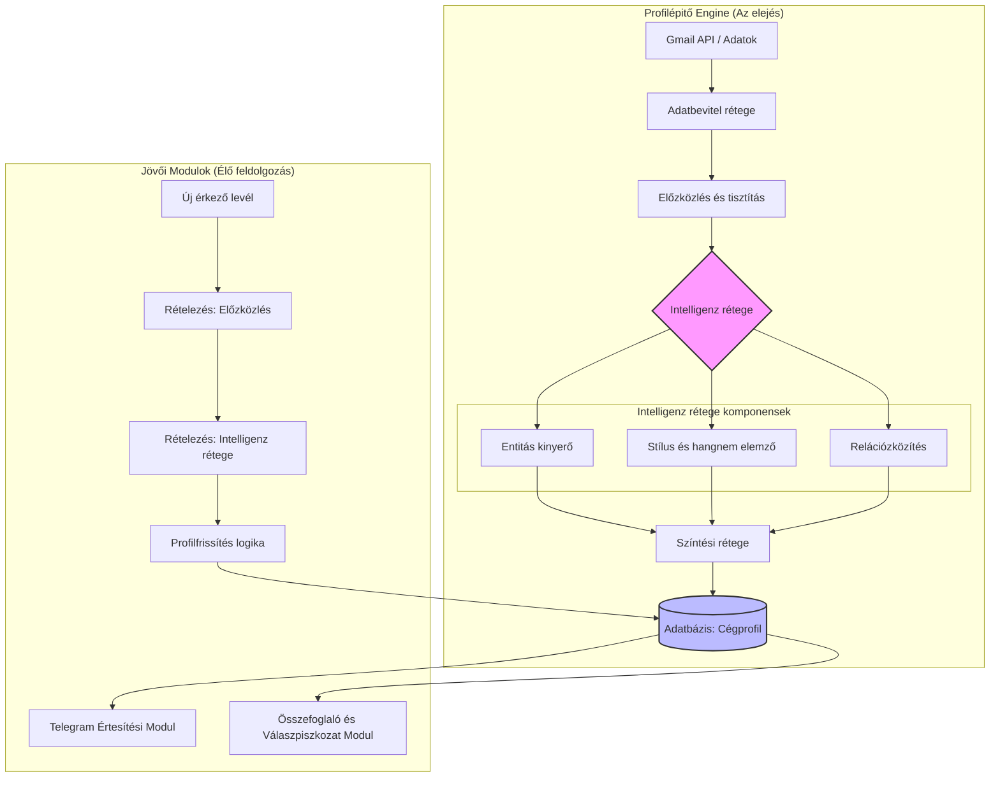

# Profilépitő Engine Terve (Email-modul MVP)

## 1. Áttekintés
Az Engine célja az, hogy a létező e-mail adatok alapján egy komplex „Cégprofilt” építsen fel. Ez a profil az alapvető adatforrás lesz minden későbbi funkcióhoz (értesítések, összefoglalók, válaszpiszkozatok).

Az engine egy **Pipeline (csatornázási)** architektúrát használ, ahol az adatok különböző szakosított komponenseken keresztül futnak, mielőtt az adatbázisba kerülnek.

## 2. Komponensek és Pipeline folyamata

Az engine az alábbi rétegekből áll:

### A. Adatbevitel rétege (Data Ingestion)
- **Feladat:** Kapcsódás a Gmail API-hoz és a múltbeli levelek letöltése a meghatározott időtartamról (pl. 30 nap).
- **Kimenet:** Nyers e-mail szövegek és metaadatok listája.

### B. El előzközlés és tisztítás (Preprocessing & Cleaning)
- **Feladat:** HTML tagok eltávolítása, szöveg tisztítása, levelek threadekre (levélváltásokra) való csoportosítása.
- **Kimenet:** Tisztán olvasható szöveges adatok és levélváltás-objektusok.

### C. Intelligenz rétege (Intelligence Layer)
*Ez a régió tartalmazza az analitikus komponenseket, amelyek később is használhatók:*
- **Entitás kinyerő (Entity Extractor):** Azonosítja személyeket, cégeket, dátumokat és pénzügyi összegeket.
- **Stílus és hangnem elemző (Sentiment & Style Analyzer):** Analizálja a cég saját leveleiből a stílust (hivatalos, közvetlen), a megszólítást és a preferált hosszúságot.
- **Relációzközítés (Relationship Mapper):** Azonosítja a „kiemelt” (VIP) feladókat, az állandó spam/hírlevél forrásokat és a leggyakoribb ügyfeleket a múltbeli levelezés alapján.

### D. Színtési rétege (Profile Synthesis)
- **Feladat:** Összefoglalja az intelligenz rétegtől érkező információkat. Ha ellentmondások vannak (pl. egy levél hivatalos, de 90%-a közvetlen), itt születik meg a döntés a „profil” meghatározásáról.
- **Kimenet:** Állott Cégprofil objektus.

### E. Adatbázis rétege (Persistence)
- **Feladat:** A végleges profil mentése az adatbázisba, a kapcsolatok (Contacts) és a profilattribútok különálló táblákba.

## 3. Adatbázis schéma terv

A táblaképítés úgy tervezப்பட்டது, hogy támogassa a későbbi egyenletes adatfrissítést is:

- **`Companies`**: 
    - `id`, `name`, `style_profile` (JSON: hangnem, megszólítás), `global_rules` (JSON).
- **`Contacts`**: 
    - `id`, `company_id` (FK), `email_address`, `name`, `priority` (VIP/Normál/Alacsony), `is_spam_source`, `source_label` (AI/Felhasználó/Visszajelzés).
- **`Conversations`**: 
    - `id`, `company_id` (FK), `last_interaction`, `summary_cache` (az utolsó 90 napos összefoglaló tárolása).

## 4. Mermaid Komponens Diagram

## 5. Megjegyzések a kapcsolódásra
- Az **Intelligence Layer** komponensek (D1, D2, D3)独立 (independens) modulokként kezelhetők. Az „új levelek feldolgozó” modul nem kell újra megírnia ezeket, csak az eredményeit felhasználani kell.
- Az engine „egyedi” feladása az, hogy a múltbeli adatból egy **állandó állapotot** (State) hoz létre az adatbázisban, amit a későbbi modulok „olvasásos” módban vagy „módosításos” módban használják fel.
