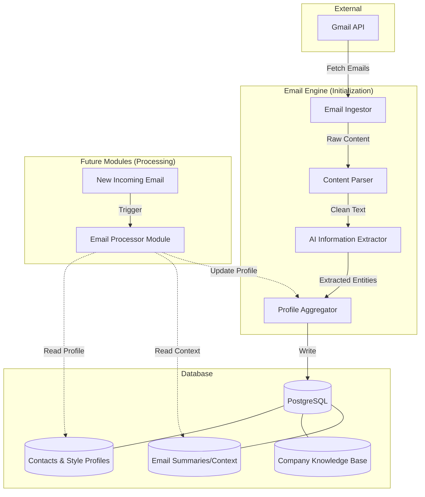

# Email Engine - Profilépítő Engine Terv (MVP)

## 1. Bevezetés

Ez a dokumentum leírja az **Email Engine** architektúráját, amely az AIsztens Email-modulának alapját képezi. Az engine feladata az első körben (Onboarding) a történtebb levelezés elemzése és egy strukturált adatbázis létrehozása a cég profiljához, stílusához és kontextusához.

**Fontos korlátozás:** Ez az engine kizárólag az inicializálásra szolgál. Nem kezeli a folyamatos beérkező leveleket, nem módosítja a profilt (azt a későbbi modulok fogják), és nem küld üzeneteket.

## 2. Az Engine feladatai

Az engine egy "snapshot" elemzést végez a Gmail fiókban található (alapból az utolsó 30 nap) levelekből, hogy létrehozzon egy tudásbázist a következő kategóriákban:

1.  **Kapcsolati profilok:** Ki a fontosak, ki a VIP-ok, milyen stílusban kommunikálnak.
2.  **Stílusprofilok:** Hogyan írónak a tulajdonos, és hogyan a gyakori feladók.
3.  **Kontextus/Tudásbázis:** A céghez kapcsolódó kulcsszavak, projektek, ügyfelek és témák összefoglalása.

## 3. Pipeline Architektúra

A folyamat egy lineáris, moduláris pipeline-ből áll, amely lehetővé teszi a komponensek később történő kicserélését vagy bővítését.

### Komponensek leírása:

1.  **`EmailIngestionService` (Fetcher)**
    - **Feladat:** Kapcsolódás a Gmail API-hoz, a meghatározott időintervallum (A12/D50) közötti levelek lekérése.
    - **Output:** Nyers e-mail objektumok (metadata + szöveg).

2.  **`EmailContentProcessor` (Parser)**
    - **Feladat:** A HTML/Plain text tisztítása, mellékletek kezelése (csak metaadatok kinyerése), és a levél szöveges részének előkészítése az AI számára.
    - **Output:** Tiszta szöveges tartalom és strukturált metaadatok.

3.  **`AIInformationExtractor` (Analyzer)**
    - **Feladat:** Az LLM (pl. Claude/GPT) segítségével a szövegből kiemelt információk kinyerése.
    - **Kiemelt adatok:**
      - _Entitás:_ Név, cég, szerepkör.
      - _Stílus:_ Hangnem (formális/informális), hossz, megszólítás, zárás.
      - _Témák:_ Kulcsszavak, projektnév, ügyfél típusa.
      - _Sürgősségi indikátorok:_ Határidők, pénzügyi kifejezések.
    - **Output:** Strukturált JSON objektum (ExtractedEntities).

4.  **`ProfileSynthesizer` (Aggregator)**
    - **Feladat:** Az egyes levelekből kinyert adatok összevetése és a profilok építése.
    - **Művelet:** Ha egy feladó többször megjelenik, a stílusát átlagolja/összegzi; ha egy téma gyakori, az bekerül a tudásbázisba.
    - **Output:** Frissített `ContactProfile`, `StyleProfile` és `CompanyKnowledgeBase`.

## 4. Adatbázis Tervezés

Az adatbázis kialakítása úgy történik, hogy a jövőbeli modulok (amelyek új leveleket dolgoznak fel) könnyen hozzáférhessenek a profilhoz, és képesek legyenek módosítani azt.

### Táblák:

#### `contacts` (Kapcsolati adatok)

| Megnevezés         | Típus           | Leírás                             |
| :----------------- | :-------------- | :--------------------------------- |
| `id`               | UUID            | Primáris kulcs                     |
| `email`            | String (Unique) | Az e-mail cím                      |
| `name`             | String          | Név/Cég neve                       |
| `domain`           | String          | Domain (pl. @google.com)           |
| `is_vip`           | Boolean         | Kiemelt feladó (A11/U17b)          |
| `style_profile_id` | UUID            | Foreign Key a `style_profiles`-hoz |

#### `style_profiles` (Stílus jellemzők)

| Megnevezés         | Típus  | Leírás                            |
| :----------------- | :----- | :-------------------------------- |
| `id`               | UUID   | Primáris kulcs                    |
| `contact_id`       | UUID   | Foreign Key a `contacts`-hoz      |
| `formality`        | Enum   | Formális, Semmi, Informális       |
| `tone`             | String | Hangnem (pl. udvarias, közvetlen) |
| `salutation`       | String | Megszólítás stílusa               |
| `closing`          | String | Zárás stílusa                     |
| `preferred_length` | Enum   | Rövid, Közepes, Hosszú            |

#### `knowledge_base` (Cég tudásbázis)

| Megnevezés    | Típus  | Leírás                                           |
| :------------ | :----- | :----------------------------------------------- |
| `id`          | UUID   | Primáris kulcs                                   |
| `entity_type` | Enum   | Client, Vendor, Project, Topic, Service          |
| `name`        | String | Az entitás neve                                  |
| `description` | Text   | Rövid leírás/kontextus                           |
| `metadata`    | JSONB  | További adatok (pl. kapcsolattartó elérhetősége) |

#### `email_summaries` (Kontextus és történet)

| Megnevezés       | Típus    | Leírás                              |
| :--------------- | :------- | :---------------------------------- |
| `id`             | UUID     | Primáris kulcs                      |
| `external_id`    | String   | Gmail Message ID                    |
| `contact_id`     | UUID     | Foreign Key a `contacts`-hoz        |
| `subject`        | String   | Tárgy                               |
| `summary`        | Text     | AI által generált összefoglaló (U5) |
| `classification` | Enum     | Sürgős, Fontos, Talán érdekes, stb. |
| `timestamp`      | DateTime | A levél érkezésének ideje           |

## 5. Interface-ek a jövőbeli modulok számára

A rendszer moduláris marad azért, mert az engine által létrehozott adatokhoz az új modulok az alábbi abstract interfécseken keresztül érnek el:

- **`IProfileProvider`**:
  - `getContactProfile(email: string): Promise<ContactProfile>`
  - `getKnowledgeBase(): Promise<KnowledgeBase[]>`
- **`IHistoryProvider`**:
  - `getRecentContext(email: string, limit: number): Promise<EmailSummary[]>`
- **`IProfileUpdater` (A későbbi modulok részéről)**:
  - `updateStyleProfile(contactId: string, changes: Partial<StyleProfile>): Promise<void>`
  - `addKnowledgeEntry(entry: KnowledgeEntry): Promise<void>`

## 6. Komponens Diagram (Mermaid)

