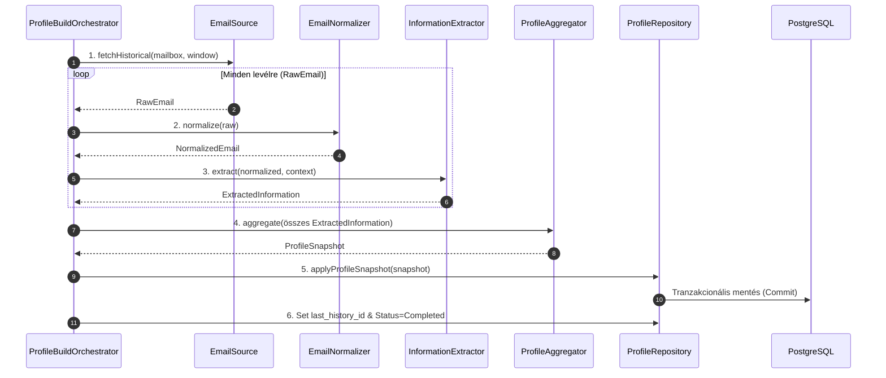

# Email Engine — Profilépítő Engine Terv (MVP)
**Státusz:** Terv (Tervezési dokumentum)
**Készült:** 2026-10-15
**Forrásdokumentumok:** [`docs/temp/Email-modul-MVP.md`](Email-modul-MVP.md), [email-engine-plan-1-deepseek-v4-pro.md](docs/temp/email-engine-plan-1-deepseek-v4-pro.md)


## 1. Cél és Hatókör (Scope Definition)

### 1.1 Engine célja
Az Email Engine elsődleges feladata az **onboarding** fázisban a bekötött Gmail postafiók múltbeli levelezéséből (alapból az utolsó 30 nap, A12/D50) egy strukturált cégprofil és kontextusadatbázis létrehozása. Ez a profil szolgáltatja az alapanyagot a későbbi, folyamatosan működő Email-modul számára (pl. U2: Kontextusfüggő értékelés).

### 1.2 Hatókör korlátozások
**Fontos:** Az engine egy **snapshot** elemző rendszer.
*   **Csak Onboarding:** Csak a múltbeli levelek feldolgozásával foglalkozik.
*   **Nincs folyamatos frissítés:** Nem figyeli / nem tölti le az újonnan érkező leveleket, és nem módosítja a profilt futás közben (ez a későbbi modul feladata).
*   **Nem küld értesítést:** Nem generál válaszpiszkozatot vagy Telegram-üzeneteket.

### 1.3 Moduláris tervezési elvek
Az architektúra minden komponensét és interfészét úgy kell kialakítani, hogy a későbbi **inkrementális profilfrissítő modul** (új levelek feldolgozása) ugyanazokat az interfészeket hívja meg. A különbség csak az orchestrációban van: onboarding teljes múltat egyszerre dolgozza fel, míg a későbbi modul levélenként futtatja a pipeline-komponenseket és végül egy **inkrementális profilfrissítő** lépést futtat.

---

## 2. Tervezési elvek (Design Principles)

Az architektúra kialakításánál az alábbi alapelvek vezettek szerepet:

1.  **Single Responsibility Principle (SRP):** Minden komponensnek csak egyetlen, jól körülhatárolt felelőssége van (pl. a letöltés csak a `EmailSource` feladata).
2.  **Dependency Inversion Principle (DIP) / Abstrakt Interfészsek:** A fő vezérlő (`ProfileBuildOrchestrator`) nem függ konkrét implementációktól (pl. Gmail API vagy LLM), hanem az **interfészekektől**. Ez biztosítja, hogy a komponensek cserélhetők legyenek (pl. más e-mail szolgáltatóra váltás).
3.  **Idempotencia és Folytathatóság:** Az onboarding folyamata félbeszakadhat (hiba, újraindítás); a futási állapotot mentve kell tartani (`ProfileBuildRuns`), így az elemzés pontosan ott folytatható, ahol szakadtunk.
4.  **Tenant-izoláció:** Minden adat és feldolgozás a postafiókhoz (`mailbox_id`) kötődik (D45).

---

## 3. A Pipeline Architektúra és Komponensek

A folyamat egy lineáris, moduláris pipeline-ből áll, amely az onboarding során végigvezetjük a múltbeli levelek feldolgozását.

### 3.1 Az Adatfolyam (Data Flow)
```mermaid
flowchart LR
    subgraph External Sources
        GMAIL[Gmail API]
        LLM[LLM API]
    end

    subgraph Engine Components
        ORCH(ProfileBuildOrchestrator)
        SRC[EmailSource]
        NORM[EmailNormalizer]
        EXTR[InformationExtractor]
        AGG[ProfileAggregator]
    end

    subgraph Persistence Layer
        REPO[ProfileRepository]
        DB[(PostgreSQL Database)]
    end

    GMAIL -->|fetchHistorical/Incremental| SRC
    SRC -->|RawEmail Stream| NORM
    NORM -->|NormalizedEmail| EXTR
    LLM -->|extract(context)| EXTR
    EXTR -->|ExtractedInformation[]| AGG
    AGG -->|ProfileSnapshot| REPO
    REPO --> DB

    ORCH -.->|Controls Flow| SRC & NORM & EXTR & AGG
```

### 3.2 Komponensek Részletes Leírása és Interfészsek (TypeScript/Pseudo-code)

A komponenseket **interfészzek** formájában definiálni kell, hogy a későbbi modulok is ugyanazokat használják.

#### A. `IProfileBuildOrchestrator` (Vezérlő / Orchestrátor)
*   **Felelősség:** Vezérli az onboarding teljes folyamatát. Kezeli az állapotmentést, a hibaüzeneteket és a tranzakcionális mentést.
*   **Bemenet:** `mailboxId`, `historyWindowDays` (A12/D50).
*   **Kimenet:** Kész profil (`ProfileSnapshot`) a DB-ben + Összegző riport (D14) jóváhagyási lépéshez.

#### B. `IEmailSource` (Letöltés / Ingestion)
*   **Felelősség:** Kapcsolódás az e-mail szolgáltatóhoz, a megadott időablak leveleinek lekérése lapozással (`pagination`), és a feldolgozási állapotának rögzítése.
*   **Interfészzek (Kritikus):**
    ```typescript
    interface IEmailSource {
      // Onboarding: teljes múlt feltérképezése (A12/D50)
      fetchHistorical(mailbox: Mailbox, window: TimeWindow): AsyncIterable<RawEmail>;
      // Későbbi modul: inkrementális letöltés a historyId-től
      fetchIncremental(mailbox: Mailbox, sinceHistoryId: string): AsyncIterable<RawEmail>;
    }
    ```

#### C. `IEmailNormalizer` (Normalizálás / Parser)
*   **Felelősség:** A nyers levélből tiszta, strukturált forma előállítása. HTML-t szövegre konvertál, aláírásokat és idézett részeket tisztítja.
*   **Bemenet:** `RawEmail` (fejléc, törzs, label-ek).
*   **Kimenet:** `NormalizedEmail` (tiszta szövegtörzs + strukturált fejléc).

#### D. `IInformationExtractor` (AI-kinyerés / Analyzer)
*   **Felelősség:** Az LLM segítségével a szövegből strukturált adatok kinyerése. Ez az egyetlen komponens, amely külső AI API-hívást végzi.
*   **Bemenet:** `NormalizedEmail`, opcionálisan a már felépült profil (kontextus).
*   **Kimenet:** `ExtractedInformation` (strukturált JSON séma: Entitások, Stílusjegyek, Témák, Sürgősségi jelek).

#### E. `IProfileAggregator` (Aggregálás / Szintézis)
*   **Felelősség:** A sok levélből kinyert adatok összegzése profillá. Ez a komponens biztosítja az **idempotenciát**: ha ugyanazt a kapcsolatot több levelezésben talál, nem hoz létre új entitást, hanem frissíti (pl. növeli a `message_count`-ot).
*   **Bemenet:** `ExtractedInformation[]`.
*   **Kimenet:** `ProfileSnapshot` — az összes szükséges entitások halmaza (Contact, StyleProfile, KnowledgeEntry).

#### F. `IProfileRepository` (Perzisztencia / Repository)
*   **Felelősség:** A profil írása és olvasása a DB-ben. Ez az egyetlen tranzakcionális írási pont.
*   **Interfészzek (CQRS):** Szétválasztja az olvasási (`IProfileProvider`) és írási (`IProfileUpdater`) logikát, biztosítva, hogy a későbbi modulok csak annyi jogot kapjanak, amennyi szükséges.

---

## 4. Adatbázis Tervezés (Schema)

A táblák kialakítása az MVP-ben megőrzési és profilépítő szempontból optimalizált. Minden tábla `mailbox_id` tenant-kulcsot használ, kivéve a globális `accounts` táblát.

*(A részletes táblázati felépítés (UUID, JSONB típusok) az előző dokumentumokban szereplő struktúrákra épül, de itt csak a kulcsfontosságú entitások és kapcsolatok emellett vannak.)*

### 4.1 Kulcsentitások
1.  **`mailboxes`**: (Tenant-kulcs). Tartja az e-mail szolgáltató bekötési információkat (`history_id`, `status`).
2.  **`contacts`**: Kapcsolati adatok. A profilépítés alapja.
3.  **`contact_style_profiles`**: Feladónkénti stílusprofil (U13).
4.  **`owner_style_profiles`**: Tulajdonos saját stílusa (A6).
5.  **`knowledge_entries`**: Cég-tudásbázis (Kontextus, U2).
6.  **`emails`**: Normalizált levéladatok és összefoglalók (`summary`, `body_text`).
7.  **`email_analyses`**: Levélről kinyert adatok (Entitások, Sürgősségi jelek) – a kontextus alapja.

### 4.2 Kapcsolatok
*   `emails` $\leftarrow$ `mailboxes`: Minden levél egy postafiókhoz köthető.
*   `email_analyses` $\rightarrow$ `emails`: Egy levél több elemzést generálhat (pl. stílus, entitás).
*   `contacts` $\leftrightarrow$ `contact_style_profiles`: One-to-one vagy one-to-many kapcsolat a feladók profiljához.

---

## 5. Komponens Diagram (Mermaid)

Ez a diagram vizualizálja az onboarding folyamatát, és mutatja a komponensek egymáshoz való viszonyát.

```mermaid
graph TD
    subgraph External Sources
        GMAIL[Gmail API]
        LLM[LLM API]
    end

    subgraph Core Engine Profiling Batch
        ORCH(ProfileBuildOrchestrator)
        SRC[EmailSource Interface]
        NORM[EmailNormalizer Interface]
        EXTR[InformationExtractor Interface]
        AGG[ProfileAggregator Interface]
    end

    subgraph Persistence Layer (Repository)
        REPO[ProfileRepository]
        IPP["IProfileProvider"]
        IPU["IProfileUpdater"]
        IES["IEmailStore"]
    end

    subgraph Database Schema
        DB[(PostgreSQL: mailboxes, contacts, knowledge_entries, emails)]
    end

    GMAIL -->|fetchHistorical/Incremental| SRC
    SRC -->|RawEmail Stream| NORM
    NORM -->|NormalizedEmail| EXTR
    LLM -->|extract(context)| EXTR
    EXTR -->|ExtractedInformation[]| AGG
    AGG -->|ProfileSnapshot| REPO
    REPO --> DB

    ORCH -.->|Controls Flow| SRC & NORM & EXTR & AGG
```

---

## 6. Adatfolyam (Sequence Diagram)

Ez a diagram mutatja az onboarding folyamat lépésről-lépésre haladását, hangsúlyozva az egyirányú adatáramlást és a tranzakcionális mentést.



---
**Összefoglaló:** Az Engine egy determinisztikus, fejlett pipeline-t használ a múltbeli adatok feldolgozására. A modularitás biztosítása érdekében minden lépés (Source $\to$ Normalizer $\to$ Extractor $\to$ Aggregator) csak az **interfész** szintjén van megfogalmazva, így a későbbi modulok egyszerűen cserélniük kell az `I*` interfész implementációját. A profilfrissítés tranzakcionális és idempotentus folyamat.
***